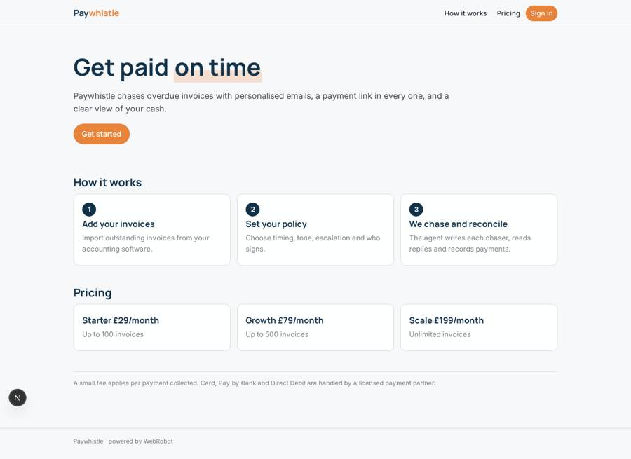
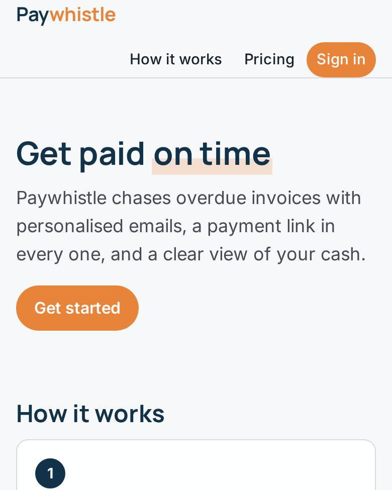
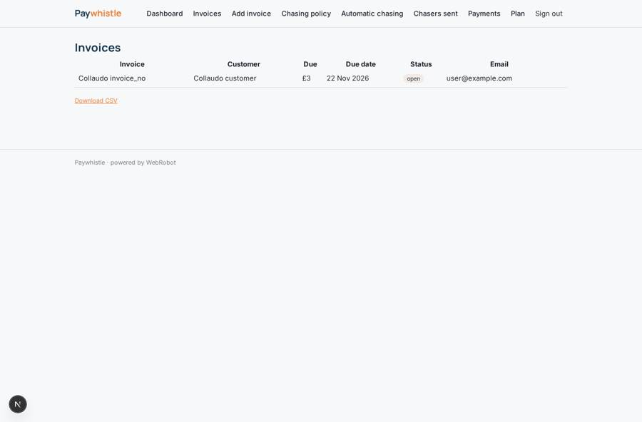
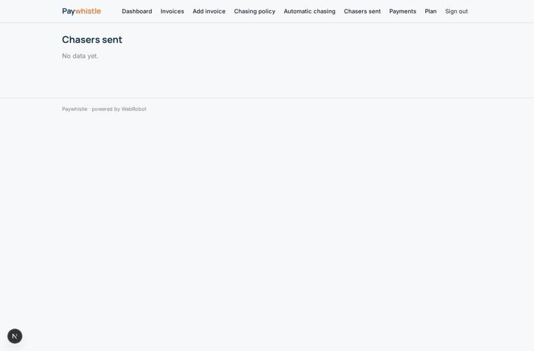
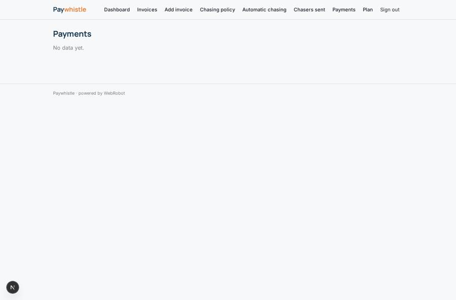
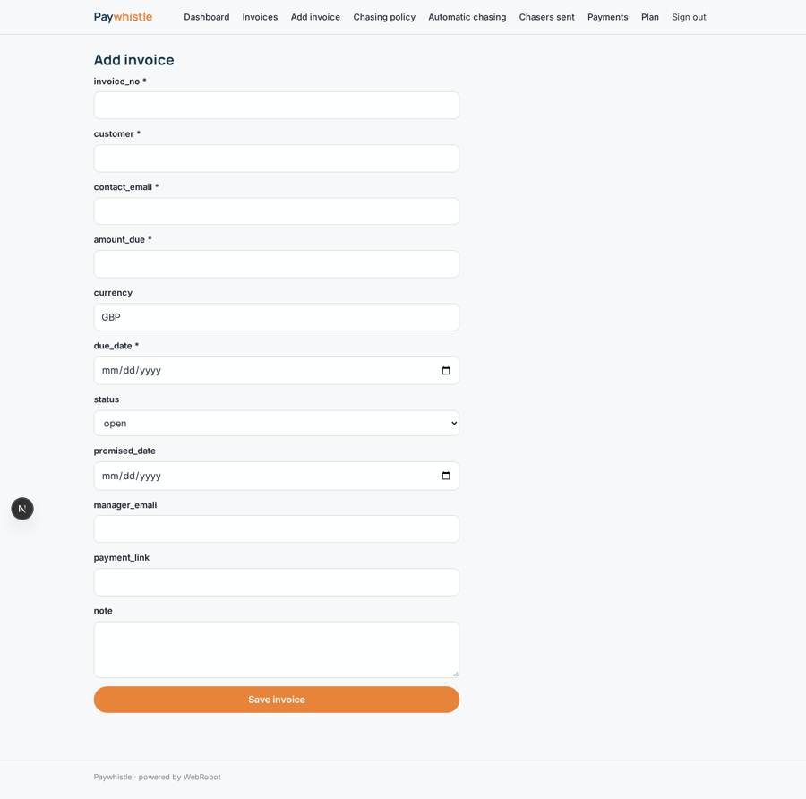

# Paywhistle

_Get paid on time, without the awkward emails._

**Sector:** Fintech, proptech, insurtech · **Manifest:** valid (schema + runtime contract) · **Functional test:** passed (15 checks passed)

## Description given to the app builder

I want Paywhistle, which gets small businesses and professional firms paid on time. A firm signs up and connects its accounting software (Xero or QuickBooks via OAuth) so outstanding invoices, contacts and payments sync automatically. The firm sets a chasing policy in a form: days before and after due date, tone, escalation steps, who signs the emails. An agent writes personalised chaser emails for each overdue invoice, referring to the invoice history and previous replies, and sends them on schedule with a payment link; customers can pay by card through Stripe, by Pay by Bank through Open Banking, or set up a Direct Debit mandate, both handled by a licensed payment partner. When a customer replies by email disputing an invoice or promising a date, the agent reads it, updates the record and pauses chasing; the account manager approves any proposed payment plan or write-off. Payments are reconciled back to the ledger. Roles: owner, finance user, account manager (own clients). Dashboards show overdue balance, expected cash this week and average days to pay. Pricing: monthly subscription by number of invoices plus a small fee per payment collected. English.

## Navigation recording

Signed in as the app's admin, the recorder opened 7 menu page(s): Dashboard, Invoices, Add invoice, Chasing policy, Automatic chasing, Chasers sent, Payments.
- data page empty: sent (table)
- data page empty: payments (table)

Empty data pages are mostly expected on the local runtime: agents are mocked there, so the collections they fill stay empty.

## Features not expressible today (spec.extensions)

- **accounting_oauth**: Automatic sync of invoices, contacts and payments from Xero or QuickBooks needs OAuth sign-in, which is not available yet. Meanwhile invoices are added by hand in the Add invoice form.
- **payment_partner**: Stripe card payments, Pay by Bank and Direct Debit mandates run through a licensed payment partner. Payment links are stored on each invoice and paid events arrive on the payment_in webhook.
- **ledger_writeback**: Writing reconciled payments back to Xero or QuickBooks also needs OAuth; payments are reconciled inside Paywhistle for now.

## Screenshots (interpretive runtime, test data)

### home-anon

### home-mobile

### invoices

### sent

### payments

### add_invoice

