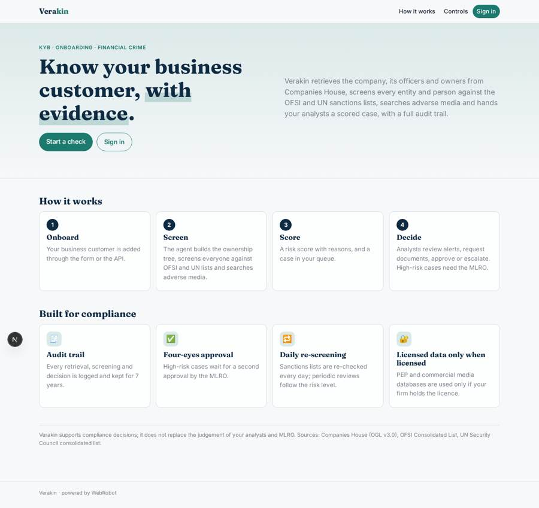
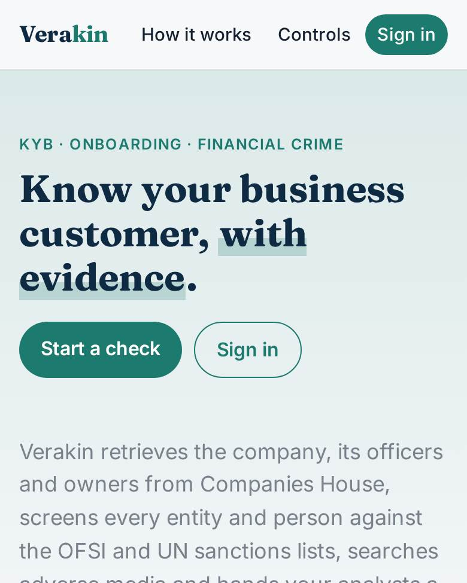
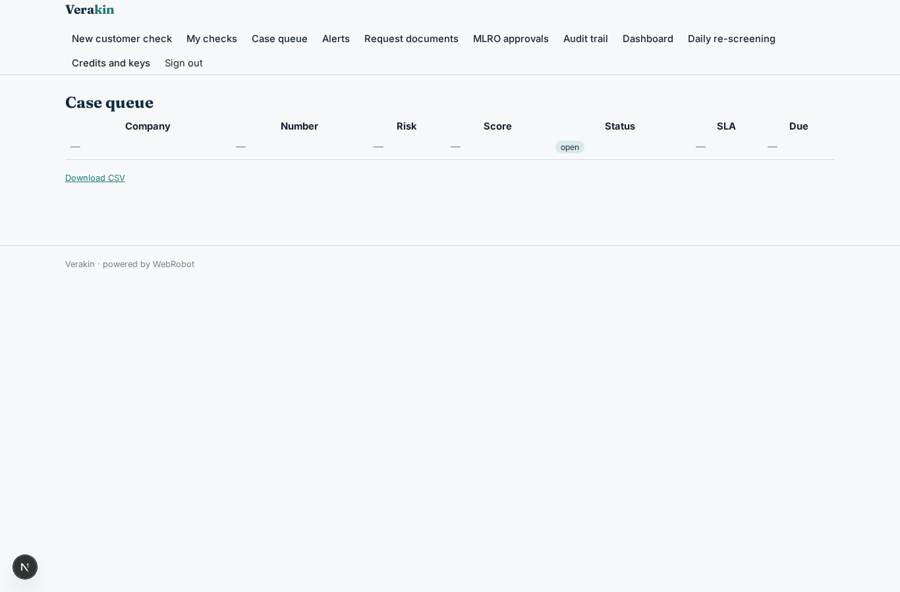
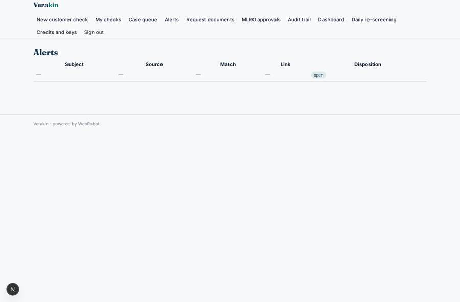
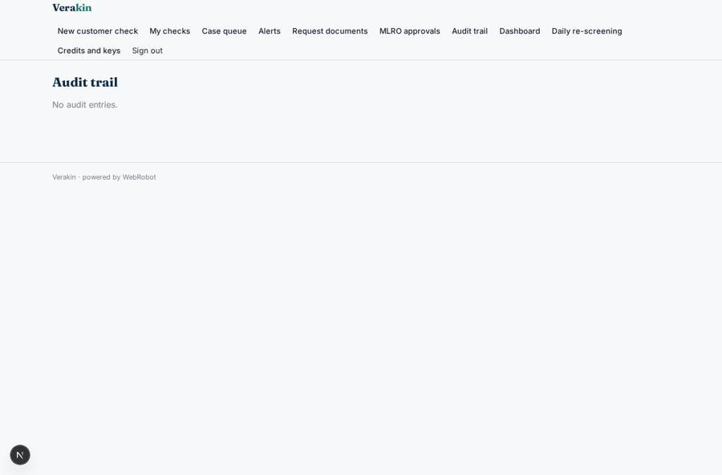
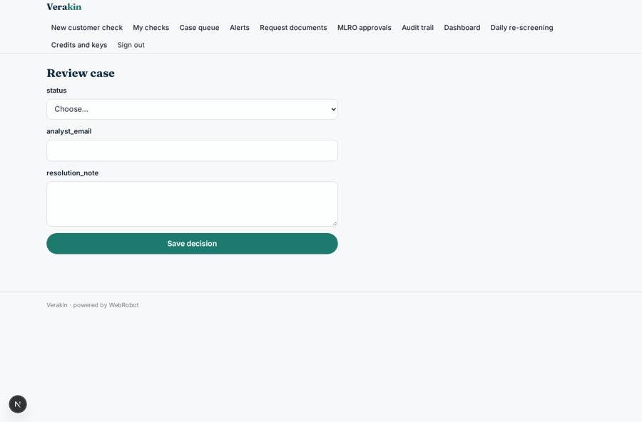

# Verakin

_AI agents for KYB, onboarding and financial-crime workflows._

**Sector:** Fintech, proptech, insurtech · **Manifest:** valid (schema + runtime contract) · **Functional test:** passed (19 checks passed)

## Description given to the app builder

We need Verakin, AI agents for KYB, onboarding and financial-crime workflows at fintechs and payment firms. A compliance team signs up; business customers are onboarded through a form (company number, trading name, website, ownership structure, expected volumes, countries) or via API. An agent retrieves the company profile, officers and persons with significant control from Companies House, builds the ownership tree, screens every entity and individual against the OFSI consolidated list and the UN sanctions list, runs web searches for adverse media and summarises relevant hits. PEP screening and commercial adverse-media databases are used only if the customer has a licence; identity verification of directors goes through a certified ID&V partner. The agent assigns a risk score with reasons and opens a case. Analysts work a queue: they review alerts, mark false positives, request documents from the customer by email, and approve or escalate; high-risk cases need a second approval from the MLRO. Every step is kept in an audit trail. Periodic reviews are scheduled by risk level and sanctions lists are re-screened daily. Dashboards show case volumes and SLA. Pricing: per check plus platform fee. English.

## Functional test: what did not pass

- **saved record shown where its collection is read** (view queue): a record was saved in cases (by user) but the page does not show it (as user) _(warning)_

## Navigation recording

Signed in as the app's admin, the recorder opened 7 menu page(s): New customer check, My checks, Case queue, Alerts, Request documents, MLRO approvals, Audit trail.
- agent run did not open: new_check: the run did not open
- data page empty: checks (history)

Empty data pages are mostly expected on the local runtime: agents are mocked there, so the collections they fill stay empty.

## Features not expressible today (spec.extensions)

- **idv_partner**: Director identity verification through a certified ID&V partner (OAuth or partner webhook flow) is not available yet; the agent only lists which directors still need ID&V.
- **pep_media_licence**: PEP and commercial adverse-media databases need the customer's own licence and an API integration; for now they are only used when the customer states it holds a licence and has an API key.
- **sms_push**: Customer reminders by SMS or WhatsApp are not available; document requests go by email.

## Screenshots (interpretive runtime, test data)

### home-anon

### home-mobile

### queue

### alert_queue

### audit

### review_case

