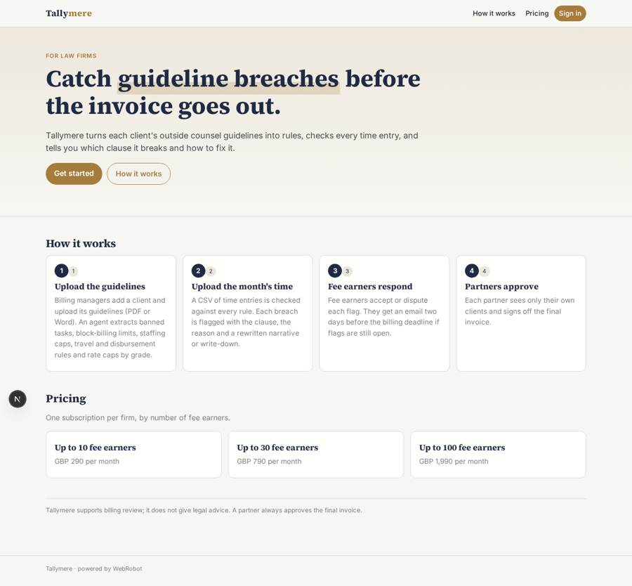
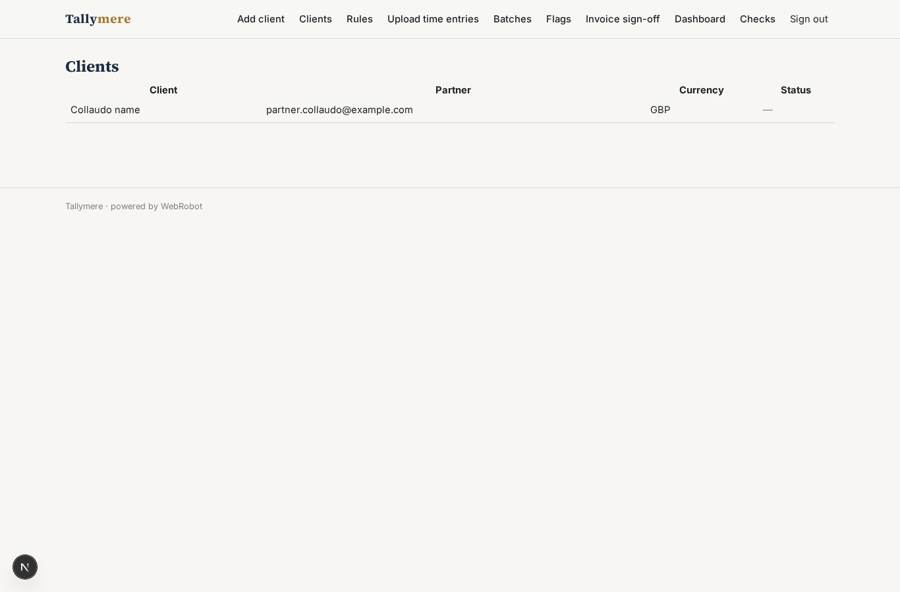
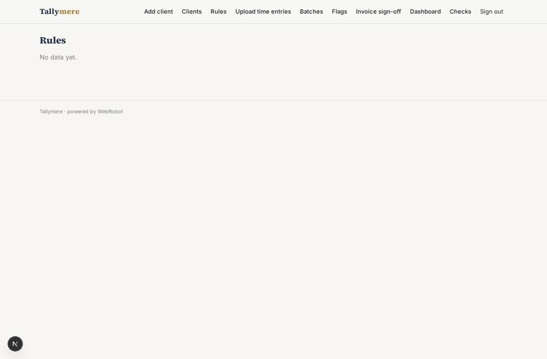
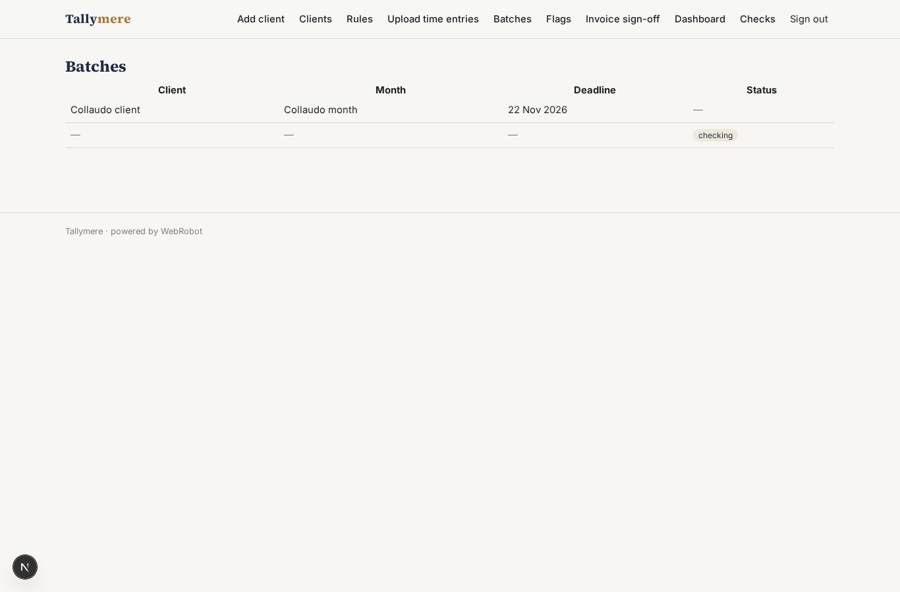
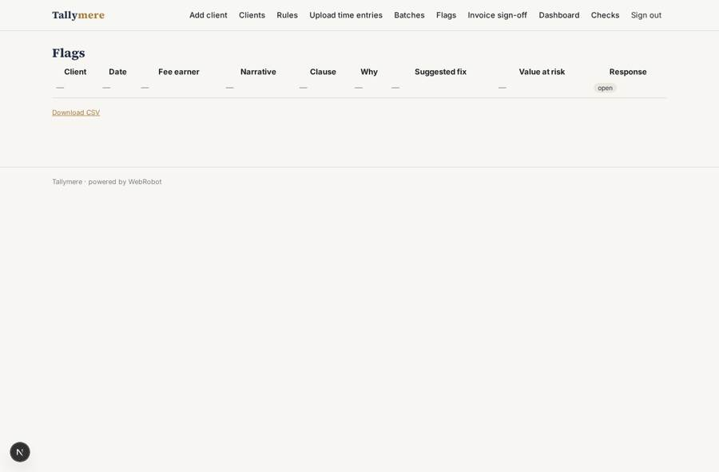

# Tallymere

_Check every invoice against the client's guidelines before it goes out._

**Sector:** B2B AI and SaaS · **Manifest:** valid (schema + runtime contract) · **Functional test:** passed (21 checks passed)

## Description given to the app builder

I want Tallymere, which checks law-firm invoices against clients' outside counsel guidelines before they are sent. The law firm signs up; billing managers, fee earners and partners are the roles, and each partner sees only their clients. For each client the billing team uploads the guidelines (PDF or Word) and an agent turns them into rules: banned task descriptions, block-billing limits, staffing caps, travel and disbursement rules, rate caps by grade. Each month the team uploads time entries as CSV (date, fee earner grade, hours, narrative, task code, rate). The agent flags every entry that breaches a rule, explains which clause it breaks, and suggests a rewritten narrative or a write-down. The fee earner accepts or disputes each flag; the partner approves the final invoice. In the real product the time entries come live from the firm's practice management and e-billing systems, connected through OAuth or enterprise APIs, so that should be there too. Emails remind fee earners about unresolved flags two days before the billing deadline. Dashboards show breaches by client, by rule and by fee earner and the value of write-downs avoided. Pricing: subscription per firm by number of fee earners, via Stripe. English.

## Functional test: what did not pass

- **saved record shown where its collection is read** (view flags): a record was saved in flags (by billing_manager) but the page does not show it (as billing_manager) _(warning)_

## Navigation recording

Signed in as the app's admin, the recorder opened 7 menu page(s): Add client, Clients, Rules, Upload time entries, Batches, Flags, Invoice sign-off.
- data page empty: rules (table)

Empty data pages are mostly expected on the local runtime: agents are mocked there, so the collections they fill stay empty.

## Features not expressible today (spec.extensions)

- **live_integrations**: Live time entries from the firm's practice management and e-billing systems through OAuth sign-in are not available yet. Until then, time entries arrive as a monthly CSV upload; enterprise API-key connections can be added per system once the vendors are named.
- **fee_earner_seats**: The limit on the number of fee earners per plan (10, 30, 100) is shown in the plan description but not enforced automatically by the runtime.
- **firm_team_accounts**: Each billing manager's records are private to their account; several billing managers sharing one firm's data need a shared team list that is not part of this design.

## Screenshots (interpretive runtime, test data)

### home-anon

### home-mobile

### clients

### rules

### batches

### flags

