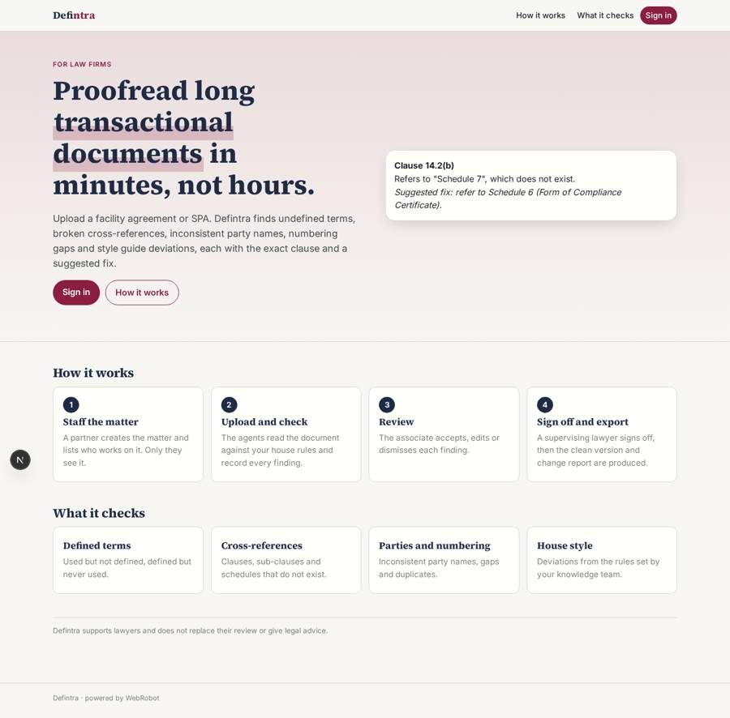
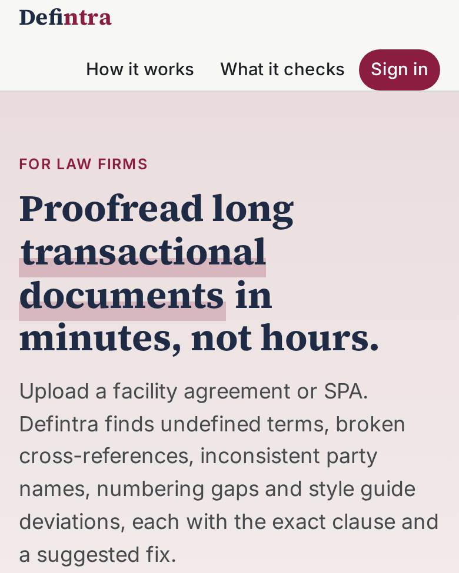
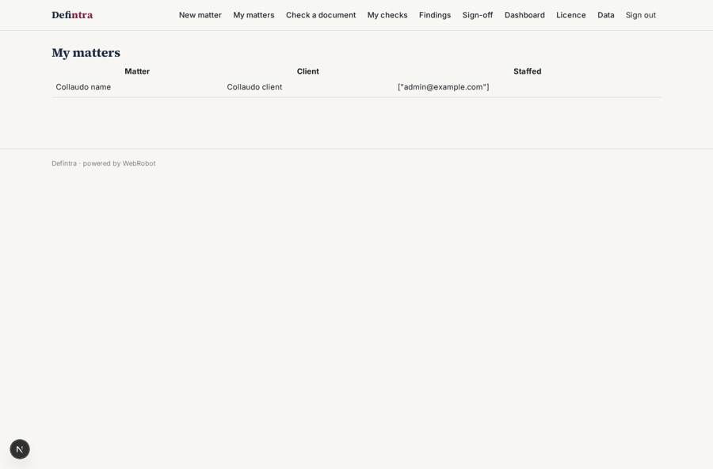
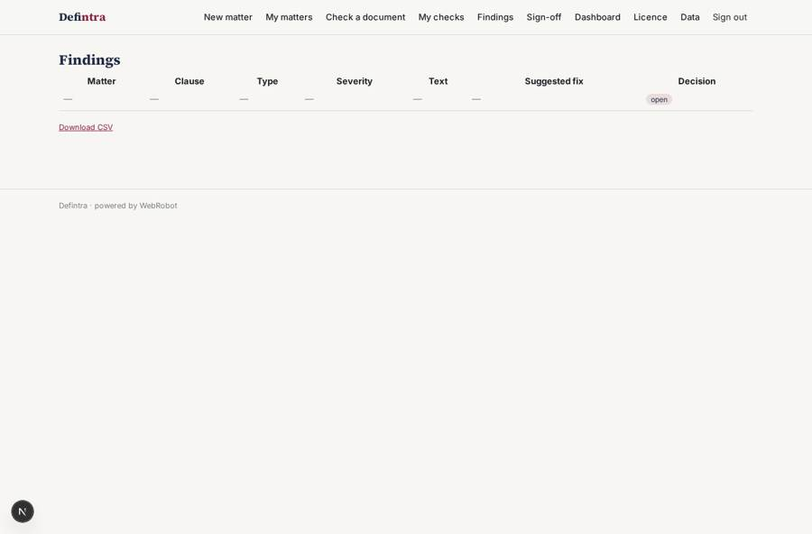
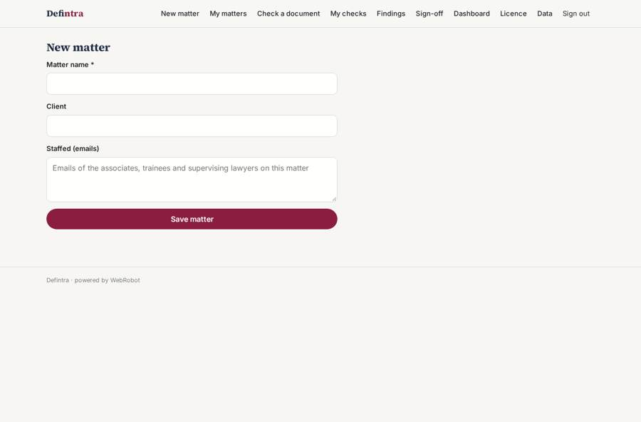
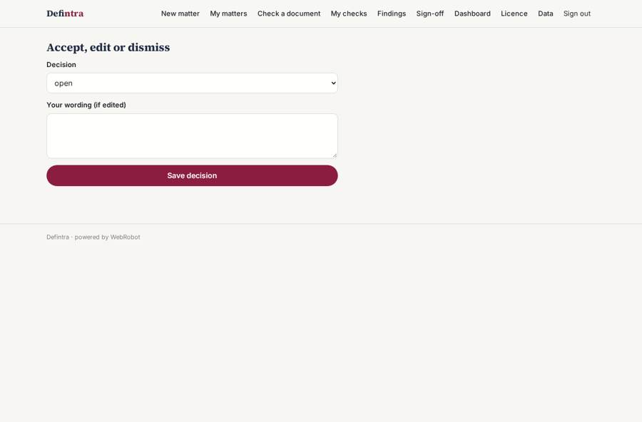

# Defintra

_Drafting and proofreading for long transactional documents._

**Sector:** B2B AI and SaaS · **Manifest:** valid (schema + runtime contract) · **Functional test:** 1 failure(s) (16 checks passed)

## Description given to the app builder

I want Defintra, a drafting and proofreading tool for law firms working on long transactional documents. The firm signs up, the knowledge team sets house rules and partners invite associates and trainees; each matter is visible only to the people staffed on it. A user uploads a facility agreement, share purchase agreement or similar and the agents check it: defined terms used but not defined or defined and never used, broken cross-references to clauses and schedules, inconsistent party names, numbering gaps, missing schedules and deviations from the firm's style guide. Each finding links to the exact paragraph with a suggested fix, and the associate accepts, edits or dismisses it; a supervising lawyer signs off before the clean version and a change report are exported. A side panel shows the definition or the referenced clause on hover. The real product lives inside Microsoft Word as an add-in and connects to the firm's document management system such as iManage, so each lawyer would sign in with Microsoft and the DMS through OAuth or enterprise integration. Dashboards show documents checked per matter, error types and time saved. Pricing: annual licence per fee earner, billed monthly through Stripe. English.

## Functional test: what did not pass

- **run started and report ready** (view check): required matter (options from collection:matters) has no option
- **saved record shown where its collection is read** (view matters): a record was saved in matters (by admin) but the page does not show it (as user) _(warning)_
- **saved record shown where its collection is read** (view findings): a record was saved in findings (by user) but the page does not show it (as user) _(warning)_

## Navigation recording

Signed in as the app's admin, the recorder opened 7 menu page(s): New matter, My matters, Check a document, My checks, Findings, Sign-off, Dashboard.
- agent run did not open: check: the run did not open
- data page empty: runs (history)

Empty data pages are mostly expected on the local runtime: agents are mocked there, so the collections they fill stay empty.

## Features not expressible today (spec.extensions)

- **word_addin**: The real product runs inside Microsoft Word as an add-in, with a side panel showing the definition or referenced clause on hover and links to the exact paragraph. Not available yet: this app works on uploaded documents and shows the clause number and quoted text.
- **microsoft_oauth_sso**: Sign-in with Microsoft (OAuth / Entra ID) is not available yet. Users sign in with an email link.
- **dms_integration**: Connection to iManage or another document management system through OAuth or enterprise integration is not available yet. Documents are uploaded by hand.
- **docx_export**: The clean version and change report are produced as a printable report, not as a tracked-changes .docx file.
- **knowledge_team_role**: The knowledge team keeps house rules as admins on the data page. A separate knowledge role would need its own write access to a shared collection.

## Screenshots (interpretive runtime, test data)

### home-anon

### home-mobile

### matters

### findings

### new_matter

### decide

