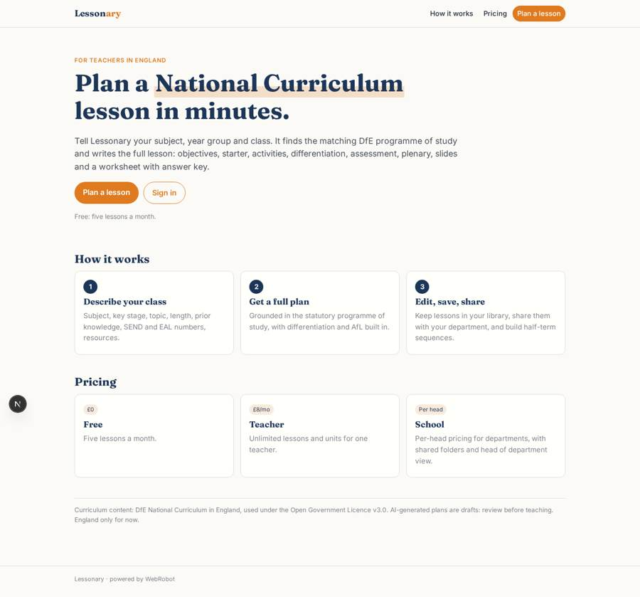
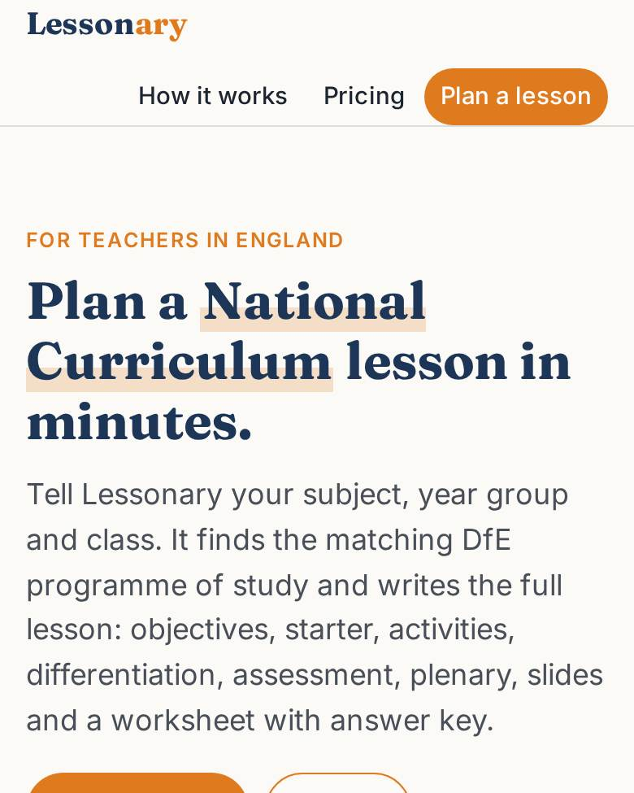
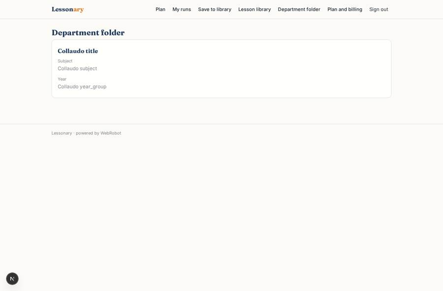
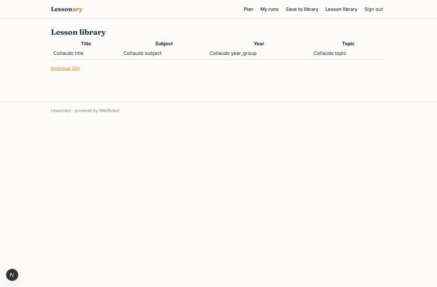
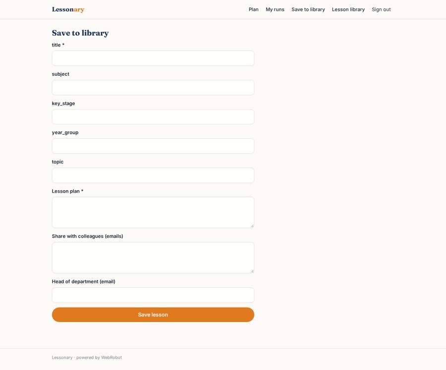
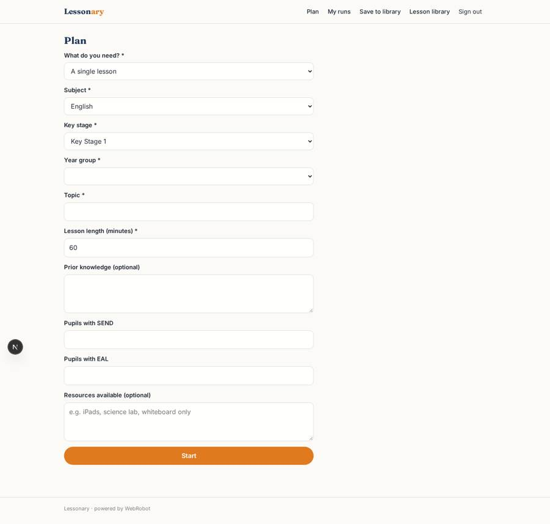

# Lessonary

_Curriculum-aligned lesson plans for English teachers, in minutes._

**Sector:** Sanità, istruzione, energia, gov · **Manifest:** valid (schema + runtime contract) · **Functional test:** passed (12 checks passed)

## Description given to the app builder

We need Lessonary, an AI lesson planner for teachers in England. A teacher signs up individually or through their school and fills a form: subject, key stage, year group, topic, lesson length, prior knowledge, number of pupils with SEND or EAL, and resources available. An agent retrieves the matching National Curriculum programme of study and generates a full lesson: objectives, starter, main activities, differentiation, assessment for learning and plenary, plus slides and a worksheet with answer key, exported as PowerPoint, Word and PDF. The teacher edits and saves lessons to their library; teachers in the same school can share lessons in a department folder, and the head of department can see all of them. A sequence builder plans a half-term unit. Pricing: free plan with five lessons a month, £8 a month per teacher, school plans per head through Stripe. Curriculum source is the DfE National Curriculum, used under the Open Government Licence; Scotland and Wales are later. English only.

## Navigation recording

Signed in as the app's admin, the recorder opened 4 menu page(s): Plan, My runs, Save to library, Lesson library.
No issue found.

Empty data pages are mostly expected on the local runtime: agents are mocked there, so the collections they fill stay empty.

## Features not expressible today (spec.extensions)

- **pptx_docx_export**: Native PowerPoint (.pptx) and Word (.docx) export is not available yet. The plan, slide outline and worksheet are in a printable report (PDF via print).
- **school_accounts**: School sign-up, per-head seat quantity through Stripe and a school-wide membership are not expressible yet. The school plan is a per-teacher monthly price; departments share by listing colleague emails and a head of department email on each lesson.
- **curriculum_retrieval**: The agent fetches the DfE National Curriculum (gov.uk, OGL v3.0) through the WebRobot MCP at run time; no cached copy. Scotland and Wales are later.

## Screenshots (interpretive runtime, test data)

### home-anon

### home-mobile

### department

### library

### save_lesson

### new

