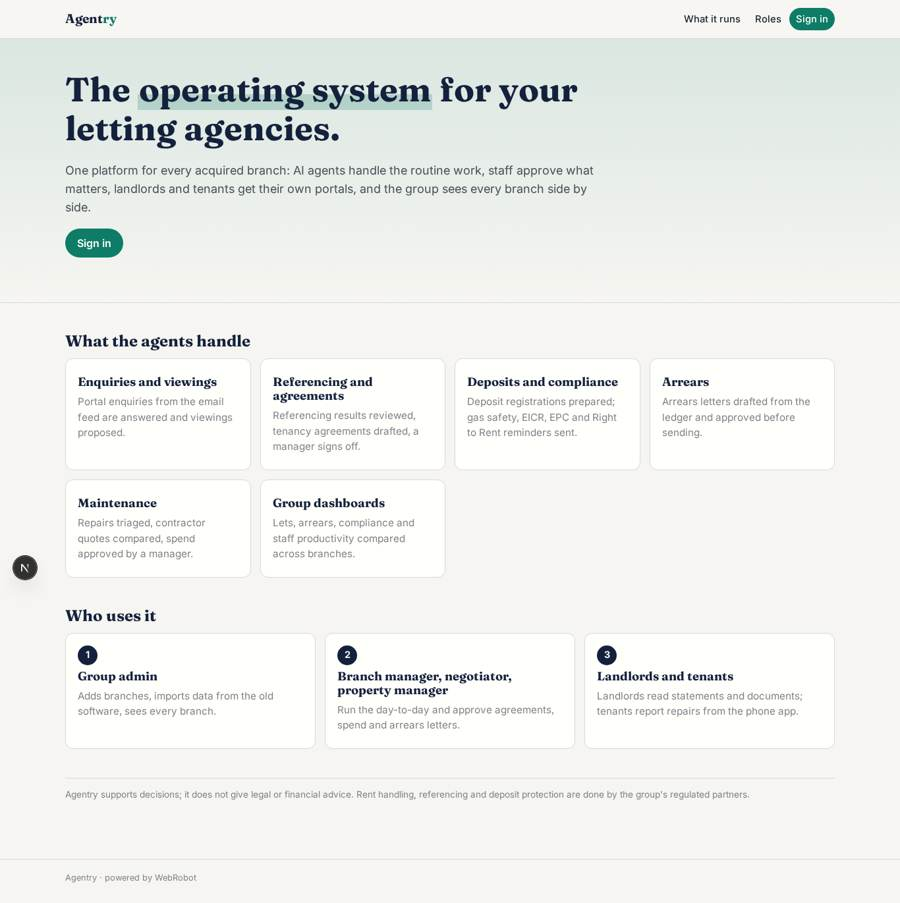
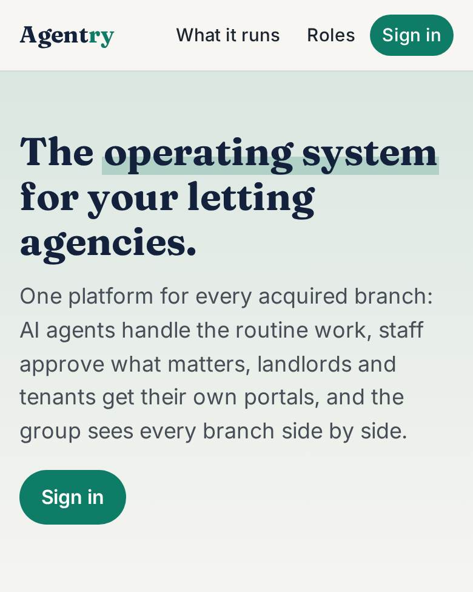
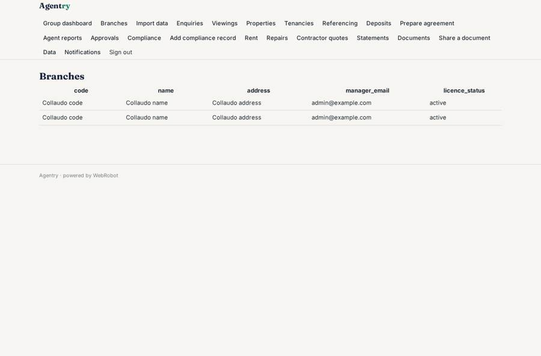
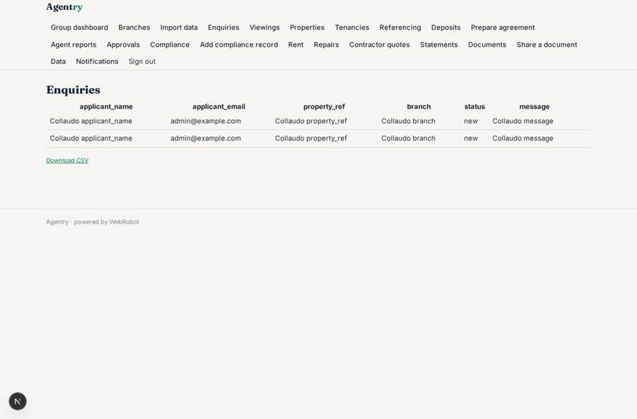
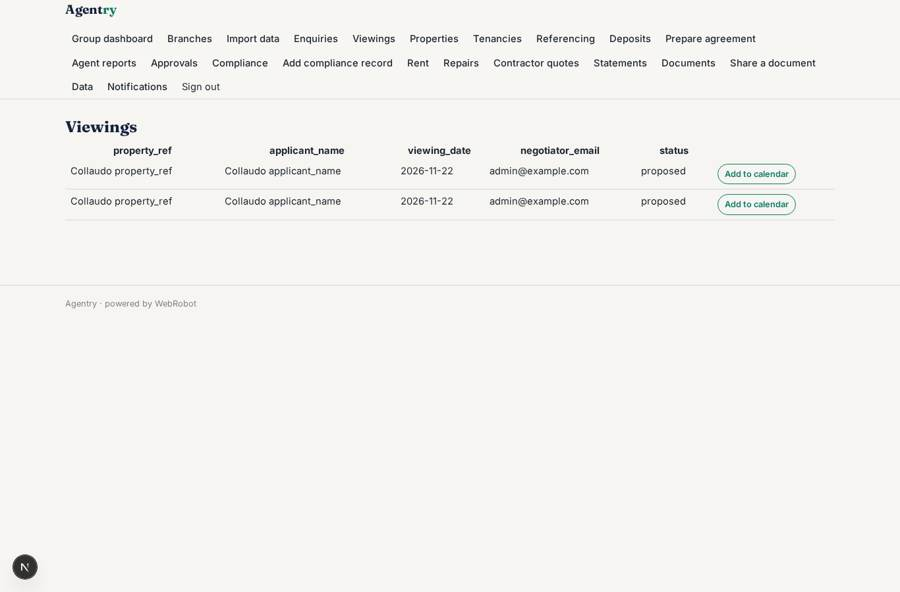
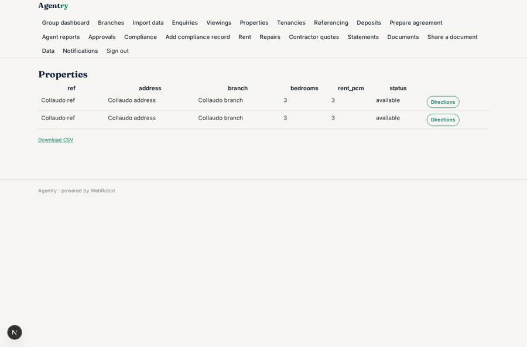

# Agentry

_The operating system for a group of letting agencies._

**Sector:** Fintech, proptech, insurtech · **Manifest:** valid (schema + runtime contract) · **Functional test:** passed (56 checks passed)

## Description given to the app builder

I want Agentry, an AI operating system for letting agencies, used by a group that acquires and runs high-street agencies. Buying the agencies, running the branches and the staff are a physical business outside the software; I need the operating system they run on. Each acquired agency is added as a branch with roles for group admin, branch manager, negotiator, property manager, landlord and tenant. Existing landlord, property and tenancy records are migrated by CSV import from the old agency software. Agents handle routine work: answering enquiries from portals by email feed, booking viewings, chasing references through a licensed referencing partner, preparing tenancy agreements, registering deposits with a protection scheme, issuing compliance reminders (gas safety, EICR, EPC, Right to Rent) and handling maintenance requests with contractor quotes. Rent is collected and paid to landlords through a regulated client money partner. Staff approve agreements, contractor spend and arrears letters. Landlords have a portal with statements and documents; tenants report repairs in the app. Group dashboards compare branches on lets, arrears, compliance and staff productivity. Pricing: internal use across the group, with a per-branch licence. English.

## Functional test: what did not pass

- **form saves a record** (form report_repair): only role tenant may fill it, and the test cannot hold that role _(warning)_

## Navigation recording

Signed in as the app's admin, the recorder opened 7 menu page(s): Group dashboard, Branches, Import data, Enquiries, Viewings, Properties, Tenancies.
No issue found.

Empty data pages are mostly expected on the local runtime: agents are mocked there, so the collections they fill stay empty.

## Design checks (linter)

- mobile.capabilities: an add-to-calendar button (view viewings) needs 'calendar' in the phone app

## Features not expressible today (spec.extensions)

- **branch_licence**: Pricing is internal use across the group with a per-branch licence. The runtime has no per-branch licence billing yet: invoice licences outside the app and track them in branches.licence_status.
- **partner_integrations**: Referencing, deposit protection and client money partners: the partners post results, ledger lines and statements to the webhook triggers (referencing_result, deposit_result, rent_feed, statement_feed). Calling the partners' APIs (sending the referencing request, the deposit registration and payouts) needs their contracts and is not available yet.
- **tenant_identity_prefill**: The repair form asks for the tenant's account email; prefilling it from the signed-in user is not available yet.
- **compliance_status_refresh**: compliance_items.status is set by staff or the CSV import; reminders are sent from expiry_date automatically.

## Screenshots (interpretive runtime, test data)

### home-anon

### home-mobile

### branches

### enquiries

### viewings

### properties

