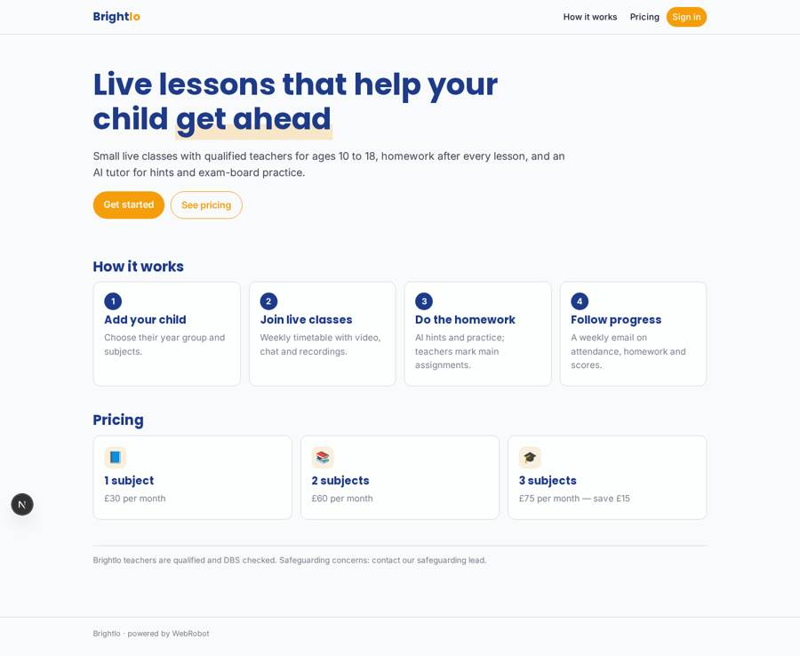
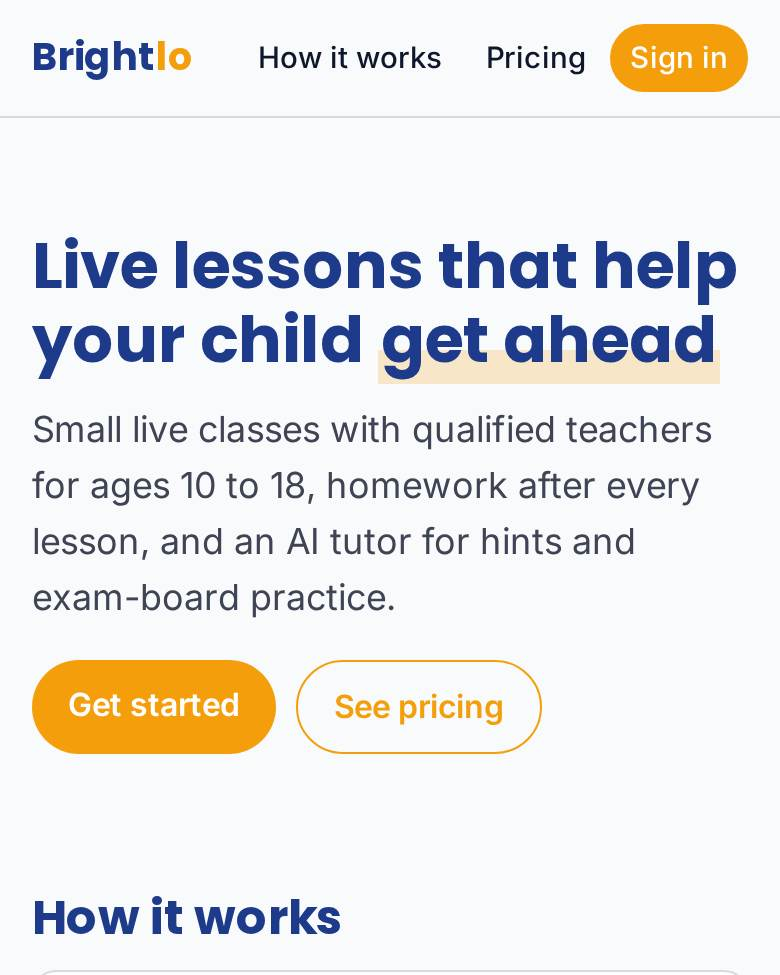
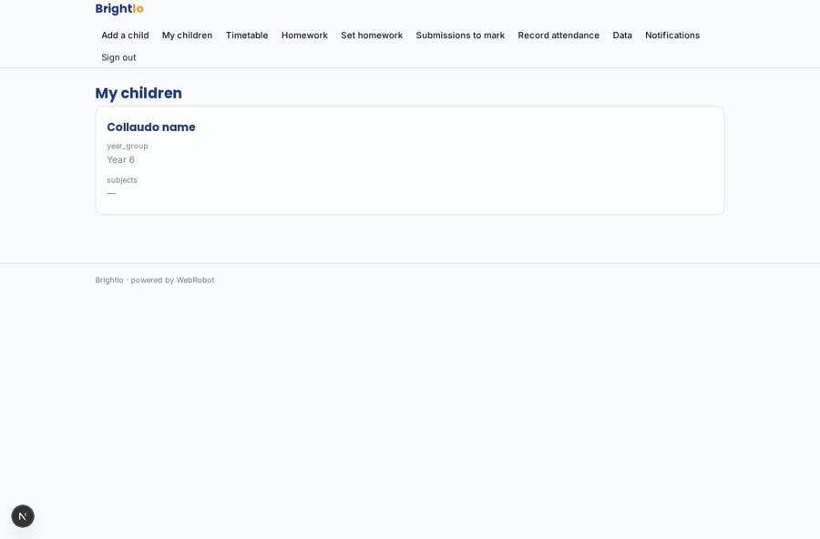
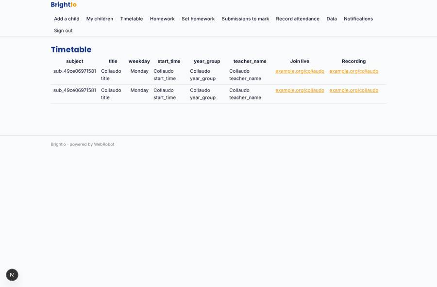
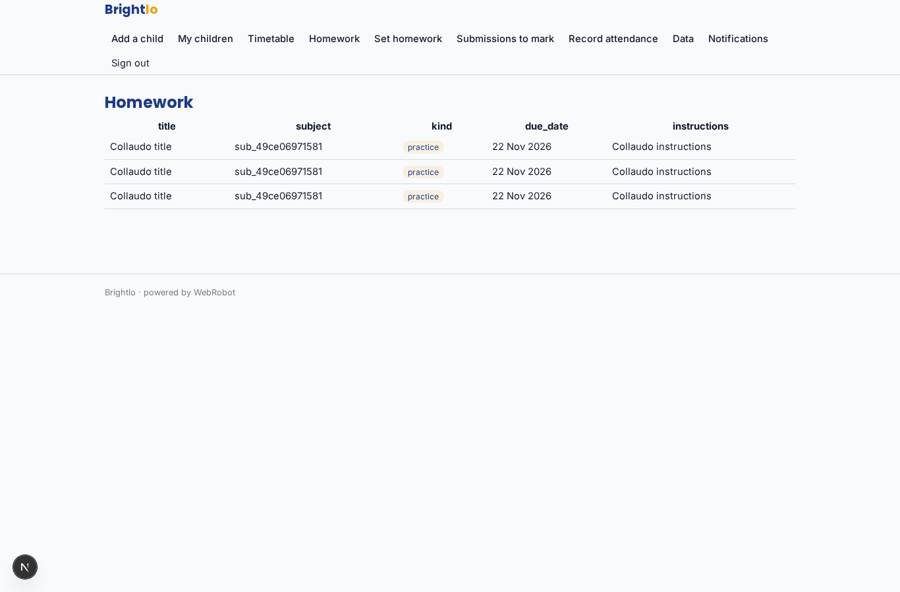
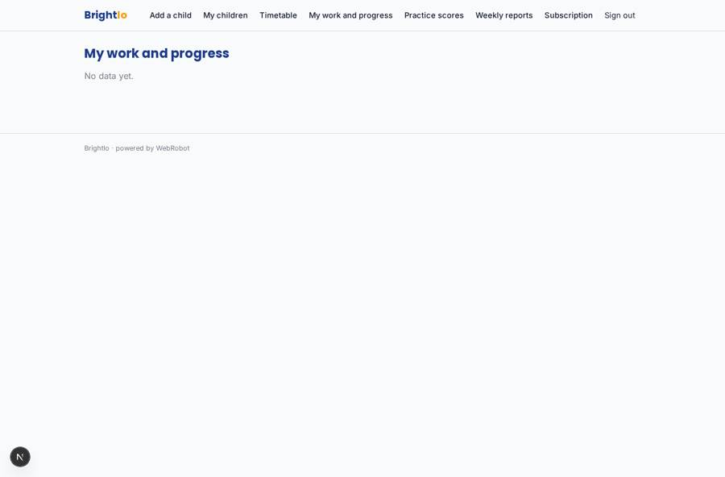

# Brightlo

_Live online lessons for 10 to 18-year-olds, with AI study tools._

**Sector:** Sanità, istruzione, energia, gov · **Manifest:** valid (schema + runtime contract) · **Functional test:** passed (27 checks passed)

## Description given to the app builder

We need Brightlo, live online lessons for 10 to 18-year-olds with AI study tools. Parents sign up, add children with year group and subjects, and choose a subscription through Stripe. Each subject has a weekly timetable of live classes taught by our qualified teachers; the teachers, their DBS checks and safeguarding are ours, and I need the software around them. Lessons run as live video classes with chat and recordings, which we need. After each class, homework is set in the app; pupils submit answers, an AI tutor gives hints and marks practice questions against the exam-board specifications, and teachers mark the main assignments. Parents get a weekly email with attendance, homework completion and scores. Pupils see their timetable, homework and progress; teachers see their classes; parents see their children; admins manage teachers, timetables and subscriptions. Pricing: £30 a month per subject, discounts for three subjects. English only, web and mobile.

## Functional test: what did not pass

- **form saves a record** (form submit_homework): only role pupil may fill it, and the test cannot hold that role _(warning)_
- **saved record shown where its collection is read** (view my_work): a record was saved in submissions (by admin) but the page does not show it (as pupil) _(warning)_

## Navigation recording

Signed in as the app's admin, the recorder opened 7 menu page(s): Add a child, My children, Timetable, Homework, Set homework, Submissions to mark, Record attendance.
No issue found.

Empty data pages are mostly expected on the local runtime: agents are mocked there, so the collections they fill stay empty.

## Design checks (linter)

- mobile.capabilities: an add-to-calendar button (view timetable) needs 'calendar' in the phone app

## Features not expressible today (spec.extensions)

- **live_video**: Live video classes with in-class chat and recordings are not available in the runtime yet: teachers paste an external meeting link into classes.join_url and recording links into recording_url. Needs an integration.
- **safeguarding_dbs**: Teacher DBS check tracking and safeguarding case management remain with Brightlo's own processes; the app only holds teacher accounts via invite.
- **subject_count_pricing**: Per-subject pricing is modelled as three plans (1, 2, 3 subjects); the 3-subject price of £75 is an assumed discount. Enforcement that the number of subjects matches the plan is not automatic.
- **autofill_parent_email**: Pupils type their parent's email on submissions so parents see the record; automatic linking is not available yet.

## Screenshots (interpretive runtime, test data)

### home-anon

### home-mobile

### my_children

### timetable

### homework_list

### my_work

