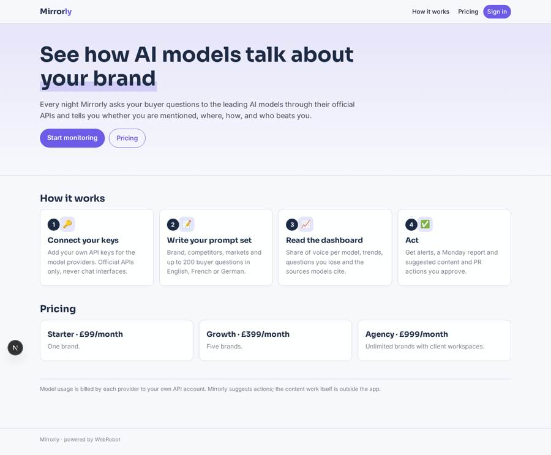
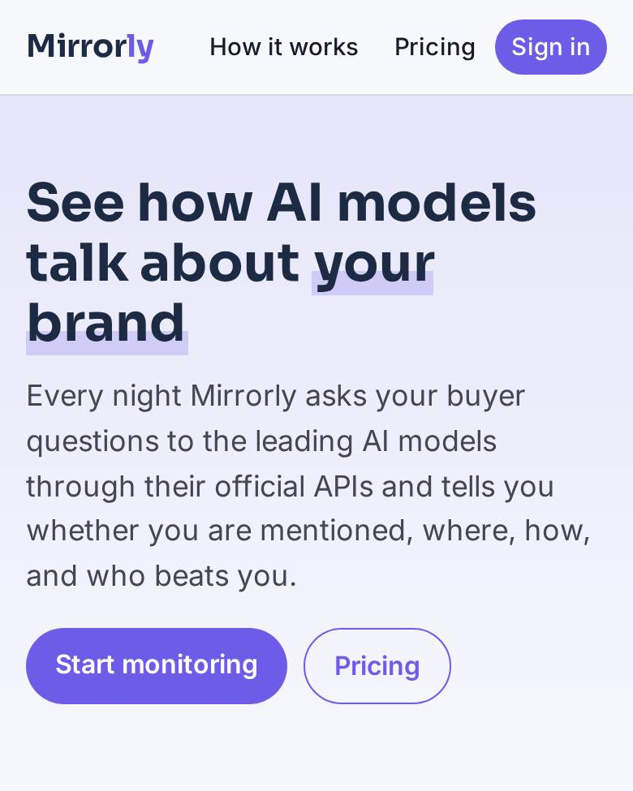
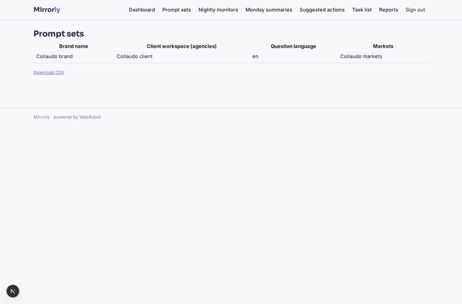
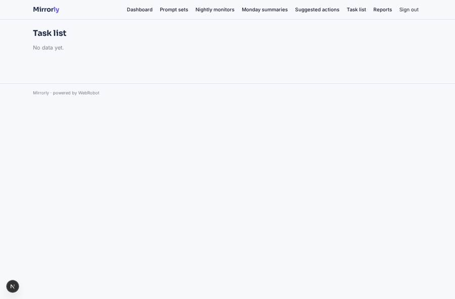
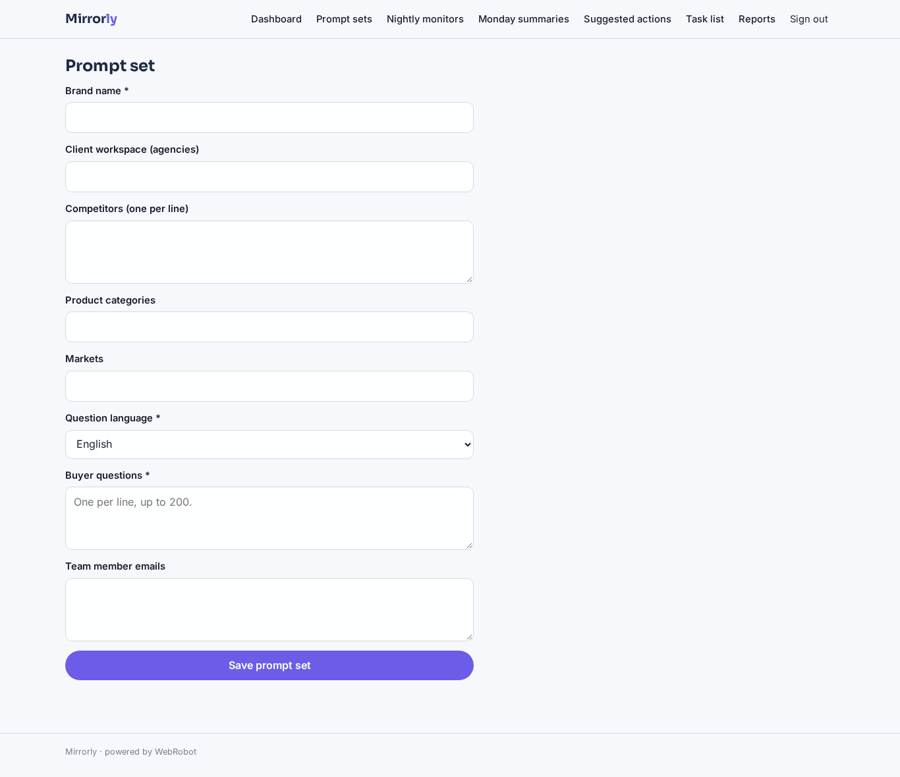
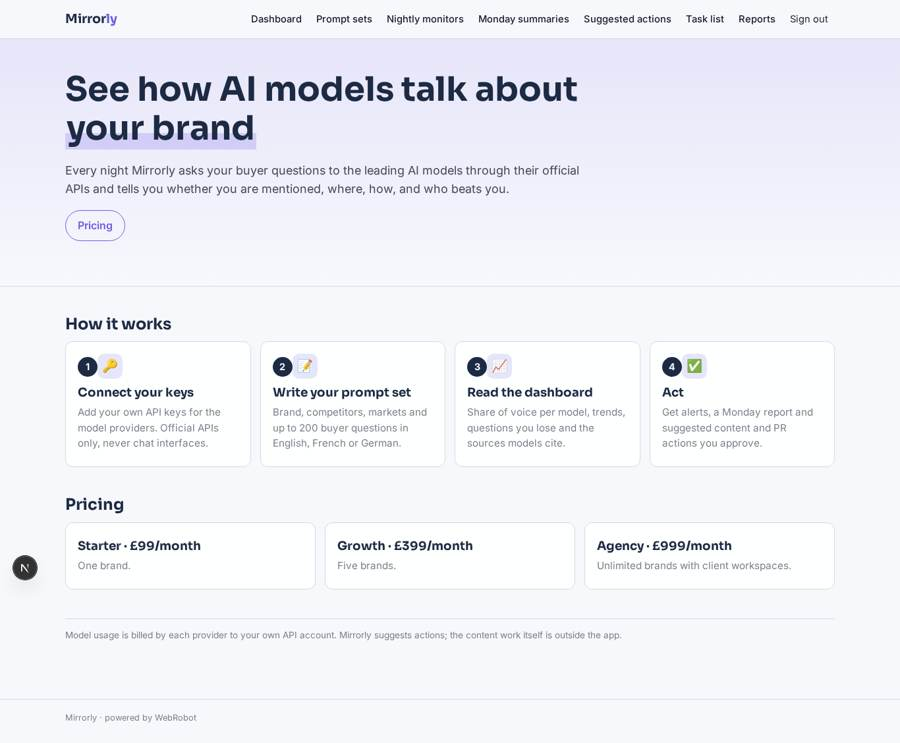

# Mirrorly

_See how your brand appears in answers from large language models._

**Sector:** Data, media, cyber, devtools · **Manifest:** valid (schema + runtime contract) · **Functional test:** passed (14 checks passed)

## Description given to the app builder

I want an app called Mirrorly that shows brands how they appear in answers from large language models. A marketing team signs up, connects its own API keys for the model providers, and creates prompt sets: brand name, competitors, product categories, markets and up to 200 buyer-style questions in English, French or German. Every night an agent sends each question to each model through the official APIs only, never through the chat interfaces, stores the answers, and extracts whether our brand is mentioned, its position, the sentiment, the cited sources and which competitors appear. The dashboard shows share of voice per model, trend lines, the questions where we lose to a competitor and the sources the models cite most. When share of voice drops by more than a threshold the team owner gets an email alert, and every Monday a summary report. An agent also suggests content and PR actions to improve presence, which a marketer must approve before they go on the task list; doing the content work itself is outside the app. Roles: owner manages keys and billing, analysts edit prompt sets, viewers only see dashboards; each brand sees only its own data. Pricing on Stripe: Starter £99 a month for one brand, Growth £399 for five brands, Agency £999 with client workspaces. English interface.

## Navigation recording

Signed in as the app's admin, the recorder opened 7 menu page(s): Dashboard, Prompt sets, Nightly monitors, Monday summaries, Suggested actions, Task list, Reports.
- data page empty: task_list (table)
- data page empty: reports (history)

Empty data pages are mostly expected on the local runtime: agents are mocked there, so the collections they fill stay empty.

## Features not expressible today (spec.extensions)

- **client_workspaces**: Agency client workspaces are modelled with the client field and member emails per prompt set; a separate workspace switcher is not available yet.
- **batching**: 200 questions across 3 models means about 600 API calls per night per brand; a single run may need batching or a higher budget.

## Screenshots (interpretive runtime, test data)

### home-anon

### home-mobile

### brands

### task_list

### brand_form

### home

