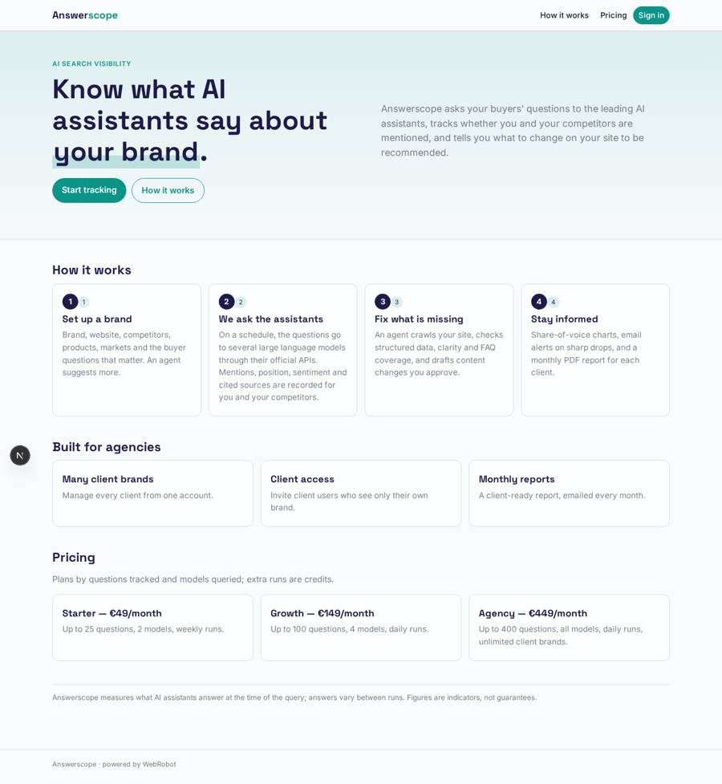
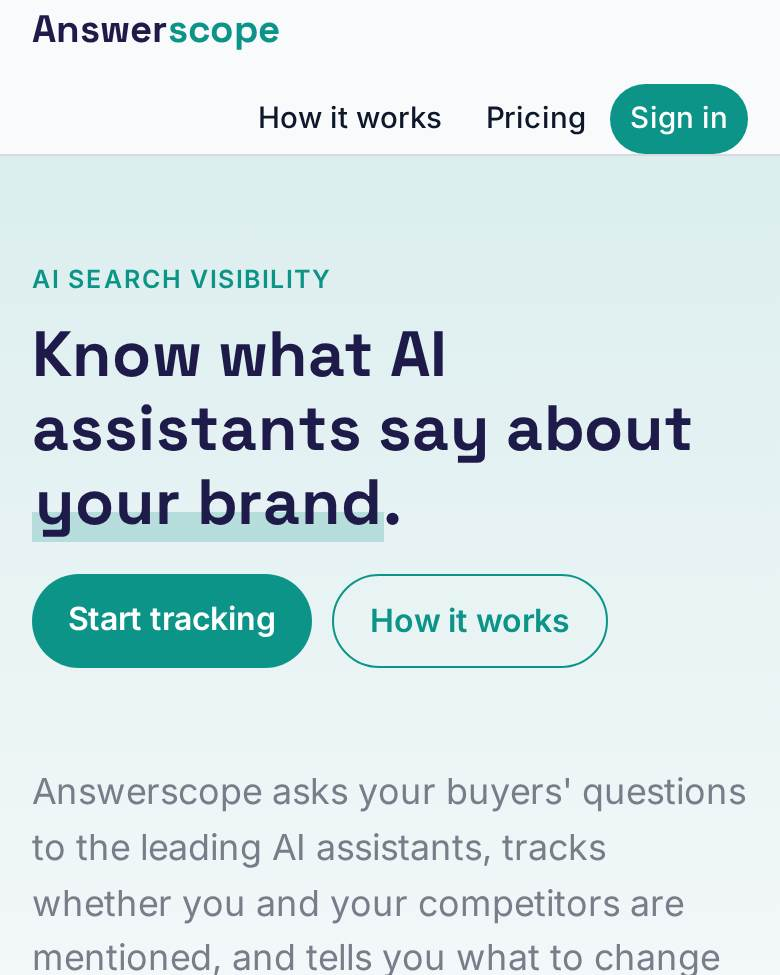
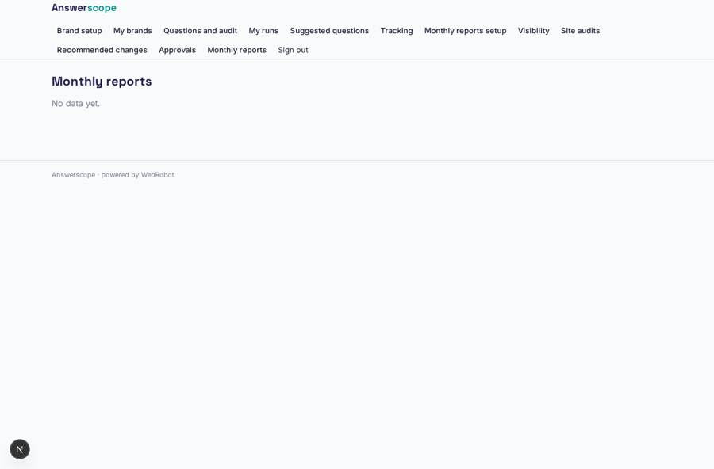
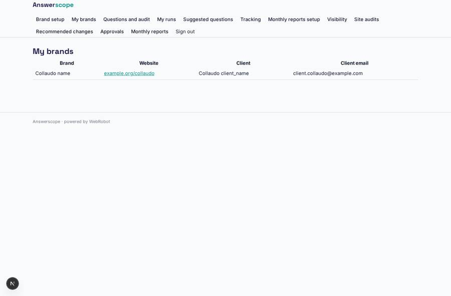
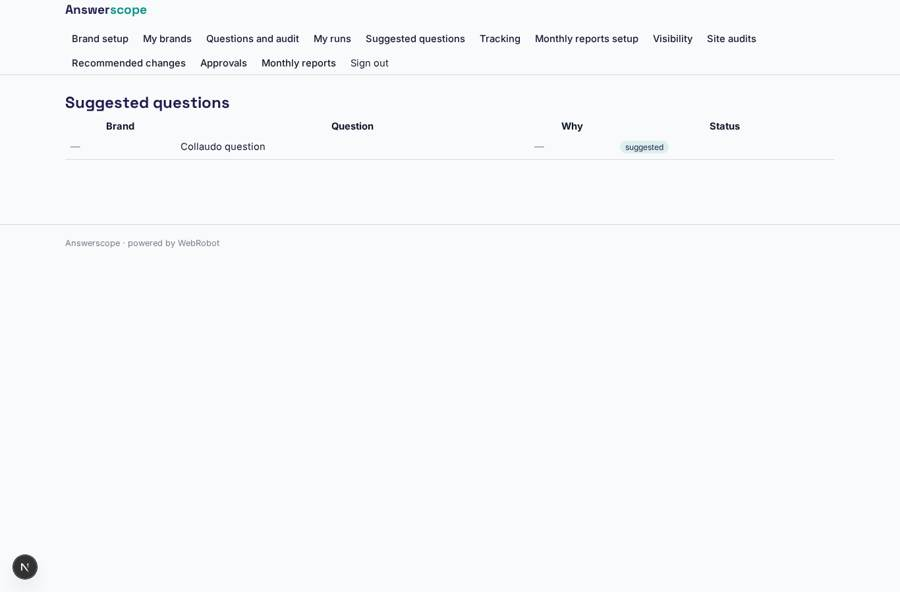
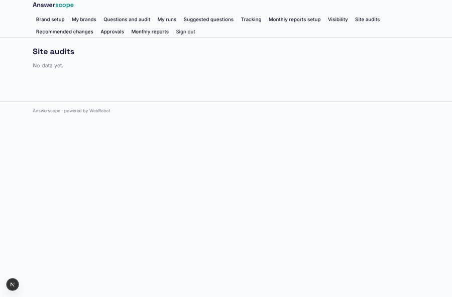

# Answerscope

_See how AI assistants talk about your brand, and fix it._

**Sector:** B2B AI and SaaS · **Manifest:** valid (schema + runtime contract) · **Functional test:** passed (18 checks passed)

## Description given to the app builder

We need Answerscope, which measures how a brand appears in answers from AI assistants and suggests fixes. Marketing teams and agencies sign up; an agency can manage several client brands and invite client users who see only their own brand. The setup form asks for brand name, website, competitors, products, markets and a list of buyer questions; an agent suggests more questions. On a schedule (daily or weekly, chosen by plan) an agent asks those questions to several large language models through their official APIs, records whether the brand is mentioned, its position, the sentiment and which sources are cited, and does the same for competitors. Another agent crawls the customer's own website and checks structured data, page clarity, FAQ coverage and missing topics, and drafts recommended content changes, which the marketer approves. Charts show share of voice by model and question over time, and alerts by email when visibility drops sharply. A monthly PDF report goes to each client. Pricing: Stripe plans by number of questions tracked and models queried, with extra runs as credits. English.

## Navigation recording

Signed in as the app's admin, the recorder opened 7 menu page(s): Brand setup, My brands, Questions and audit, My runs, Suggested questions, Tracking, Monthly reports setup.
No issue found.

Empty data pages are mostly expected on the local runtime: agents are mocked there, so the collections they fill stay empty.

## Features not expressible today (spec.extensions)

- **plan_enforcement**: The number of questions tracked, the models queried and daily-vs-weekly frequency per plan are described in the plans but not enforced automatically; the marketer picks the schedule on the tracking page and run credits are charged per run.
- **pdf_report**: The monthly report is a printable page (save as PDF from the browser) and the email links to it; a PDF file attachment is not generated.

## Screenshots (interpretive runtime, test data)

### home-anon

### home-mobile

### reports

### brands

### suggestions

### audits

