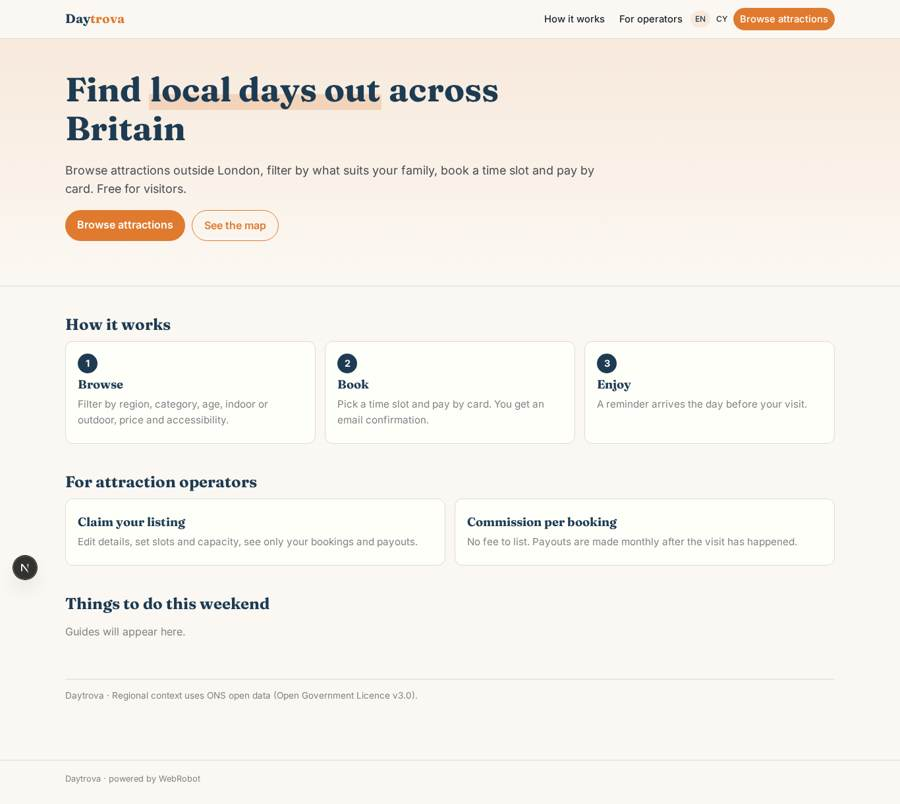
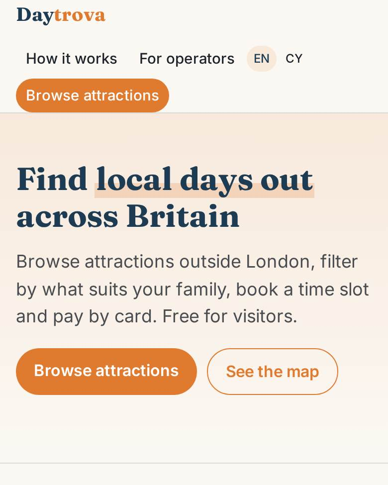
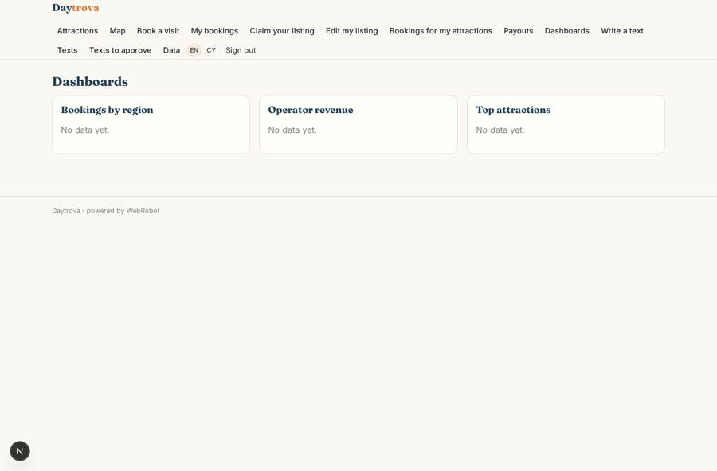
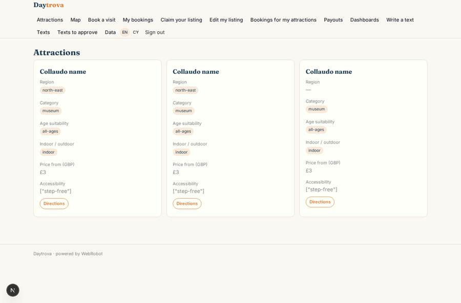
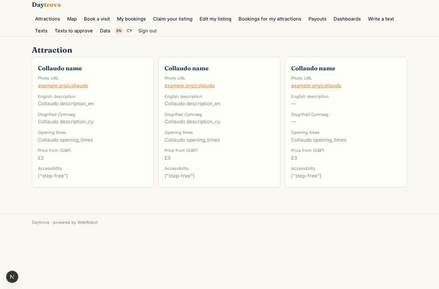
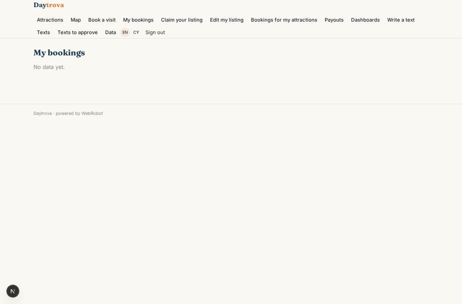

# Daytrova

_Find and book local attractions and experiences across Britain._

**Sector:** Consumer, travel, retail · **Manifest:** valid (schema + runtime contract) · **Functional test:** passed (28 checks passed)

## Description given to the app builder

I want a web app called Daytrova for finding and booking local attractions and experiences across Britain, especially outside London. Visitors browse a shared catalogue with filters (region, category, age suitability, indoor/outdoor, price, accessibility) and a map, open a listing with photos, opening times and reviews, then book a time slot and pay by card. Attraction operators get their own role: they claim their listing, edit details, set slots and capacity, and see only their own bookings and payouts. Admins can bulk import listings from a CSV supplied by operators under agreement. An agent writes and refreshes listing descriptions and seasonal "things to do this weekend" guides, using VisitBritain and ONS open data for context; every new text waits for admin approval before going live. Visitors get a booking confirmation email with a QR code and a reminder the day before. We take the visitor's payment and pay each of our roughly 2,700 operators their share minus our commission monthly, holding funds until the visit has happened, so I need marketplace escrow and payouts to many operators. Dashboards: bookings by region, operator revenue, top attractions. Free for visitors, commission per booking for operators. English and Welsh.

## Functional test: what did not pass

- **saved record shown where its collection is read** (view my_payouts): a record was saved in payouts (by admin-data, admin-data) but the page does not show it (as operator) _(warning)_

## Navigation recording

Signed in as the app's admin, the recorder opened 7 menu page(s): Attractions, Map, Book a visit, My bookings, Claim your listing, Edit my listing, Bookings for my attractions.
- data page empty: operator_bookings (table)

Empty data pages are mostly expected on the local runtime: agents are mocked there, so the collections they fill stay empty.

## Features not expressible today (spec.extensions)

- **escrow_payouts**: Holding the visitor's payment until the visit has happened, then paying each of ~2,700 operators monthly minus commission, is not expressible yet. The manifest declares per_transaction billing with sellers = attractions and a 12% fee (placeholder, set your rate); escrow release after the visit and the monthly batch payout need platform support. Meanwhile admins record monthly statements in the payouts collection (admin-only back office; each operator reads only their own rows).
- **qr_code**: The confirmation email is plain text with a booking reference; a QR code image in the email is not available yet.
- **booking_stamping**: The bookings collection needs attraction_name, region, operator_email and price copied from the attraction for operators' views and the dashboards; the booking view does not fill them automatically yet.
- **reviews**: Public visitor reviews on a listing (written by visitors, readable by everyone) are not available yet.
- **catalogue_filters**: Interactive visitor filters (region, category, age, indoor/outdoor, price, accessibility) on the catalogue depend on the runtime's table/cards filter bar; the fields are all declared.
- **visitbritain_data**: VisitBritain has no suitable open API in the allowed list; the agent uses ONS through an http tool and VisitBritain open data only from the admin's context. CSV bulk import of listings uses the built-in /admin/data page.

## Screenshots (interpretive runtime, test data)

### home-anon

### home-mobile

### insights

### catalogue

### attraction

### my_bookings

