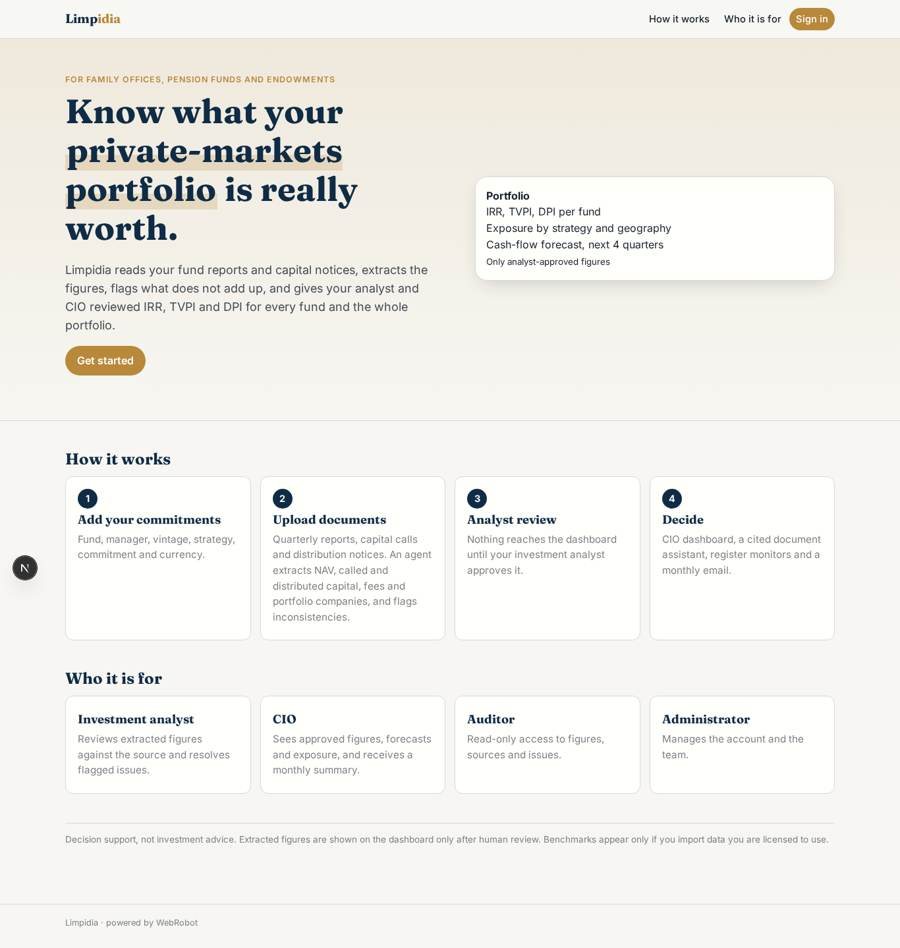
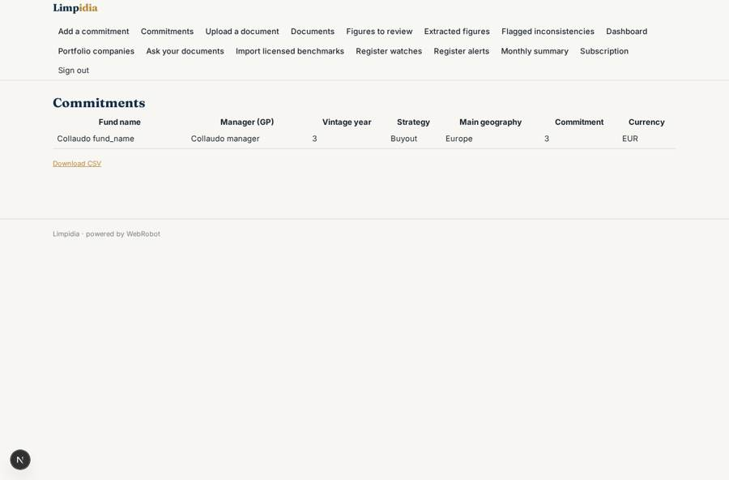
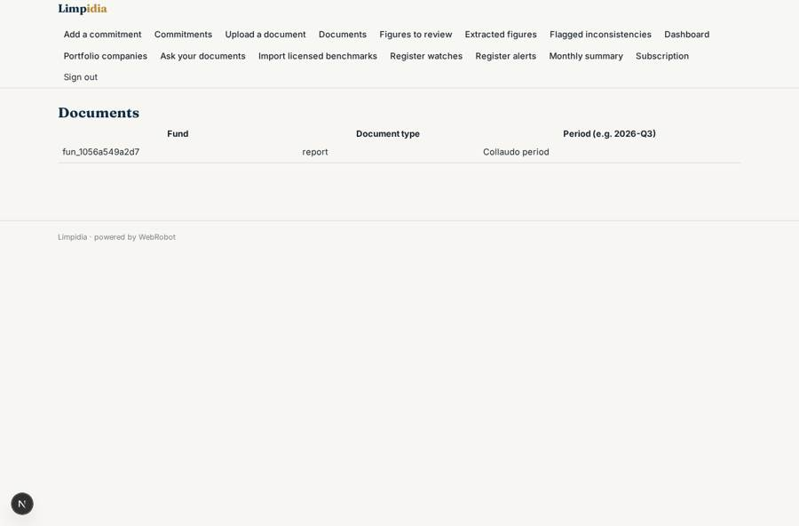
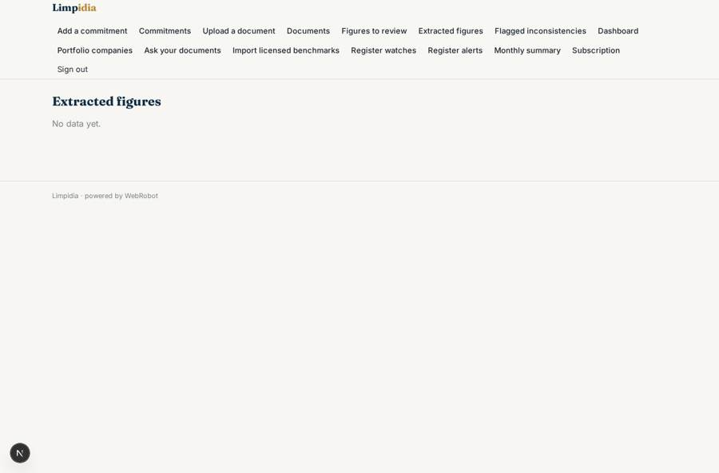
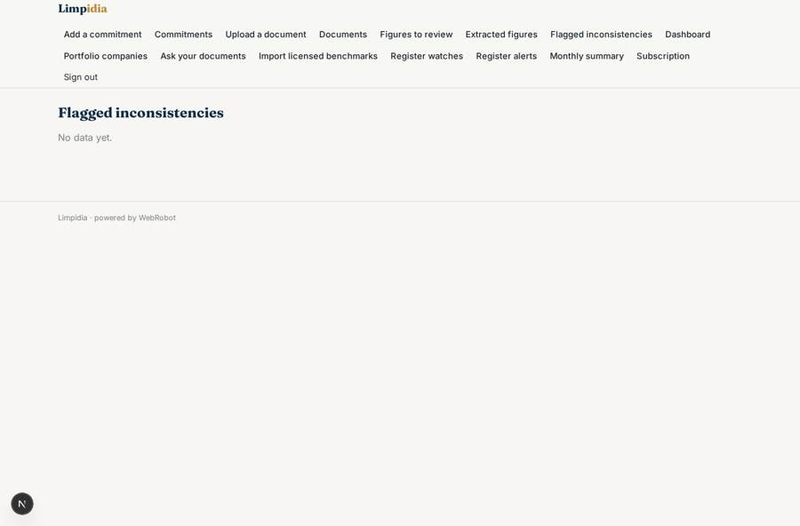

# Limpidia

_The intelligence layer for limited partners in private markets._

**Sector:** Fintech, proptech, insurtech · **Manifest:** valid (schema + runtime contract) · **Functional test:** passed (23 checks passed)

## Description given to the app builder

We need Limpidia, an intelligence layer for limited partners investing in private markets. An LP (family office, pension fund, endowment) signs up and adds its fund commitments with a form: fund name, manager, vintage, strategy, commitment, currency. Quarterly reports, capital call and distribution notices are uploaded or pulled from GP investor portals using the LP's own logins or OAuth where the portal supports it. An agent extracts NAV, called and distributed capital, fees and portfolio company data into structured records, flags inconsistencies between notices and reports, and computes IRR, TVPI and DPI per fund and for the whole portfolio. A chat assistant answers questions across all documents with citations. Scheduled monitors check Companies House filings and the FCA Register for managers and portfolio companies and alert on changes. Benchmarks from commercial fund datasets are shown only if the customer has a licence. The investment analyst reviews extracted figures before they reach the dashboard; the CIO sees approved figures, cash-flow forecasts and exposure by strategy and geography, and gets a monthly email summary. Roles: admin, analyst, CIO, auditor read-only. Pricing: yearly subscription by number of fund commitments. English.

## Navigation recording

Signed in as the app's admin, the recorder opened 7 menu page(s): Add a commitment, Commitments, Upload a document, Documents, Figures to review, Extracted figures, Flagged inconsistencies.
- form not sent: fund_add: Currency is required
- data page empty: figures (table)
- data page empty: issues (table)

Empty data pages are mostly expected on the local runtime: agents are mocked there, so the collections they fill stay empty.

## Features not expressible today (spec.extensions)

- **gp_portal_pull**: Pulling documents from GP investor portals with the LP's own logins or OAuth is not available yet (no OAuth, no username/password logins, and every portal has its own API). For now documents are uploaded; portals that issue an API key can be added later through an account credential and an http tool.
- **fca_email_header**: The FCA Register API also needs an X-Auth-Email header besides the key. The app supports one credential header, so the admin must confirm with WebRobot how this header is set for the app.
- **commercial_benchmark_feeds**: Live feeds from commercial fund datasets are not connected. Benchmarks are shown only from data the customer imports and confirms it is licensed to use.
- **lp_team_separation**: Analyst, CIO and auditor access works through the member emails stored on each record. The approvals list for analysts is not yet limited by LP organisation and needs checking before many LPs share one app.

## Screenshots (interpretive runtime, test data)

### home-anon

### home-mobile

### funds

### documents

### figures

### issues

