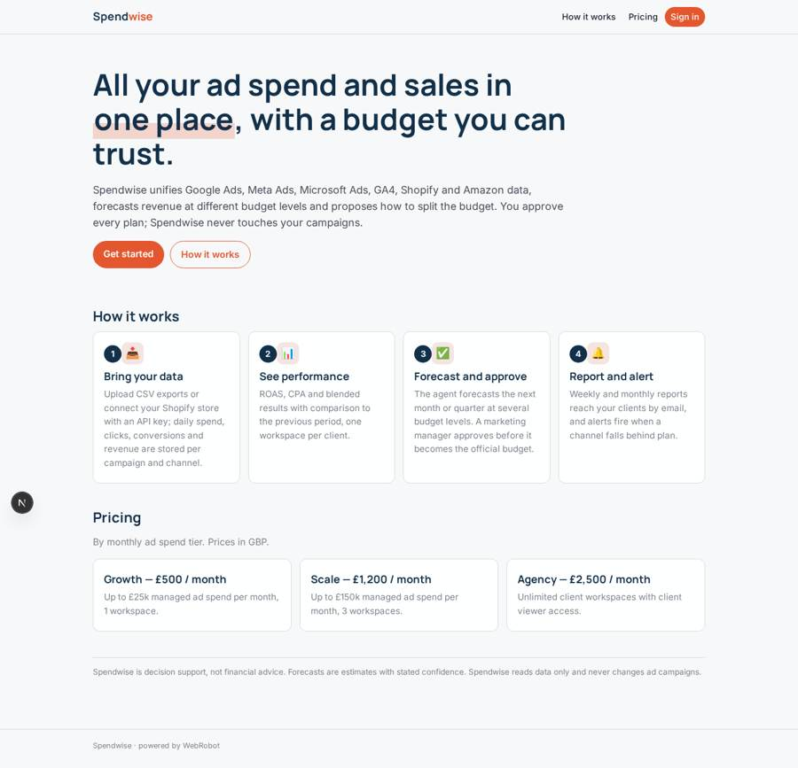
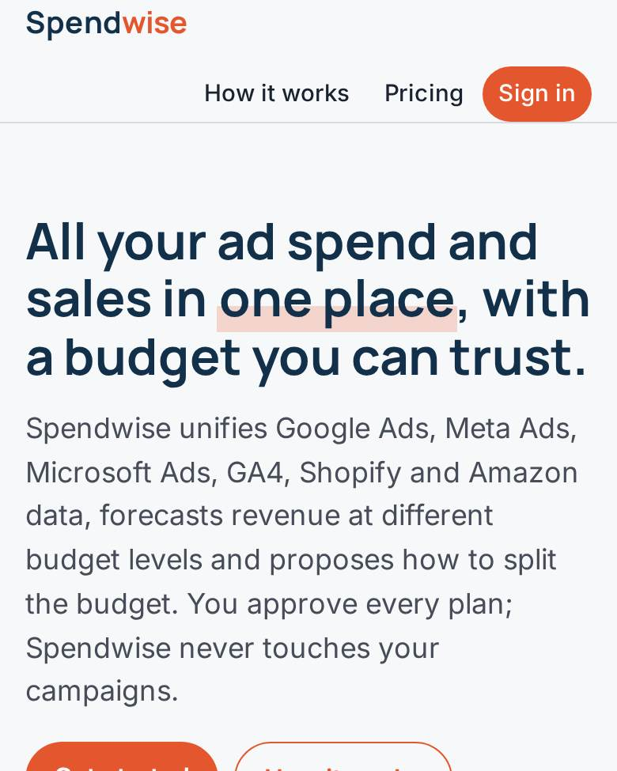
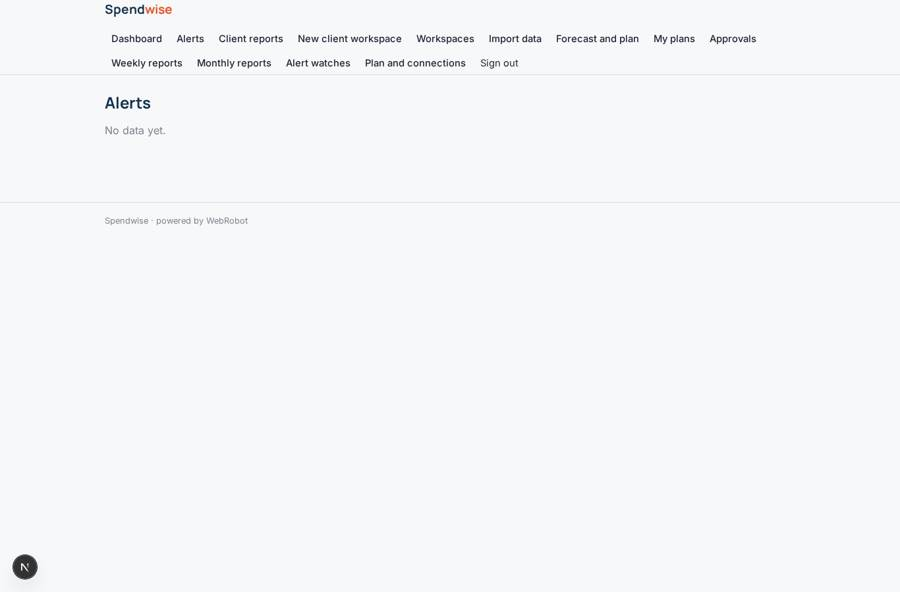
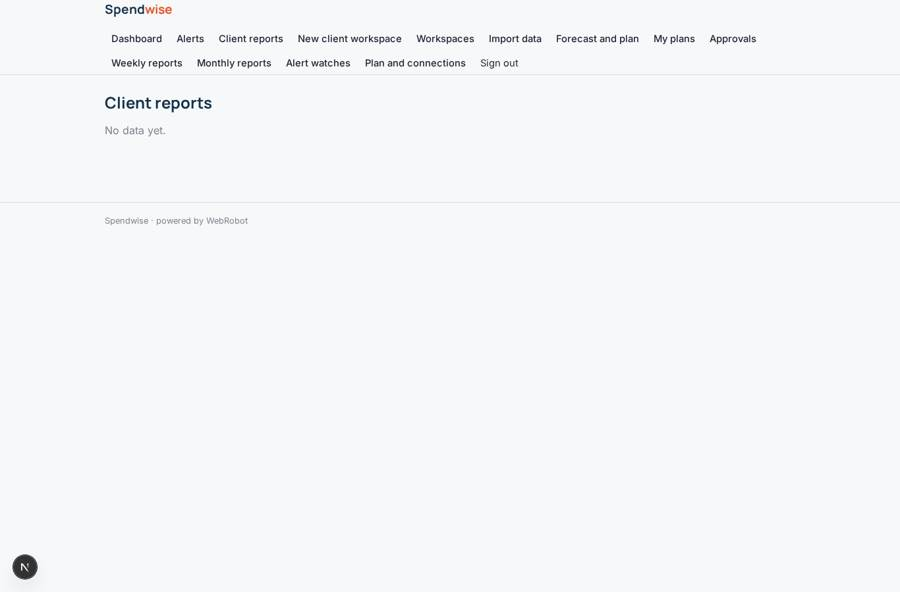
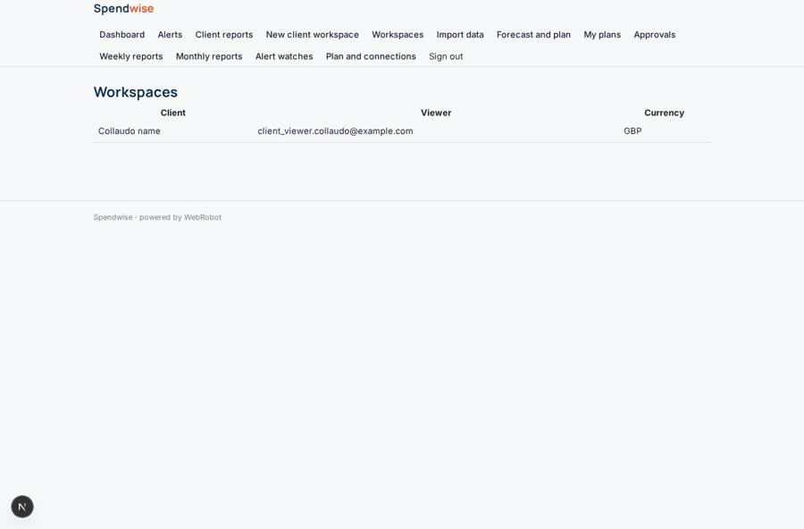
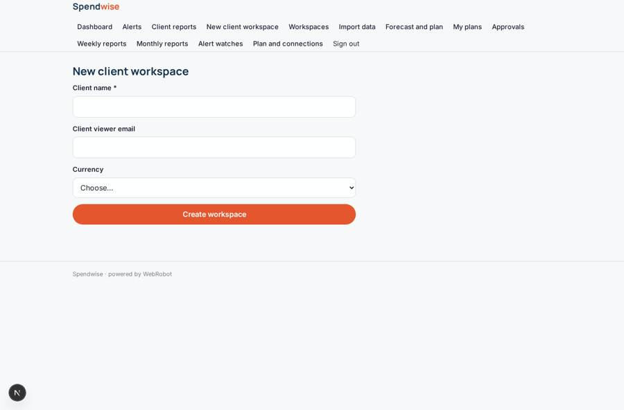

# Spendwise

_One view of ad spend and sales, with a forecast and a budget you approve._

**Sector:** Data, media, cyber, devtools · **Manifest:** valid (schema + runtime contract) · **Functional test:** passed (20 checks passed)

## Description given to the app builder

We need an app called Spendwise for e-commerce and marketing teams to unify advertising and sales data, forecast results and allocate budget. A brand or agency signs up and connects Google Ads, Meta Ads, Microsoft Ads, Google Analytics 4, Shopify and Amazon through OAuth, under each platform's terms, as the real product does; CSV upload is a fallback. The app stores daily spend, impressions, clicks, conversions and revenue per campaign and channel. Dashboards show return on ad spend, cost per acquisition, blended performance and comparisons with the previous period. An agent forecasts revenue for the next month or quarter at different budget levels and proposes how to split budget between channels, with expected outcomes and confidence. A marketing manager must approve a plan before it is saved as the official budget; the app never changes campaigns by itself. Scheduled reports go to clients by email each week and month. Alerts fire when a channel underperforms the plan. Agencies manage several client workspaces; each client sees only its own data. Roles: admin, marketer, client viewer. Pricing: from £500 a month by ad spend tier, with an agency plan. English only.

## Navigation recording

Signed in as the app's admin, the recorder opened 7 menu page(s): Dashboard, Alerts, Client reports, New client workspace, Workspaces, Import data, Forecast and plan.
- data page empty: alerts (table)
- data page empty: reports (table)
- agent run did not open: new_plan: the run did not open

Empty data pages are mostly expected on the local runtime: agents are mocked there, so the collections they fill stay empty.

## Features not expressible today (spec.extensions)

- **oauth_connectors**: OAuth connections to Google Ads, Meta Ads, Microsoft Ads, Google Analytics 4 and Amazon are not available yet; only CSV upload and Shopify via API key work now. Daily sync from those platforms must wait for OAuth support.
- **workspace_quotas**: Plan limits on the number of client workspaces and ad spend tiers are not enforced automatically; they are described in the plans.
- **ratio_aggregation**: ROAS and CPA in aggregated dashboards are averages of the daily values, not spend-weighted ratios.

## Screenshots (interpretive runtime, test data)

### home-anon

### home-mobile

### alerts

### reports

### workspaces

### workspaces_form

