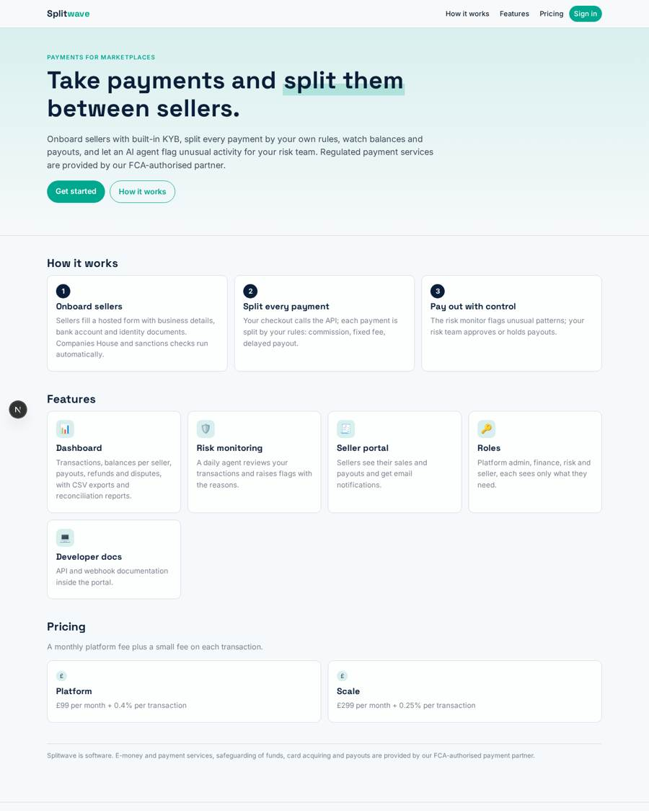
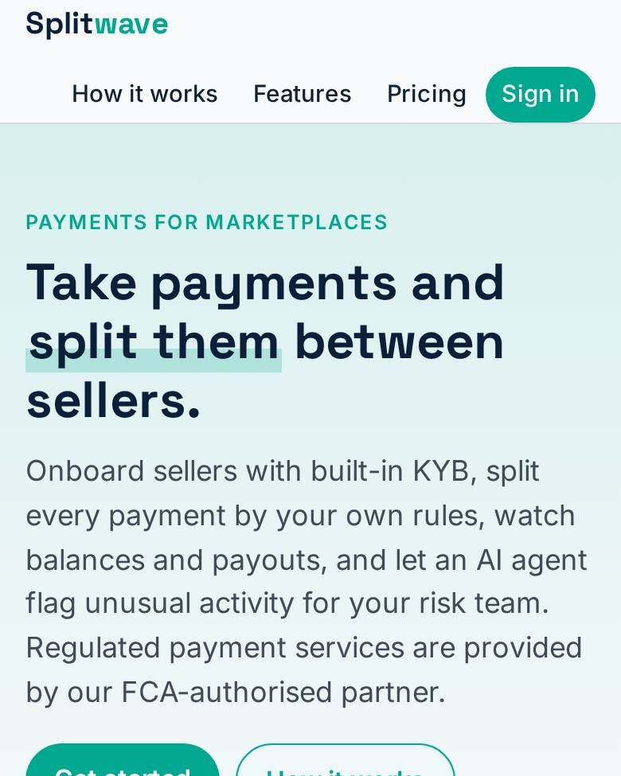
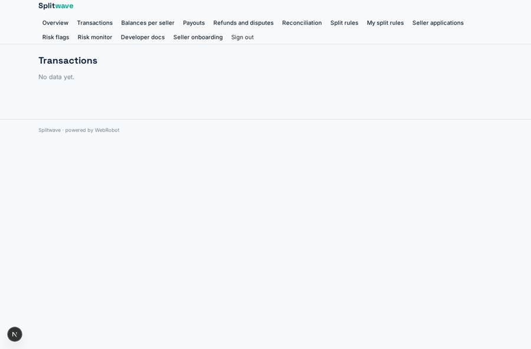
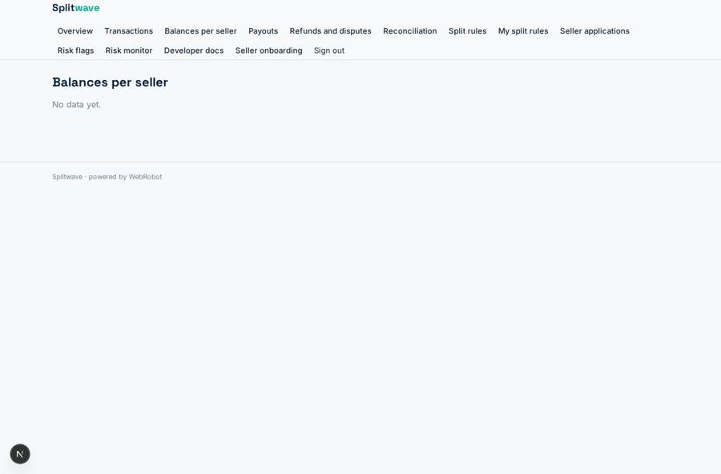
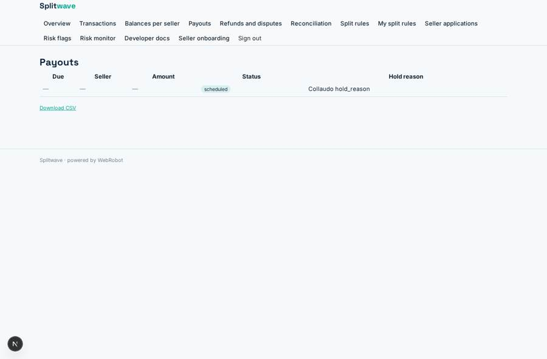
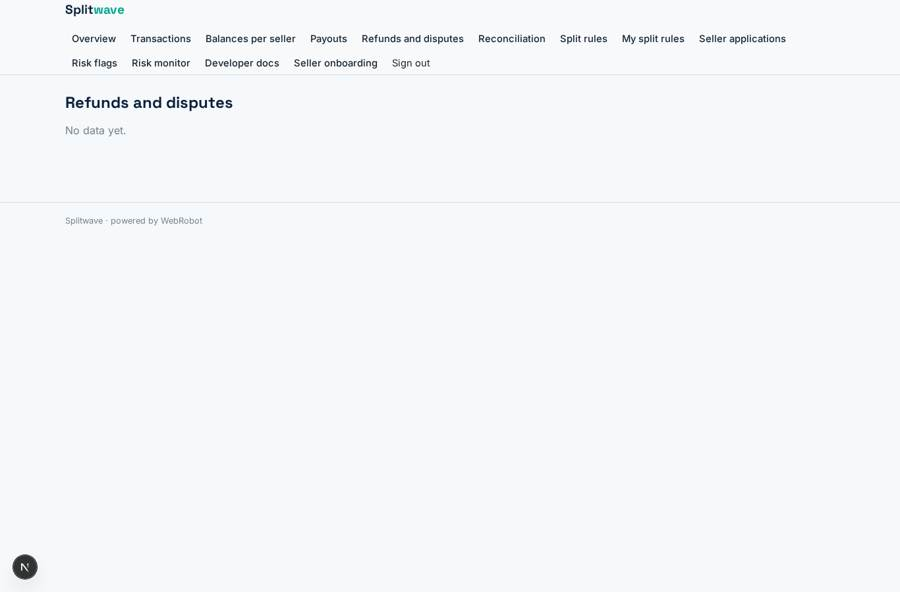

# Splitwave

_Split payments for marketplaces and platforms, with onboarding, KYB and risk control built in._

**Sector:** Fintech, proptech, insurtech · **Manifest:** valid (schema + runtime contract) · **Functional test:** passed (31 checks passed)

## Description given to the app builder

I want Splitwave, a payments platform for marketplaces and software platforms that need to take payments and split them between sellers. The e-money and payment institution authorisation, safeguarding of funds, card acquiring and payouts are with our FCA-authorised payment partner; I need the software around it. A platform signs up, creates its account and onboards its sellers through a hosted form collecting business details, bank account and identity documents, with KYB checks on Companies House and sanctions screening. The platform integrates a checkout via API; payments are split automatically according to rules it defines (commission percentage, fixed fees, delayed payouts). A dashboard shows transactions, balances per seller, payouts, refunds and disputes, with CSV exports and reconciliation reports. An agent monitors transactions for unusual patterns and flags them for the platform's risk team, who approve or hold payouts. Sellers have their own portal to see their sales and payouts and receive email notifications. Roles: platform admin, finance, risk, seller. Developer documentation and API keys are in the portal. Pricing: per-transaction fee plus monthly platform fee. English.

## Functional test: what did not pass

- **saved record shown where its collection is read** (view flags): a record was saved in risk_flags (by user) but the page does not show it (as user) _(warning)_

## Navigation recording

Signed in as the app's admin, the recorder opened 7 menu page(s): Overview, Transactions, Balances per seller, Payouts, Refunds and disputes, Reconciliation, Split rules.
- data page empty: transactions (table)
- data page empty: balances (table)
- data page empty: disputes (table)
- data page empty: reconciliation (table)

Empty data pages are mostly expected on the local runtime: agents are mocked there, so the collections they fill stay empty.

## Design checks (linter)

- collection disputes: view disputes, view my_disputes, tool read_disputes of risk_monitor read it, but nothing writes it — add a form view on it (the users fill their own records), an agent tool that writes or appends to it, or a trigger write; or, for a list the admins keep, make it ownedBy shared (admins fill it on the data page)

## Features not expressible today (spec.extensions)

- **checkout_api_and_keys**: The checkout/payment API, the issuing and rotation of per-platform API keys, and per-platform webhook authentication are not available in the manifest: payments are created with the payment partner and delivered here by webhook. Each webhook must carry the platform's team emails so the right records are shared.
- **split_engine**: The split calculation (commission %, fixed fee, delayed payout date) runs in the checkout/partner integration; Splitwave stores the computed commission, fee and net. Automatic payout creation from rules and payout execution at the partner are not available yet.
- **fixed_fee_per_transaction**: The platform's own price has a per-transaction percentage fee; a fixed amount per transaction (e.g. 20p) cannot be expressed in billing yet.
- **seller_deep_links**: Sellers open onboarding from the menu; a personalised invite link with a pre-filled platform email is not available.
- **safeguarding_and_licences**: E-money and payment institution authorisation, safeguarding, card acquiring and payouts remain with the FCA-authorised partner; the app holds no client money.

## Screenshots (interpretive runtime, test data)

### home-anon

### home-mobile

### transactions

### balances

### payouts

### disputes

