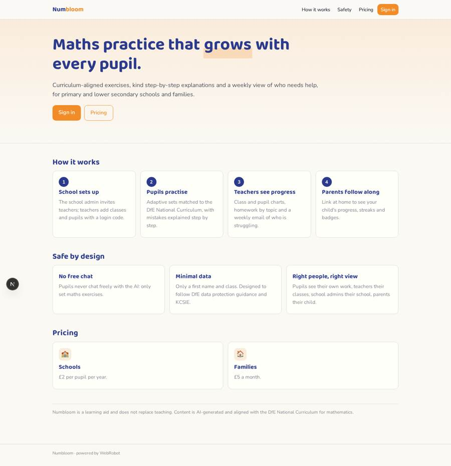
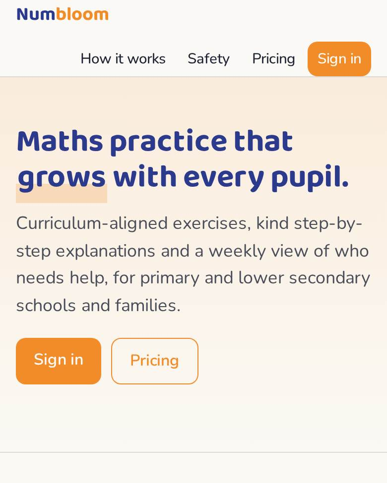
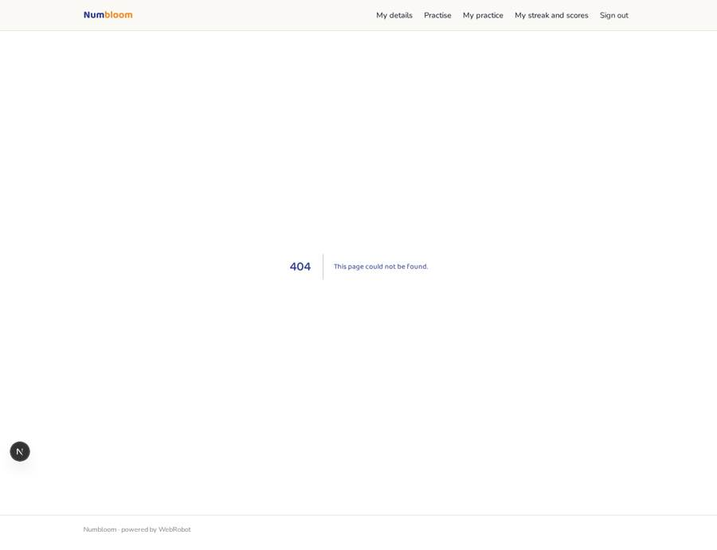
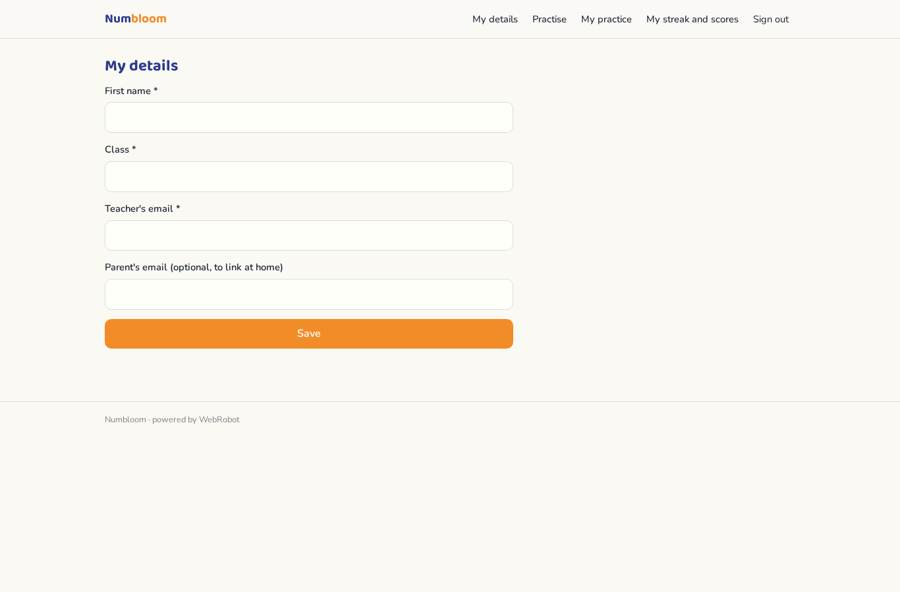

# Numbloom

_Maths practice that adapts to every pupil._

**Sector:** Sanità, istruzione, energia, gov · **Manifest:** valid (schema + runtime contract) · **Functional test:** passed (18 checks passed)

## Description given to the app builder

I want Numbloom, an AI maths practice platform for primary and lower secondary pupils. A school signs up; the school admin adds teachers and classes, teachers add pupils with a login code, and parents can link at home. An agent generates practice exercises aligned with the DfE National Curriculum for maths, adapts difficulty to each pupil's answers, explains mistakes step by step in plain language, and spots misconceptions. Teachers set weekly homework by topic, see class and pupil progress on charts, and get a weekly email of who is struggling and with what. Pupils see only their own work and a streak and badge system; teachers see their classes; the school admin sees the school; parents see their child. No free-text chat for pupils under 13 and no personal data beyond first name and class, following DfE data protection guidance and KCSIE. Pricing: £2 per pupil per year for schools, £5 a month for families through Stripe. English only.

## Functional test: what did not pass

- **form saves a record** (form add_pupil): only role teacher may fill it, and the test cannot hold that role _(warning)_
- **form saves a record** (form set_homework): only role teacher may fill it, and the test cannot hold that role _(warning)_
- **template instance created and run** (template weekly_digest): reserved to teacher _(warning)_
- **page opened by a role allowed to** (view pupil_table): only role teacher/school_admin may open it, the test cannot hold it _(warning)_
- **page opened by a role allowed to** (view add_pupil): only role teacher may open it, the test cannot hold it _(warning)_
- **page opened by a role allowed to** (view my_roster): only role teacher/school_admin may open it, the test cannot hold it _(warning)_
- **page opened by a role allowed to** (view set_homework): only role teacher may open it, the test cannot hold it _(warning)_
- **page opened by a role allowed to** (view homework_list): only role teacher/school_admin may open it, the test cannot hold it _(warning)_
- **page opened by a role allowed to** (view watch): only role teacher may open it, the test cannot hold it _(warning)_

## Navigation recording

Signed in as the app's admin, the recorder opened 2 menu page(s): Class progress, Plan.
No issue found.

Empty data pages are mostly expected on the local runtime: agents are mocked there, so the collections they fill stay empty.

## Features not expressible today (spec.extensions)

- **pupil_login_code**: Pupils sign in by magic link; a pupil login code (no pupil email) is not available yet. For now pupils use a school-managed address and enter first name, class and teacher in My details. Roster codes are recorded for teachers only.
- **school_isolation**: School admins and teachers are scoped by teacher email, but one app serves one school's data set: for several schools, publish one app per school, since the school admin role sees all records.
- **homework_to_pupils**: Homework is stored for teachers; showing it to pupils of a class needs class-level sharing, not available yet. Teachers see it in Homework set.
- **per_pupil_pricing**: The school plan is £2 per pupil per year; per-seat quantity billing is not available yet, so the plan is a flat price to adjust by the owner.
- **badges**: Streaks and badges are shown as counts of completed sets and scores; dedicated badge artwork and logic are not available yet.

## Screenshots (interpretive runtime, test data)

### home-anon

### home-mobile

### pupil_table

### my_roster

### homework_list

### join

