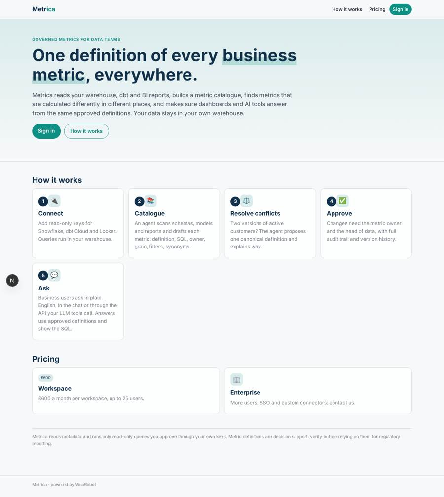
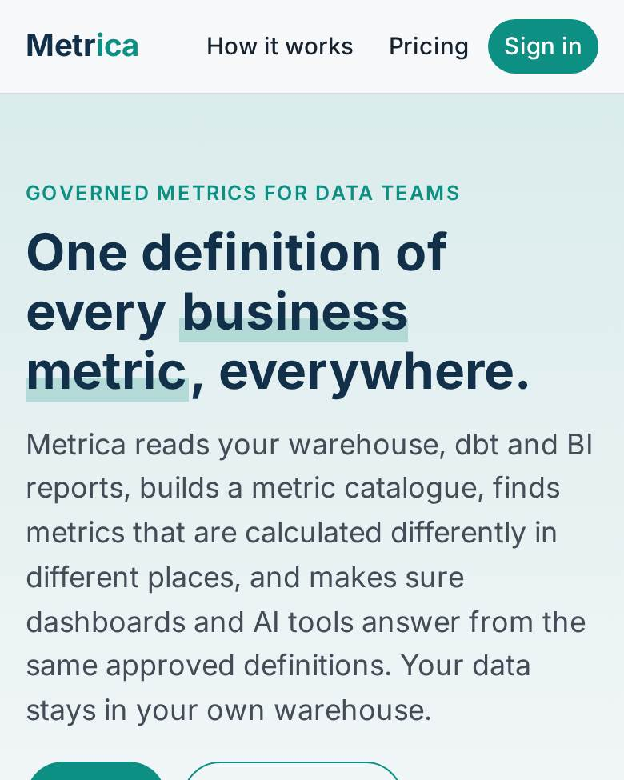
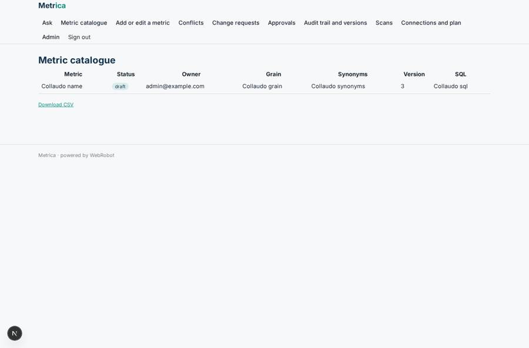
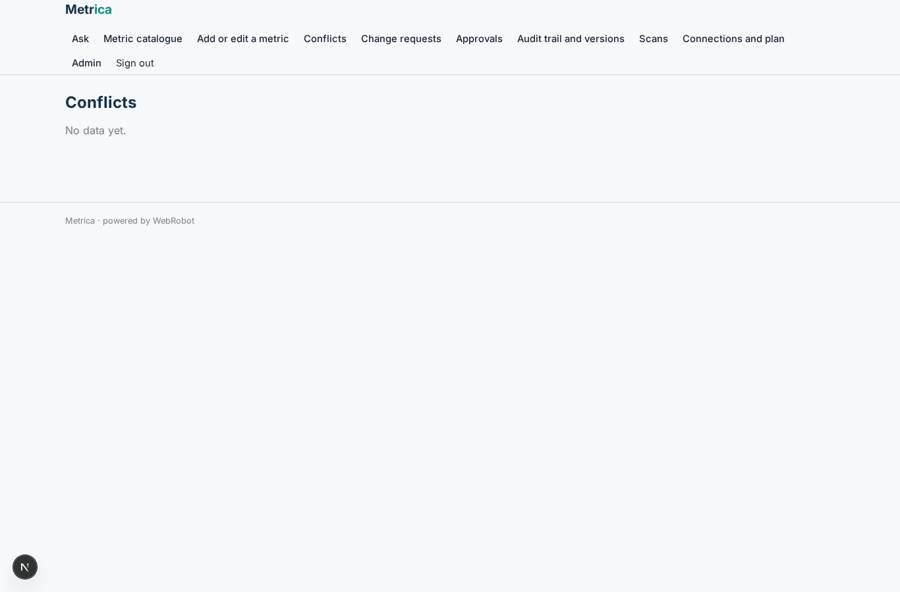
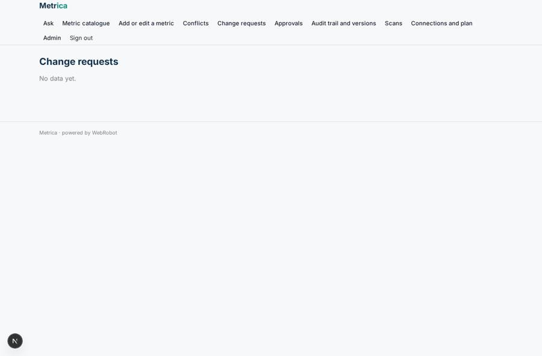
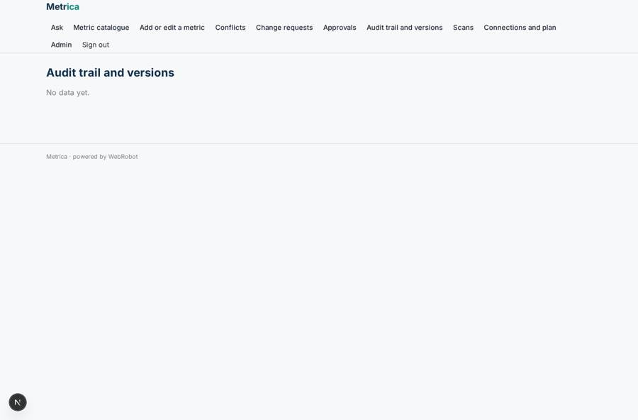

# Metrica

_One definition for every business metric, in every dashboard and every AI tool._

**Sector:** Data, media, cyber, devtools · **Manifest:** valid (schema + runtime contract) · **Functional test:** passed (25 checks passed)

## Description given to the app builder

We need an app called Metrica that keeps a company's business metric definitions consistent so that AI tools and dashboards give the same answers. A data team signs up and connects its warehouse: Snowflake, BigQuery, Redshift or Postgres, plus Looker and dbt Cloud through OAuth, the way the real product does; a service-account key can be a fallback. The app reads schemas, dbt models and existing reports and builds a metric catalogue: name, business definition, SQL, owner, grain, filters, synonyms and status. An agent scans reports and queries regularly, finds metrics that are calculated differently in different places (for example two versions of active customers), and proposes one canonical definition with an explanation. Any change to a definition needs approval from the metric owner and the head of data, with a full audit trail and version history. Business users can ask questions in plain English through a chat or through an API that other LLM tools call, and the answer always uses the approved definitions and shows the SQL. Roles: admin, data engineer, metric owner, business viewer. A weekly email lists conflicts found and pending approvals. Pricing: £600 a month per workspace up to 25 users, enterprise on request. English only. Data stays in the customer's own warehouse.

## Navigation recording

Signed in as the app's admin, the recorder opened 7 menu page(s): Ask, Metric catalogue, Add or edit a metric, Conflicts, Change requests, Approvals, Audit trail and versions.
- data page empty: conflicts_view (table)
- data page empty: changes (table)
- data page empty: audit (table)

Empty data pages are mostly expected on the local runtime: agents are mocked there, so the collections they fill stay empty.

## Features not expressible today (spec.extensions)

- **oauth_connections**: OAuth sign-in to Looker, dbt Cloud, BigQuery and Google/Snowflake is not available yet: connections use pasted API keys or tokens (service-account fallback). BigQuery, Redshift and Postgres need a connector that is not available yet; Snowflake is the supported warehouse for now.
- **workspace_user_cap**: The cap of 25 users per workspace and the enterprise tier on request are not enforced by the manifest; handled commercially. Enterprise is contact-only.
- **question_api**: The API for other LLM tools currently exposes the approved catalogue at /api/metrics (token access) and the app's built-in MCP endpoint; a dedicated natural-language question endpoint is not available yet.

## Screenshots (interpretive runtime, test data)

### home-anon

### home-mobile

### catalogue

### conflicts_view

### changes

### audit

