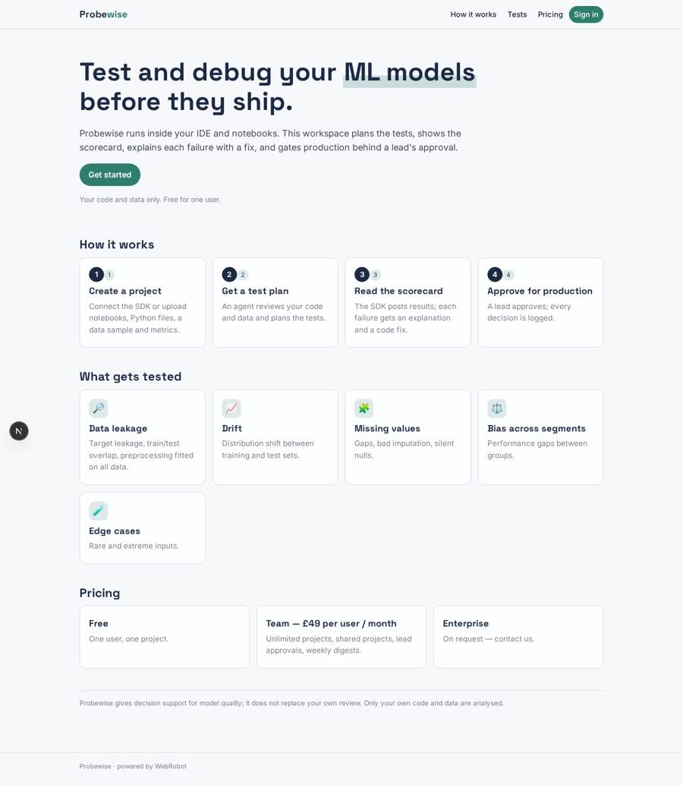
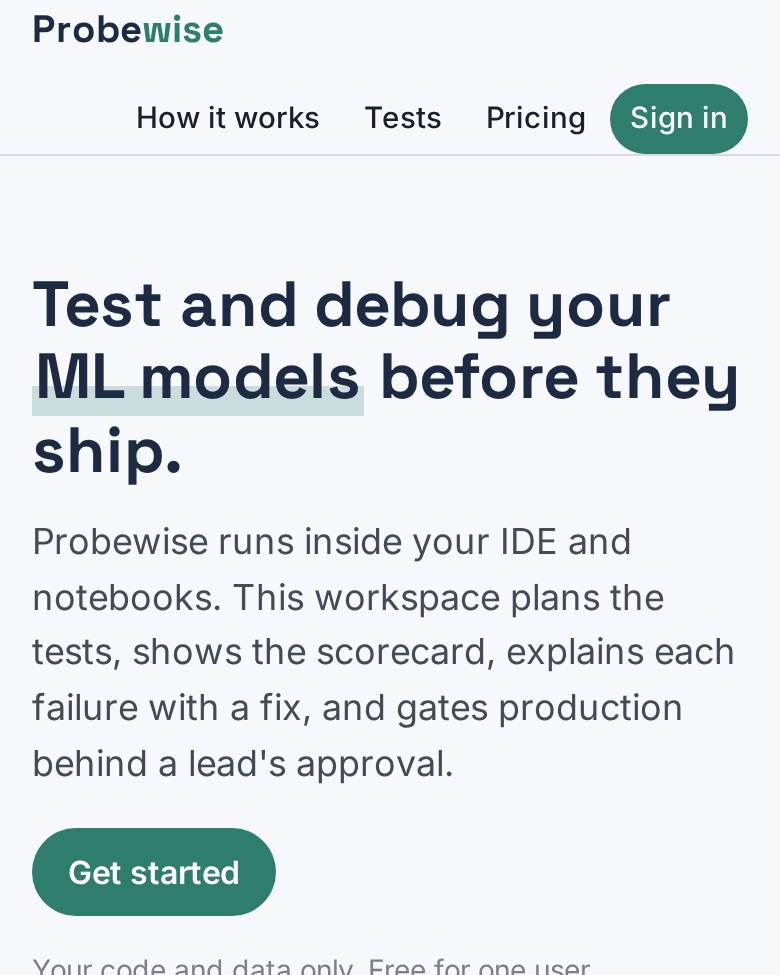
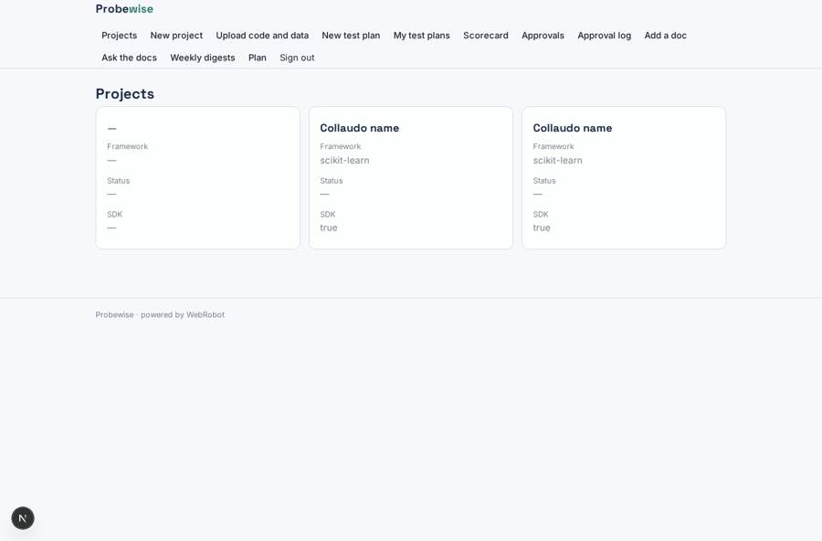
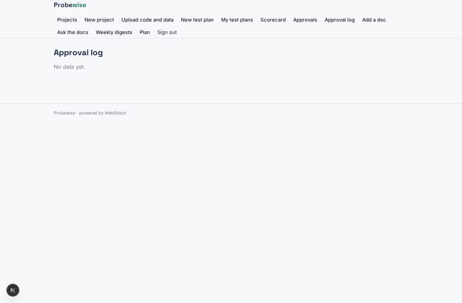
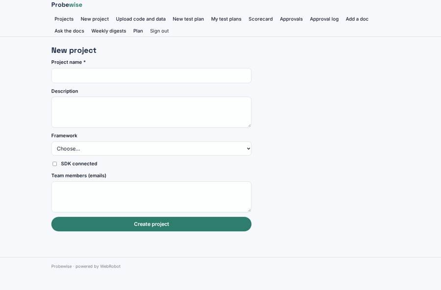
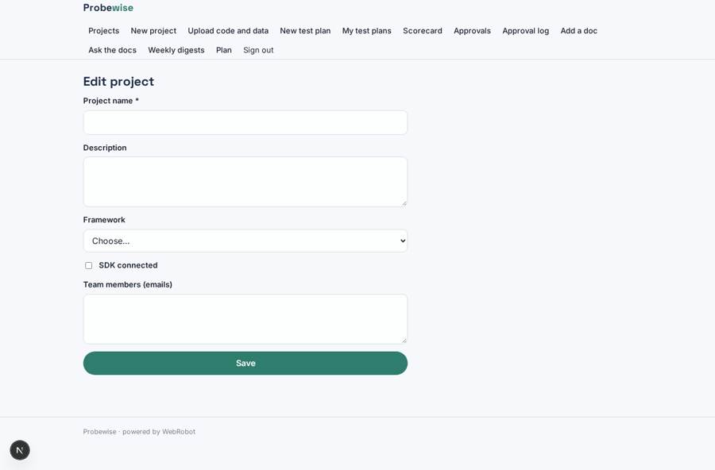

# Probewise

_Test and debug your ML models and pipelines, with a copilot that explains every failure._

**Sector:** Data, media, cyber, devtools · **Manifest:** valid (schema + runtime contract) · **Functional test:** passed (24 checks passed)

## Description given to the app builder

We need an app called Probewise, a copilot that helps data scientists test and debug machine-learning models and pipelines. The real product runs inside the data scientist's IDE and notebooks as an SDK and executes tests on their own models; that SDK and local execution are ours, and I need the web workspace around it. A data scientist signs up, creates a project and either connects the SDK or uploads notebooks, Python files, a sample of training data and model metrics. An agent reviews the code and data and produces a test plan: data leakage, drift between training and test sets, missing values, bias across segments, and performance on edge cases. The SDK runs the tests and posts results back; the app shows them as a scorecard with pass, warn or fail, and the agent explains each failure and suggests a fix with code. A lead must approve a model before it is marked ready for production, and each approval is logged. A RAG assistant answers questions using the team's own docs. Weekly emails summarise open issues per project. Roles: admin, data scientist, reviewer. Pricing: free for one user, team £49 per user a month, enterprise on request. English only; customer code and data only.

## Navigation recording

Signed in as the app's admin, the recorder opened 7 menu page(s): Projects, New project, Upload code and data, New test plan, My test plans, Scorecard, Approvals.
- agent run did not open: new_plan: the run did not open

Empty data pages are mostly expected on the local runtime: agents are mocked there, so the collections they fill stay empty.

## Features not expressible today (spec.extensions)

- **per_seat_billing**: Team plan is £49 per user per month; per-seat counting, the free single-user limit and the Enterprise on-request tier are handled outside the manifest (contact sales).
- **sdk_token**: The SDK authenticates to the results webhook with the app's hook secret; mapping each posted result to its owner and sharing results with project members need a per-user SDK token, not yet available.
- **python_uploads**: Python files cannot be uploaded with a .py extension yet: rename to .txt, or paste the code.

## Screenshots (interpretive runtime, test data)

### home-anon

### home-mobile

### projects

### audit

### new_project

### edit_project

