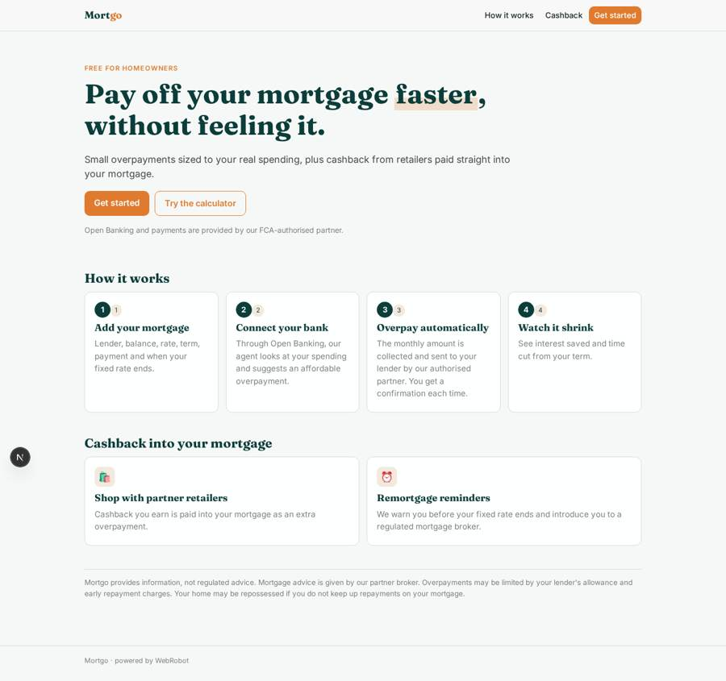
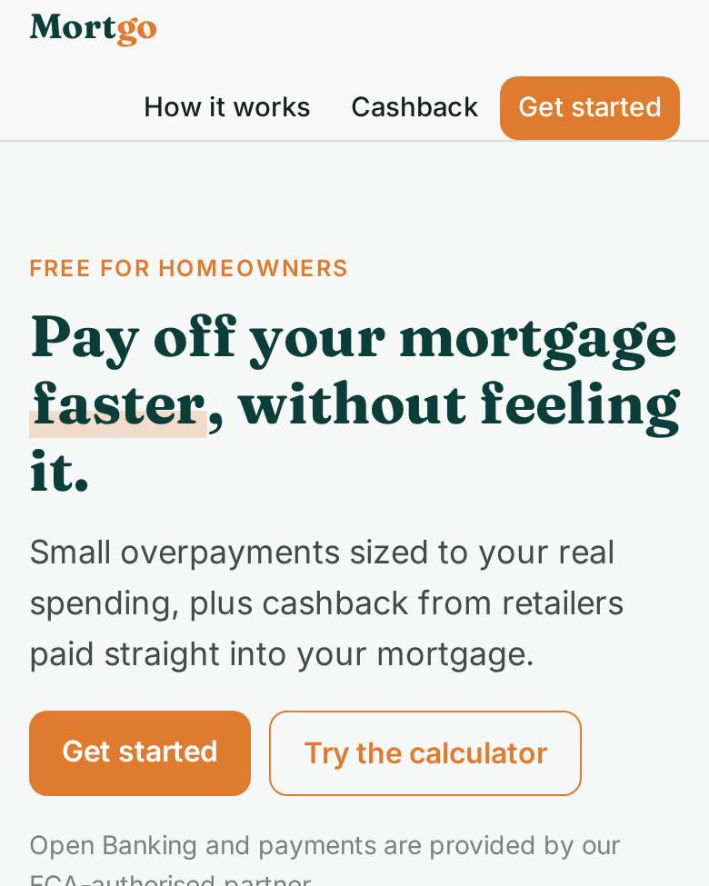
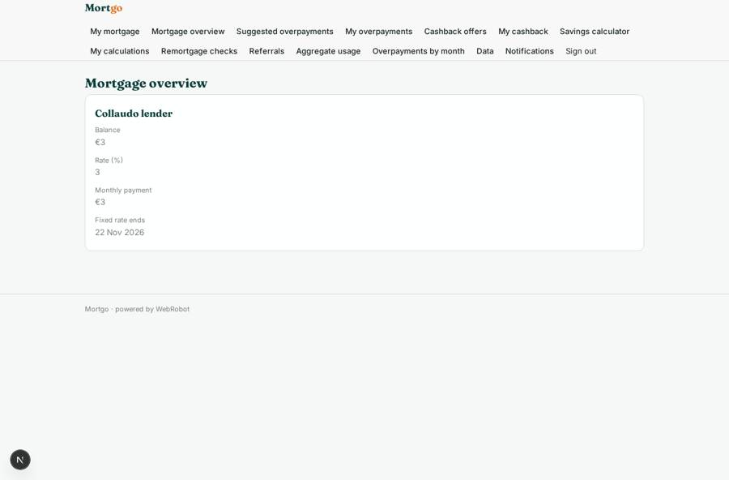
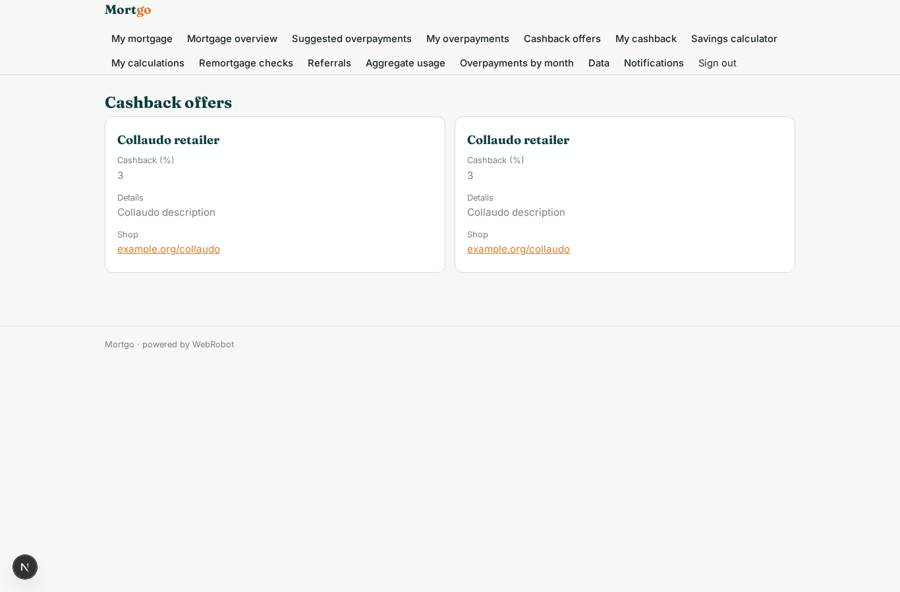
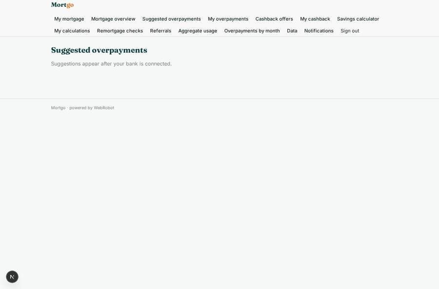
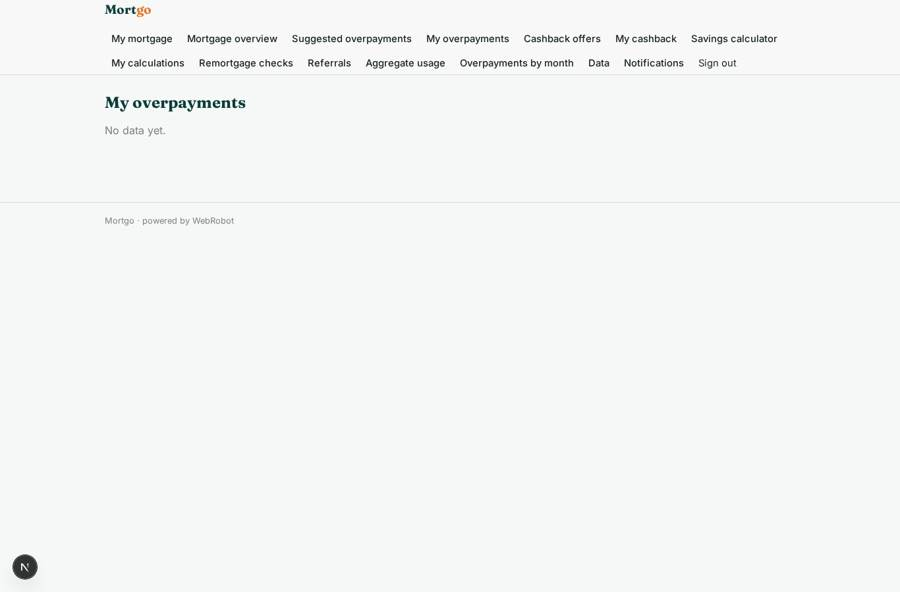

# Mortgo

_Pay off your mortgage faster with small overpayments and cashback._

**Sector:** Fintech, proptech, insurtech · **Manifest:** valid (schema + runtime contract) · **Functional test:** 1 failure(s) (14 checks passed)

## Description given to the app builder

I want Mortgo, an app that helps homeowners pay off their mortgage faster through small overpayments and cashback. The Open Banking connection, the payment initiation to lenders and any FCA permissions are with our authorised partner; I need the software around it. Users sign up in a mobile app and add their mortgage with a form: lender, balance, rate, term, monthly payment, fixed-rate end date, overpayment allowance. They connect their bank account through Open Banking, and an agent analyses spending to suggest an affordable monthly overpayment, collected automatically and sent to the lender through the partner. Users earn cashback from partner retailers, which is also paid into the mortgage. A calculator shows interest saved and time cut from the term, using Bank of England rates for context. Before the fixed rate ends the app sends reminders and compares remortgage options, referring users to a regulated mortgage broker partner for advice. Push and email notifications confirm each overpayment and progress. Admins manage retailer offers and see aggregate usage. Roles: user, admin, partner broker. Pricing: free for users; revenue from retailer commissions and broker referral fees. English.

## Functional test: what did not pass

- **trigger has its effect** (trigger referral_new): notify expected after a referrals record, nothing seen (outbox 0, last: {}); log: []

## Navigation recording

Signed in as the app's admin, the recorder opened 7 menu page(s): My mortgage, Mortgage overview, Suggested overpayments, My overpayments, Cashback offers, My cashback, Savings calculator.
- data page empty: overpayments (table)
- data page empty: my_cashback (table)
- form not sent: calculator: slots are not available on this runtime

Empty data pages are mostly expected on the local runtime: agents are mocked there, so the collections they fill stay empty.

## Features not expressible today (spec.extensions)

- **open_banking_partner**: Bank connection (Open Banking consent), payment initiation and collection of overpayments, and the FCA permissions are provided by the authorised partner. The partner must POST spending summaries, overpayment results and cashback events to the three webhook triggers, with the user's email so each record is attached to the right account. The in-app bank connection screen and the user confirming each suggested overpayment are hand-built against the partner's API.
- **broker_fees**: Retailer commissions and broker referral fees are settled outside the app with the partners; the app only records referrals and cashback.

## Screenshots (interpretive runtime, test data)

### home-anon

### home-mobile

### my_mortgages

### offers_view

### plan

### overpayments

