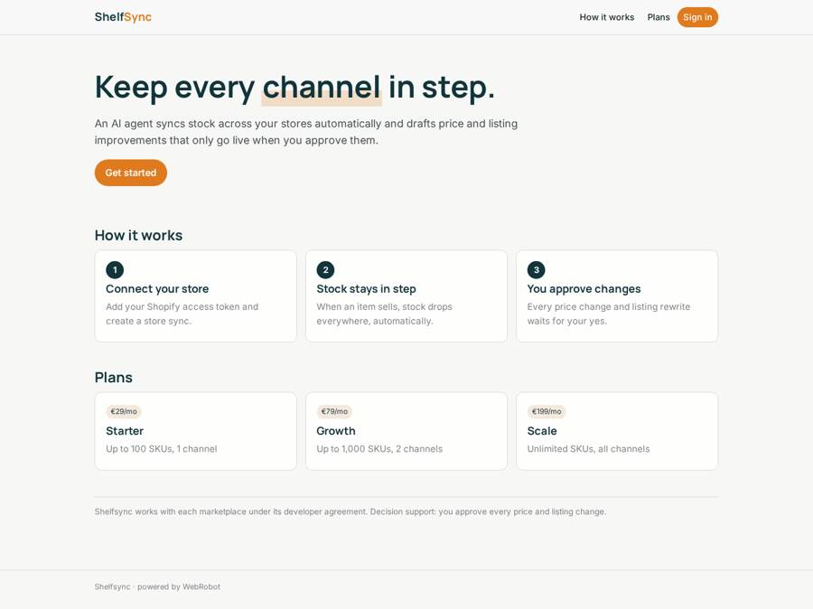
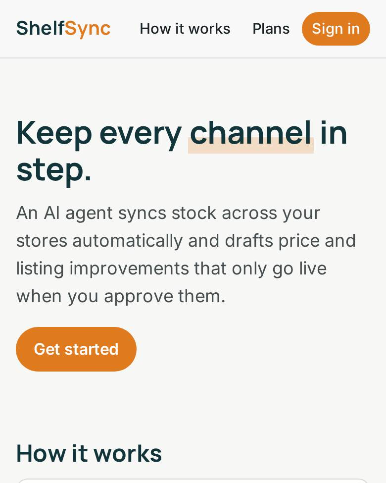
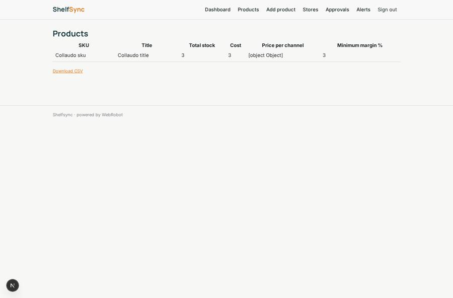
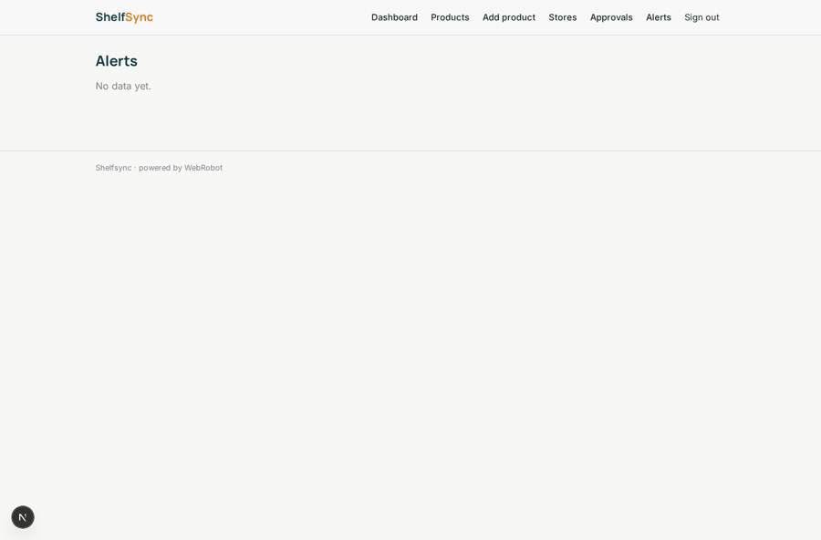
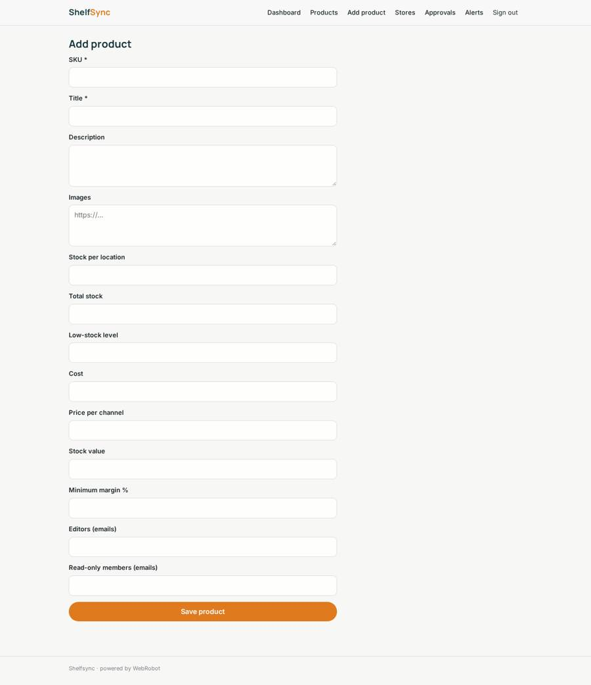
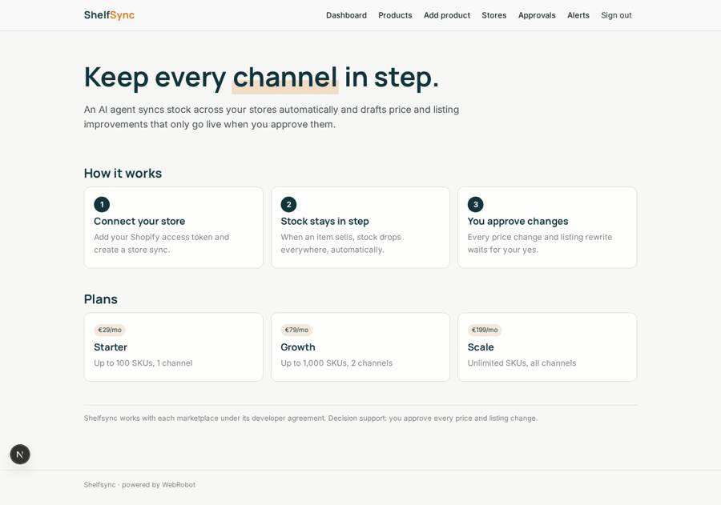

# Shelfsync

_Inventory, listings and prices in step across Shopify, Amazon and Etsy._

**Sector:** Consumer, travel, retail · **Manifest:** valid (schema + runtime contract) · **Functional test:** passed (11 checks passed)

## Description given to the app builder

We need an app called Shelfsync where an AI agent keeps a merchant's inventory, listings and prices in step across Shopify, Amazon and Etsy. Merchants sign up and connect each store with OAuth (Shopify, Amazon SP-API, Etsy), under each marketplace's developer agreement. The app keeps a product collection per organisation: SKU, title, description, images, stock per location, cost, price per channel and minimum margin. Scheduled monitors pull orders and stock every 15 minutes; when an item sells on one channel the agent reduces stock on the others. The agent also drafts listing improvements and price changes based on margin rules and the merchant's own sales history; every price change and every listing rewrite waits for the merchant's approval, except stock updates, which are automatic. Alerts by email for low stock, failed syncs and listings suppressed by a marketplace. Team members can be read-only or editors; merchants see only their own store; admins see all. Dashboards: sales per channel, stock value, sync errors, approved changes history. Pricing: monthly plans by number of SKUs and channels. English.

## Navigation recording

Signed in as the app's admin, the recorder opened 6 menu page(s): Dashboard, Products, Add product, Stores, Approvals, Alerts.
- data page empty: alerts (table)

Empty data pages are mostly expected on the local runtime: agents are mocked there, so the collections they fill stay empty.

## Features not expressible today (spec.extensions)

- **oauth_channels**: OAuth sign-in is not available yet: Shopify is connected with the merchant's Admin API access token. Amazon SP-API and Etsy need OAuth and cannot be connected yet.
- **sync_frequency**: Monitors run hourly (the minimum supported); a 15-minute cycle is not available.
- **channel_quota**: Plan limits on the number of channels are described in the plans but only the SKU quota is enforced.
- **team_roles**: Team members are added by email in the editors and viewers lists of each product; there is no invitation screen yet.

## Screenshots (interpretive runtime, test data)

### home-anon

### home-mobile

### products_list

### alerts

### product_form

### home

