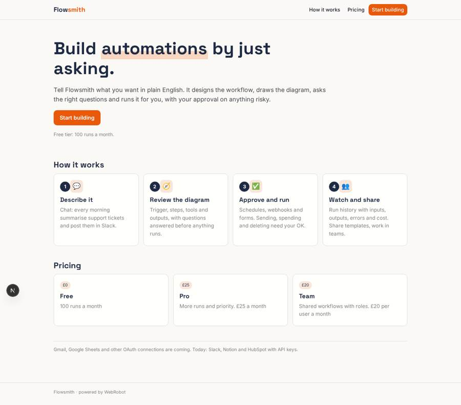
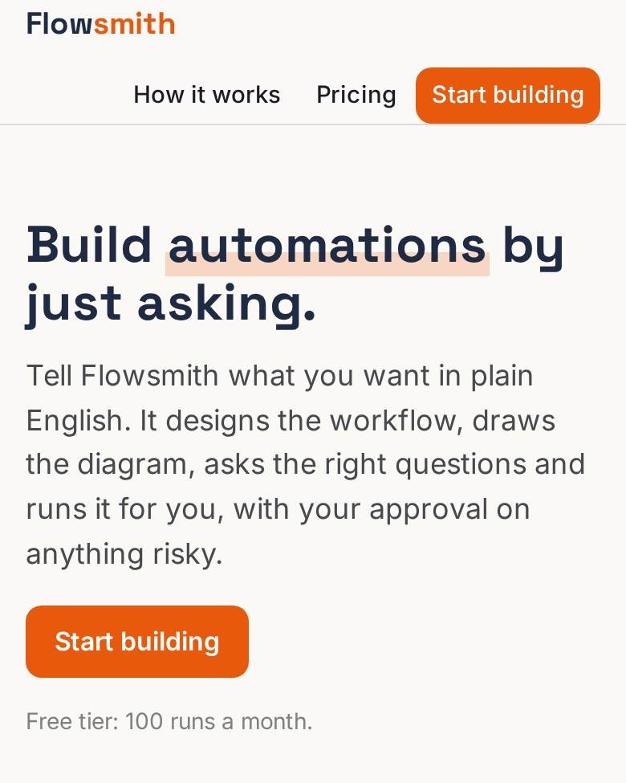
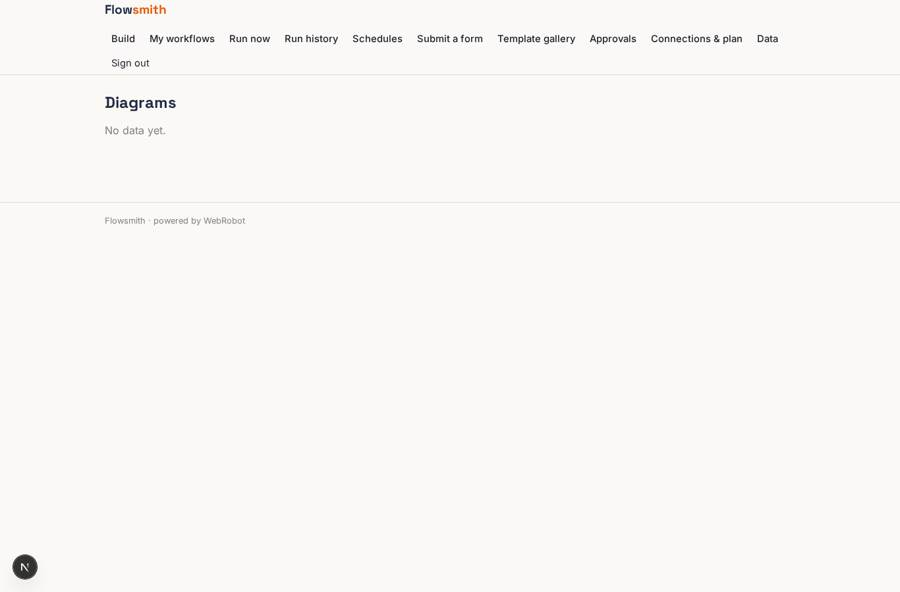
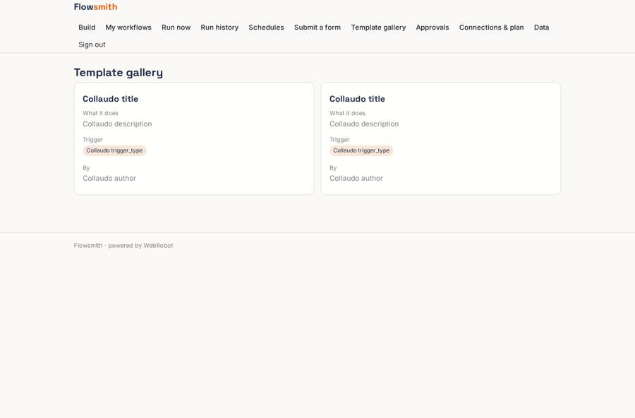
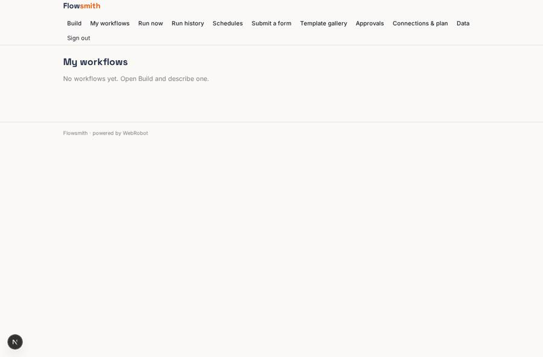

# Flowsmith

_Build automations and AI agents by chatting in plain English._

**Sector:** Data, media, cyber, devtools · **Manifest:** valid (schema + runtime contract) · **Functional test:** 2 failure(s) (13 checks passed)

## Description given to the app builder

We need an app called Flowsmith that lets people build automations and AI agents by chatting in plain English. A user signs up and describes what they want, for example every morning summarise new support emails and post the summary in Slack. A builder agent turns the request into a workflow with trigger, steps, tools and outputs, shows it as a diagram, and asks clarifying questions. The real product connects to Gmail, Slack, Notion, Google Sheets, HubSpot and dozens of other services through OAuth per user; I want those connections, plus generic HTTP and MCP tools with API keys. Triggers include schedules, webhooks, incoming emails and form submissions. Steps that send messages externally, spend money or delete data require the user's approval the first time, or every time if the user chooses. Each workflow has run history with inputs, outputs, errors and cost, and failure alerts by email. Users can share workflows as templates in a gallery and clone templates from others. Teams share workflows and connections with roles: owner, editor, runner. Pricing: free tier with 100 runs a month, Pro £25 a month, Team £20 per user. English interface.

## Functional test: what did not pass

- **run started and report ready** (view run): required workflow (options from collection:workflows) has no option
- **template instance created and run** (template scheduled_workflow): create: 400 workflow is required

## Navigation recording

Signed in as the app's admin, the recorder opened 7 menu page(s): Build, My workflows, Run now, Run history, Schedules, Submit a form, Template gallery.
- agent run did not open: run: the run did not open

Empty data pages are mostly expected on the local runtime: agents are mocked there, so the collections they fill stay empty.

## Features not expressible today (spec.extensions)

- **oauth_connections**: Per-user OAuth for Gmail, Google Sheets, Slack, Notion, HubSpot and others is not available yet. Slack, Notion and HubSpot use API keys for now.
- **generic_http_mcp_tools**: User-defined HTTP and MCP tools with their own API keys (arbitrary hosts) are not available yet; only the listed hosts can be called.
- **incoming_email_trigger**: Triggers from incoming emails are not available yet. Webhooks, forms and schedules are.
- **team_roles**: Owner, editor and runner roles are modelled per workflow with the members and runners lists. Shared team connections and per-user billing seats need a custom team layer.
- **visual_diagram**: The diagram is shown as text arrows; an interactive node diagram needs a custom component.

## Screenshots (interpretive runtime, test data)

### home-anon

### home-mobile

### diagram

### gallery

### workflows

### history

