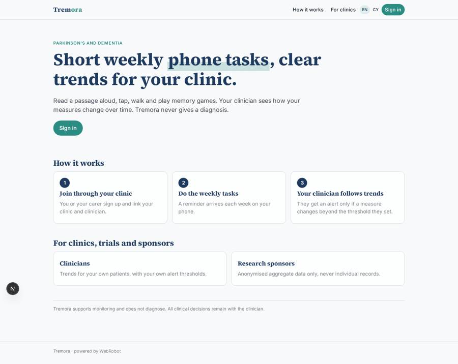
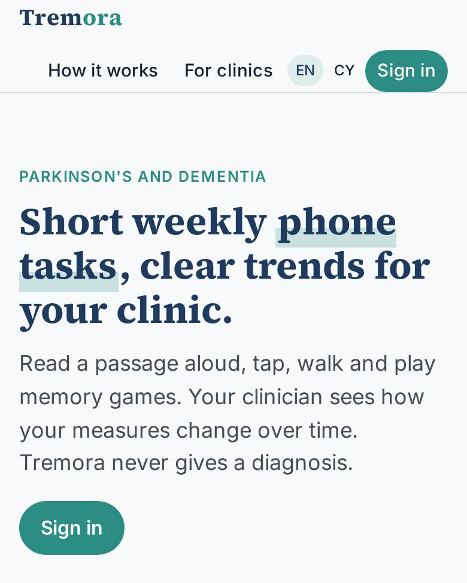
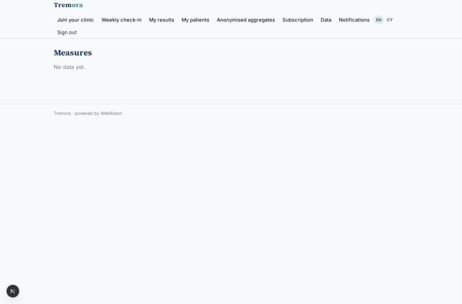
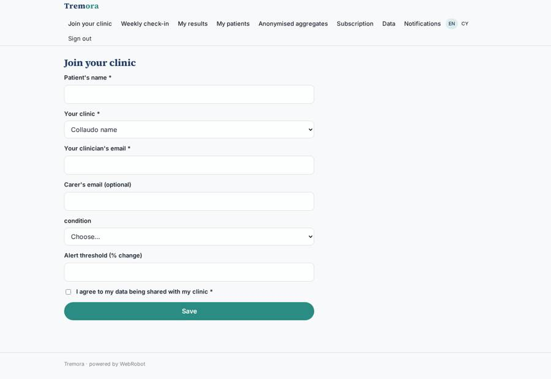
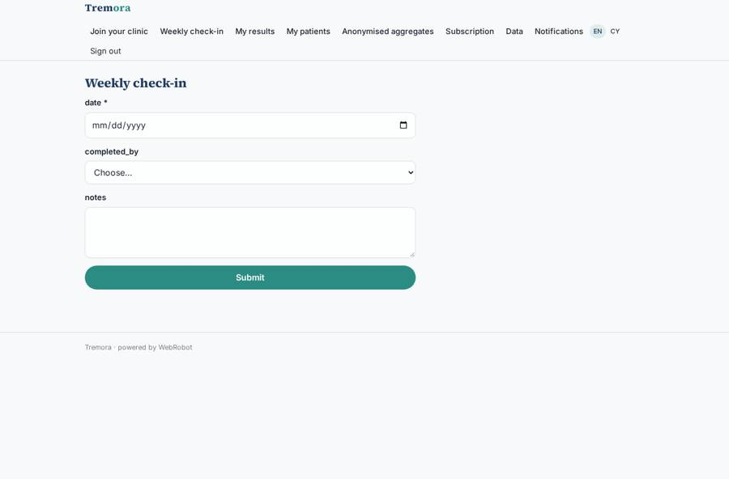

# Tremora

_Weekly phone-based speech, movement and cognition measures, with trends for your clinician._

**Sector:** Sanità, istruzione, energia, gov · **Manifest:** valid (schema + runtime contract) · **Functional test:** passed (18 checks passed)

## Description given to the app builder

We need Tremora, a smartphone assessment of speech, movement and cognition for people living with Parkinson's and dementia. Patients, or a carer on their behalf, sign up through their clinic and do short tasks on the phone: reading a passage aloud, a finger-tapping test, a walking test with the phone in a pocket, and memory and attention games. We need audio and motion-sensor signal processing to compute the measures, and those algorithms need clinical validation and MHRA registration as software as a medical device with UKCA marking; the validation studies, clinical datasets under licence and the regulatory file are ours, and I need the software around them. Clinicians at participating clinics see their own patients' trends over time on a dashboard, with alerts when a measure changes beyond a threshold they set; the app never gives a diagnosis and all clinical decisions stay with the clinician. Patients get reminders to do weekly tasks by push notification, and carers can be linked to a patient. Research sponsors can see only anonymised aggregate data. Priced per patient per month to clinics and trials. English first, then Welsh.

## Navigation recording

Signed in as the app's admin, the recorder opened 6 menu page(s): Join your clinic, Weekly check-in, My results, My patients, Anonymised aggregates, Subscription.
- data page empty: my_results (table)

Empty data pages are mostly expected on the local runtime: agents are mocked there, so the collections they fill stay empty.

## Features not expressible today (spec.extensions)

- **sensor_tasks**: Audio recording (reading aloud), motion-sensor capture (finger tapping, pocket walking test) and the memory and attention games are not available as built-in phone capabilities yet. They need a dedicated capture module in the phone shell, outside this manifest.
- **signal_processing_samd**: The audio and motion signal-processing algorithms are your validated software as a medical device (MHRA registration, UKCA marking, clinical datasets under licence). They stay outside the app: the service posts the computed measures to the webhook /api/hooks/new_measure, one record per measure with patient_email, clinician_email, carer_email, task, measure, value, date and a measure_id, and the app only stores and displays them. The webhook must attribute each record to the patient's user account; confirm this at integration.
- **per_patient_billing**: Per patient per month pricing is not metered automatically. Plans here are placeholder flat tiers; per-active-patient invoicing needs a custom billing extension.
- **carer_on_behalf**: Carers see and add to a linked patient through the carer_email on the patient record. Acting fully on the patient's account on their behalf, and DPA/clinical governance (DCB0129 and DTAC) must be agreed in the regulatory file.
- **welsh_review**: Welsh text is provided for main screens as a first draft and should be reviewed by a qualified Welsh translator, then extended to all remaining strings.

## Screenshots (interpretive runtime, test data)

### home-anon

### home-mobile

### my_results

### clinician_measures

### register

### checkin

