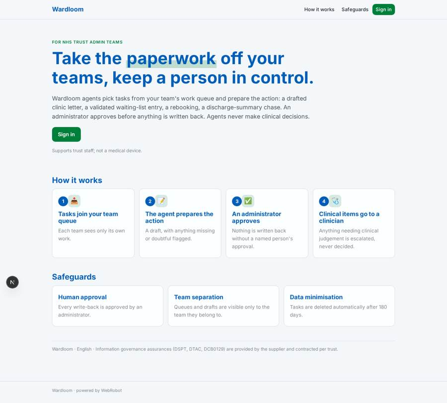
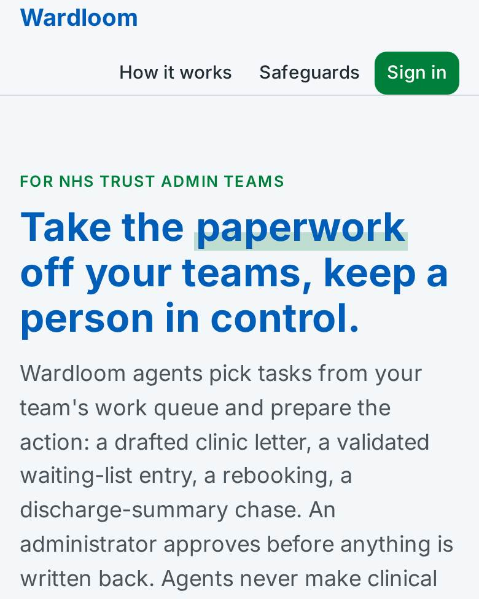
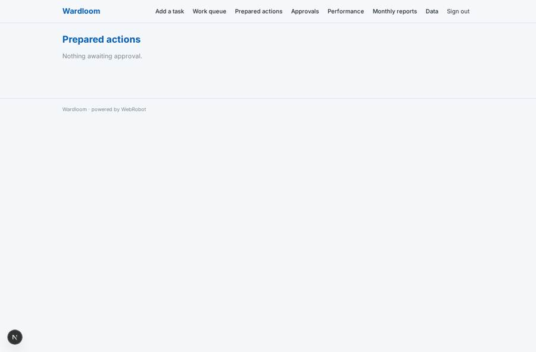
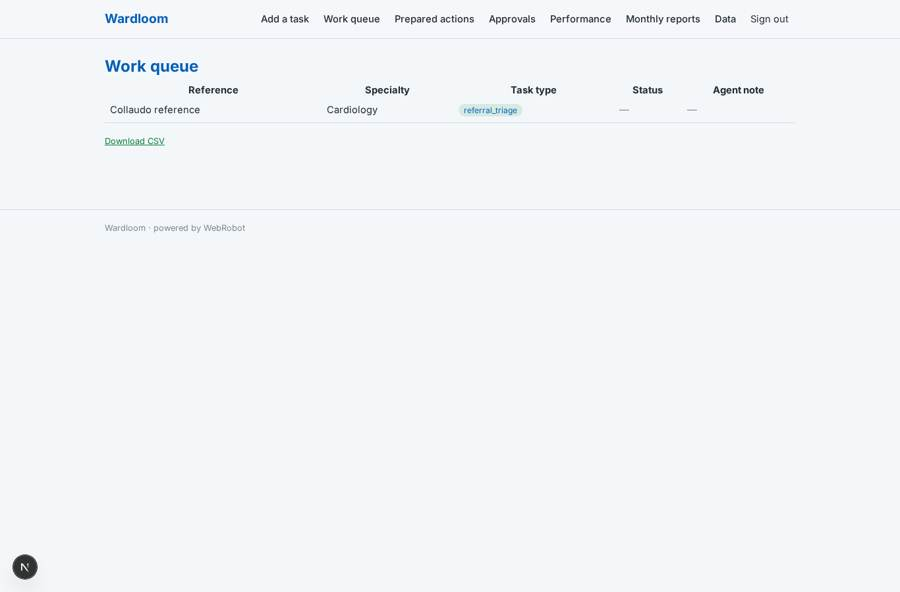
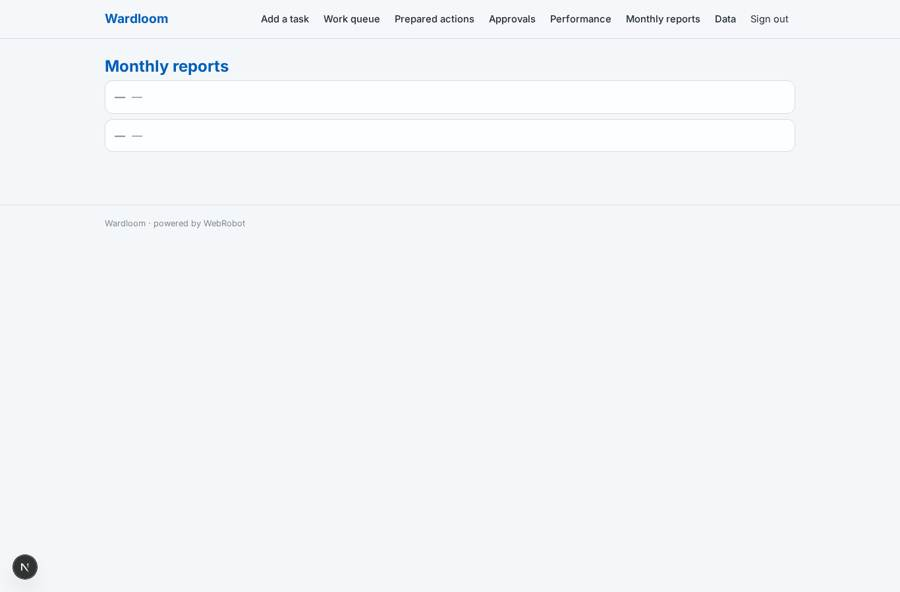
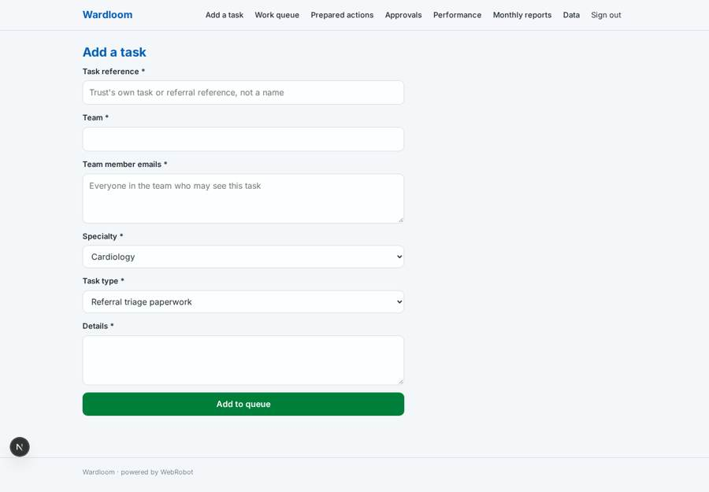

# Wardloom

_Agents that take the admin off NHS trust staff, with an administrator approving every action._

**Sector:** Sanità, istruzione, energia, gov · **Manifest:** valid (schema + runtime contract) · **Functional test:** passed (10 checks passed)

## Description given to the app builder

We need Wardloom, AI agents that take administrative work off NHS trust staff: referral triage paperwork, clinic letter typing and sending, waiting-list validation, appointment booking and rebooking, discharge-summary chasing. The real product runs inside the trust's electronic patient record and patient administration system, so we need integrations with those systems (HL7/FHIR interfaces and the supplier APIs), plus the information governance a trust demands: DSPT submission, DTAC, a DCB0129 clinical safety case and a named clinical safety officer. Those assurances and the procurement are ours; I need the software around them. Trust admin staff and team leads sign in; each team sees only its own work queues. Agents pick tasks from a queue, prepare the action (for example a validated waiting-list entry or a drafted letter), and an administrator approves before anything is written back to the record. No clinical decisions are made by agents; anything clinical goes to a clinician. Dashboards show tasks completed, time saved and backlog per specialty, using NHS England open data on waiting times for context. Monthly report emailed to the trust digital lead. Priced per trust by annual contract. English only.

## Functional test: what did not pass

- **saved record shown where its collection is read** (view reports): a record was saved in monthly_reports (by admin-data, admin-data) but the page does not show it (as admin) _(warning)_

## Navigation recording

Signed in as the app's admin, the recorder opened 6 menu page(s): Add a task, Work queue, Prepared actions, Approvals, Performance, Monthly reports.
No issue found.

Empty data pages are mostly expected on the local runtime: agents are mocked there, so the collections they fill stay empty.

## Features not expressible today (spec.extensions)

- **epr_pas_integration**: Reading from and writing back to the trust's electronic patient record and patient administration system (HL7/FHIR interfaces, supplier APIs) is not available in this app. Tasks are added through the intake form or CSV, and approved actions are written back by the trust's integration or by staff. A bespoke interface is needed.
- **information_governance**: DSPT submission, DTAC, DCB0129 clinical safety case and the named clinical safety officer are the supplier's own assurances outside the software. The app supports them with team-restricted records, human approval, escalation of clinical items and 180-day retention.
- **annual_contract_billing**: Pricing is per trust by annual contract, invoiced outside the app. The app is free to use inside a contracted trust, with no in-app payments.
- **rtt_open_data_load**: NHS England waiting-time data is published as spreadsheets, not an API. Admins load it as a CSV on the data page (rtt_context); there is no automatic refresh.
- **multi_team_roles**: Team separation is by the member email list on each task. A team-lead role with automatic team management, and a clinician hand-off queue, are not available yet.

## Screenshots (interpretive runtime, test data)

### home-anon

### home-mobile

### drafts

### queue

### reports

### intake

