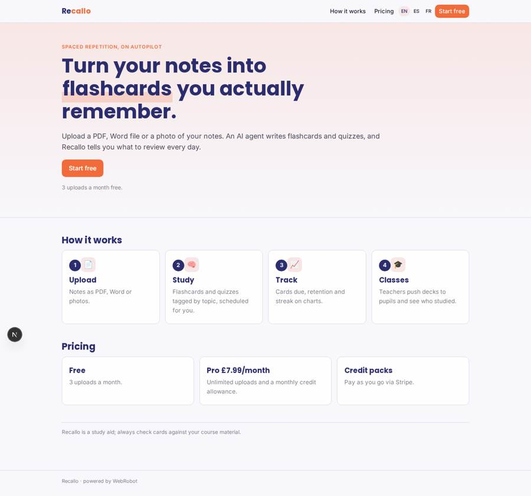
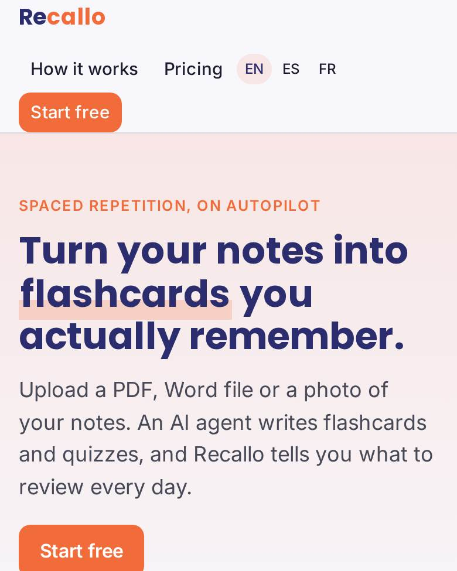
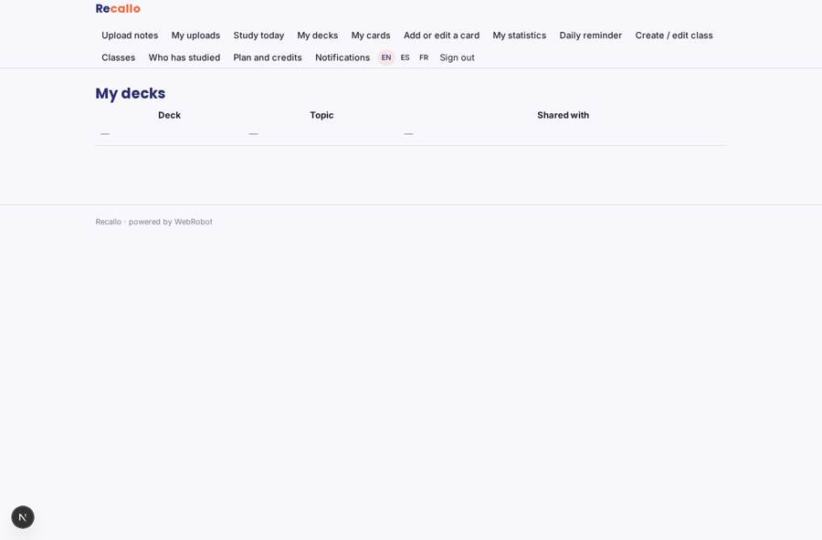
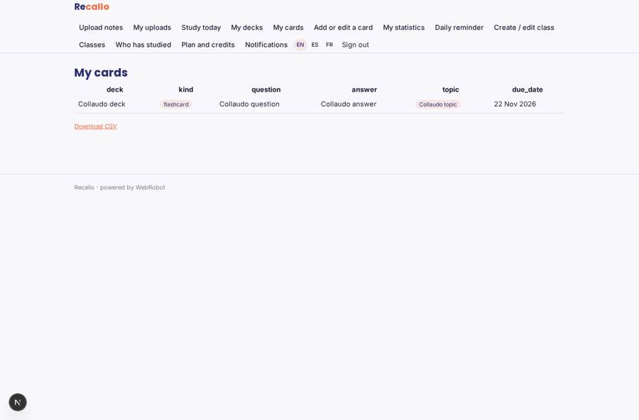
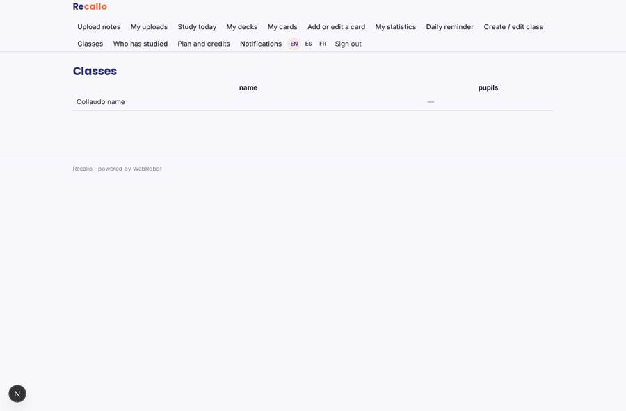
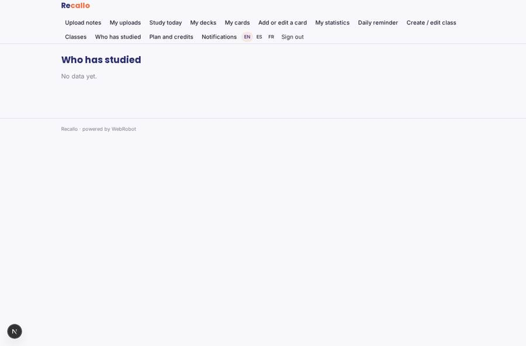

# Recallo

_Turn your notes into flashcards and quizzes you actually remember._

**Sector:** Sanità, istruzione, energia, gov · **Manifest:** valid (schema + runtime contract) · **Functional test:** passed (21 checks passed)

## Description given to the app builder

We need Recallo, a study app that turns notes into flashcards and quizzes with spaced repetition. Students sign up and upload notes as PDF, Word, slides or photos, and later we want lecture videos and audio recordings as input too. An agent extracts the text, creates flashcards and multiple-choice quizzes, and tags them by topic; the student can edit, delete or add cards. A spaced-repetition scheduler decides what to review each day and sends a reminder notification at the student's chosen time. Students can share decks with classmates through a link and study together in a timed quiz. Each student sees their own decks and statistics: cards due, retention rate and streak, on charts. Pricing: free with a limit of three uploads a month; paid plans at £7.99 a month or credit packs through Stripe. Mobile app and web, in English, Spanish and FrenchTeachers can also create a class space and push decks to pupils, seeing who has studied them. .

## Functional test: what did not pass

- **saved record shown where its collection is read** (view decks): a record was saved in decks (by user) but the page does not show it (as user) _(warning)_

## Navigation recording

Signed in as the app's admin, the recorder opened 7 menu page(s): Upload notes, My uploads, Study today, My decks, My cards, Add or edit a card, My statistics.
- agent run did not open: new_deck: the run did not open
- data page empty: uploads (history)

Empty data pages are mostly expected on the local runtime: agents are mocked there, so the collections they fill stay empty.

## Features not expressible today (spec.extensions)

- **link_sharing**: Sharing a deck through a link that classmates open to join is not available yet: decks are shared by adding classmates' or pupils' emails (share_deck view). Changing a deck's members does not update already-created cards; share before generating, or re-share.
- **timed_group_quiz**: A live timed quiz played together with classmates (shared timer and leaderboard) is not available yet; each student takes the quiz on their own.
- **media_input**: Lecture video and audio recordings as input (transcription) are planned for later. Slides must be exported to PDF for now.
- **teacher_assignment_propagation**: Pushing a deck to a whole class copies the pupils' emails from the class when the deck is built; teacher_email is typed by the teacher and not verified.

## Screenshots (interpretive runtime, test data)

### home-anon

### home-mobile

### decks

### cards

### classes

### class_progress

