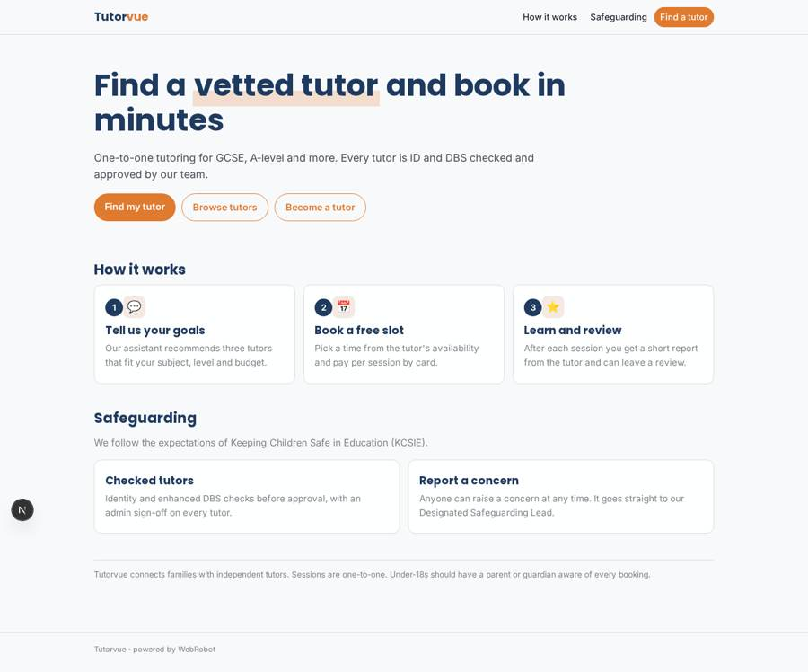
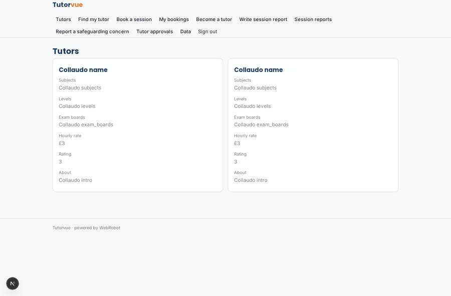
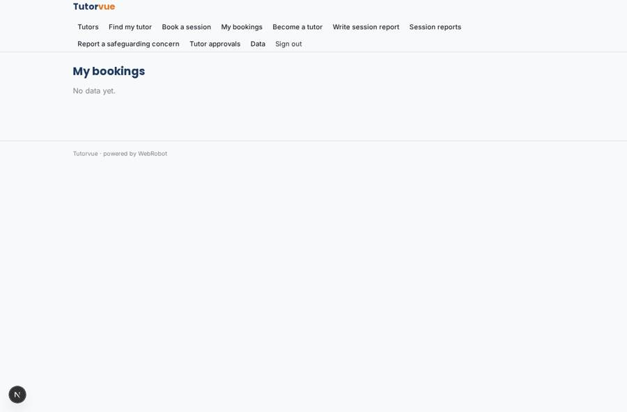
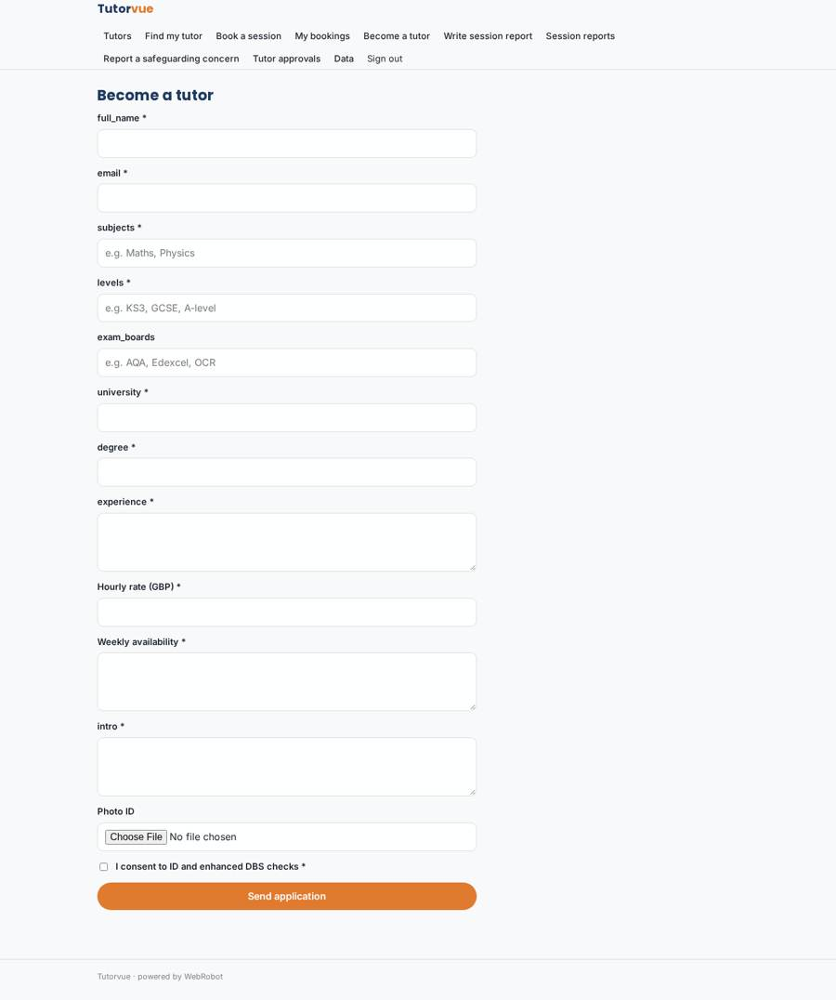
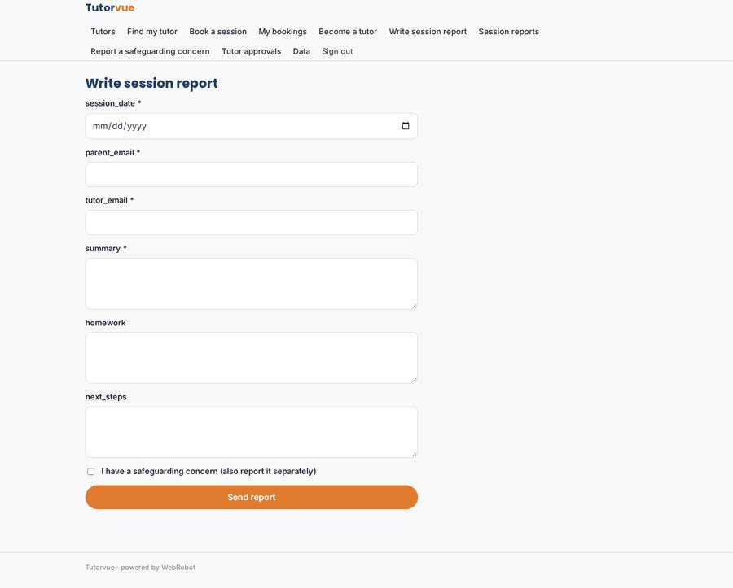

# Tutorvue

_Vetted one-to-one tutors, booked in minutes._

**Sector:** Sanità, istruzione, energia, gov · **Manifest:** valid (schema + runtime contract) · **Functional test:** passed (23 checks passed)

## Description given to the app builder

I want Tutorvue, a one-to-one tutoring marketplace. Tutors apply with a profile: subjects, levels, exam boards, university and degree, experience, hourly rate, availability slots and a short intro; we need ID and DBS checks through a third-party service before approval, and an admin approves each tutor. Parents or students search the tutor catalogue by subject, level, price and rating, and an assistant recommends three tutors that fit their goals. They book a session into a free slot and pay per session through Stripe; we keep a commission and pay tutors out weekly. Sessions happen by video with a shared whiteboard, which we need inside the app. After each session the tutor writes a short report, and the parent leaves a review. Email reminders the day before and an hour before each session. Tutors see only their bookings, parents only theirs, admins everything including disputes and refunds. Safeguarding follows KCSIE expectations. English only.

## Functional test: what did not pass

- **saved record shown where its collection is read** (view my_reports): a record was saved in session_reports (by admin) but the page does not show it (as user) _(warning)_

## Navigation recording

Signed in as the app's admin, the recorder opened 7 menu page(s): Tutors, Find my tutor, Book a session, My bookings, Become a tutor, Write session report, Session reports.
- data page empty: my_bookings (table)

Empty data pages are mostly expected on the local runtime: agents are mocked there, so the collections they fill stay empty.

## Features not expressible today (spec.extensions)

- **video_whiteboard**: Video calls with a shared whiteboard inside the app are not available yet. Interim: the booking confirmation carries the tutor's own meeting link; needs a custom integration.
- **id_dbs_checks**: ID and enhanced DBS checks by a third-party provider are not connectable yet. The admin runs them with the provider and records the result when deciding the tutor_approval; the application collects consent and photo ID.
- **hour_before_reminder**: The one-hour-before email reminder is not available: date reminders fire once a day. The day-before reminder is set up.
- **weekly_payouts_refunds**: Weekly tutor payouts and admin refunds through Stripe Connect need manual setup in Stripe. Per-session payment, the 15% commission and the seller list are declared in billing.
- **rating_aggregate**: Average rating on the catalogue: ratings are stored from reviews, but the tutors.rating figure is updated by the admins for now.
- **booking_tutor_link**: A booking is tied to its tutor by the tutor's email typed from the catalogue, so tutors see their own bookings. Filling it automatically from the chosen resource needs a custom step.

## Screenshots (interpretive runtime, test data)

### home-anon

### home-mobile

### catalogue

### my_bookings

### apply

### write_report

