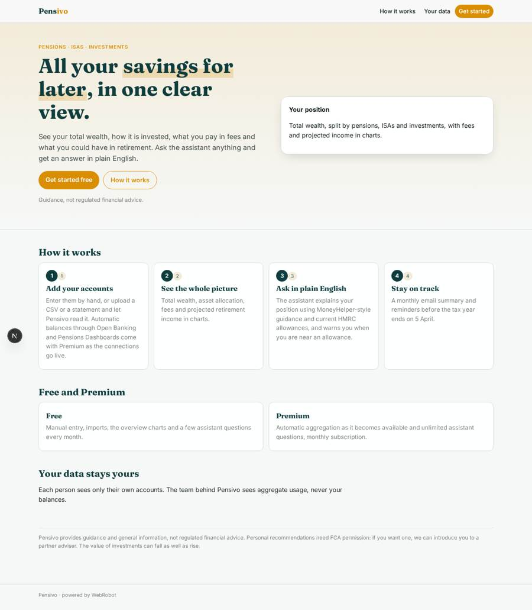
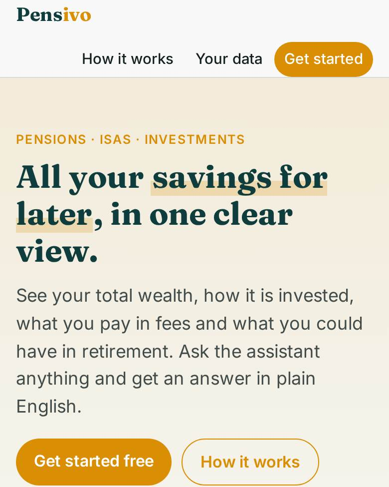
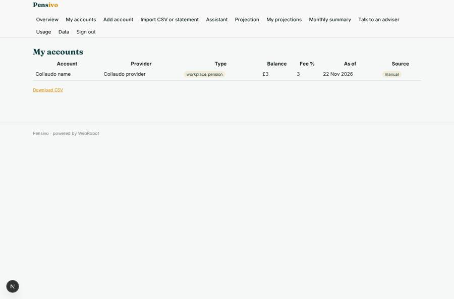
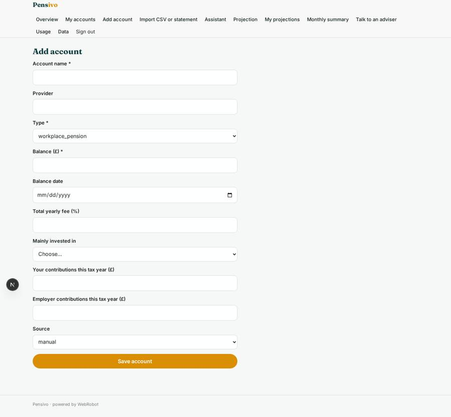
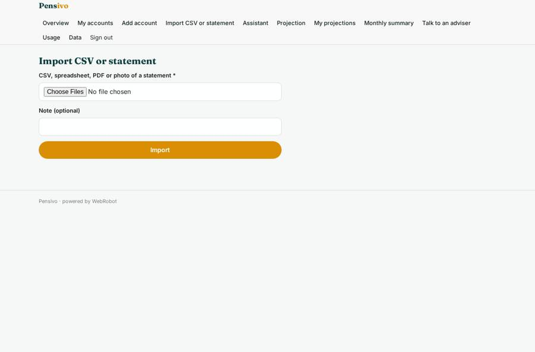
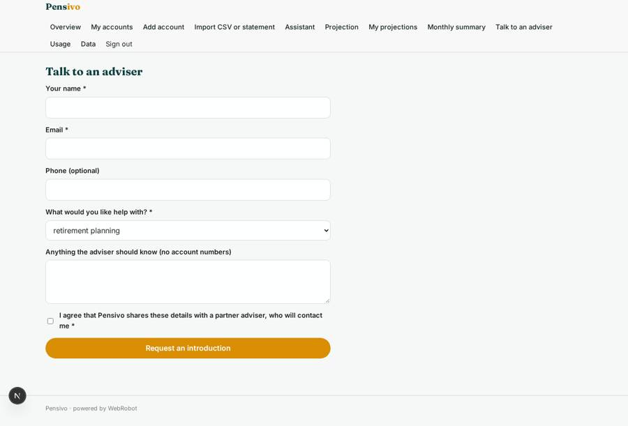

# Pensivo

_Your pensions, ISAs and investments in one place, explained in plain English._

**Sector:** Fintech, proptech, insurtech · **Manifest:** valid (schema + runtime contract) · **Functional test:** passed (24 checks passed)

## Description given to the app builder

We need Pensivo, a single view of a person's pensions, ISAs and investments with AI guidance. Individuals sign up and add their accounts; ideally balances come in automatically through an Open Banking and Open Finance aggregation partner and, once live, the Pensions Dashboards programme, but users can also enter holdings manually or upload a CSV or statement. The app shows total wealth, asset allocation, fees and projected retirement income in charts. A chat assistant explains the user's position in plain English, using MoneyHelper guidance and current HMRC ISA and pension allowances, warns when they are near the annual allowance and suggests questions to ask an adviser. It must give guidance, not regulated advice; personal recommendations would require FCA permission, so when a user asks what to do, the app offers a referral to a partner adviser instead. Users get a monthly email summary and reminders before the tax year end. Each user sees only their own data; the admin sees aggregate usage, never balances. Pricing: free tier with manual entry, premium monthly subscription with automatic aggregation and unlimited assistant questions. English.

## Navigation recording

Signed in as the app's admin, the recorder opened 7 menu page(s): Overview, My accounts, Add account, Import CSV or statement, Assistant, Projection, My projections.
- agent run did not open: projection: the run did not open

Empty data pages are mostly expected on the local runtime: agents are mocked there, so the collections they fill stay empty.

## Features not expressible today (spec.extensions)

- **open_banking_aggregation**: Automatic balances through an Open Banking / Open Finance aggregation partner need an OAuth consent flow, which is not available yet. Until then users enter holdings manually or import a CSV or statement; the accounts source field already has an 'aggregated' value for later.
- **pensions_dashboards**: Pensions Dashboards connection is not available yet; to add once the programme is live and a connection route exists.
- **premium_gating_of_aggregation**: Aggregation as a Premium-only feature has to be gated when the connection is built; today Premium unlocks unlimited assistant questions and higher import and projection quotas.
- **admin_balance_privacy**: Admins are meant to see aggregate usage only (the Usage page). The built-in admin data page can reach user collections, so restrict who holds the admin role and do not use it on accounts.
- **fca_permission**: The app gives guidance only. Personal recommendations are not made; users are referred to a partner adviser via the Adviser referral form. The referral partner agreement and compliance wording need legal review.
- **allowance_upkeep**: Admins must add each tax year's allowance figures (ISA, Lifetime ISA, annual allowance, MPAA, tax year end) on the data page; reminders and the assistant read them from there.

## Screenshots (interpretive runtime, test data)

### home-anon

### home-mobile

### accounts

### add_account

### import

### adviser_referral

