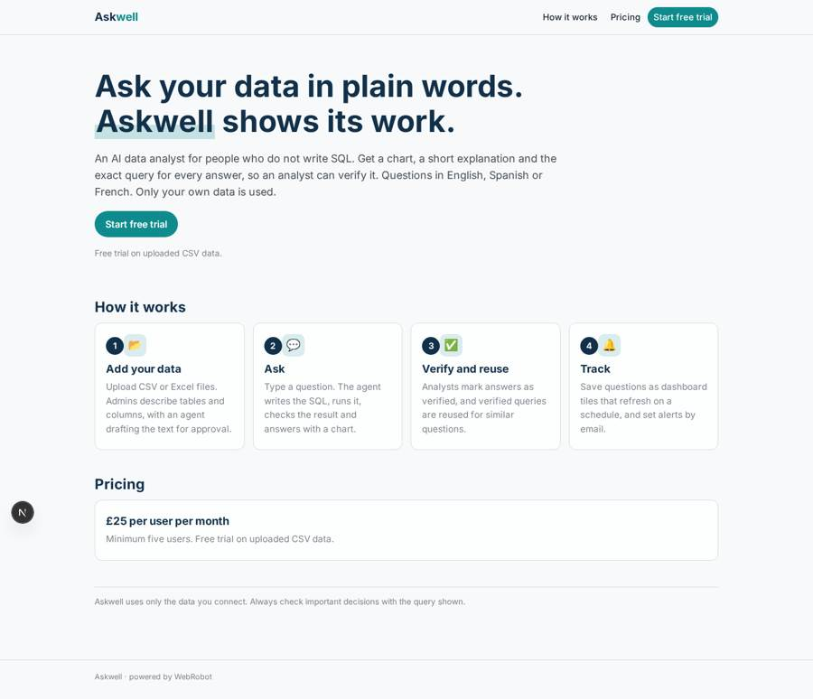
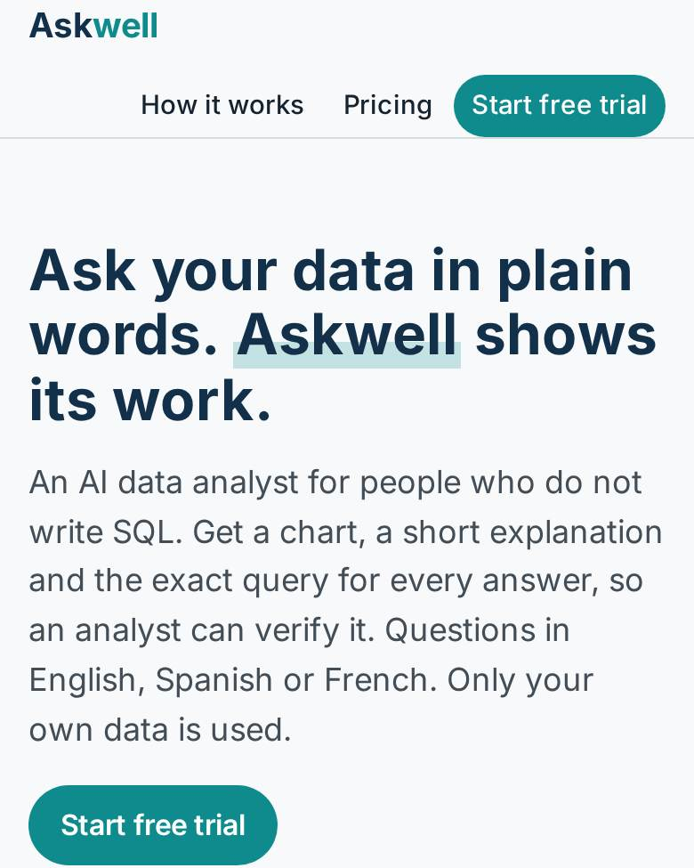
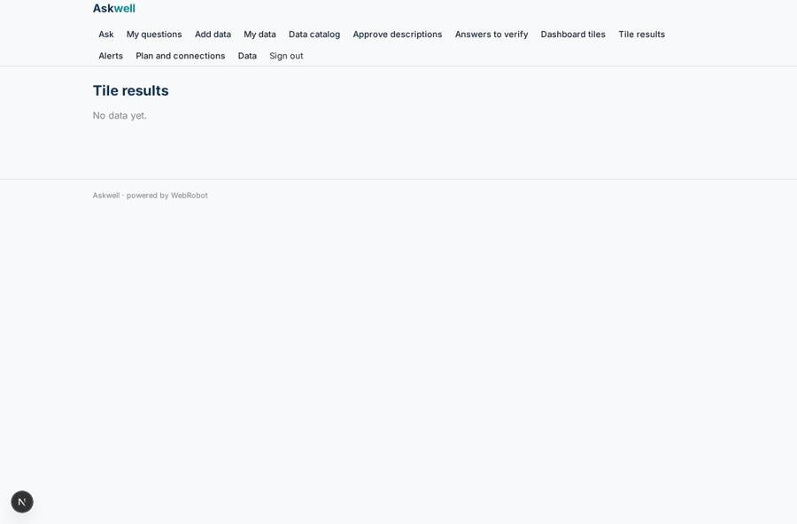
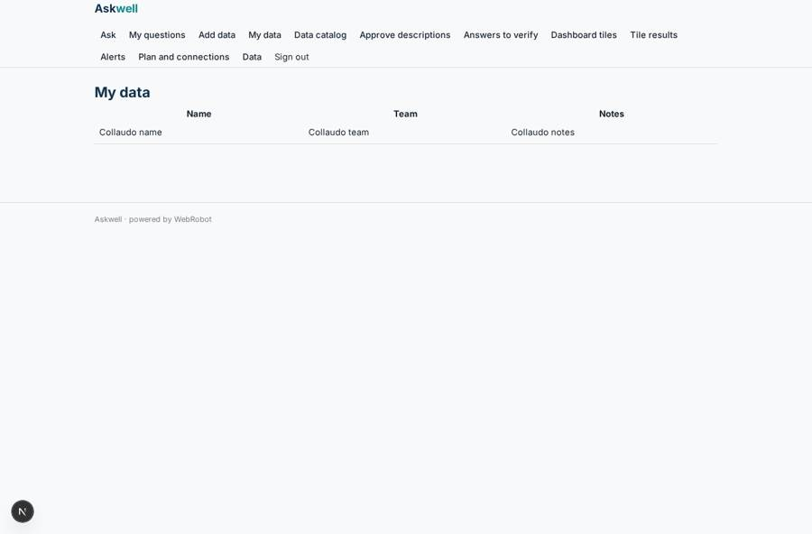
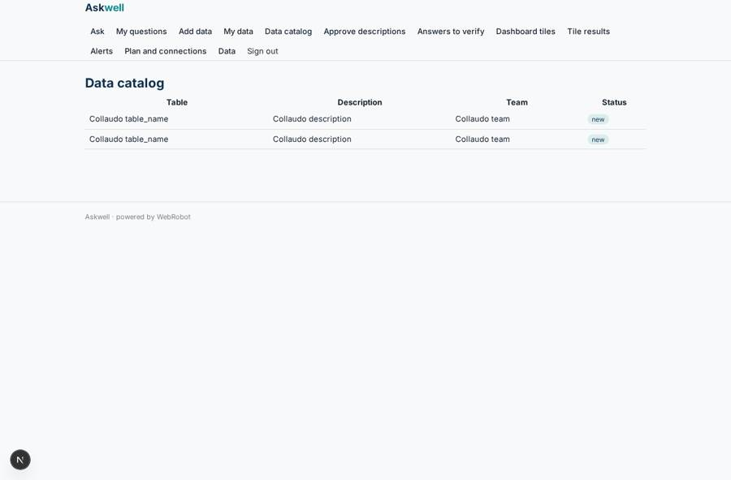
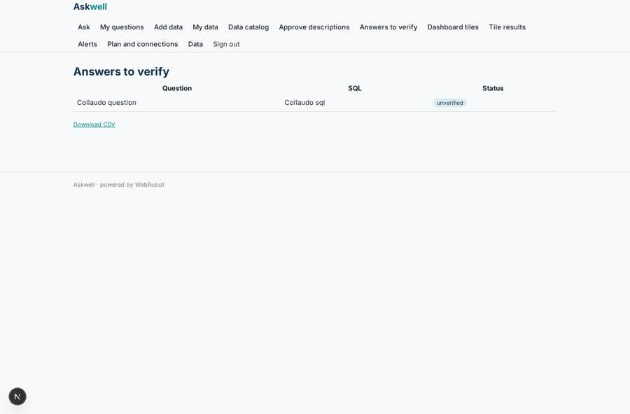

# Askwell

_Ask your data a question. Get a chart, an explanation and the SQL._

**Sector:** Data, media, cyber, devtools · **Manifest:** valid (schema + runtime contract) · **Functional test:** passed (24 checks passed)

## Description given to the app builder

I want an app called Askwell, an AI data analyst for business users who do not write SQL. A company signs up and connects its data: OAuth connectors to Snowflake, BigQuery, Postgres, Salesforce, HubSpot and Google Analytics 4, as the real product offers, and CSV or Excel upload for anyone without a warehouse. An admin documents tables and columns with business descriptions, and an agent drafts these descriptions for approval. A user types a question such as which region grew fastest last quarter; the agent writes the SQL, runs it, checks the result for obvious errors, returns a chart and a short explanation, and always shows the query so an analyst can verify it. Users can save questions as dashboard tiles that refresh on a schedule, and set alerts such as email me if weekly sales fall below a value. Analysts can mark answers as verified, and verified queries are reused for similar questions. Roles: admin manages connections and permissions, analysts verify, business users ask; row-level rules limit what each team sees. Pricing: £25 per user per month, minimum five users, with a free trial on uploaded CSV data. English interface, questions also accepted in Spanish and French. Only the customer's own data is used.

## Navigation recording

Signed in as the app's admin, the recorder opened 7 menu page(s): Ask, My questions, Add data, My data, Data catalog, Approve descriptions, Answers to verify.
No issue found.

Empty data pages are mostly expected on the local runtime: agents are mocked there, so the collections they fill stay empty.

## Features not expressible today (spec.extensions)

- **oauth_connectors**: OAuth connectors to Snowflake, BigQuery, Postgres, Salesforce and Google Analytics 4 are not available yet; live SQL against a warehouse needs them. For now data comes from CSV/Excel upload (queries run in SQLite) and from HubSpot with a private-app API key.
- **minimum_seats**: The five-user minimum of the £25 seat plan and per-seat billing are not enforceable by the manifest; set them in Stripe. A free trial is given as signup credits for uploaded CSV data.
- **team_row_rules**: Row-level rules by team are only partly expressed: datasets and answers are private to their owner (plus analysts' read access). Team-wide sharing of datasets with per-team filters needs a team-membership collection and derived roles, to be added once the teams are known.

## Screenshots (interpretive runtime, test data)

### home-anon

### home-mobile

### tile_results_view

### my_data

### catalog

### verify

