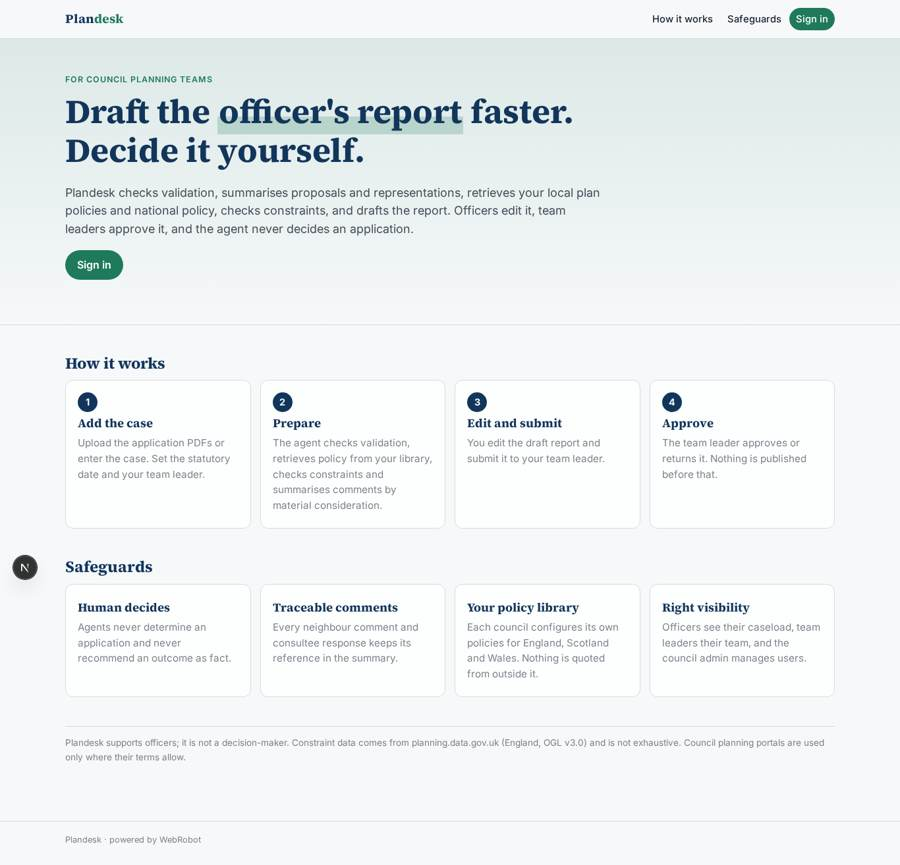
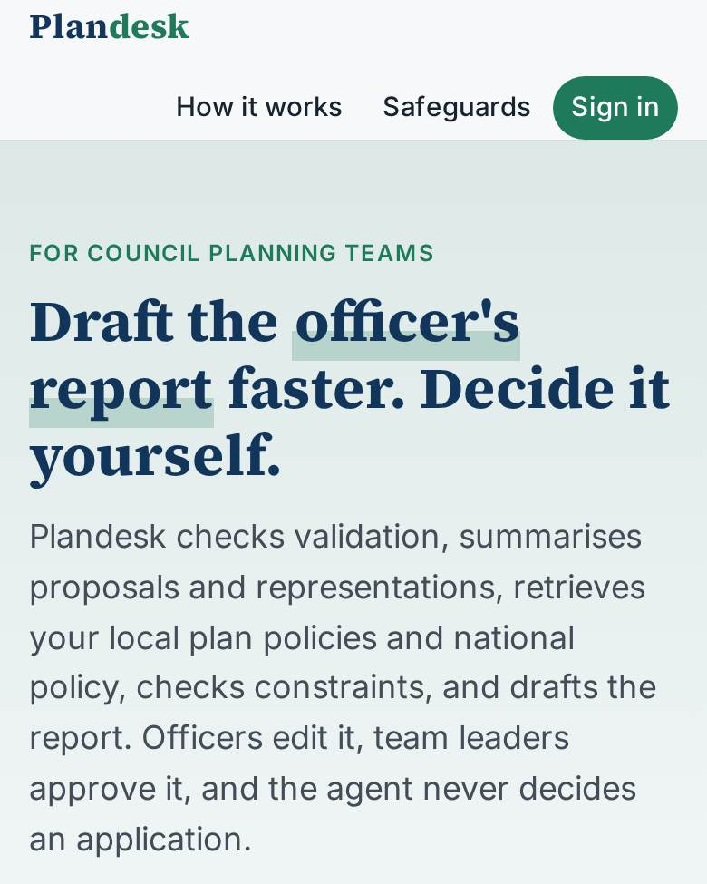
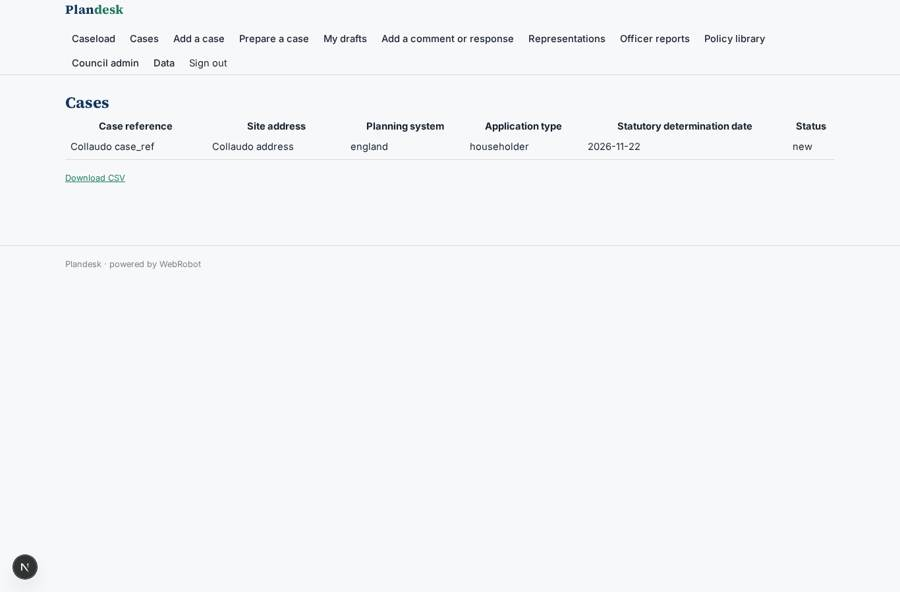
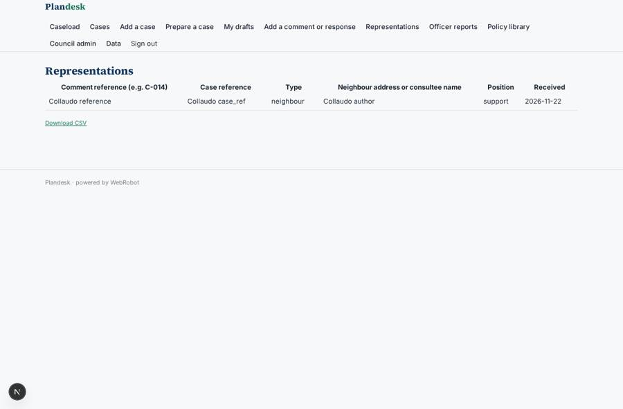
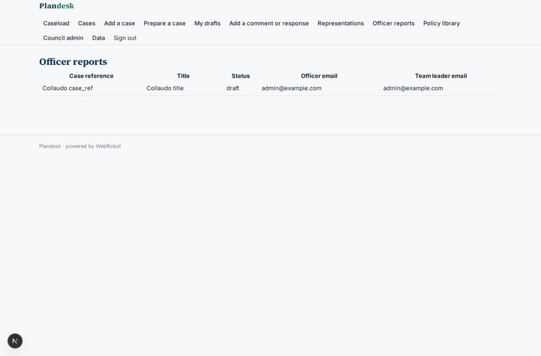
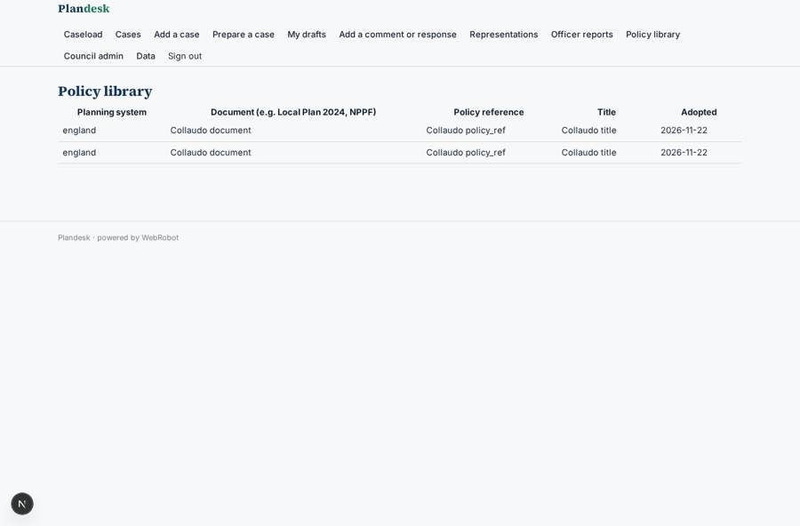

# Plandesk

_An AI workspace for council planning officers._

**Sector:** Sanità, istruzione, energia, gov · **Manifest:** valid (schema + runtime contract) · **Functional test:** passed (33 checks passed)

## Description given to the app builder

We need Plandesk, an AI workspace for council planning officers. A council signs up; roles are planning officer, team leader, validation officer and admin. Planning applications are uploaded as PDFs or pulled from the council back office (Idox, Uniform), which we want as an integration. An agent checks validation requirements, summarises the proposal, retrieves relevant local plan policies and the NPPF, checks constraints from planning.data.gov.uk, and drafts the officer's report. The officer edits it and a team leader approves before anything is published; agents never decide an application. Dashboards show caseload and statutory deadlines; email reminders before determination dates. Pricing by council annual contract, through G-Cloud. Neighbour comments and consultee responses are uploaded and an agent summarises them by material planning consideration, keeping every comment traceable. Planning law differs in England, Scotland and Wales, so each council's policy library is configured separately. Council planning portals are used only where their terms allow. Officers see their own caseload, team leaders their team, and the council admin manages users. English only.

## Functional test: what did not pass

- **saved record shown where its collection is read** (view comments): a record was saved in comments (by admin) but the page does not show it (as team_leader) _(warning)_
- **saved record shown where its collection is read** (view reports): a record was saved in reports (by admin) but the page does not show it (as team_leader) _(warning)_

## Navigation recording

Signed in as the app's admin, the recorder opened 7 menu page(s): Caseload, Cases, Add a case, Prepare a case, My drafts, Add a comment or response, Representations.
- agent run did not open: new_run: the run did not open
- data page empty: history (history)

Empty data pages are mostly expected on the local runtime: agents are mocked there, so the collections they fill stay empty.

## Features not expressible today (spec.extensions)

- **idox_uniform_integration**: Pulling applications from the council back office (Idox, Uniform) needs a per-council integration (API access and credentials agreed with the council). Not available yet: cases are uploaded as PDFs or entered by hand.
- **council_portals**: Council planning portals may be read only where their terms of use allow it; no portal is scraped by default.
- **gcloud_contract**: Pricing is an annual council contract sold through G-Cloud, invoiced outside the app, so billing is set to free.
- **scotland_wales_constraints**: planning.data.gov.uk covers England only; constraint data sources for Scotland and Wales are not integrated and officers check them manually.
- **single_council_tenancy**: Each council runs its own app instance, so its users, cases and policy library stay separate; records are ownedBy user, with team leader access via team_leader_email.
- **deadline_reminder_filter**: Date reminders cannot be filtered by status, so they fire for every case with a determination date, including determined ones.

## Screenshots (interpretive runtime, test data)

### home-anon

### home-mobile

### cases

### comments

### reports

### policy_library

