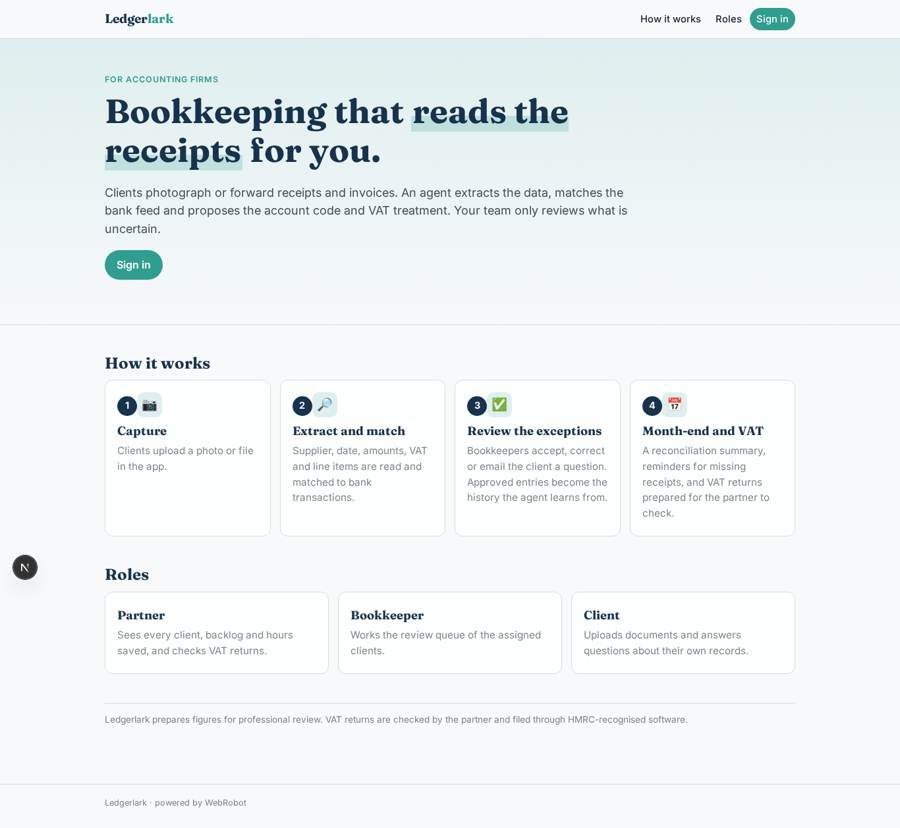
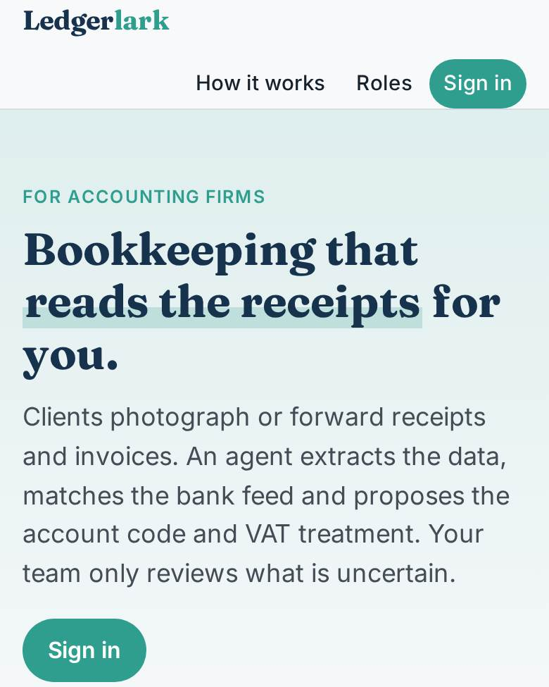
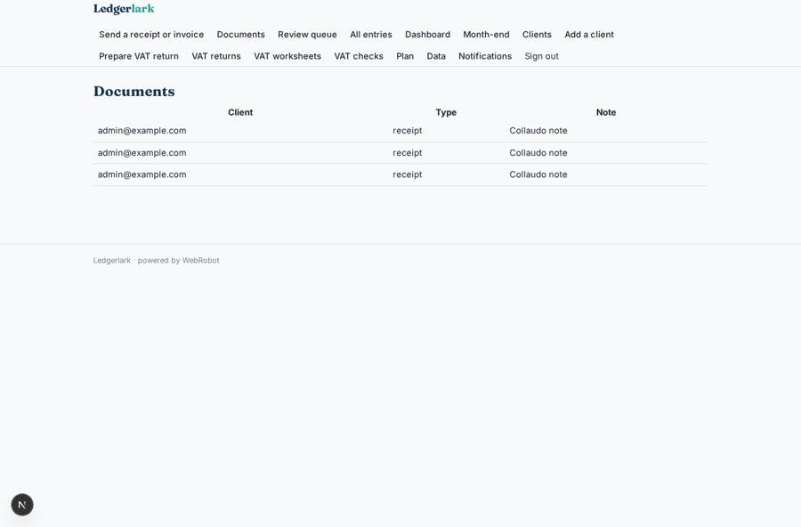
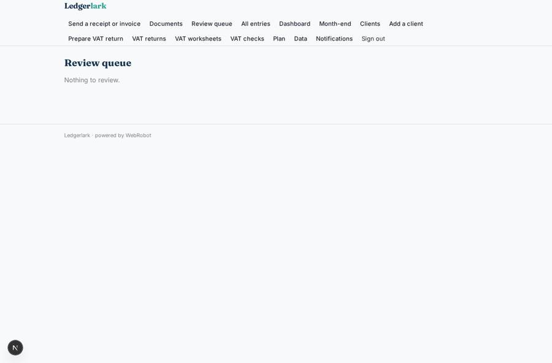
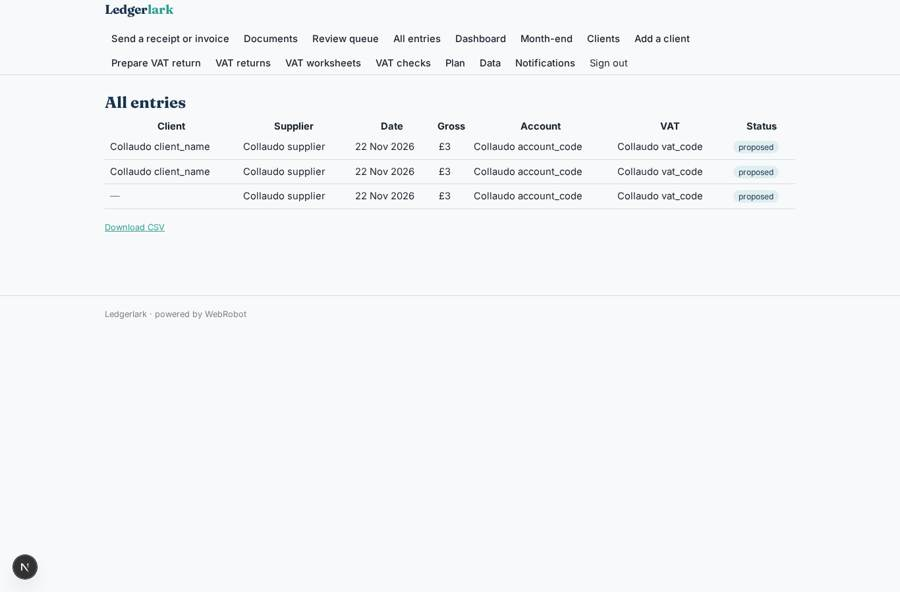
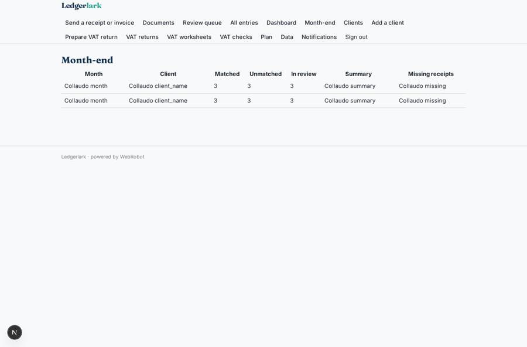

# Ledgerlark

_AI-native bookkeeping for accounting firms._

**Sector:** Fintech, proptech, insurtech · **Manifest:** valid (schema + runtime contract) · **Functional test:** passed (38 checks passed)

## Description given to the app builder

We need Ledgerlark, AI-native bookkeeping for accounting firms. A firm signs up, adds its clients and connects each client's ledger in Xero or QuickBooks through OAuth, plus bank feeds via Open Banking. Clients send receipts and invoices by photo upload in the app or by forwarding them to a dedicated email address. An agent extracts supplier, date, amounts, VAT and line items, matches documents to bank transactions, proposes the account code and VAT treatment according to HMRC VAT rules and the client's history, and posts approved entries to the ledger. Anything uncertain lands in a review queue for the bookkeeper, who accepts, corrects or asks the client a question by email; corrections are remembered for next time. Each month the agent prepares a reconciliation summary and a list of missing receipts and chases clients with reminders. VAT returns are prepared for the partner to check and filed under Making Tax Digital through HMRC-recognised software. Roles: partner (all clients), bookkeeper (assigned clients), client (own documents and questions). Dashboards show backlog per client and hours saved. Pricing: monthly fee per client entity. English.

## Functional test: what did not pass

- **saved record shown where its collection is read** (view all_entries): a record was saved in entries (by admin-data, admin-data, admin) but the page does not show it (as bookkeeper) _(warning)_

## Navigation recording

Signed in as the app's admin, the recorder opened 7 menu page(s): Send a receipt or invoice, Documents, Review queue, All entries, Dashboard, Month-end, Clients.
No issue found.

Empty data pages are mostly expected on the local runtime: agents are mocked there, so the collections they fill stay empty.

## Features not expressible today (spec.extensions)

- **ledger_oauth**: Connecting each client's Xero or QuickBooks ledger through OAuth is not available yet. Until then, chart of accounts and history are in entries; the bookkeeper posts approved entries to the ledger and sets them to posted.
- **open_banking**: Open Banking bank feeds are not available yet. Bank transactions are imported by the admins on the data page (CSV) into bank_transactions.
- **inbound_email**: Forwarding receipts to a dedicated email address per client is not available yet. Clients upload by photo or file in the app.
- **ledger_posting**: Automatic posting of approved entries to Xero or QuickBooks needs OAuth, which is not available yet.
- **mtd_filing**: Filing under Making Tax Digital is done by the partner in HMRC-recognised software, after approving the worksheet. Direct HMRC submission is not available.
- **per_entity_billing**: The subscription is one plan priced per client entity. Automatic counting of client entities to scale the invoice is not available; the partner sets the quantity.
- **inbound_reply_questions**: Client answers to a bookkeeper's question arrive by reply to the email or as a new upload; they are not threaded in the app.

## Screenshots (interpretive runtime, test data)

### home-anon

### home-mobile

### my_docs

### review

### all_entries

### summaries

