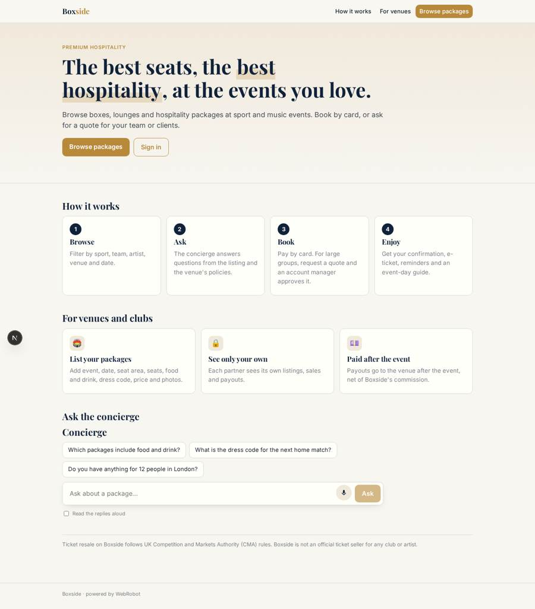
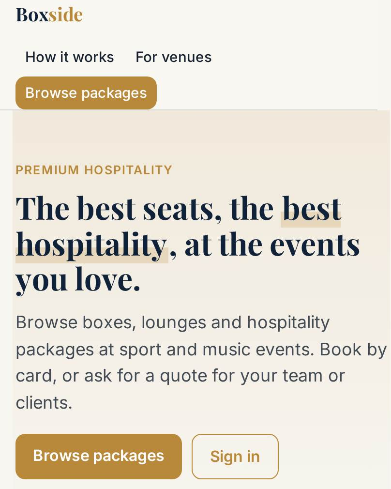
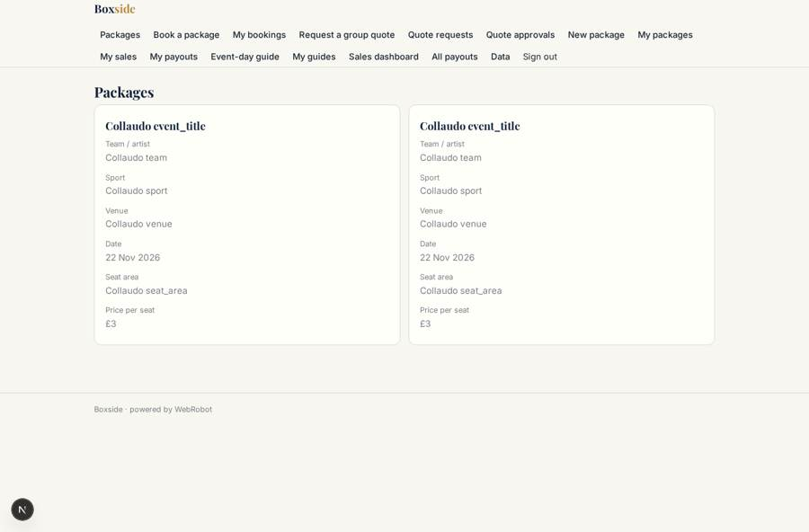
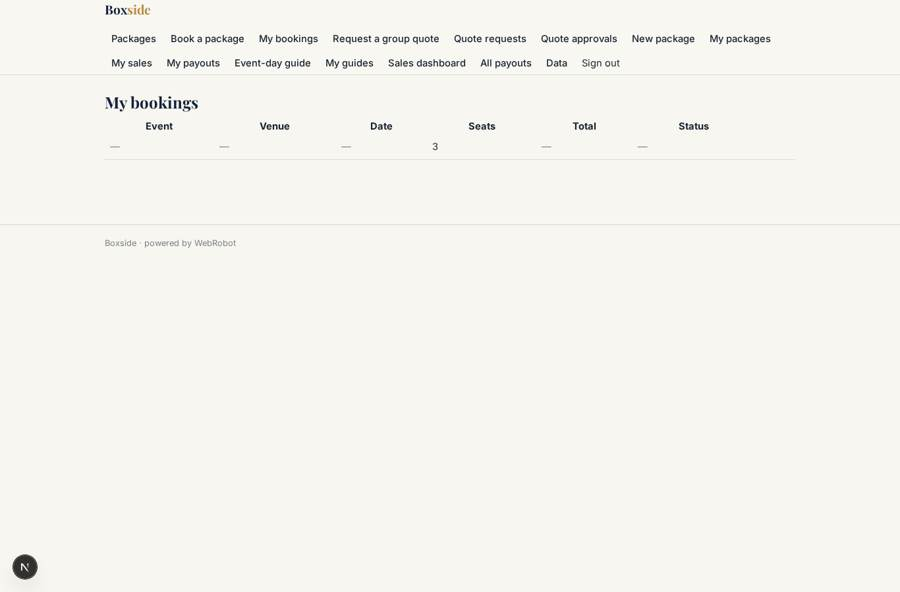
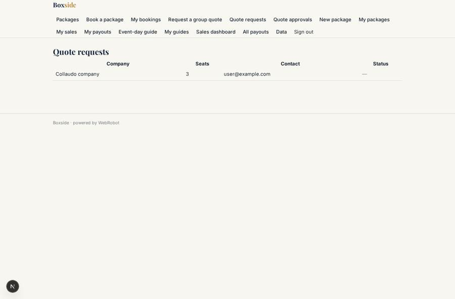
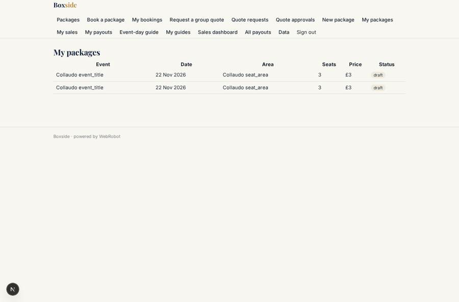

# Boxside

_Premium hospitality and seating for sport and music events._

**Sector:** Consumer, travel, retail · **Manifest:** valid (schema + runtime contract) · **Functional test:** passed (35 checks passed)

## Description given to the app builder

We need an app called Boxside, a marketplace for premium hospitality and seating at sport and music events. Our venue contracts and payouts to venues are the product; I need the software around them. Venues and clubs sign up as partners and list packages: event, date, seat area, number of seats, food and drink included, dress code, price and photos; they see only their own listings and sales. Buyers (individuals and companies) browse a catalogue by sport, team, artist, venue and date, then book and pay by card; corporate buyers can request a quote for large groups through a form, and an account manager approves the quote. An agent answers buyer questions about packages from the listing details and venue policies, and drafts event-day guides with arrival times and parking. Buyers get confirmations, e-tickets from the venue's system and reminders. Payouts go to each venue after the event, minus our commission. Resale of tickets must follow UK CMA rules. Dashboards show sales by venue and event, sell-through and revenue. English.

## Functional test: what did not pass

- **saved record shown where its collection is read** (view my_orders): a record was saved in orders (by buyer) but the page does not show it (as buyer) _(warning)_
- **saved record shown where its collection is read** (view sales): a record was saved in orders (by buyer) but the page does not show it (as admin) _(warning)_

## Navigation recording

Signed in as the app's admin, the recorder opened 7 menu page(s): Packages, Book a package, My bookings, Request a group quote, Quote requests, Quote approvals, New package.
No issue found.

Empty data pages are mostly expected on the local runtime: agents are mocked there, so the collections they fill stay empty.

## Features not expressible today (spec.extensions)

- **card_checkout**: The booking form saves the order. Card payment through Stripe Connect, and setting price, amount, venue and partner_email from the catalogue entry on the server, still need wiring. The app owner must connect Stripe in the studio.
- **venue_payouts**: Payouts are statements in the payouts collection, entered by admins (or by CSV) after each event. Automatic calculation across all orders is not available. Transfers to venues' Stripe Connect accounts are made outside this manifest.
- **etickets**: E-tickets come from each venue's ticketing system. Fetching them needs the venue's API and a credential for each partner. For now the confirmation email tells the buyer to expect them from the venue.
- **resale_cma**: Resale is not part of this version. Before building it, Boxside needs UK CMA / Consumer Rights Act rules: show seat, face value and seller status, and cap resale prices where the venue or promoter requires it. It also needs counsel's review.
- **listing_photos**: Partner photos are private to the uploader, so buyers cannot see them in the catalogue yet. Public images need a shared file store.
- **sell_through**: Sell-through % (seats sold ÷ seats offered) is shown as two figures side by side. A computed ratio needs a joined aggregate.
- **reminder_filter**: Date reminders cannot be filtered by status, so the day-before reminder goes for every order with an event date, including unpaid or cancelled ones.
- **messaging**: SMS, WhatsApp and push reminders are not available. Reminders are sent by email.

## Screenshots (interpretive runtime, test data)

### home-anon

### home-mobile

### catalogue

### my_orders

### quotes_review

### my_listings

