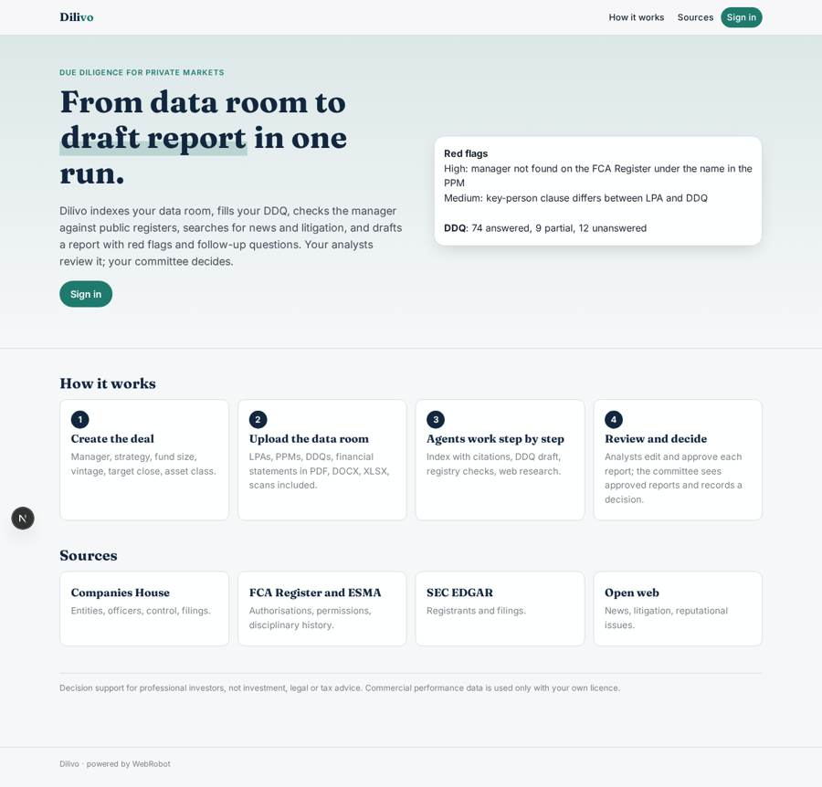
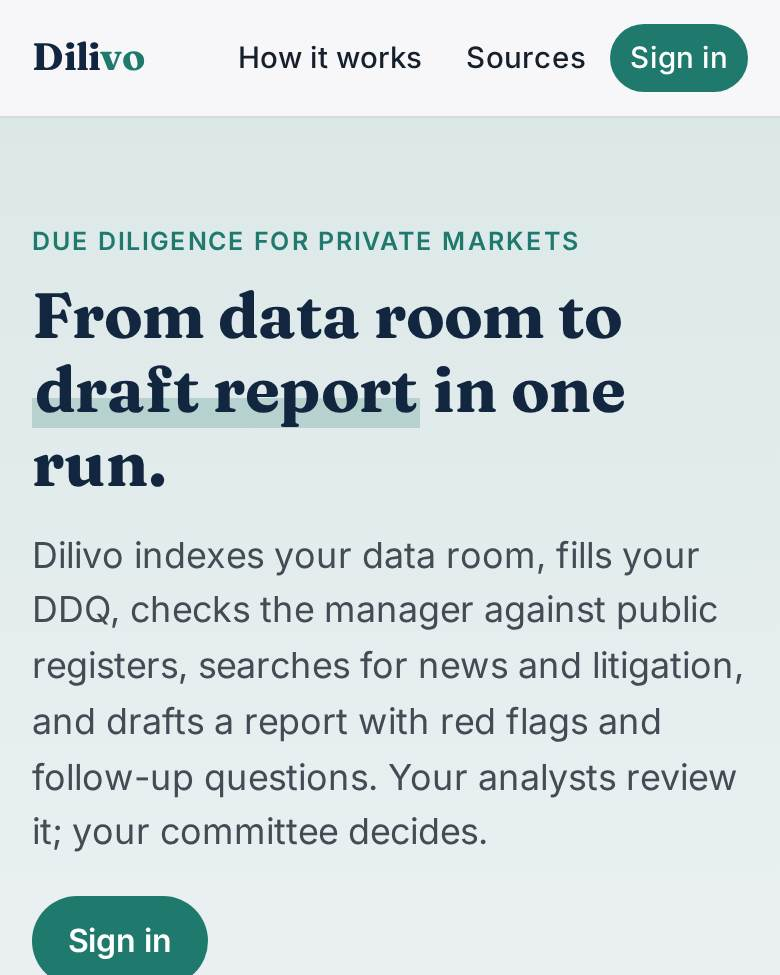
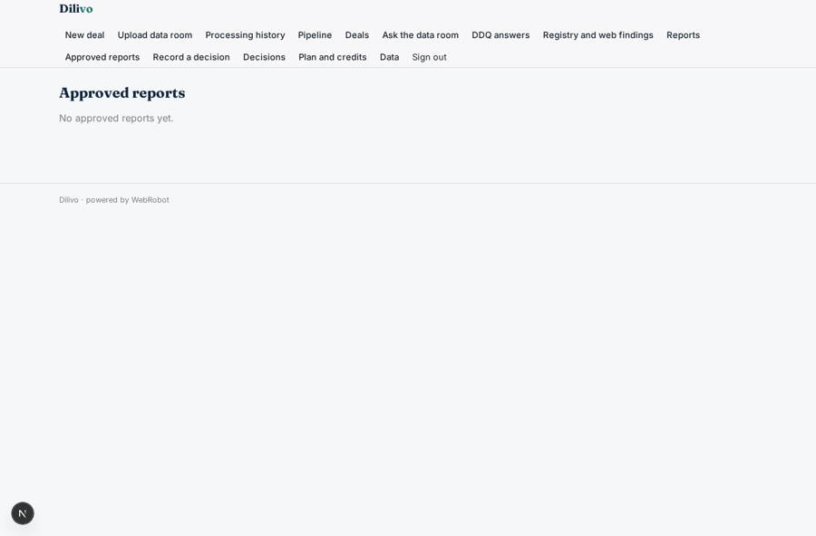
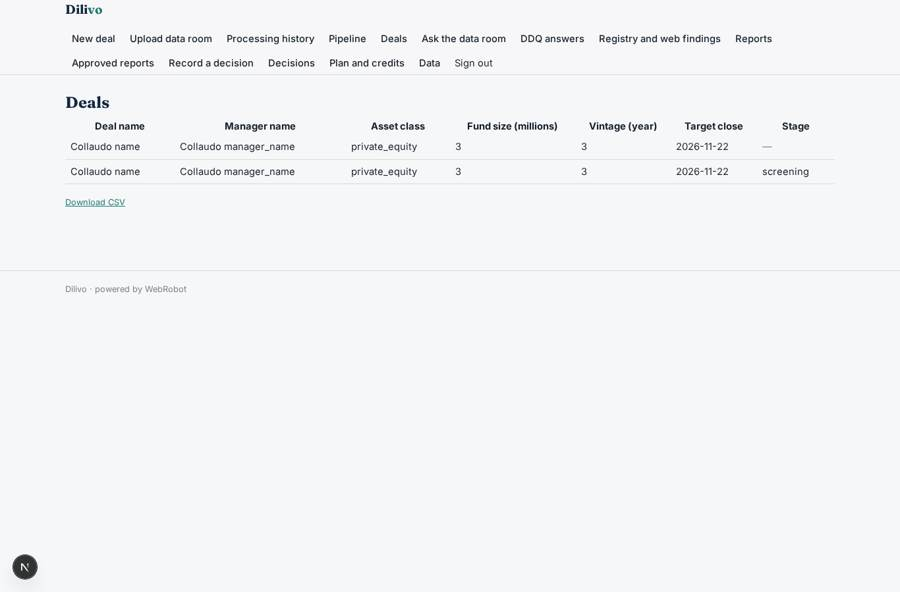
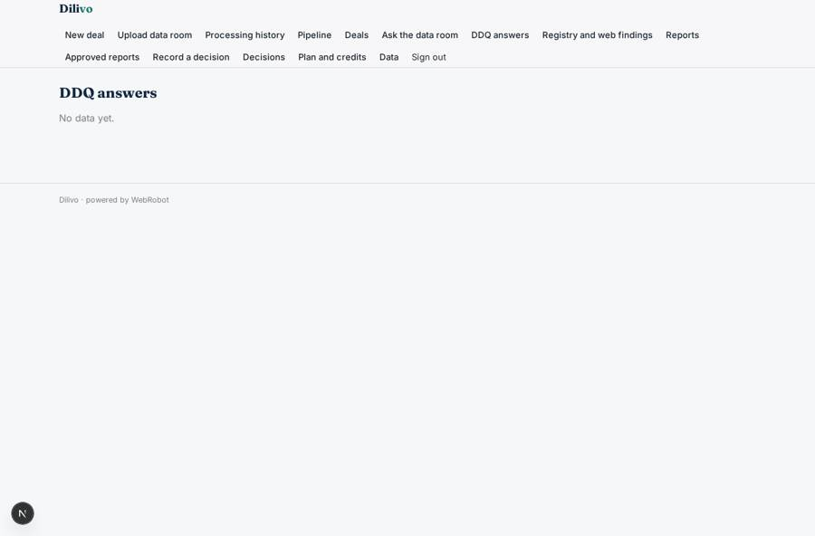
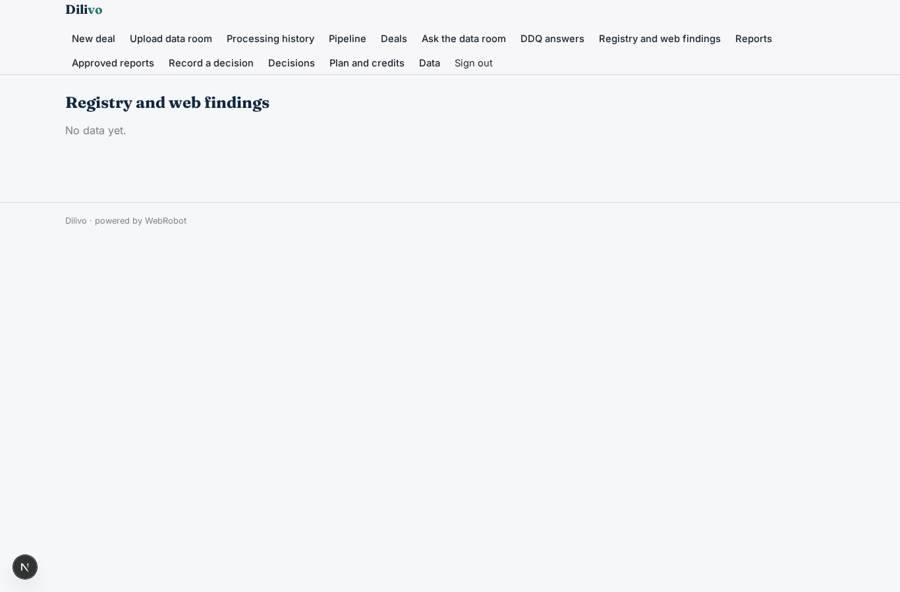

# Dilivo

_AI due diligence for private markets and alternative assets._

**Sector:** Fintech, proptech, insurtech · **Manifest:** valid (schema + runtime contract) · **Functional test:** passed (40 checks passed)

## Description given to the app builder

I want Dilivo, an AI due diligence workspace for investors in private markets and alternative assets. An investment team signs up; analysts create a deal with a form (manager name, strategy, fund size, vintage, target close, asset class) and upload the data room: LPAs, PPMs, DDQs, financial statements in PDF, DOCX and XLSX, including scanned pages. A team of agents then works step by step: one indexes the documents and answers questions with citations to page and paragraph, one fills our standard DDQ template from the documents and marks unanswered questions, one checks the manager and its entities against Companies House, the FCA Register and SEC/ESMA filings, and one runs web searches for news and litigation. The output is a draft due diligence report with red flags and a list of follow-up questions for the manager. The analyst reviews each section, edits and approves; the investment committee member sees only approved reports and records a decision. Commercial fund performance data is used only if the customer has a licence and connects it. Dashboards show the pipeline of deals by stage. Pricing: subscription per seat plus credits per data room processed. English.

## Navigation recording

Signed in as the app's admin, the recorder opened 7 menu page(s): New deal, Upload data room, Processing history, Pipeline, Deals, Ask the data room, DDQ answers.
- form not sent: new_deal: Asset class is required
- agent run did not open: data_room: the run did not open
- data page empty: runs (history)
- data page empty: ddq (table)

Empty data pages are mostly expected on the local runtime: agents are mocked there, so the collections they fill stay empty.

## Features not expressible today (spec.extensions)

- **seat_management**: Per-seat subscription: the seat count follows the invited analysts and committee members; automatic seat counting and billing per seat is not available yet, so the owner adjusts seats in Stripe.
- **licensed_performance_data**: Commercial fund performance data (licensed databases) is not wired in: it needs the customer's own licence and API host. Add a credential and an http tool once the provider is known; until then the agents use no third-party performance figures.
- **fca_api_and_esma_files**: The FCA Register API needs two headers (email and key); until that is supported the FCA Register and ESMA registers are read as public web pages through the WebRobot MCP.

## Screenshots (interpretive runtime, test data)

### home-anon

### home-mobile

### ic_reports

### deals

### ddq

### findings_view

