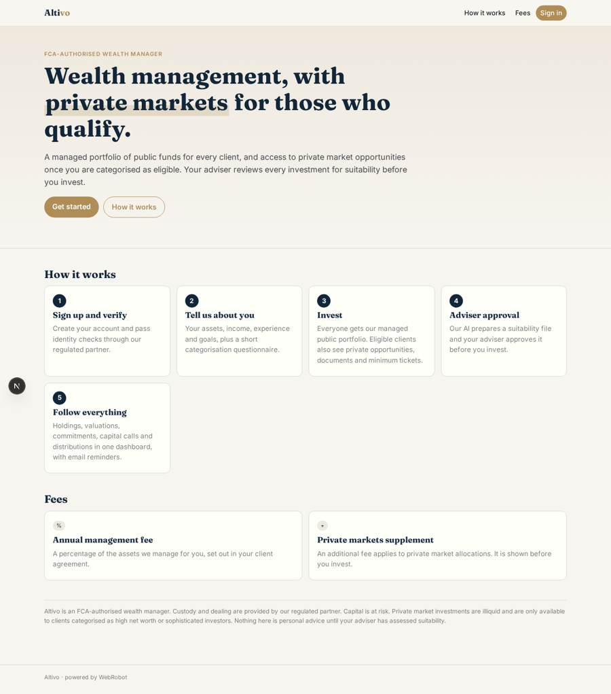
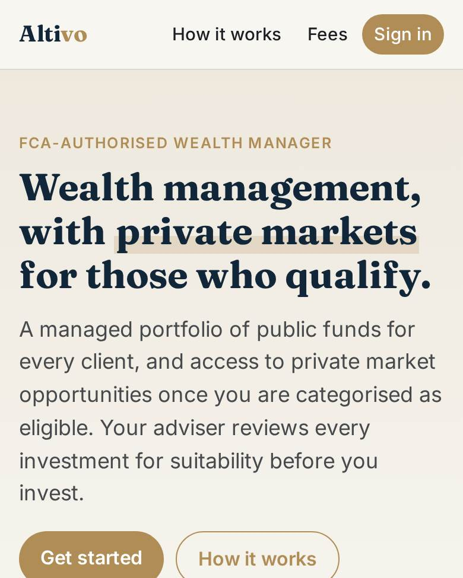
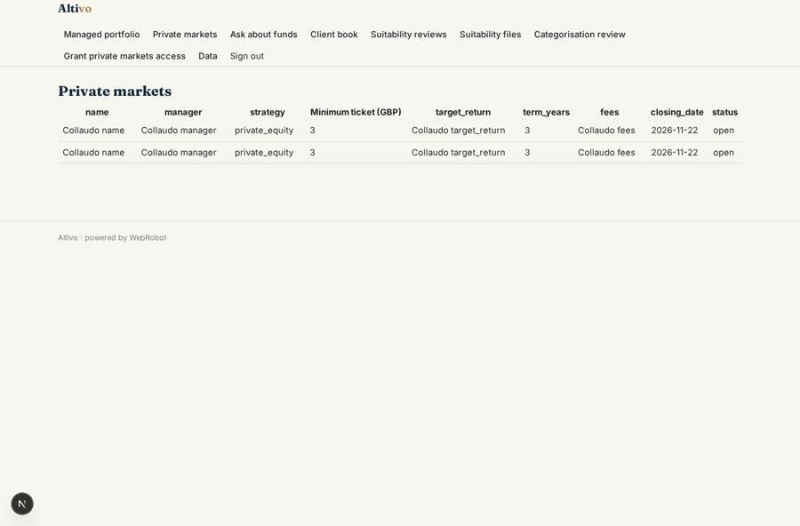
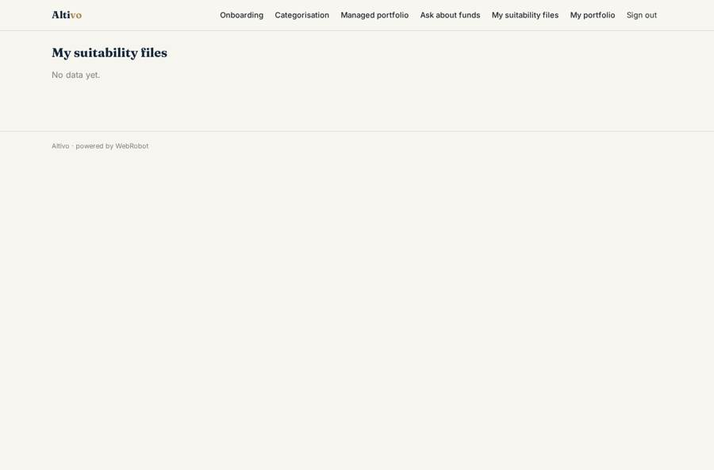
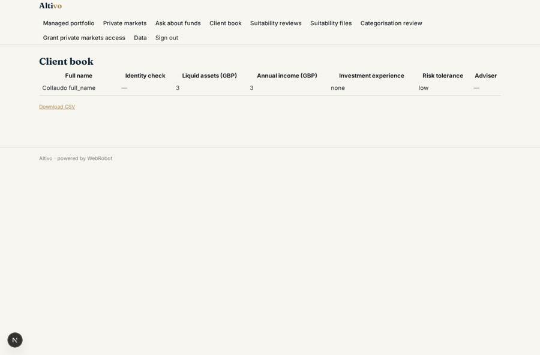
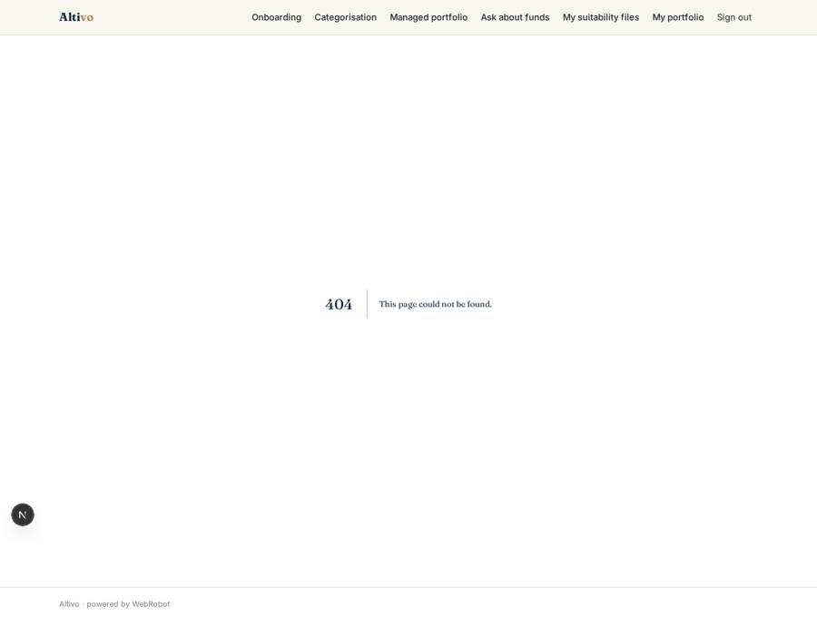

# Altivo

_Public market portfolios, and private markets for those who qualify._

**Sector:** Fintech, proptech, insurtech · **Manifest:** valid (schema + runtime contract) · **Functional test:** passed (29 checks passed)

## Description given to the app builder

We want Altivo, a wealth platform giving clients public market portfolios plus access to private markets for those who are eligible. Acting as an FCA-authorised wealth manager, custody and dealing are done by our regulated partner; I need the software around it. Clients sign up, pass identity checks through the partner and complete an onboarding form: assets, income, investment experience, goals, and a categorisation questionnaire to establish whether they qualify as high net worth or sophisticated investors. Everyone sees a managed portfolio of public funds; eligible clients also see private market opportunities with documents and minimum ticket sizes. An agent summarises fund documents, answers questions with citations and prepares a suitability file, which an adviser reviews and approves before the client can invest. Clients see a dashboard of holdings, valuations, commitments, capital calls and distributions, with email reminders when a capital call is due. Advisers have a client book and a task list; compliance reviews categorisation and suitability. Roles: client, adviser, compliance, admin. Pricing: annual management fee as a percentage of assets, with an extra fee on private market allocations. English.

## Functional test: what did not pass

- **form saves a record** (form invest): only role eligible may fill it, and the test cannot hold that role _(warning)_
- **form saves a record** (form new_task): only role adviser may fill it, and the test cannot hold that role _(warning)_
- **trigger has its effect** (trigger categorisation_submitted): email to role:compliance: no such recipient in the test (role nobody holds or empty field) _(warning)_

## Navigation recording

Signed in as the app's admin, the recorder opened 7 menu page(s): Managed portfolio, Private markets, Ask about funds, Client book, Suitability reviews, Suitability files, Categorisation review.
- data page empty: adviser_files (table)

Empty data pages are mostly expected on the local runtime: agents are mocked there, so the collections they fill stay empty.

## Features not expressible today (spec.extensions)

- **partner_identity_checks**: Identity verification by the regulated partner is not integrated. The partner's result can be sent to a webhook or set by compliance in the client's kyc_status field. A native partner connection needs OAuth or a partner API with its own terms.
- **partner_feed**: Holdings, commitments, capital calls and distributions come from the partner by webhook (hook_holdings, hook_commitments, hook_capital_calls, hook_distributions) or admin CSV upload on /admin/data.
- **dealing_gate**: The app records the adviser approval and notifies the client. Dealing and custody are executed by the partner. Blocking the order at the partner until approval needs a partner-side integration.
- **percentage_fee_billing**: The annual management fee as a percentage of assets, plus the extra fee on private market allocations, is not a billing mode. Fees are invoiced by Altivo or the partner outside the app. The app only describes them.

## Screenshots (interpretive runtime, test data)

### home-anon

### home-mobile

### private_markets

### my_files

### client_book

### tasks

