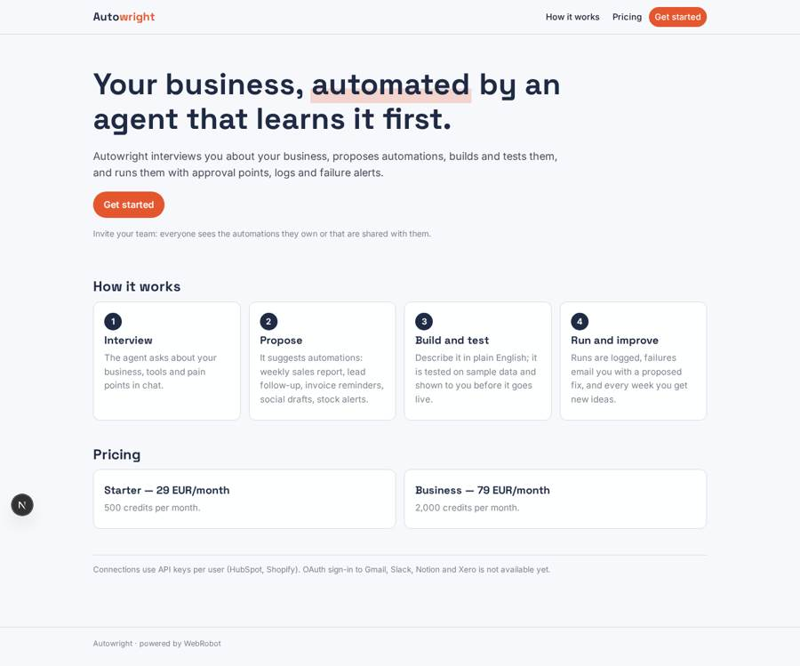
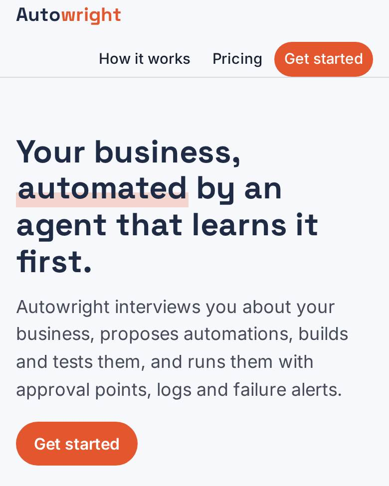
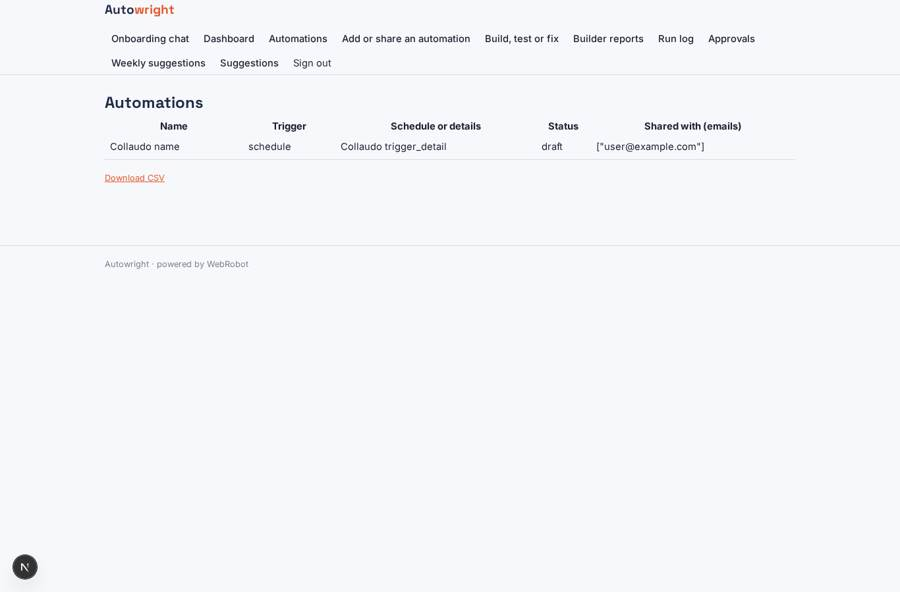
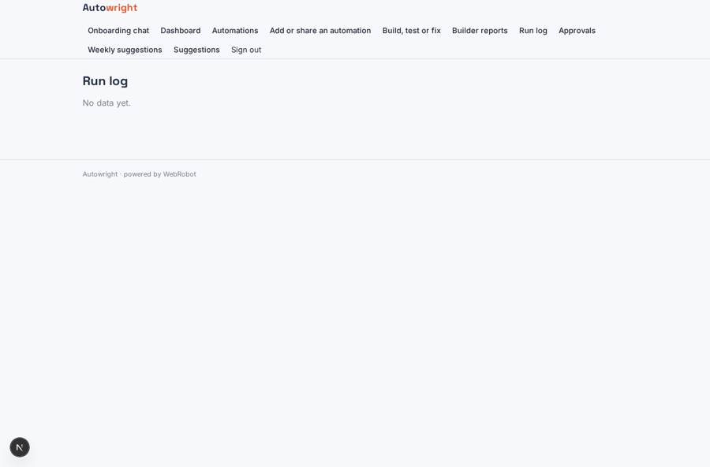
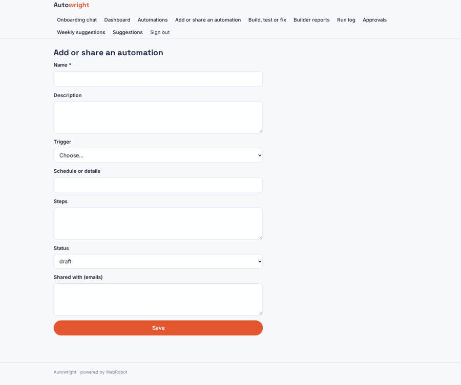
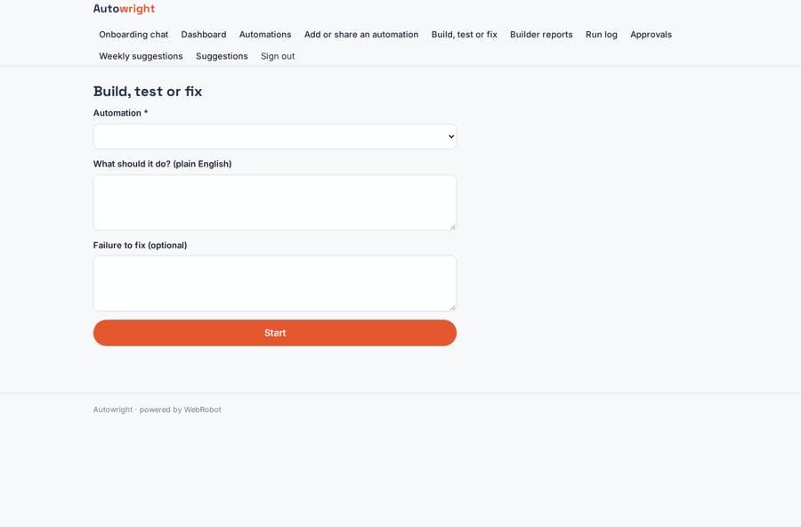

# Autowright

_An AI agent that learns your business, then builds and runs its automations._

**Sector:** B2B AI and SaaS · **Manifest:** valid (schema + runtime contract) · **Functional test:** passed (16 checks passed)

## Description given to the app builder

I want Autowright, a proactive AI agent that learns how a small business works and then builds and runs automations for it. A business signs up, invites team members, and each person sees the automations they own or that are shared with them. At onboarding an agent interviews the owner in chat about the business, its tools, recurring tasks and pain points, and proposes a list of automations: weekly sales report, lead follow-up, invoice reminders, social post drafts, stock alerts. The user describes or approves an automation in plain English; the agent turns it into steps with a trigger (schedule, webhook, form submission), actions (HTTP calls, MCP tools, emails, documents) and approval points, tests it on sample data and shows the result before switching it on. Runs are logged, failures alert the owner by email and the agent proposes a fix. Each week it suggests new automations based on what it has observed. The real product connects to hundreds of SaaS tools (Gmail, Slack, Notion, Shopify, Xero, HubSpot) with OAuth per user, so I want that. Dashboard of automations, runs, time saved and costs. Pricing: monthly plans with credits per run via Stripe. English.

## Navigation recording

Signed in as the app's admin, the recorder opened 7 menu page(s): Onboarding chat, Dashboard, Automations, Add or share an automation, Build, test or fix, Builder reports, Run log.
- data page empty: runs_log (table)

Empty data pages are mostly expected on the local runtime: agents are mocked there, so the collections they fill stay empty.

## Features not expressible today (spec.extensions)

- **oauth_connectors**: OAuth per user to hundreds of SaaS tools (Gmail, Slack, Notion, Xero, Microsoft 365) is not available yet; only API-key connections (HubSpot, Shopify) work. Automation steps are executed by the agent through app tools, not by an always-on workflow engine.

## Screenshots (interpretive runtime, test data)

### home-anon

### home-mobile

### automations

### runs_log

### automation_form

### new_run

