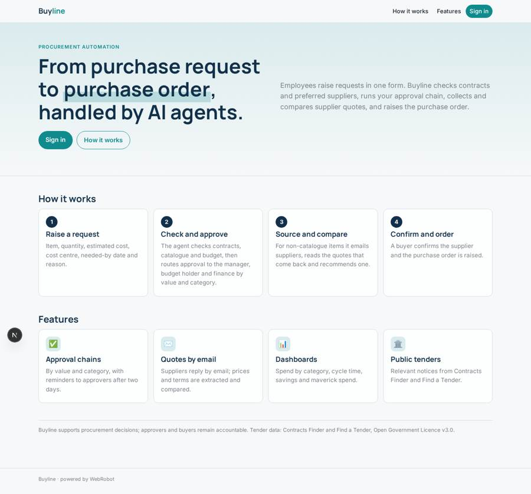
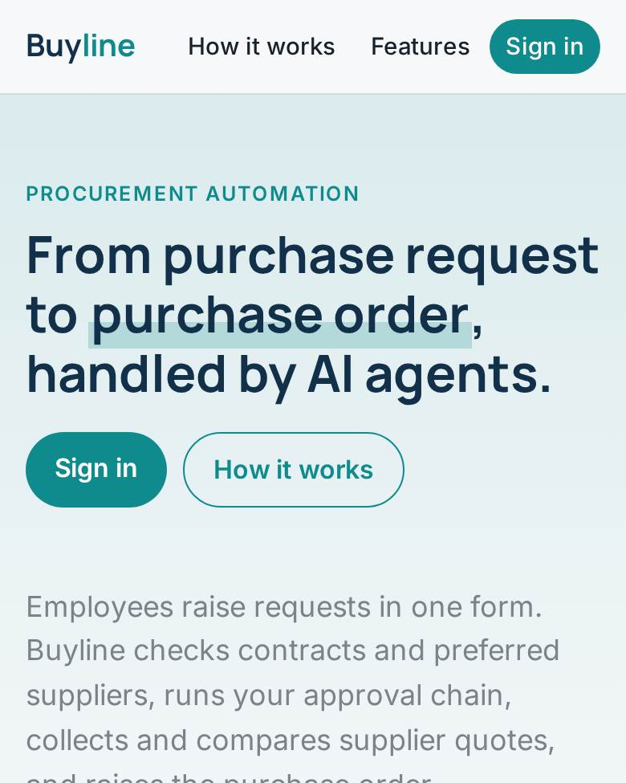
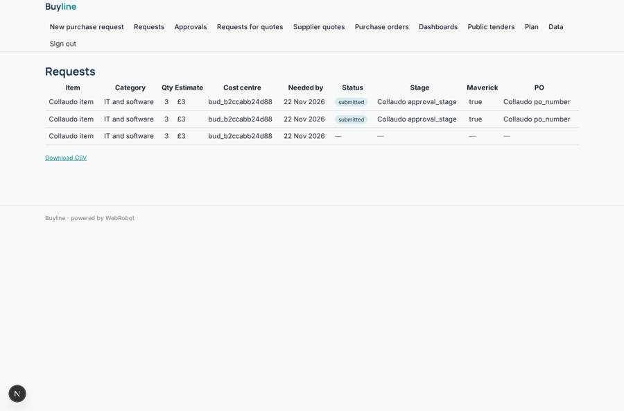
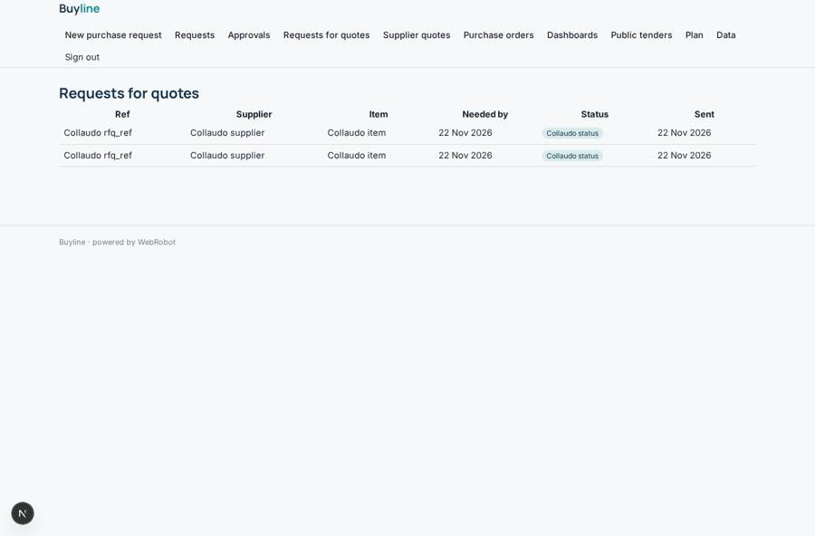
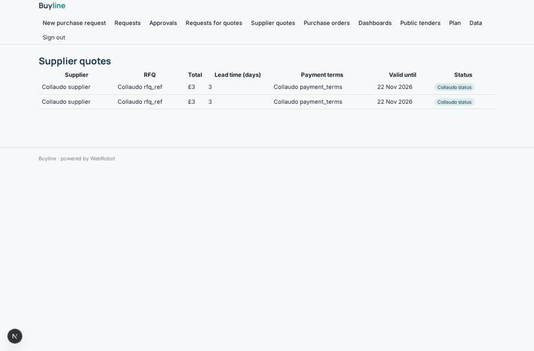
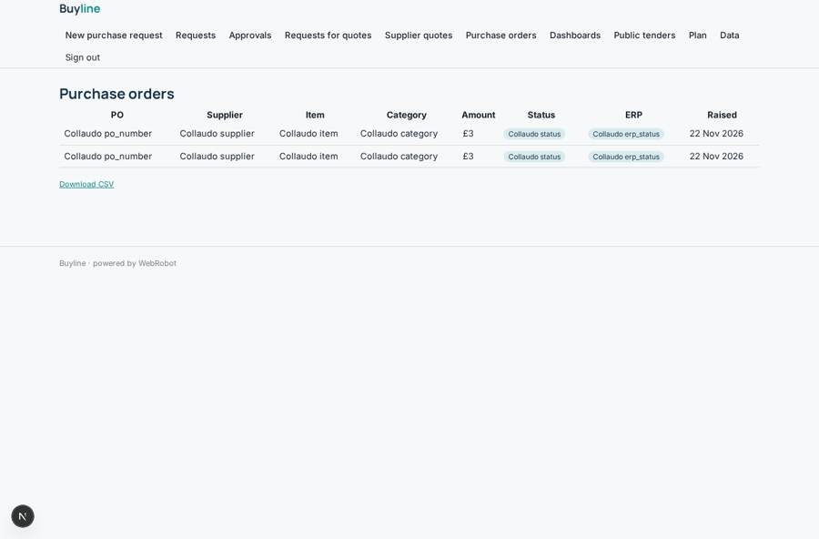

# Buyline

_AI agents that take procurement from request to purchase order._

**Sector:** Data, media, cyber, devtools · **Manifest:** valid (schema + runtime contract) · **Functional test:** passed (23 checks passed)

## Description given to the app builder

We need an app called Buyline, AI agents that automate procurement from request to purchase order. An organisation signs up and imports its suppliers, catalogues, budgets and approval rules. Employees raise purchase requests through a form: item, quantity, estimated cost, cost centre, needed-by date and reason; the agent checks for existing contracts and preferred suppliers. Approval chains run by value and category, with the manager, budget holder and finance approving in turn. For non-catalogue items the agent drafts requests for quotes and sends them to suppliers; in the real product supplier quotes arrive by inbound email, and I want that included. The agent extracts prices and terms from quote documents, compares them and recommends a supplier, and a buyer confirms. It then raises the purchase order; the real product writes into the customer's ERP and procure-to-pay systems through OAuth connectors, which I also want. Public sector customers can see relevant tenders from Contracts Finder and Find a Tender official APIs. Dashboards show spend by category, cycle time, savings and maverick spend. Reminders go to approvers after two days. Roles: admin, requester, approver, buyer, finance. Pricing: from £2,000 a month. English only.

## Functional test: what did not pass

- **saved record shown where its collection is read** (view orders): a record was saved in purchase_orders (by admin-data, admin-data) but the page does not show it (as requester) _(warning)_

## Navigation recording

Signed in as the app's admin, the recorder opened 7 menu page(s): New purchase request, Requests, Approvals, Requests for quotes, Supplier quotes, Purchase orders, Dashboards.
No issue found.

Empty data pages are mostly expected on the local runtime: agents are mocked there, so the collections they fill stay empty.

## Features not expressible today (spec.extensions)

- **erp_oauth_connectors**: Writing purchase orders into the customer's ERP and procure-to-pay systems through OAuth connectors is not available yet. Purchase orders are saved with erp_status pending_export and can be exported as CSV from the orders view.
- **organisation_onboarding**: Each organisation runs its own deployment; its admins import suppliers, catalogues, contracts, budgets and approval rules on the data page (CSV). Self-serve multi-organisation signup is not part of this manifest.
- **inbound_email_address**: The inbound quotes mailbox address is assigned when the email channel is activated; attachment text extraction depends on the channel.

## Screenshots (interpretive runtime, test data)

### home-anon

### home-mobile

### my_requests

### rfqs_view

### quotes_view

### orders

