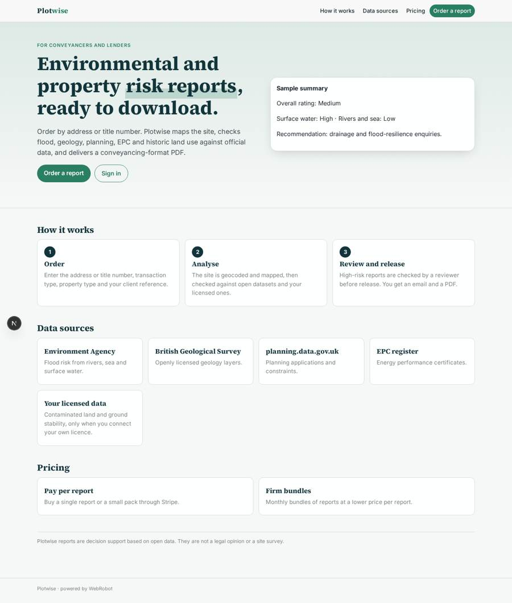
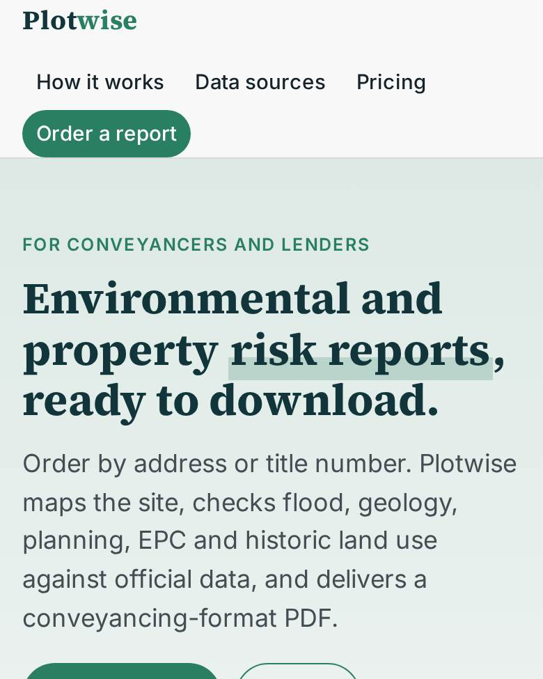
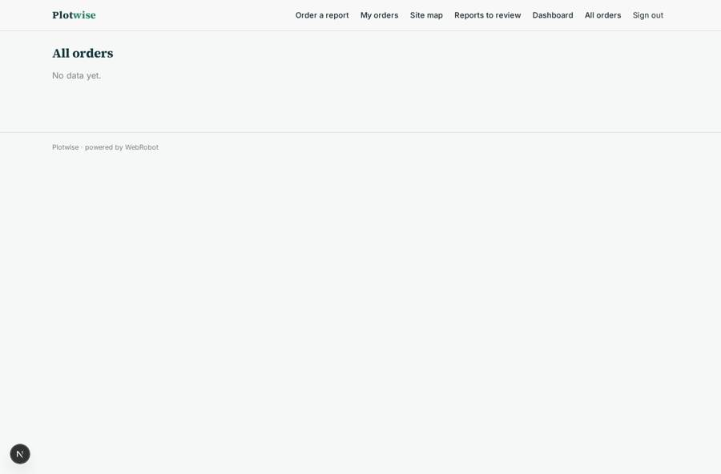
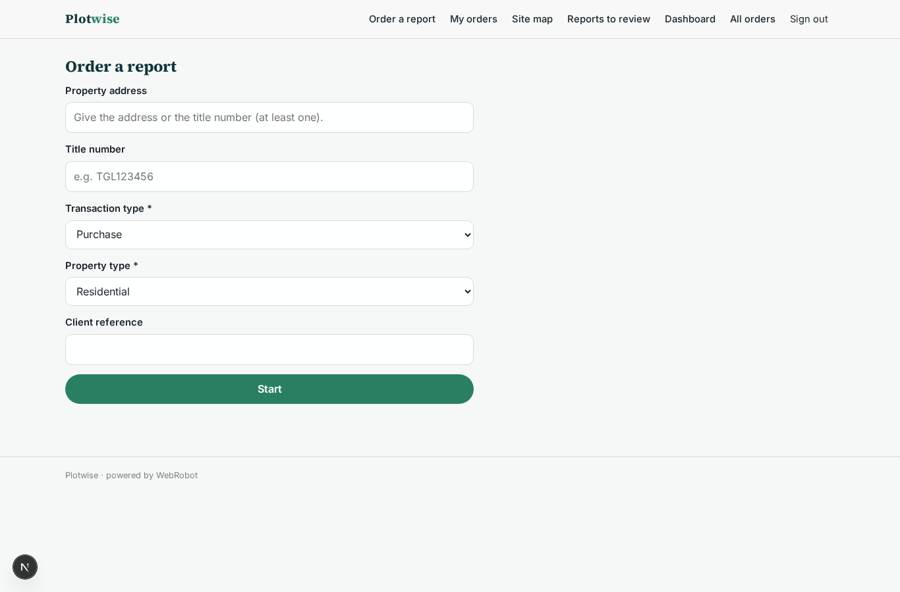
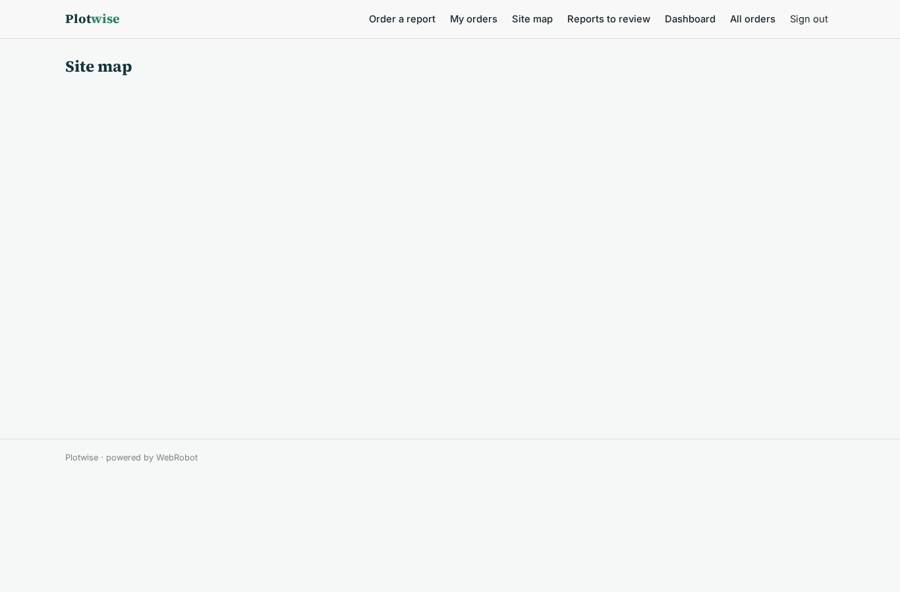
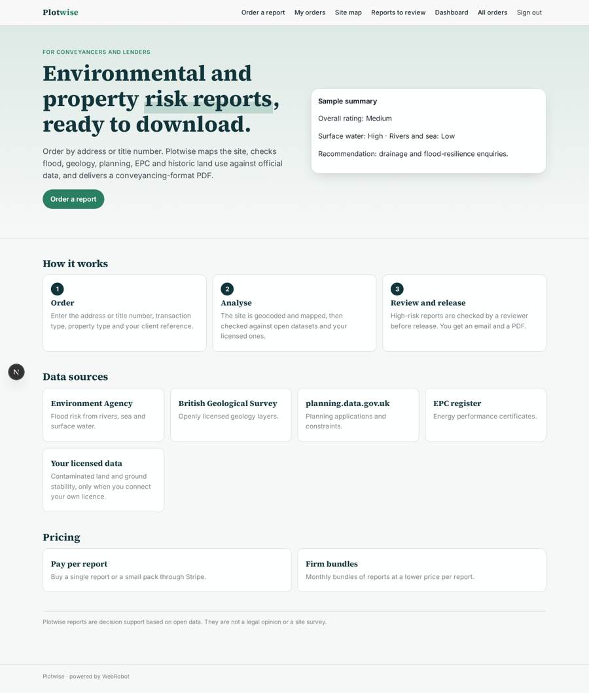

# Plotwise

_Environmental and property risk reports for conveyancers and lenders._

**Sector:** Fintech, proptech, insurtech · **Manifest:** valid (schema + runtime contract) · **Functional test:** passed (12 checks passed)

## Description given to the app builder

I want Plotwise, which produces environmental and property risk reports for conveyancers and lenders. Law firms and lenders sign up; a user orders a report with a form: property address or title number, transaction type, residential or commercial, client reference. The app geocodes the address and draws the site on a map, then an agent queries open datasets: Environment Agency flood risk from rivers, sea and surface water, BGS geology layers that are openly licensed, planning applications from planning.data.gov.uk, EPC certificates, and nearby historic land uses. Contaminated land and ground stability datasets from commercial providers are included only if the customer has a licence. The agent writes a report in the standard conveyancing format with a summary, risk ratings, explanations and recommendations, alongside the CON29-style questions it can answer. A reviewer at our company checks reports flagged as high risk before they are released. The client downloads the PDF and receives an email when ready. Roles: firm admin, conveyancer (own orders), reviewer. Dashboards show orders and turnaround. Pricing: pay per report through Stripe, with discounted monthly bundles for firms. English.

## Navigation recording

Signed in as the app's admin, the recorder opened 6 menu page(s): Order a report, My orders, Site map, Reports to review, Dashboard, All orders.
- data page empty: orders_table (table)

Empty data pages are mostly expected on the local runtime: agents are mocked there, so the collections they fill stay empty.

## Features not expressible today (spec.extensions)

- **firm_wide_visibility**: Firm admins should see all orders of their firm. Records are owned per user, so firm-wide visibility and firm-level credit sharing are not available yet; a firm admin buys bundles and sees their own orders.
- **turnaround_metric**: The dashboard shows order and completion times from the run list; a computed turnaround-hours figure is not available as an aggregate yet.
- **pdf_download**: The PDF comes from the printable report view (print or save as PDF).
- **licensed_provider_host**: The commercial provider host pattern in egress (*.groundsure.com) must match the provider the customers license.

## Screenshots (interpretive runtime, test data)

### home-anon

### home-mobile

### orders_table

### new_order

### site_map

### home

