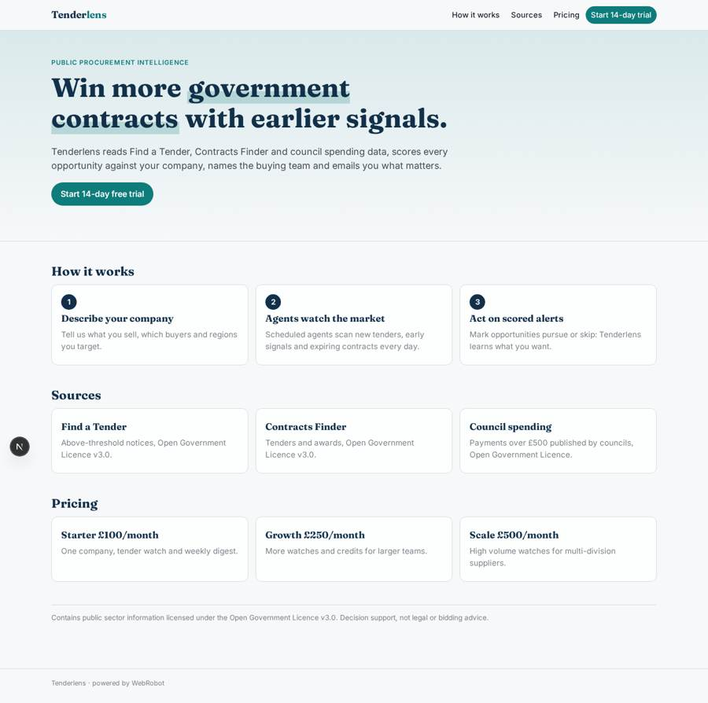
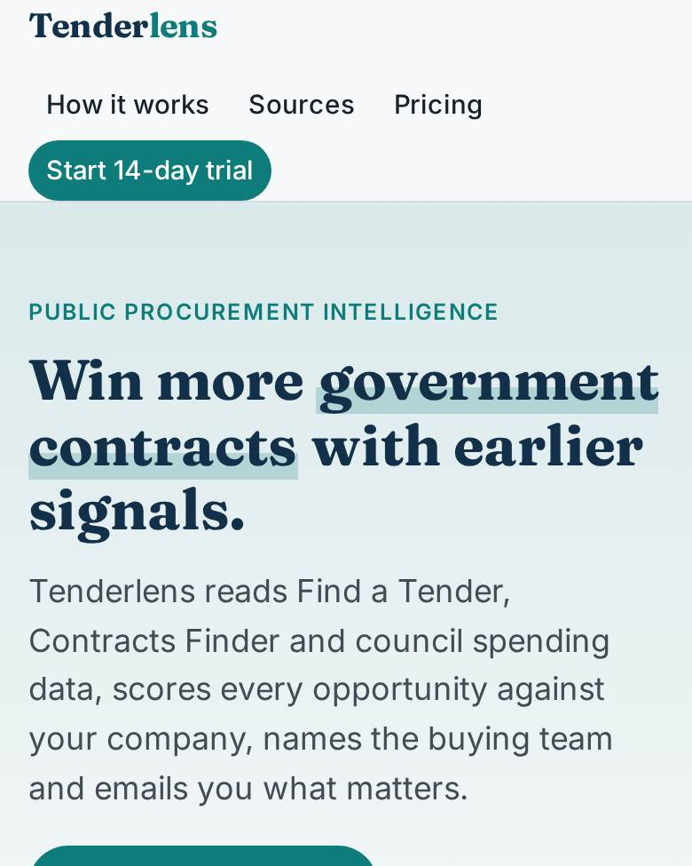
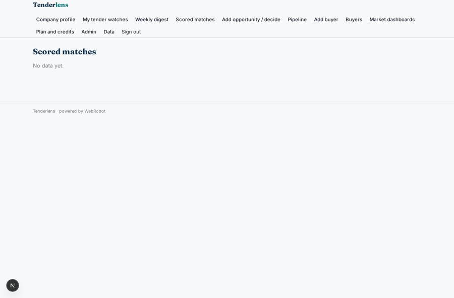
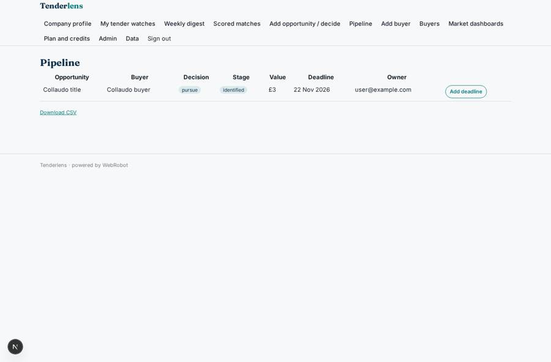
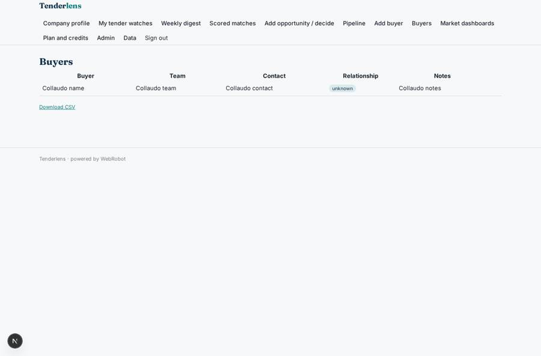
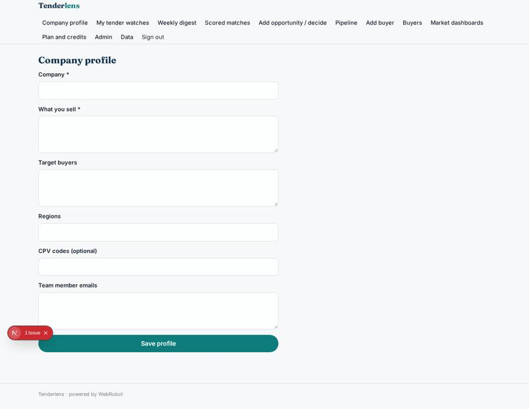

# Tenderlens

_Public procurement intelligence for companies selling to government._

**Sector:** Sanità, istruzione, energia, gov · **Manifest:** valid (schema + runtime contract) · **Functional test:** 1 failure(s) (20 checks passed)

## Description given to the app builder

I want Tenderlens, public procurement intelligence for companies selling to government. Suppliers sign up, describe what they sell, target buyers and regions. Scheduled agents read Find a Tender, Contracts Finder and council spending data under the Open Government Licence, and alert users by email to relevant tenders, early signals and expiring contracts. A CRM-like view lets sales teams track buyers, notes and opportunities; we want CRM integrations by OAuth. Plans £100 to £500 a month through Stripe. Roles are company admin, sales lead and bid manager; each company sees only its own pipeline. An agent summarises each tender, scores fit against the company profile and names the buying team, and users mark opportunities as pursue or skip, which teaches the scoring. Dashboards show spend by buyer, contract renewals coming up in the next 18 months and competitor wins from published award notices. A weekly digest email arrives every Monday. Free trial for 14 days. English only.

## Functional test: what did not pass

- **page opened by a role allowed to** (view account): status 200, error page (as user)

## Navigation recording

Signed in as the app's admin, the recorder opened 7 menu page(s): Company profile, My tender watches, Weekly digest, Scored matches, Add opportunity / decide, Pipeline, Add buyer.
- data page empty: matches_view (table)

Empty data pages are mostly expected on the local runtime: agents are mocked there, so the collections they fill stay empty.

## Features not expressible today (spec.extensions)

- **crm_oauth**: CRM integrations by OAuth (Salesforce, HubSpot, Dynamics) are not available yet; the built-in pipeline and buyers views, with CSV export, are provided meanwhile. API-key CRMs can be added through credentials later.
- **free_trial_14_days**: A 14-day free trial is approximated with signup credits; time-limited trial enforcement and Stripe trial periods are not available yet and must be configured by the owner.
- **scoring_feedback**: Pursue/skip decisions are passed to the scorer as context and instance memory; there is no model training.

## Screenshots (interpretive runtime, test data)

### home-anon

### home-mobile

### matches_view

### pipeline

### buyers

### profile

