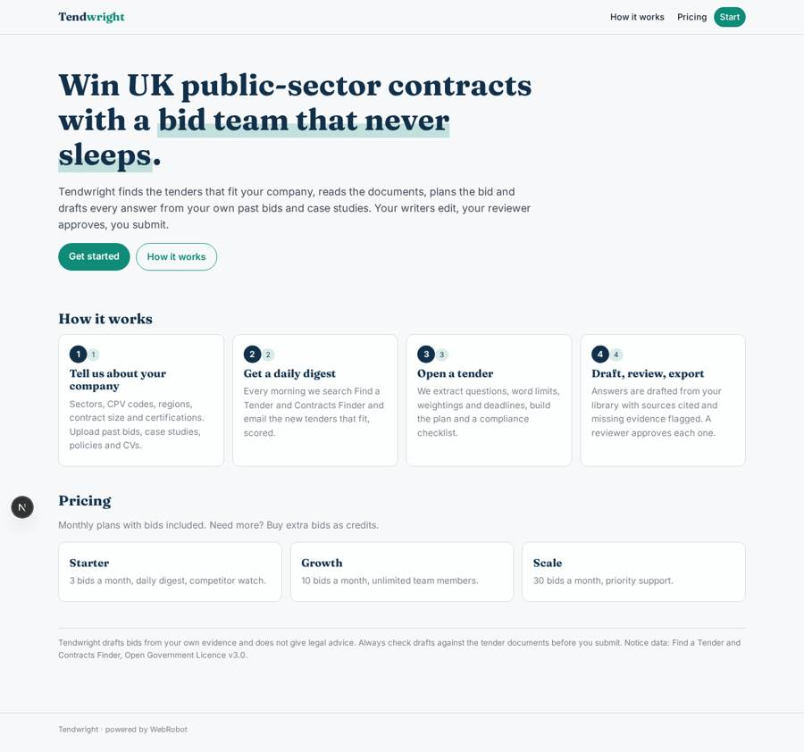
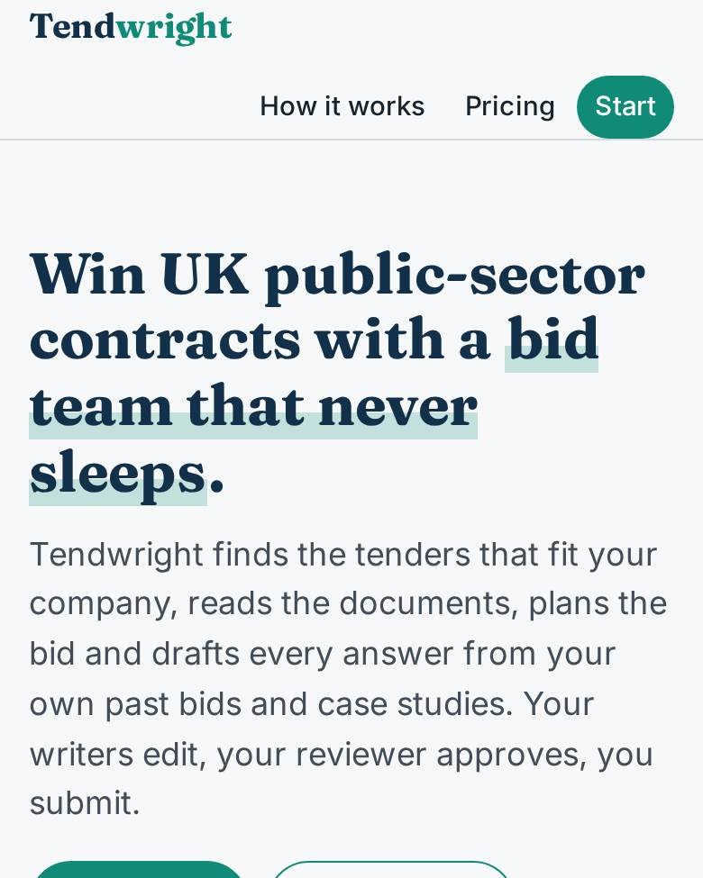
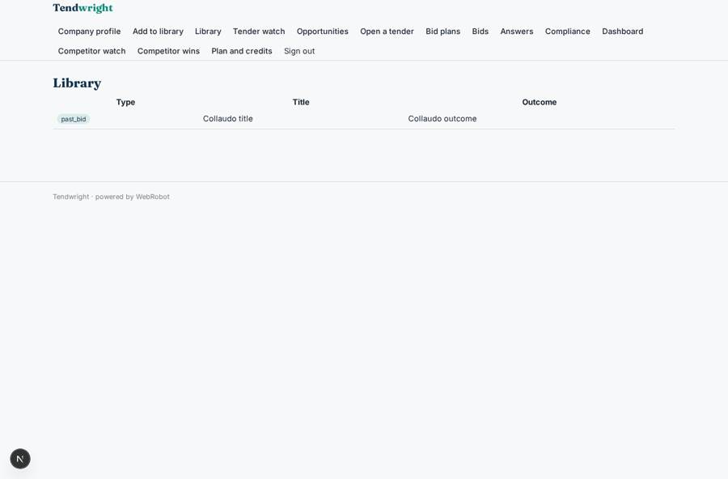
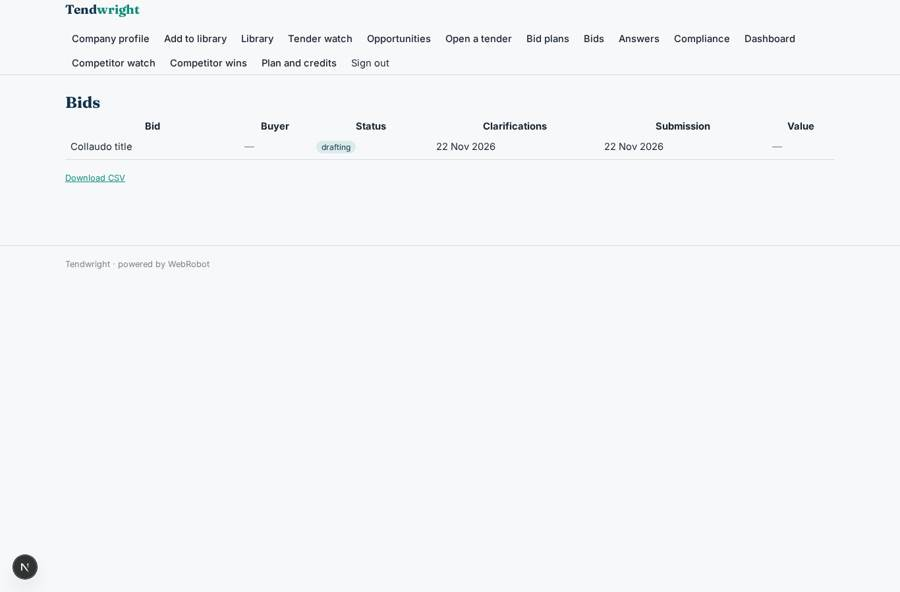
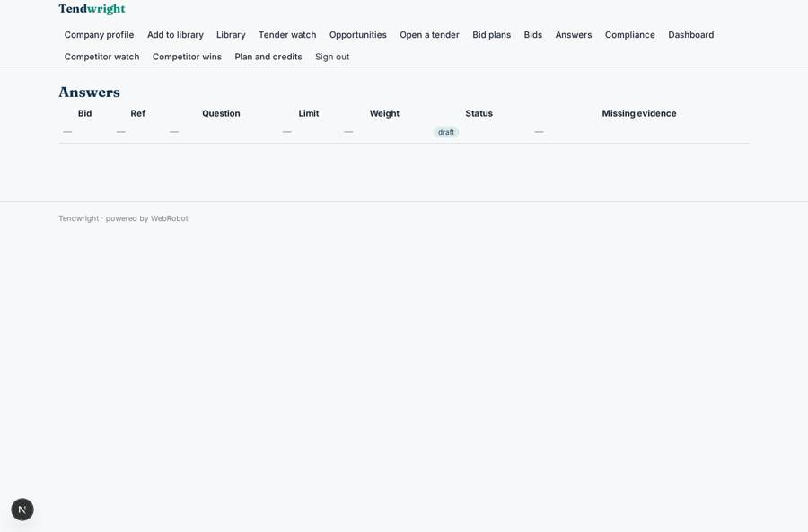

# Tendwright

_Win UK public-sector contracts without the bid-writing grind._

**Sector:** B2B AI and SaaS · **Manifest:** valid (schema + runtime contract) · **Functional test:** passed (26 checks passed)

## Description given to the app builder

I want Tendwright, which helps SMEs win UK public-sector contracts. A company signs up and invites bid writers and reviewers; each company sees only its own bids. At onboarding a form captures sectors, CPV codes, regions, contract value range and certifications held, and the company uploads past bids, case studies, policies and CVs written as roles. A daily agent searches the Find a Tender and Contracts Finder APIs, scores each new opportunity for fit and emails a digest. When the user opens a tender, the agent downloads the documents, extracts questions, word limits, weightings and deadlines, and builds a bid plan. For each question it drafts an answer from the company's own library, citing which past bid or case study it used and flagging missing evidence such as social value commitments. Writers edit and a reviewer approves every answer before export to Word. A compliance checklist confirms mandatory documents. Reminders before clarification and submission deadlines. Dashboard of pipeline, bids submitted, win rate and value won, and an agent that summarises award notices for competitors' wins. Pricing: monthly plans via Stripe with a number of bids included, extra bids as credits. English.

## Functional test: what did not pass

- **saved record shown where its collection is read** (view answers): a record was saved in bid_questions (by user) but the page does not show it (as user) _(warning)_

## Navigation recording

Signed in as the app's admin, the recorder opened 7 menu page(s): Company profile, Add to library, Library, Tender watch, Opportunities, Open a tender, Bid plans.
No issue found.

Empty data pages are mostly expected on the local runtime: agents are mocked there, so the collections they fill stay empty.

## Features not expressible today (spec.extensions)

- **word_export**: Export to Word (.docx) is not available yet. The compiled bid is a printable report you can save as PDF or copy into Word.
- **reviewer_only_approval**: Approving an answer is a status change on the answer. The designated reviewer can set it, but the runtime cannot yet forbid writers from setting it too.
- **find_a_tender_documents**: Find a Tender documents may need a login to download. When the agent cannot fetch them, the user uploads the documents in the Open a tender form.

## Screenshots (interpretive runtime, test data)

### home-anon

### home-mobile

### library

### opportunities

### bids

### answers

