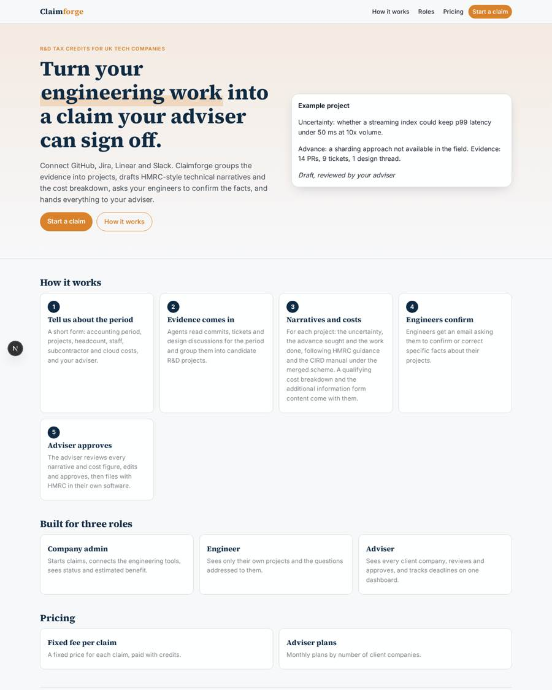
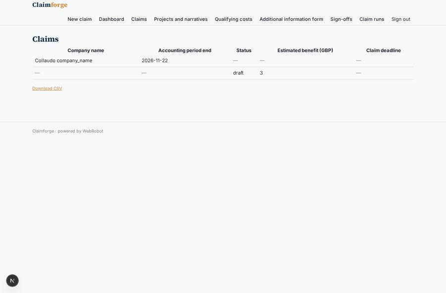
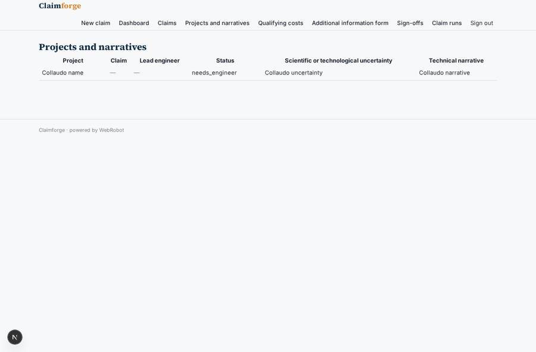
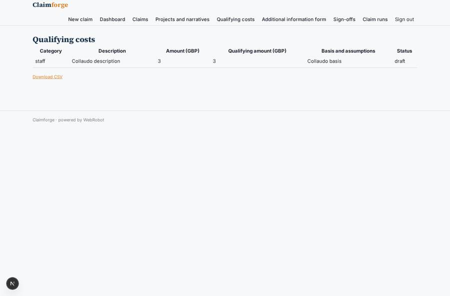
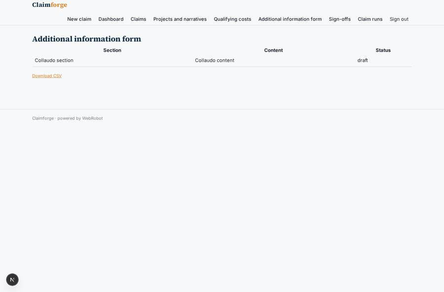

# Claimforge

_R&D tax credit claims for UK tech companies, drafted from your engineering evidence and reviewed by your adviser._

**Sector:** Fintech, proptech, insurtech · **Manifest:** valid (schema + runtime contract) · **Functional test:** passed (31 checks passed)

## Description given to the app builder

I want Claimforge, which automates R&D tax credit claims for UK tech companies. A company signs up with its adviser; the company connects its engineering tools (GitHub, Jira, Linear and Slack via OAuth) so commits, tickets and design discussions for the accounting period come in. A form collects the period, projects, headcount and staff costs, subcontractors and cloud costs. Agents group the evidence into projects, identify the scientific or technological uncertainty, the advance sought and the work done, and draft technical narratives following HMRC guidance and the CIRD manual under the merged scheme rules from April 2024; another agent prepares the qualifying cost breakdown and the content for the additional information form. Engineers are asked by email to confirm or correct facts about their projects. The adviser reviews every narrative and the cost figures, edits and approves; filing with HMRC is done by the adviser in their own software, not by the app. Roles: company admin, engineer (own projects), adviser (all client companies). Dashboards show claim status per client and estimated benefit. Reminders before claim deadlines. Pricing: fixed fee per claim, adviser plans by number of clients. English.

## Functional test: what did not pass

- **form saves a record** (form answer): only role engineer may fill it, and the test cannot hold that role _(warning)_

## Navigation recording

Signed in as the app's admin, the recorder opened 7 menu page(s): New claim, Dashboard, Claims, Projects and narratives, Qualifying costs, Additional information form, Sign-offs.
No issue found.

Empty data pages are mostly expected on the local runtime: agents are mocked there, so the collections they fill stay empty.

## Features not expressible today (spec.extensions)

- **oauth_connections**: GitHub, Jira, Linear and Slack connect with OAuth. OAuth sign-in to other services is not available yet, so users paste an API key or token on the account page. Switch to OAuth when it is supported.
- **adviser_client_quota**: Adviser plan limits by number of client companies are shown in the plan description but cannot be enforced yet, because client companies create their own claim records.
- **filing_outside_app**: Filing with HMRC is done by the adviser in their own software. The app only prepares drafts, cost lines and additional information form content.

## Screenshots (interpretive runtime, test data)

### home-anon

### home-mobile

### claims

### projects

### costs

### aif

