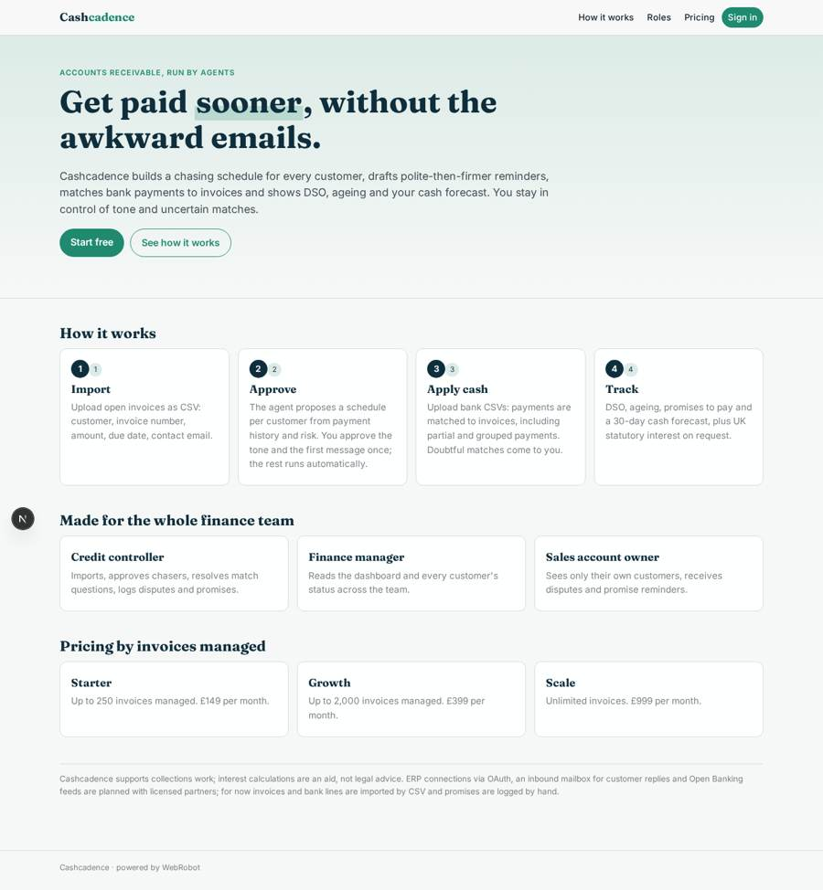
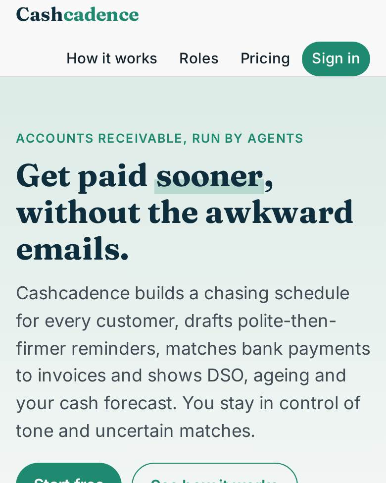
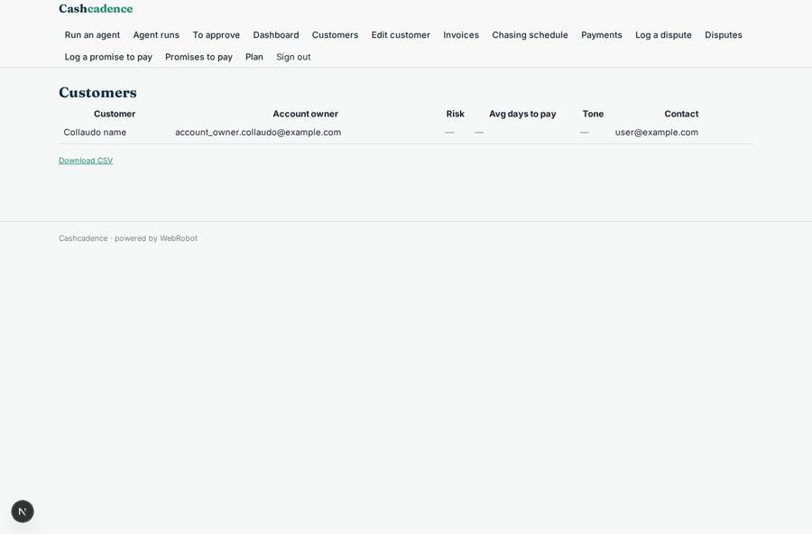
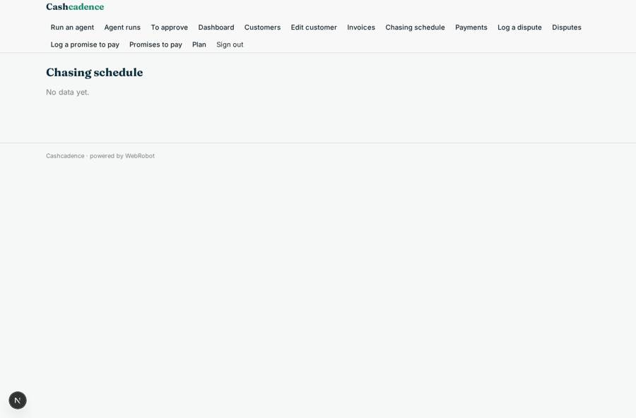
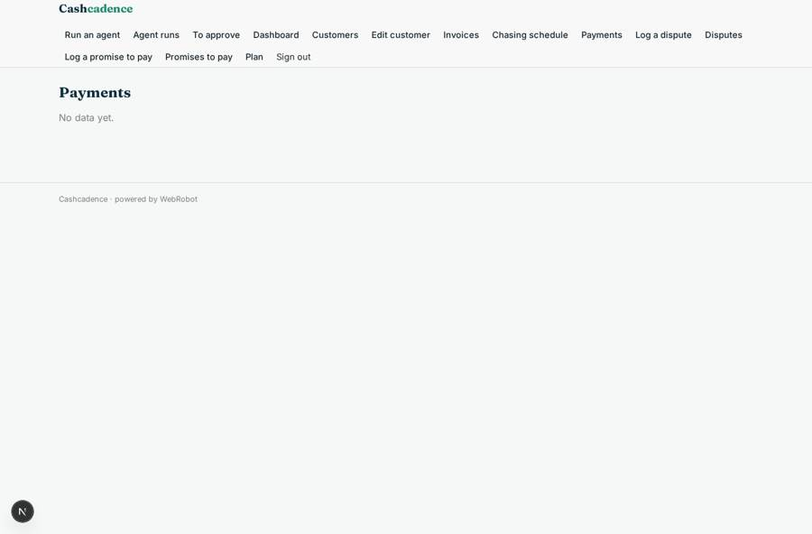

# Cashcadence

_Agentic accounts receivable: chase smarter, match payments, get paid sooner._

**Sector:** B2B AI and SaaS · **Manifest:** valid (schema + runtime contract) · **Functional test:** passed (22 checks passed)

## Description given to the app builder

We need Cashcadence, an agentic accounts receivable tool for collections and cash application. Finance teams at mid-sized companies sign up; roles are credit controller, finance manager and sales account owner, and owners see only their customers. Open invoices are imported by CSV (customer, invoice number, amount, due date, contact email). An agent builds a chasing schedule per customer based on payment history and risk, and drafts polite, then firmer reminders; the credit controller approves the tone and first message per customer, then the schedule runs automatically. Disputes are logged by form and routed to the account owner. When payments are imported from bank CSVs, an agent matches them to invoices, handles partial and grouped payments and asks a human about uncertain matches. Statutory late payment interest under UK law is calculated on request. Dashboards show days sales outstanding, ageing, promises to pay and cash forecast. The real product connects to ERP and accounting systems through OAuth, reads customers' email replies to chasers from an inbound mailbox, and matches payments using bank data via Open Banking, which needs a licensed partner, so include those. Pricing: subscription by number of invoices managed. English.

## Navigation recording

Signed in as the app's admin, the recorder opened 7 menu page(s): Run an agent, Agent runs, To approve, Dashboard, Customers, Edit customer, Invoices.
- data page empty: invoices (table)

Empty data pages are mostly expected on the local runtime: agents are mocked there, so the collections they fill stay empty.

## Features not expressible today (spec.extensions)

- **erp_oauth**: Not available yet: connecting ERP and accounting systems (Xero, QuickBooks, Sage, NetSuite) through OAuth to sync customers, invoices and payment status. Today invoices are imported by CSV; this needs OAuth sign-in to other services.
- **inbound_mailbox**: Not available yet: reading customers' email replies to chasers from an inbound mailbox, to log promises to pay and disputes automatically. Today promises and disputes are logged by form.
- **open_banking**: Not available yet: bank feeds through Open Banking for payment matching; it needs a licensed partner (AISP). Today bank statements are imported as CSV.

## Screenshots (interpretive runtime, test data)

### home-anon

### home-mobile

### customers

### invoices

### chasers

### payments

