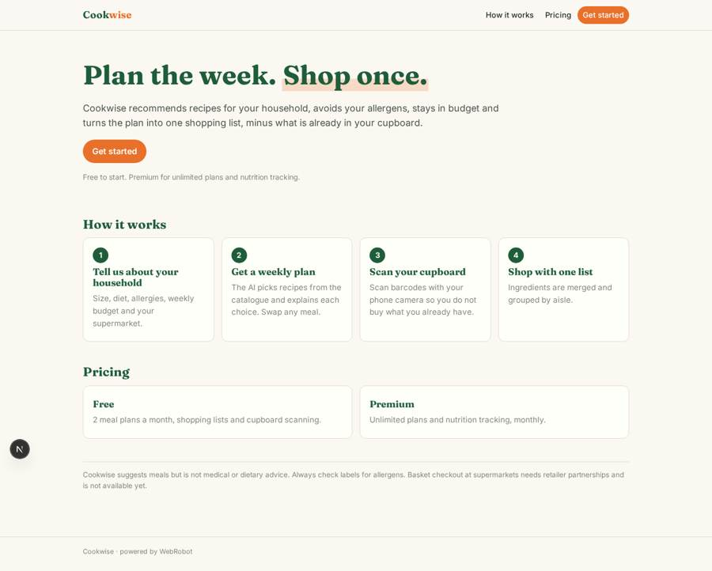
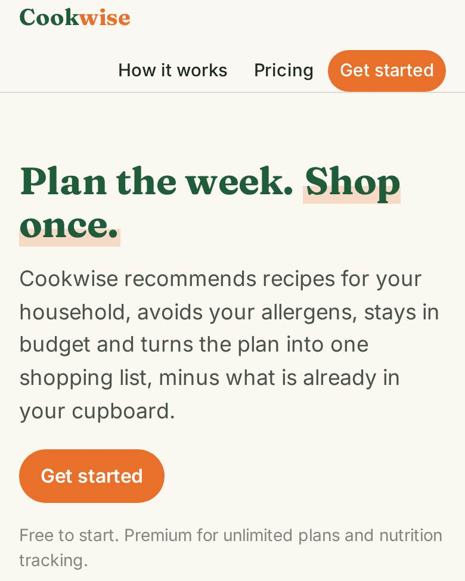
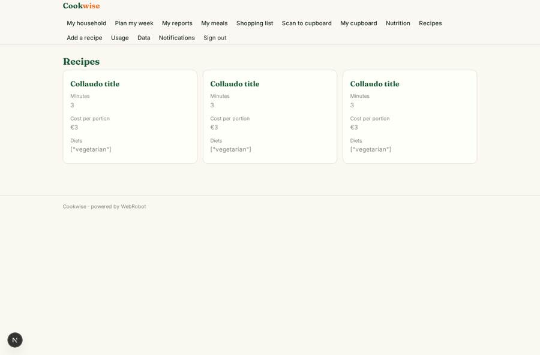
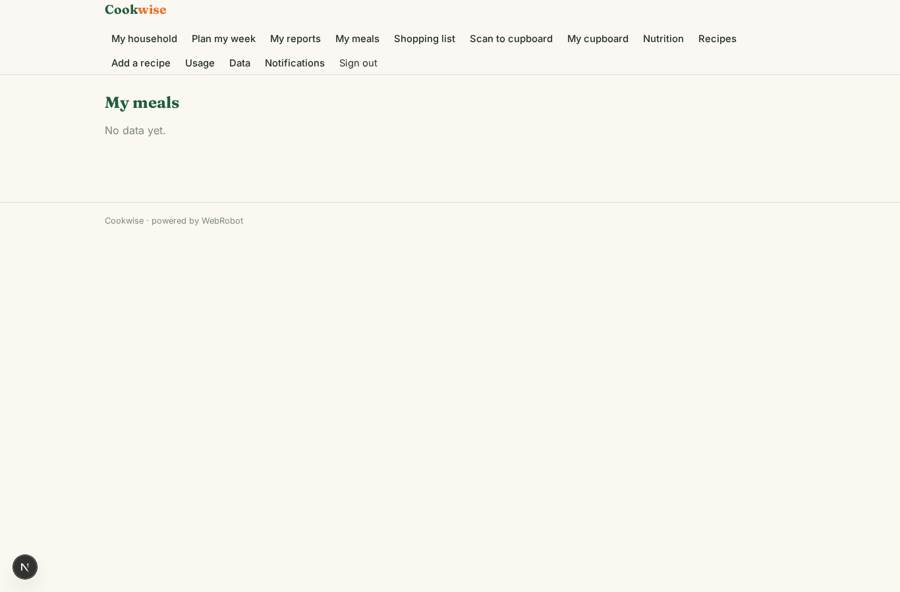
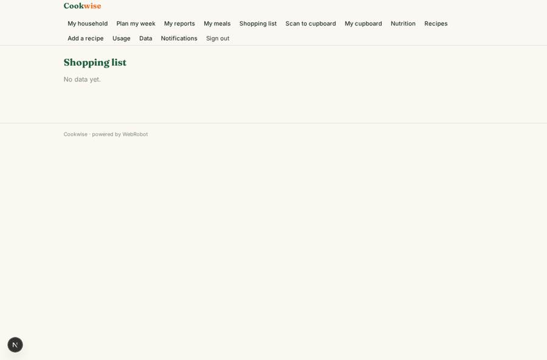
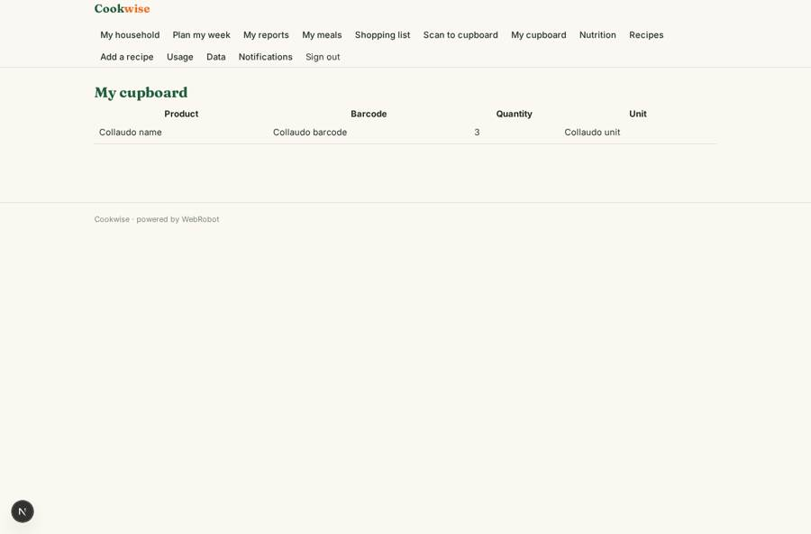

# Cookwise

_From recipes to your supermarket shopping list._

**Sector:** Consumer, travel, retail · **Manifest:** valid (schema + runtime contract) · **Functional test:** passed (19 checks passed)

## Description given to the app builder

We want a phone app, also on the web, called Cookwise that turns recipes into supermarket shopping. Users sign up and set household size, diet (vegetarian, vegan, halal, gluten-free), allergies, budget per week and preferred supermarket. A recipe catalogue (our own recipes or licensed ones) has ingredients, steps, time, cost per portion and photos. An AI agent recommends recipes and builds a weekly meal plan, explaining choices and avoiding allergens; users can swap meals. The app turns the plan into a combined shopping list, deduplicating ingredients and subtracting what users already have, which they can add by scanning barcodes in their cupboard with the phone camera. Then the list should become a basket at the chosen supermarket and go to checkout; this needs retailer product data and basket integration by partnership only, as there are no public basket APIs. Push reminders on Sunday to plan the week and on the day to defrost. Users see only their own plans; recipe editors manage the catalogue; admins see usage. Pricing: free with a premium monthly subscription for unlimited plans and nutrition tracking. English.

## Navigation recording

Signed in as the app's admin, the recorder opened 7 menu page(s): My household, Plan my week, My reports, My meals, Shopping list, Scan to cupboard, My cupboard.
- data page empty: my_meals (table)
- data page empty: shopping (table)

Empty data pages are mostly expected on the local runtime: agents are mocked there, so the collections they fill stay empty.

## Features not expressible today (spec.extensions)

- **retailer_basket**: Turning the shopping list into a basket at the chosen supermarket and checkout needs retailer product data and basket integration, available only through partnership (no public basket APIs). Not available yet: users shop from the list and export it as CSV.
- **licensed_recipes**: If recipes are licensed from a third party, the editors import them into the catalogue and record the licence in the source field.

## Screenshots (interpretive runtime, test data)

### home-anon

### home-mobile

### recipes

### my_meals

### shopping

### pantry

