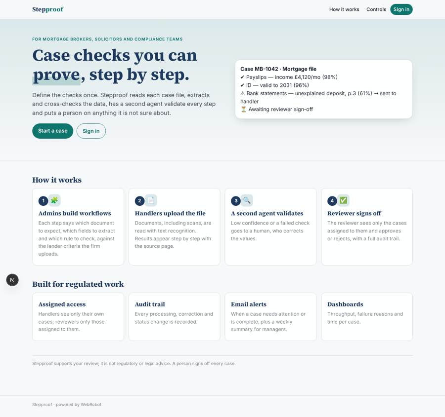
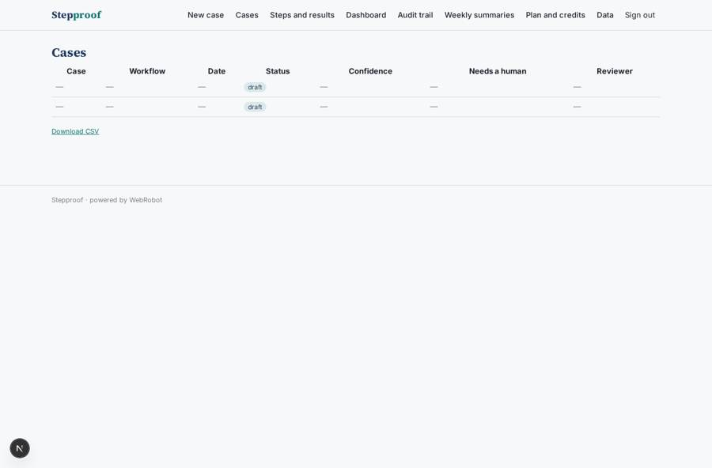
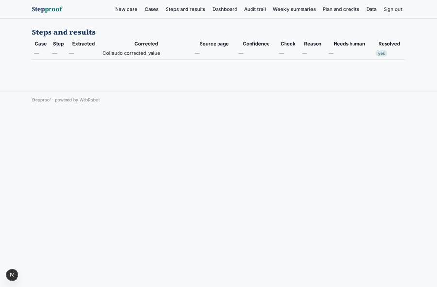
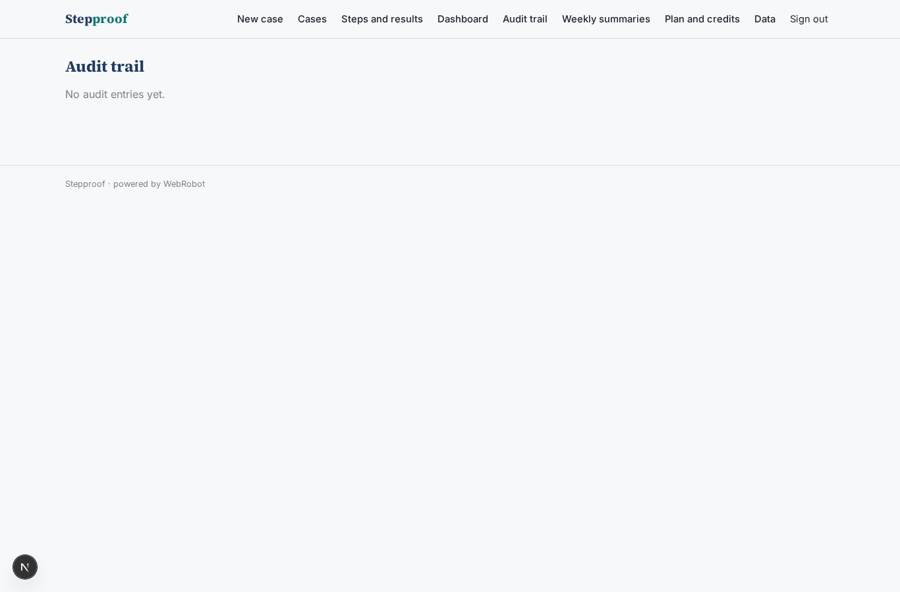
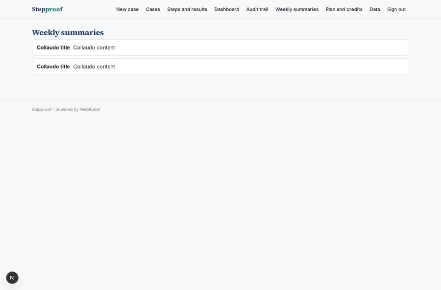

# Stepproof

_Reliable multi-step checks on case files, with a human wherever the AI is unsure._

**Sector:** B2B AI and SaaS · **Manifest:** valid (schema + runtime contract) · **Functional test:** passed (22 checks passed)

## Description given to the app builder

I want Stepproof, a tool for regulated firms such as mortgage brokers, solicitors and compliance teams that runs reliable multi-step checks on case files. The firm signs up; an admin builds workflows, case handlers work cases, reviewers approve, and handlers see only cases assigned to them. A workflow is a list of steps defined by forms: which document to expect, which fields to extract, which rule to check. For a mortgage file: payslips, bank statements, ID and application form; the agent extracts income, outgoings and employment details, checks consistency across documents, recomputes affordability against the lender criteria the firm uploaded and flags gaps. Each step has a validation check by a second agent, and any step with low confidence or a failed check goes to a human. The handler uploads documents, sees the results step by step with links to the source page, corrects values and sends the case to the reviewer for sign-off. Scanned documents need text recognition. Emails when a case needs attention or is complete, a weekly summary for managers. Dashboards of throughput, failure reasons and time per case. Full audit trail. Pricing: subscription per firm plus a charge per case processed. English.

## Functional test: what did not pass

- **saved record shown where its collection is read** (view cases): a record was saved in cases (by handler, admin) but the page does not show it (as handler) _(warning)_

## Navigation recording

Signed in as the app's admin, the recorder opened 7 menu page(s): New case, Cases, Steps and results, Dashboard, Audit trail, Weekly summaries, Plan and credits.
- agent run did not open: new_case: the run did not open

Empty data pages are mostly expected on the local runtime: agents are mocked there, so the collections they fill stay empty.

## Features not expressible today (spec.extensions)

- **per_firm_tenancy**: Each firm is intended to be its own app instance (one subscription and one set of admins per firm); a single instance shared by several firms is not isolated between them.
- **source_page_links**: Source pages are recorded as document name and page text in each step; clickable deep links into the page image are not available yet.
- **case_assignment_by_admin**: A case is assigned to the handler who creates it; reassigning a case to another handler is not supported yet.

## Screenshots (interpretive runtime, test data)

### home-anon

### home-mobile

### cases

### steps

### audit

### weekly

