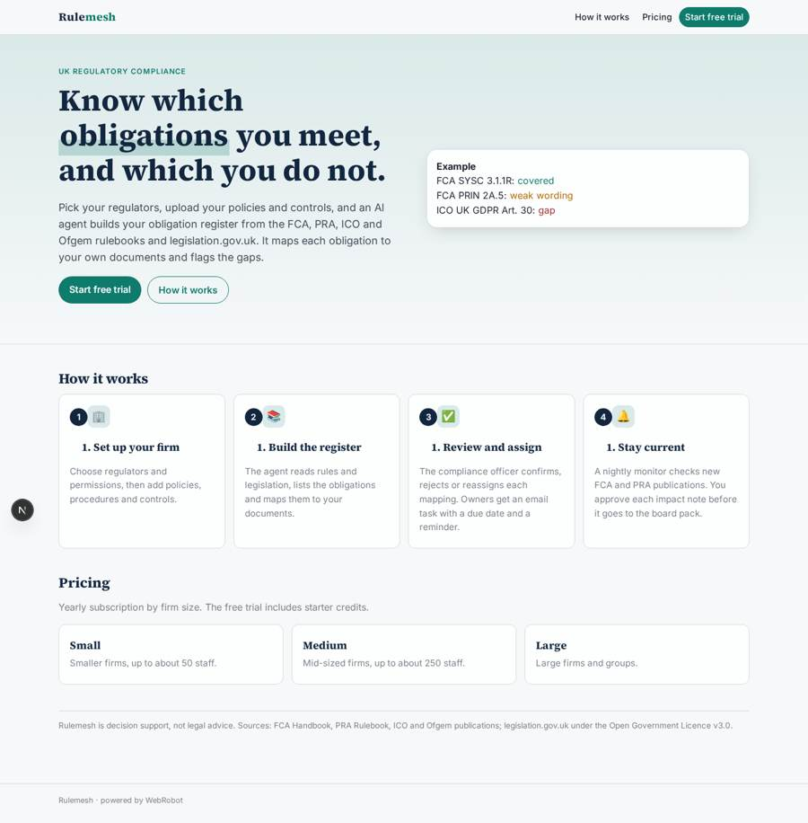
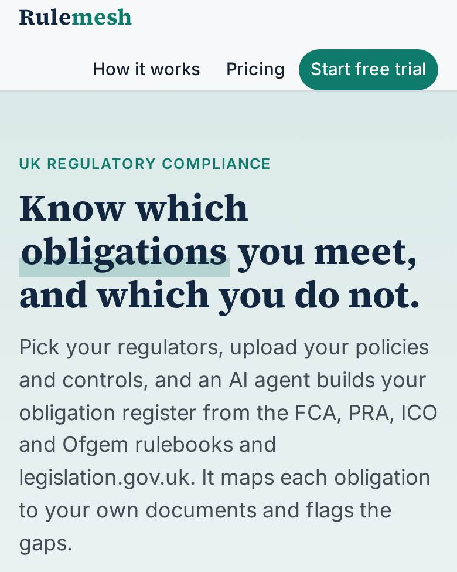
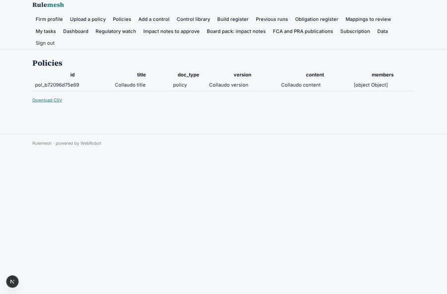
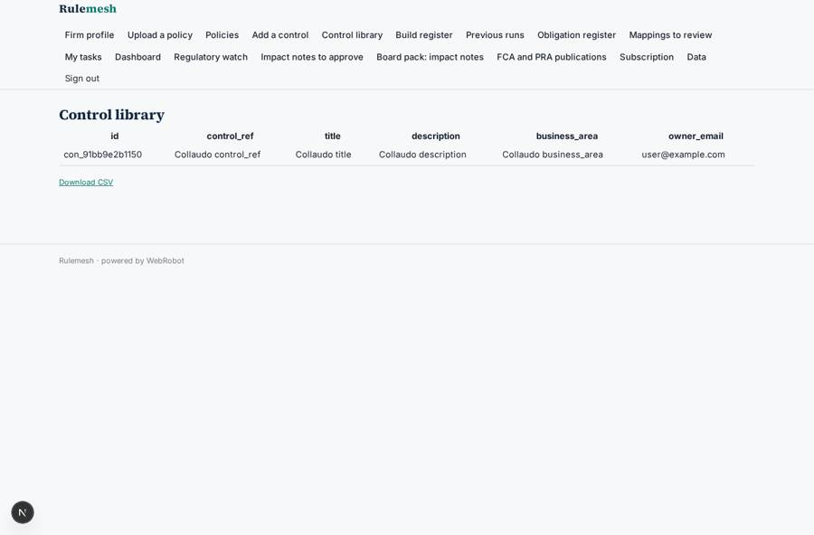
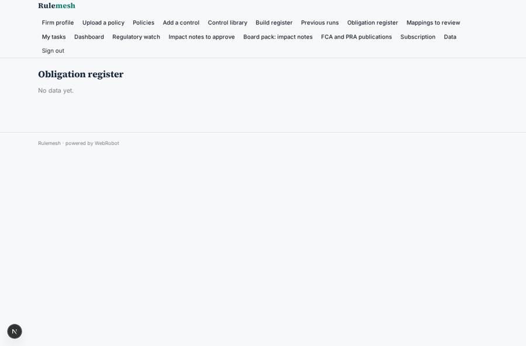
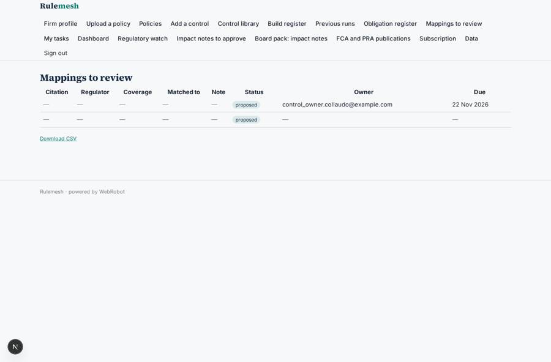

# Rulemesh

_Every UK regulatory obligation, mapped to your policies and controls._

**Sector:** Fintech, proptech, insurtech · **Manifest:** valid (schema + runtime contract) · **Functional test:** passed (32 checks passed)

## Description given to the app builder

We need a compliance platform called Rulemesh for UK regulated firms. A firm signs up, picks its regulators (FCA, PRA, ICO, Ofgem) and its permissions, and uploads its own policies, procedures and control library. An agent reads the relevant rulebooks and legislation.gov.uk texts, builds an obligation register (obligation, source citation, applicable business area) and maps each obligation to the firm's policies and controls, flagging gaps where nothing covers it and weak spots where the wording is vague. The compliance officer reviews each mapping and confirms, rejects or reassigns it to an owner; owners get an email task with a due date and a reminder before it expires. Every night a scheduled monitor checks new FCA and PRA publications, consultation papers and policy statements, and when something changes the agent drafts an impact note listing which obligations and controls are affected; the compliance officer approves it before it reaches the board pack. Roles: admin, compliance officer, control owner (sees only own tasks), auditor (read-only). Dashboards show coverage per regulator, open gaps and overdue actions, with CSV and PDF export. Pricing is a yearly subscription by firm size, with a free trial. English.

## Navigation recording

Signed in as the app's admin, the recorder opened 7 menu page(s): Firm profile, Upload a policy, Policies, Add a control, Control library, Build register, Previous runs.
- form not sent: firm: Regulators is required

Empty data pages are mostly expected on the local runtime: agents are mocked there, so the collections they fill stay empty.

## Features not expressible today (spec.extensions)

- **trial_by_credits**: The free trial is a one-off allowance of starter credits at signup, not a time-limited trial.
- **overdue_filter**: A filter on due dates relative to today is not available. The dashboard lists open actions by due date, and overdue owners are emailed the day after the due date.
- **pdf_export**: PDF export uses the printable views (browser print or save as PDF). CSV export is available on the tables.
- **rulebook_sources**: The FCA Handbook, PRA Rulebook, ICO and Ofgem have no reusable API here. The agent reads their pages through the WebRobot MCP, and legislation.gov.uk through its open data. The nightly monitor covers FCA and PRA only.

## Screenshots (interpretive runtime, test data)

### home-anon

### home-mobile

### policies

### controls

### obligations

### mappings

