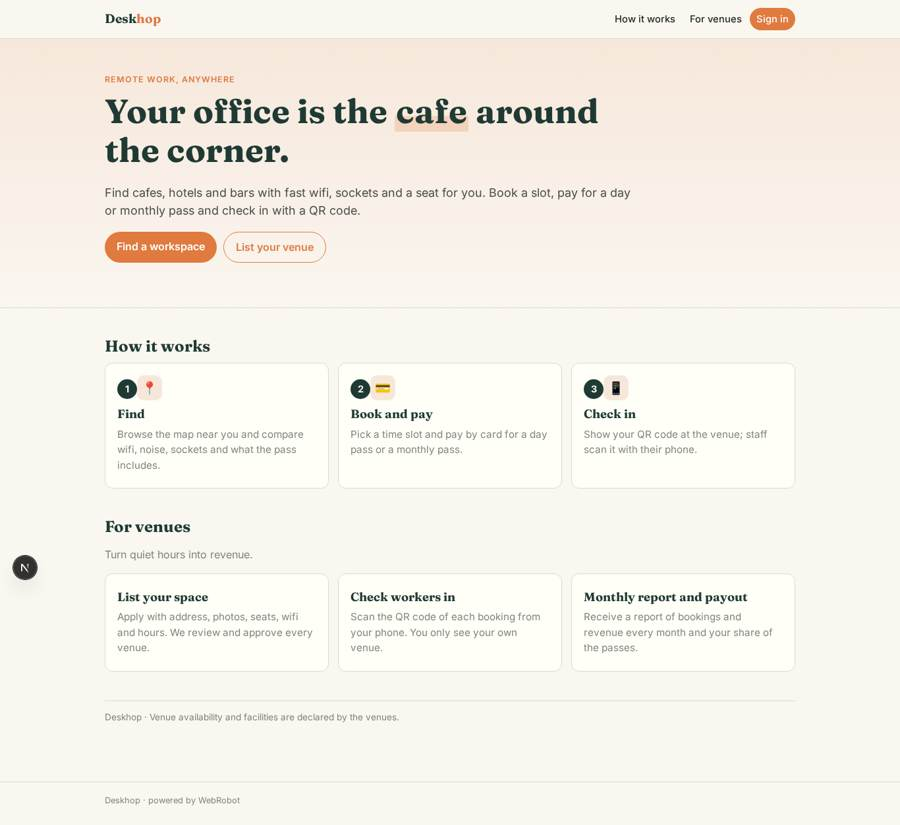
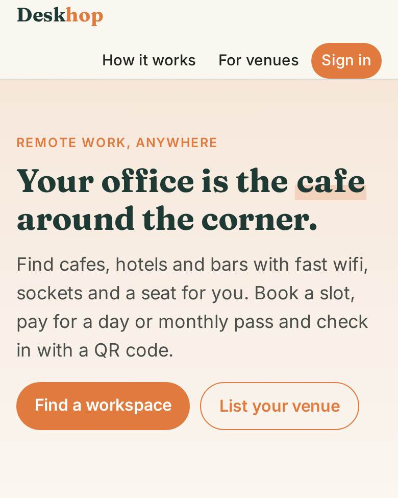
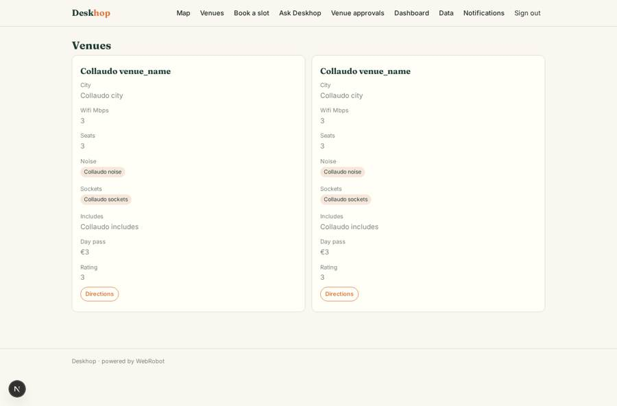
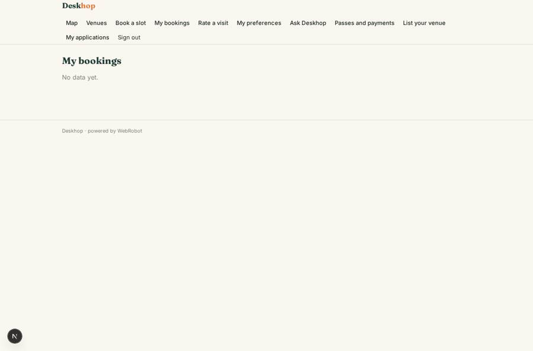
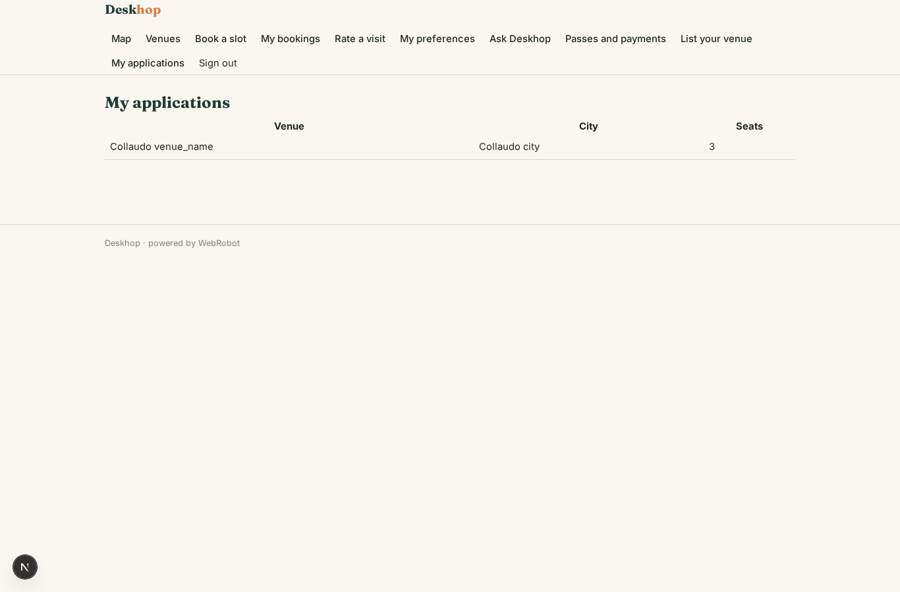

# Deskhop

_Work from the best cafes, hotels and bars near you._

**Sector:** Consumer, travel, retail · **Manifest:** valid (schema + runtime contract) · **Functional test:** passed (29 checks passed)

## Description given to the app builder

I want a phone app, also on the web, called Deskhop that connects remote workers with workspaces in cafes, hotels and bars. Venues sign up as partners and list their space: address, photos, number of work seats, wifi speed, power sockets, noise level, opening hours for workers, and what a pass includes (coffee, lunch). Venue staff see only their own venue. Workers sign up, find venues on a map near their phone location with filters, book a time slot and pay for a day pass or a monthly pass by card. At the venue they check in by showing a QR code that staff scan with their phone. An agent recommends venues from past bookings and preferences and answers questions about venues. Workers rate each visit. Venues get a monthly report of bookings and revenue; we pay venues their share monthly. Admins approve new venues and see dashboards of bookings, active passes and top cities. Emails confirm bookings and remind workers when a monthly pass renews. English.

## Functional test: what did not pass

- **form saves a record** (form checkin): only role partner may fill it, and the test cannot hold that role _(warning)_
- **template instance created and run** (template venue_report): reserved to partner _(warning)_

## Navigation recording

Signed in as the app's admin, the recorder opened 6 menu page(s): Map, Venues, Book a slot, Ask Deskhop, Venue approvals, Dashboard.
No issue found.

Empty data pages are mostly expected on the local runtime: agents are mocked there, so the collections they fill stay empty.

## Features not expressible today (spec.extensions)

- **qr_display**: The worker's check-in code is shown as text in My bookings; rendering it as a QR image is not available yet.
- **near_me_filters**: Interactive filters (wifi, noise, distance from the phone position) on the map are not available; the assistant filters venues in chat.
- **per_venue_capacity**: Booking capacity per slot is one fixed number; per-venue seat counts are not enforced.
- **venue_payouts**: The 70% venue share is calculated and recorded; the monthly bank payout to venues is done manually.

## Screenshots (interpretive runtime, test data)

### home-anon

### home-mobile

### venues_list

### my_bookings

### my_listings

### checkin_log

