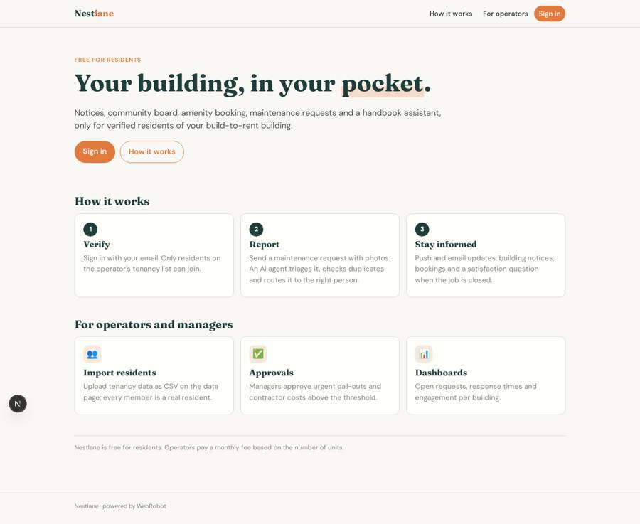
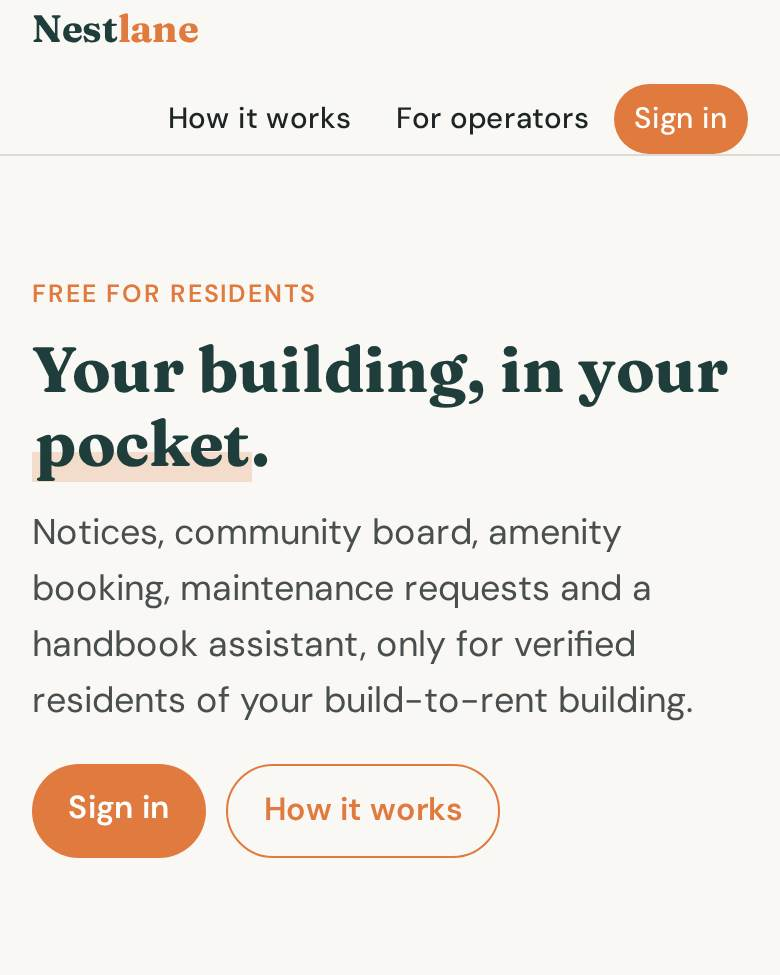
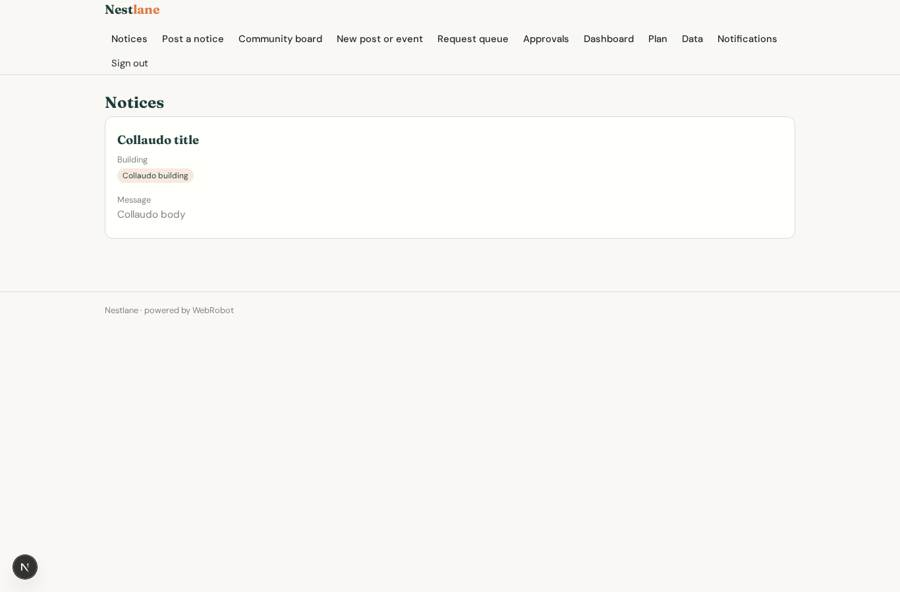
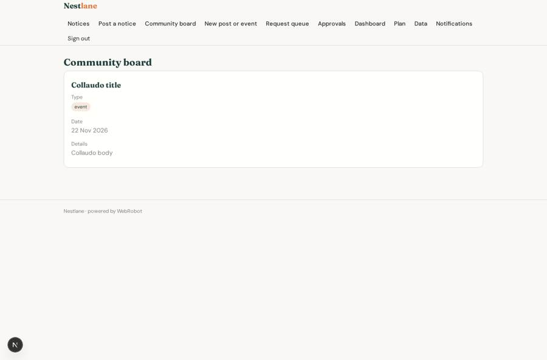
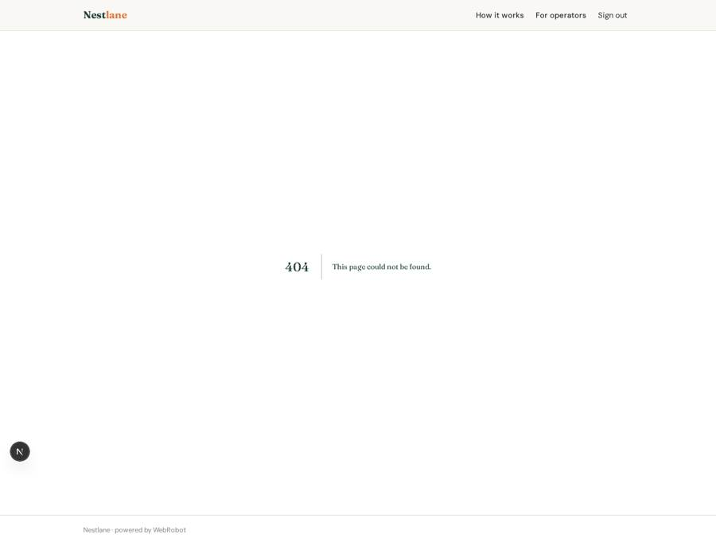
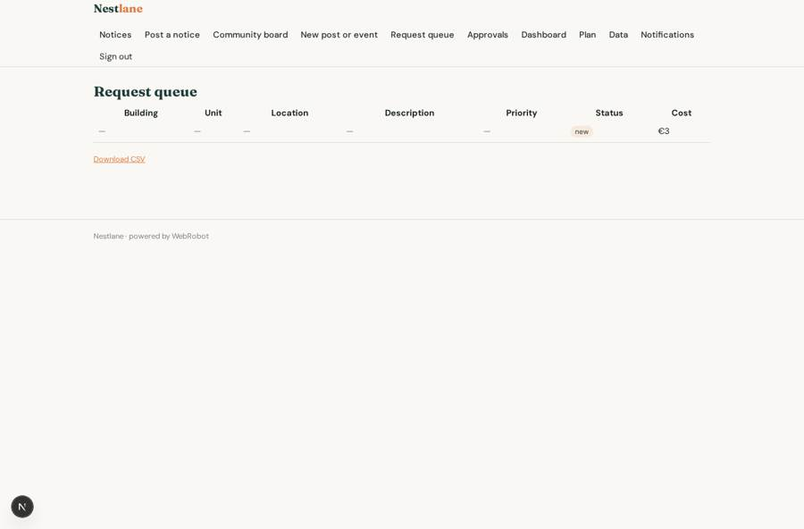

# Nestlane

_The resident app for build-to-rent buildings._

**Sector:** Fintech, proptech, insurtech · **Manifest:** valid (schema + runtime contract) · **Functional test:** passed (34 checks passed)

## Description given to the app builder

We need a resident app called Nestlane for build-to-rent operators and property managers. The operator signs up, creates buildings and imports residents from a CSV of its tenancy data; only residents who match the import can verify and join, so every member is a real resident. Roles: operator admin (all buildings), building manager (own building), maintenance staff (assigned requests), resident (own building and own requests). Residents get a phone app with push notifications: building notices, a community board for events and posts, an amenity booking calendar (gym, lounge, guest suite) and a maintenance request form with category, location, urgency, description and photos. An agent triages each request, suggests the category and priority, checks for duplicates in the same building and routes it to the right staff member; the manager approves urgent callouts and contractor costs above a threshold. Residents receive status updates by push and email, and a satisfaction question when the job is closed. A chat assistant answers resident questions from the building handbook and house rules. Managers see dashboards of open requests, response times and engagement. Pricing: monthly fee per unit for the operator, free for residents. English.

## Functional test: what did not pass

- **form saves a record** (form new_request): only role resident may fill it, and the test cannot hold that role _(warning)_
- **form saves a record** (form feedback): only role resident may fill it, and the test cannot hold that role _(warning)_
- **trigger has its effect** (trigger notice_push): email to role:resident: no such recipient in the test (role nobody holds or empty field) _(warning)_
- **saved record shown where its collection is read** (view my_requests): a record was saved in requests (by admin) but the page does not show it (as resident) _(warning)_
- **saved record shown where its collection is read** (view staff_queue): a record was saved in requests (by admin) but the page does not show it (as maintenance) _(warning)_

## Navigation recording

Signed in as the app's admin, the recorder opened 7 menu page(s): Notices, Post a notice, Community board, New post or event, Request queue, Approvals, Dashboard.
No issue found.

Empty data pages are mostly expected on the local runtime: agents are mocked there, so the collections they fill stay empty.

## Features not expressible today (spec.extensions)

- **per_unit_pricing**: The fee is per unit, but plans are sold as unit bands; exact per-unit metering is not available yet.
- **building_scoping**: Notices, community posts, bookings and feedback are visible to all residents/managers of the app, not filtered per building, because access rules cannot match a user's building yet. Push notices reach all residents.

## Screenshots (interpretive runtime, test data)

### home-anon

### home-mobile

### notices

### board

### my_requests

### staff_queue

