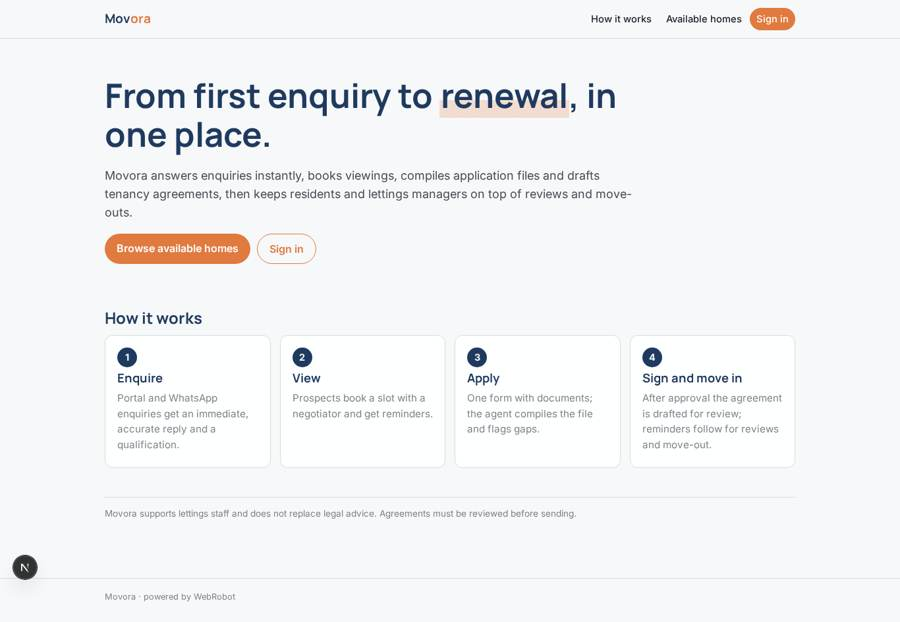
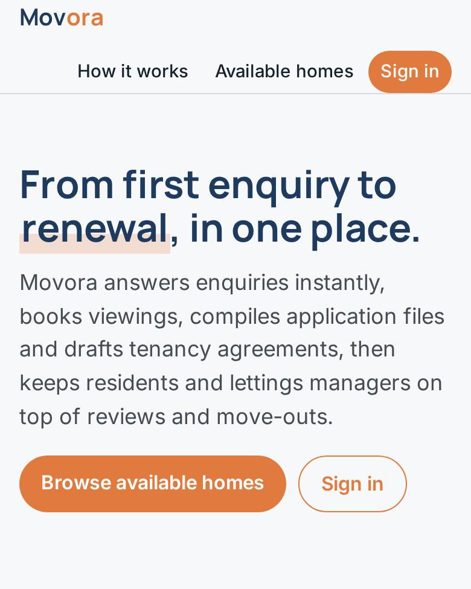
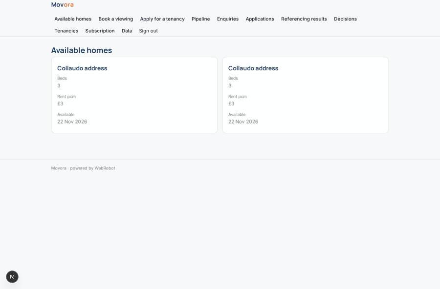
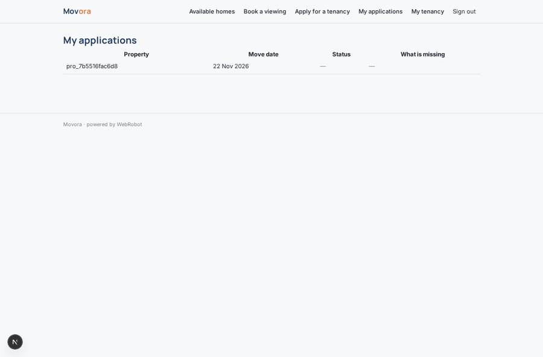
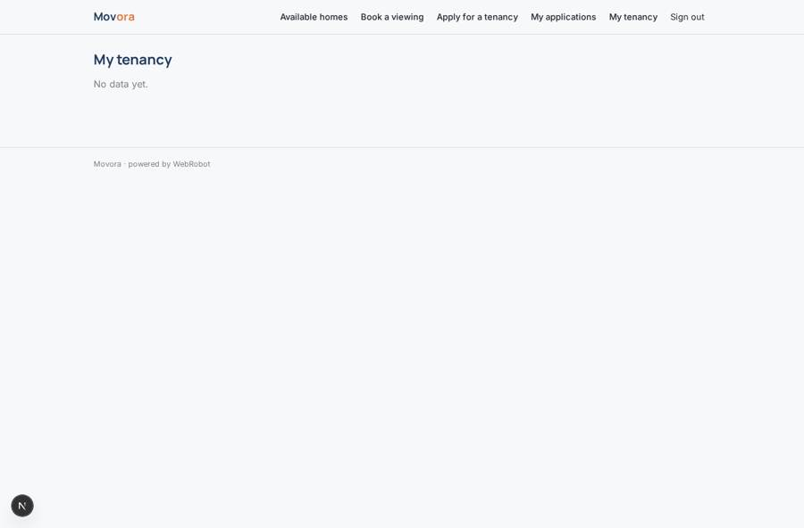
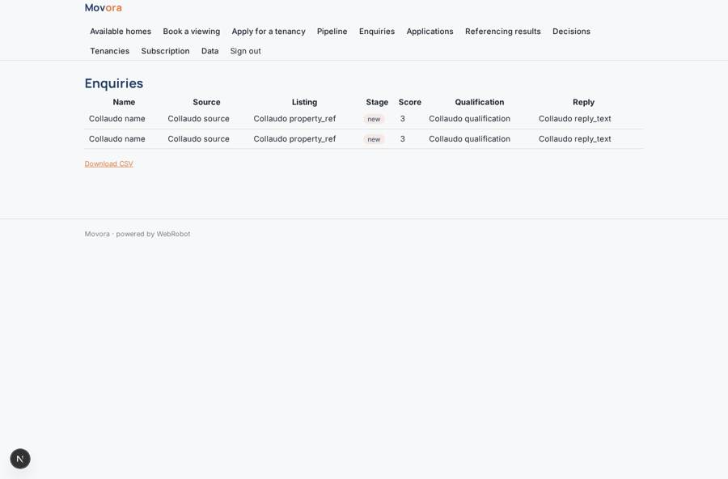

# Movora

_Every resident, from first enquiry to renewal._

**Sector:** Fintech, proptech, insurtech · **Manifest:** valid (schema + runtime contract) · **Functional test:** passed (32 checks passed)

## Description given to the app builder

We need Movora, a resident lifecycle platform for rental operators: enquiry, viewing, referencing, lease signing and renewal. The operator signs up with its portfolio of properties. Enquiries arrive from listing portals by email feed and from WhatsApp; an agent replies immediately, answers questions from the property details, qualifies the lead and books a viewing in the agent's calendar with reminders. After the viewing the prospect fills an application form: personal details, employment, income, current address, guarantor, pets, move date, and uploads documents. Referencing with credit data is done by a licensed partner; the agent compiles the file and highlights gaps. The lettings manager approves or declines. The app generates the tenancy agreement, updated for the Renters' Rights Act transition, and sends it for e-signature; deposit and first rent are collected through a payment partner. During the tenancy the app sends renewal and rent review reminders and a move-out checklist. Roles: operator admin, lettings manager, negotiator, applicant and resident (own records). Dashboards show pipeline, voids and time to let. Pricing: monthly subscription by number of units under management. English.

## Functional test: what did not pass

- **trigger has its effect** (trigger referencing_in): email to role:lettings_manager: no such recipient in the test (role nobody holds or empty field) _(warning)_
- **trigger has its effect** (trigger agreement_ready): email to role:lettings_manager: no such recipient in the test (role nobody holds or empty field) _(warning)_
- **trigger has its effect** (trigger partner_event_notify): email to role:lettings_manager: no such recipient in the test (role nobody holds or empty field) _(warning)_
- **saved record shown where its collection is read** (view my_tenancy): a record was saved in tenancies (by admin) but the page does not show it (as resident) _(warning)_

## Navigation recording

Signed in as the app's admin, the recorder opened 7 menu page(s): Available homes, Book a viewing, Apply for a tenancy, Pipeline, Enquiries, Applications, Referencing results.
No issue found.

Empty data pages are mostly expected on the local runtime: agents are mocked there, so the collections they fill stay empty.

## Features not expressible today (spec.extensions)

- **multi_operator**: This manifest serves one operator (its admins fill the portfolio on the data page). Several operators signing up with their own portfolios means one app per operator.
- **unit_cap**: The unit limit of each plan is not enforced automatically for properties added by admins; staff keep within their plan.
- **whatsapp_replies**: WhatsApp inbound works through the webhook, but sending WhatsApp replies is not available yet: the negotiator receives the ready reply and sends it manually.
- **calendar_sync**: Viewings are booked in the app's booking calendar; syncing to Google or Microsoft calendars (OAuth) is not available yet.
- **referencing_partner**: The licensed referencing partner is not called from the app: the partner posts its result to the referencing webhook and the agent never runs credit checks.
- **esignature_and_payments**: E-signature and collection of deposit and first rent run at the partners; their status arrives by webhook and the manager updates the tenancy record. Sending the agreement to the signature provider is not available yet.

## Screenshots (interpretive runtime, test data)

### home-anon

### home-mobile

### listings

### my_applications

### my_tenancy

### enquiries_list

