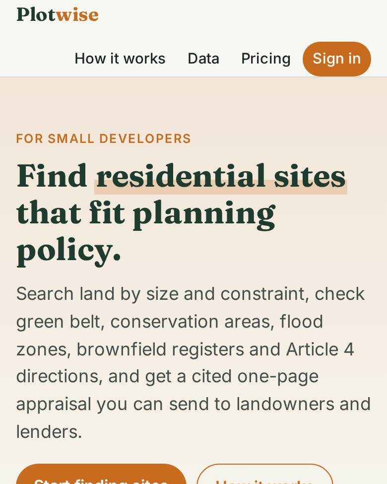
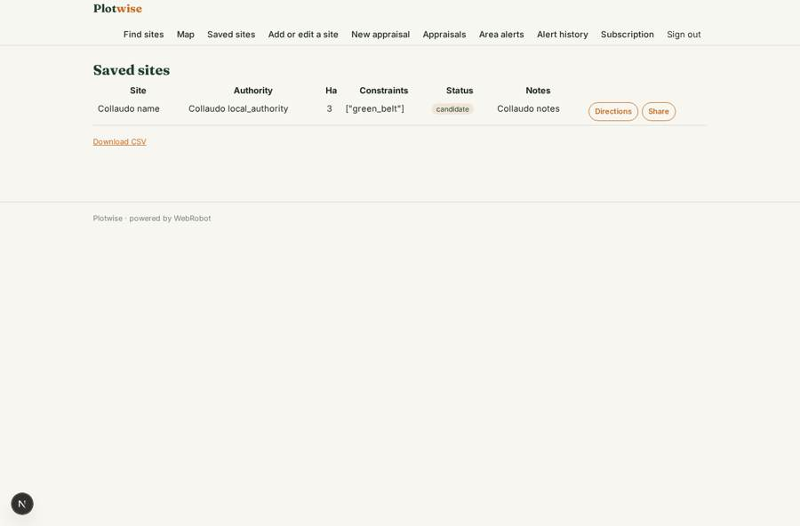
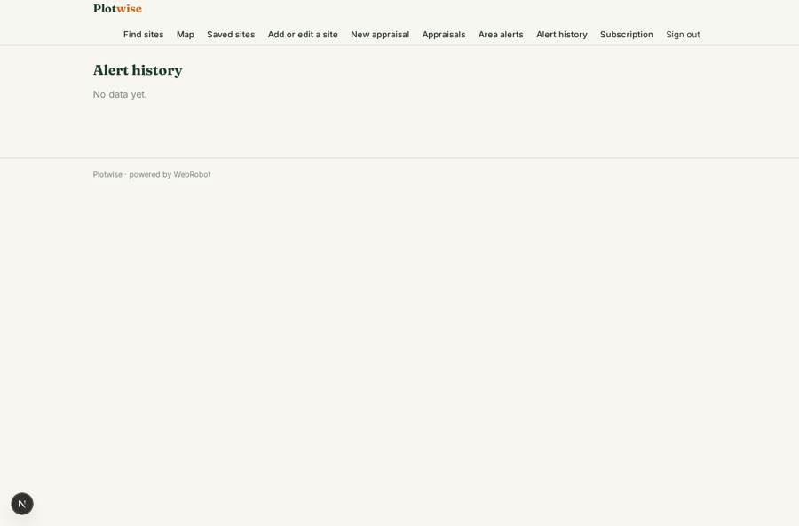
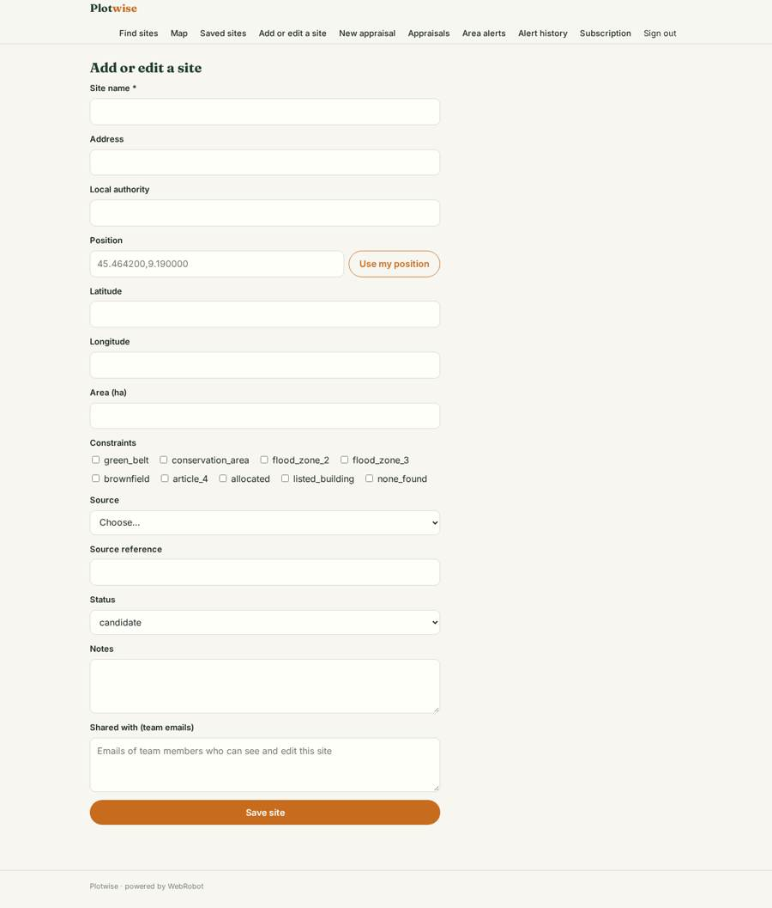
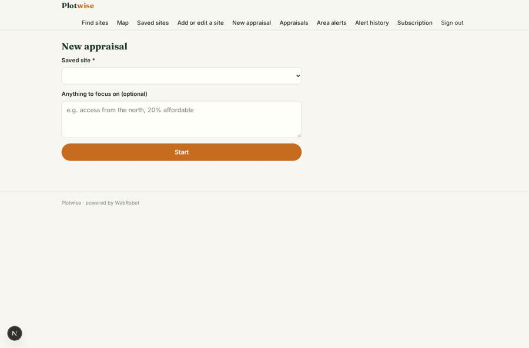

# Plotwise

_Find residential sites that fit planning policy, and appraise them in minutes._

**Sector:** Sanità, istruzione, energia, gov · **Manifest:** valid (schema + runtime contract) · **Functional test:** passed (14 checks passed)

## Description given to the app builder

I want Plotwise, a geospatial, policy-aware residential site finding and planning tool for small developers. Users search a map of land parcels, filter by size and constraints from planning.data.gov.uk and OS OpenData, and the premium Ordnance Survey MasterMap only if we have a licence. An agent checks local plan policies and planning history and estimates capacity. Users save sites and notes; Stripe subscription. Sites can be exported as a one-page PDF for landowners and lenders. The search covers green belt, conservation areas, flood zones, brownfield land registers and article 4 directions. For each site the agent drafts a short appraisal: policy fit, likely number of homes, access, constraints and risks, citing each policy. Users share saved sites with their team; roles are owner and team member. Email alerts when new brownfield or allocated sites appear in their search areas. Planning history comes from public data only. Pricing: £49 a month for one user, £149 for teams, through Stripe. English only.

## Navigation recording

Signed in as the app's admin, the recorder opened 7 menu page(s): Find sites, Map, Saved sites, Add or edit a site, New appraisal, Appraisals, Area alerts.
No issue found.

Empty data pages are mostly expected on the local runtime: agents are mocked there, so the collections they fill stay empty.

## Features not expressible today (spec.extensions)

- **pdf_export**: The one-page PDF is produced with the report view's print / save as PDF; there is no separate branded PDF generator yet.
- **team_seats**: Team seat limits (how many members per Team plan) are not enforced by the runtime; sharing is by the members email list on each site.
- **parcel_boundaries**: The map shows site points; true parcel polygons (INSPIRE index polygons, OS MasterMap) are not drawn yet.

## Screenshots (interpretive runtime, test data)

### home-anon

### home-mobile

### sites

### alerts

### site_form

### new_appraisal

