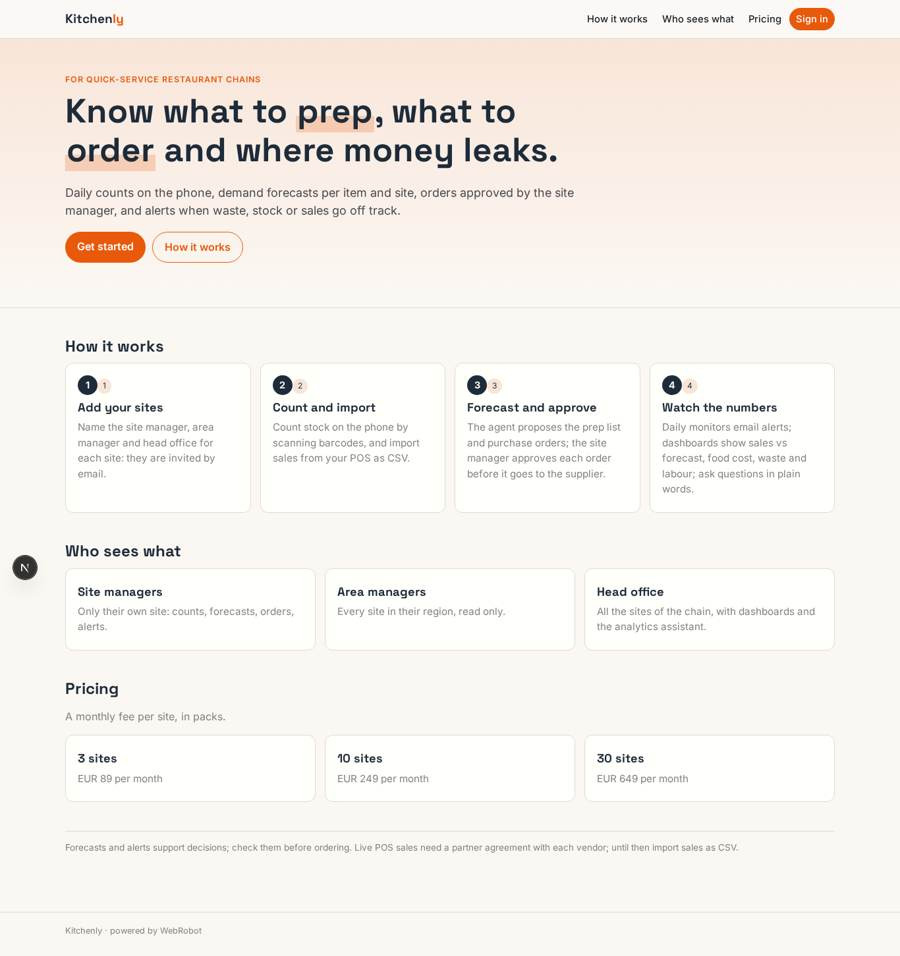
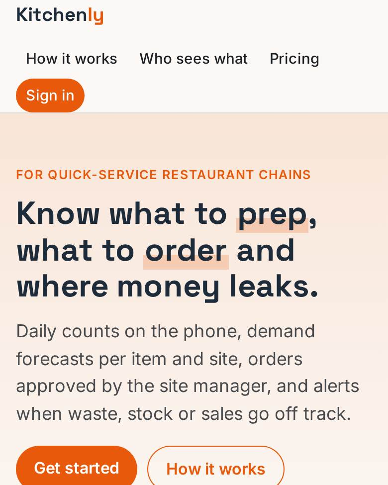
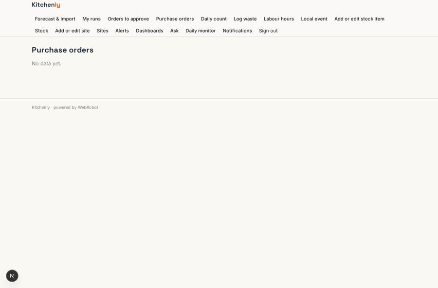
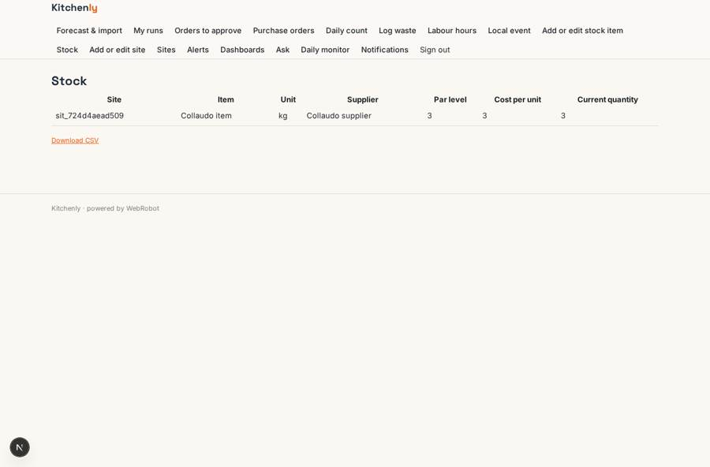
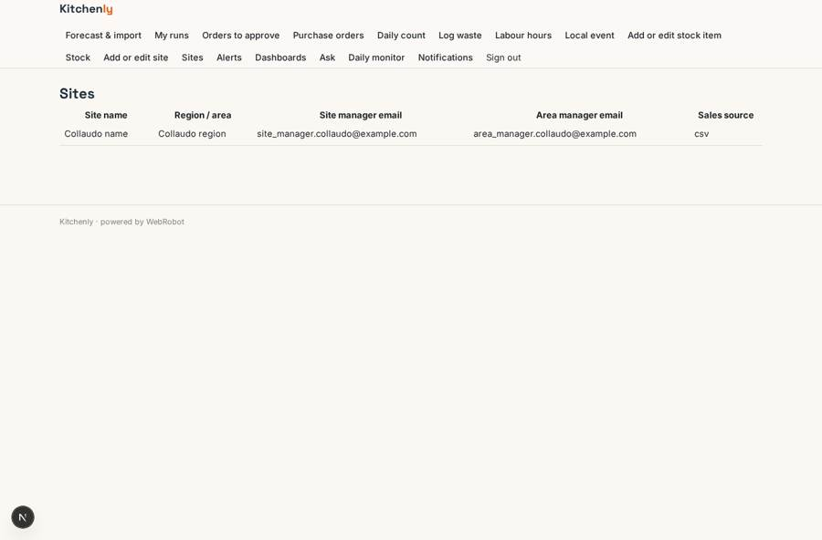
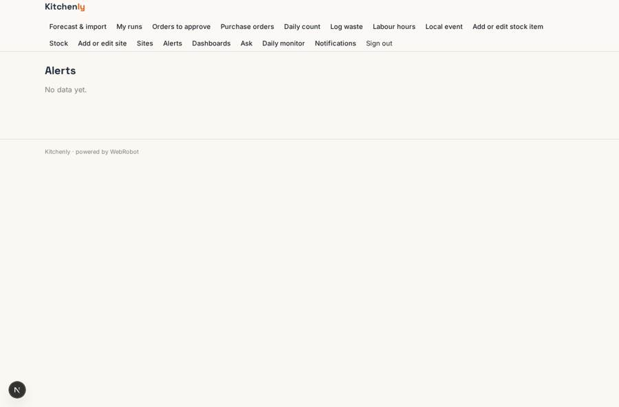

# Kitchenly

_Stock, forecasts and orders for quick-service restaurant chains._

**Sector:** Consumer, travel, retail · **Manifest:** valid (schema + runtime contract) · **Functional test:** passed (27 checks passed)

## Description given to the app builder

We need an operations app called Kitchenly for quick-service restaurant chains. A chain signs up, adds its sites and invites area managers and site managers; site managers see only their site, area managers their region, head office everything. Each site keeps a stock collection (item, unit, supplier, par level, cost, current quantity) and does a daily count on a phone-friendly form with barcode scanning. Sales should come live from the point-of-sale systems through vendor APIs, only where we have a partner agreement and OAuth access; until then managers import sales as CSV. A forecasting agent predicts demand per item, per site, per day from past sales, weekday and local events, proposes prep quantities and purchase orders, and the site manager approves each order before it is emailed to the supplier. Scheduled monitors flag waste, stock below par, unusual sales drops and food-cost overruns, and send email alerts. An "ask" analytics agent answers questions like "which sites had the worst waste last week?" with charts. Dashboards: sales vs forecast, food cost percentage, waste and labour hours per site. Pricing: monthly fee per site. English.

## Navigation recording

Signed in as the app's admin, the recorder opened 7 menu page(s): Forecast & import, My runs, Orders to approve, Purchase orders, Daily count, Log waste, Labour hours.
- data page empty: orders (table)

Empty data pages are mostly expected on the local runtime: agents are mocked there, so the collections they fill stay empty.

## Features not expressible today (spec.extensions)

- **pos_live_sales**: Live sales from POS vendor APIs need a partner agreement and OAuth sign-in with each vendor, which is not available yet. Until then managers import sales as CSV. Enable per vendor once the agreement exists.
- **per_site_billing**: The fee is per site, sold as packs of 3, 10 and 30 sites with a cap on the number of sites. Exact per-site metering (a quantity-based Stripe subscription) is not available yet.
- **site_emails_on_records**: Visibility per site, region and head office follows the manager emails stored on each record. Forms ask for them; copying them automatically from the site record is not available yet.

## Screenshots (interpretive runtime, test data)

### home-anon

### home-mobile

### orders

### stock_list

### site_list

### alerts

