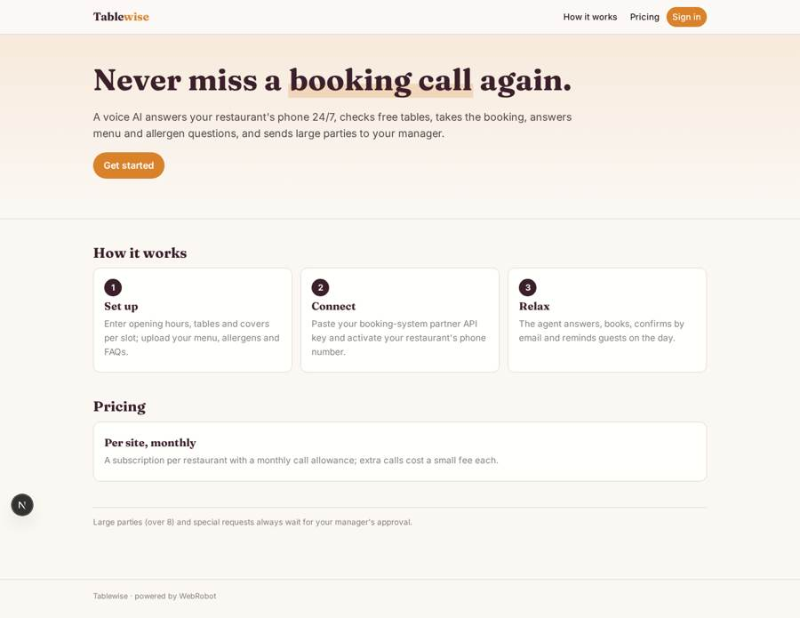
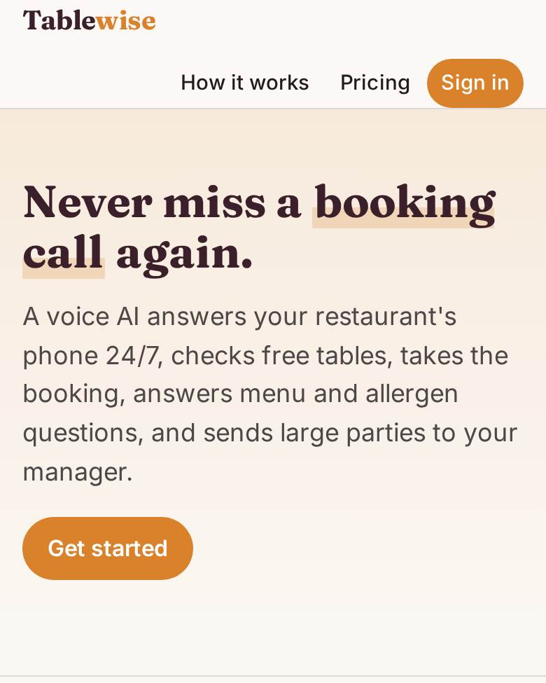
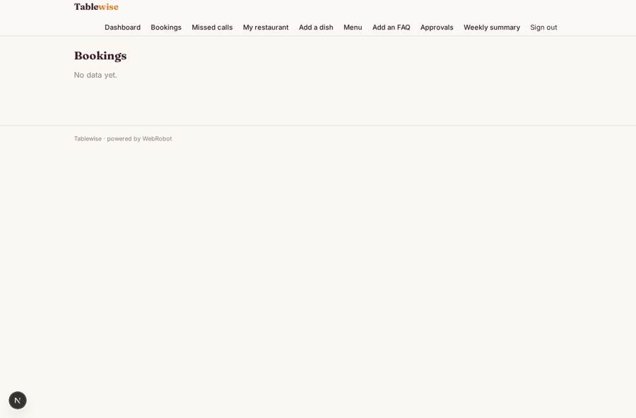
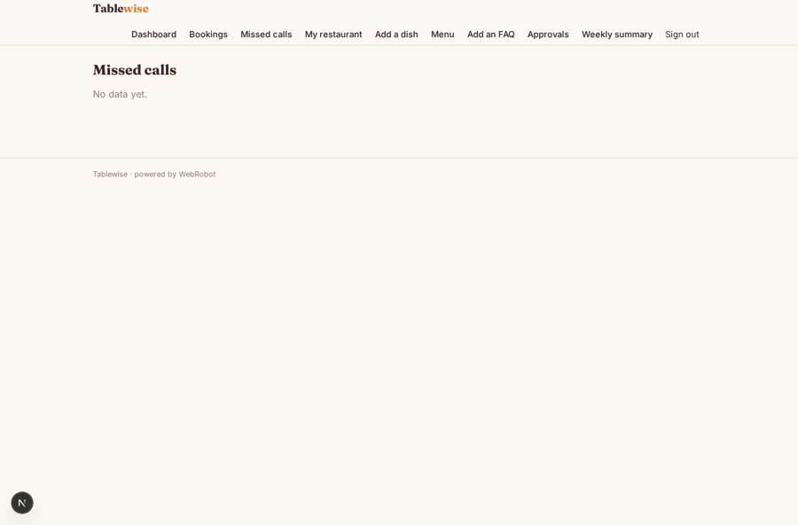
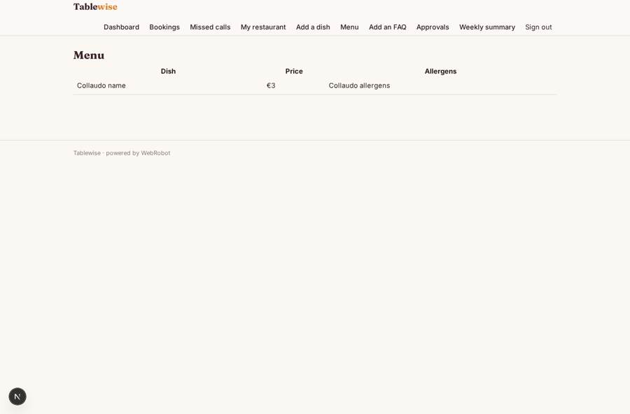
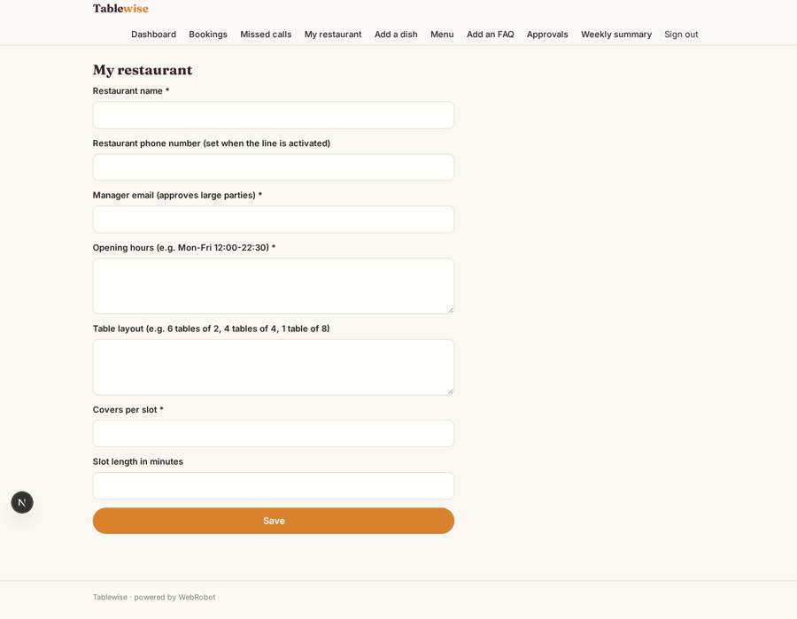

# Tablewise

_A voice AI that answers your restaurant's phone 24/7 and books the tables._

**Sector:** Consumer, travel, retail · **Manifest:** valid (schema + runtime contract) · **Functional test:** passed (16 checks passed)

## Description given to the app builder

I want an app called Tablewise that answers a restaurant's phone 24/7 with a voice AI and takes table bookings. Restaurant owners sign up, enter opening hours, table layout and covers per slot, upload their menu, allergens and FAQs, and connect their booking system (OpenTable-type or ResOS-type) with a partner API key. When a customer rings, the voice agent answers, understands the request, checks free slots, takes name, phone, party size, time and dietary notes, books the table and reads back the confirmation; it also answers menu questions from the uploaded menu. Large parties (over 8) or special requests go to the manager for approval before confirming. Customers get a confirmation email or text, and a reminder on the day. Telephony and real-time voice calls are the core of the product: we need a phone number per restaurant and live speech in and out. Staff see a dashboard of calls, bookings made, missed calls and transcripts; owners see only their own restaurant; admins see all restaurants. A weekly email summarises calls and covers booked. Pricing: monthly subscription per site with a call allowance and a fee per extra call. English.

## Navigation recording

Signed in as the app's admin, the recorder opened 7 menu page(s): Dashboard, Bookings, Missed calls, My restaurant, Add a dish, Menu, Add an FAQ.
- data page empty: bookings (table)
- data page empty: missed (table)

Empty data pages are mostly expected on the local runtime: agents are mocked there, so the collections they fill stay empty.

## Features not expressible today (spec.extensions)

- **phone_number_per_restaurant**: A phone number per restaurant is provisioned with Activate phone on the phone channel; routing each number to its own restaurant record and live speech in and out depend on the telephony provider, and one channel is declared here.
- **sms_not_available**: Confirmation and reminder by text message are not available yet: guests get email only (the agent takes an email on the call).
- **opentable_connector**: OpenTable-type partner APIs: only a ResOS-style http tool is declared; a second connector needs the partner's endpoint and licence terms.

## Screenshots (interpretive runtime, test data)

### home-anon

### home-mobile

### bookings

### missed

### menu

### restaurant

