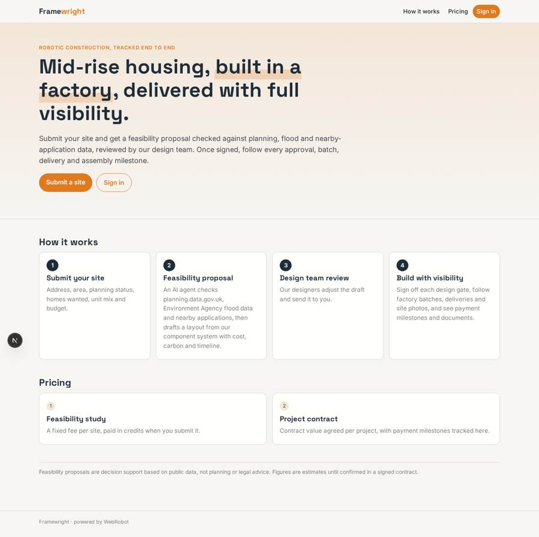
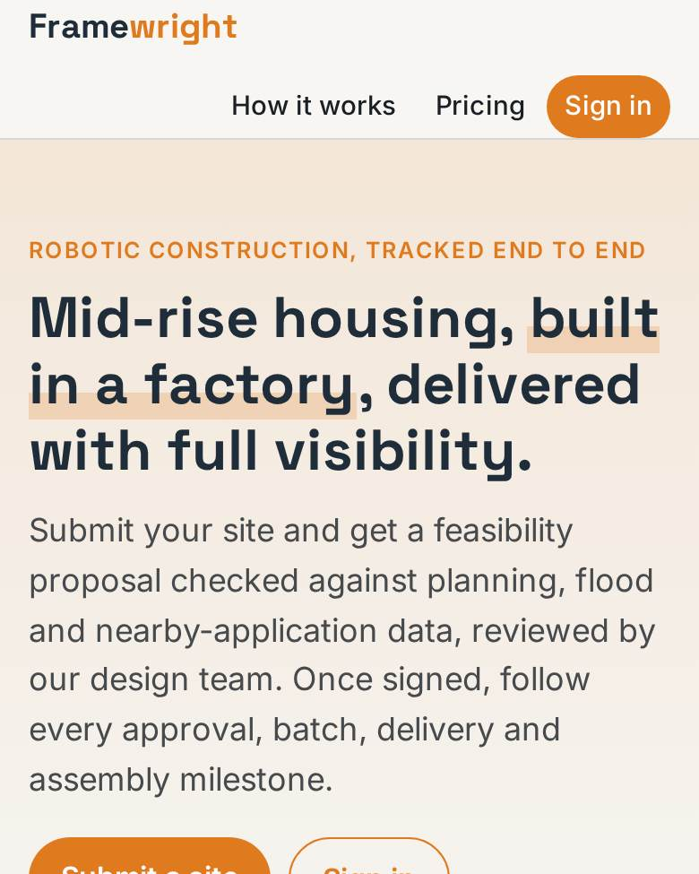
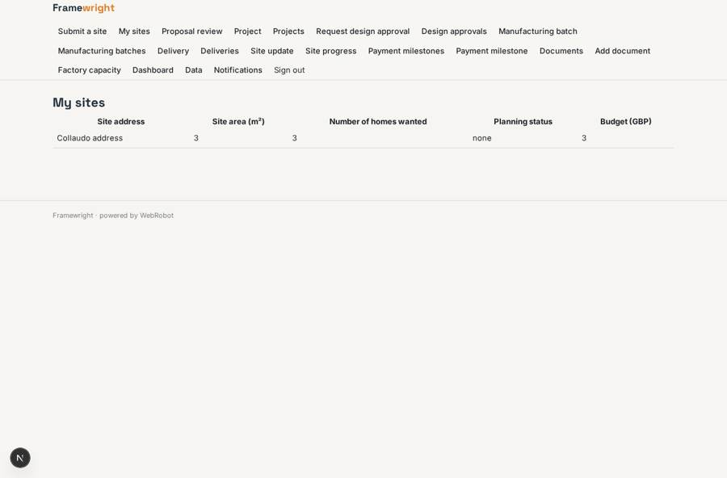
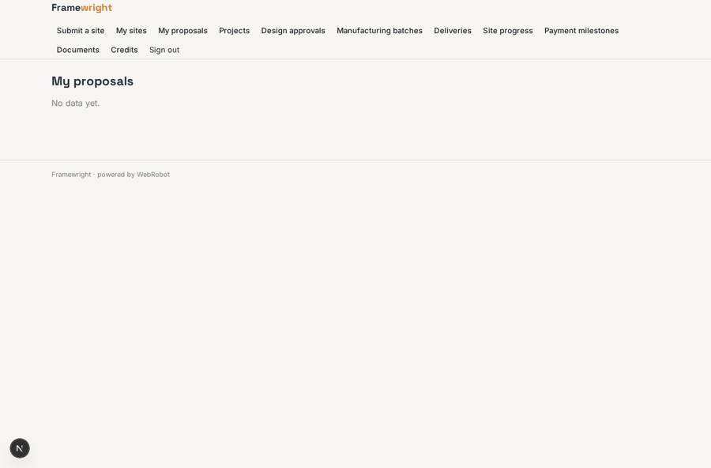
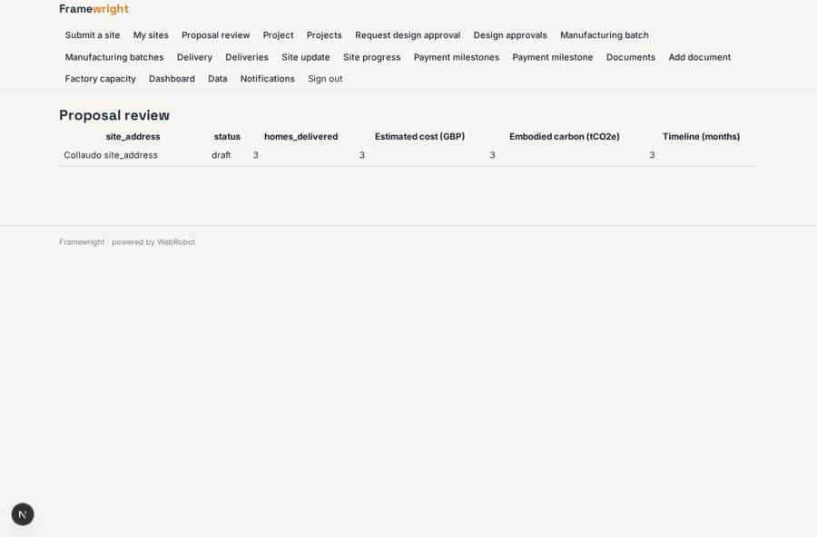
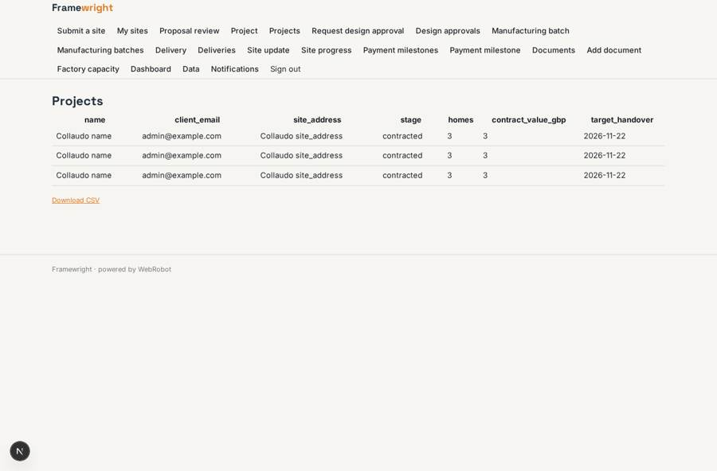

# Framewright

_From site to handover: mid-rise housing built by factory robots, tracked in one place._

**Sector:** Fintech, proptech, insurtech · **Manifest:** valid (schema + runtime contract) · **Functional test:** passed (45 checks passed)

## Description given to the app builder

I want Framewright, the software layer for a robotic construction business that builds mid-rise housing with factory robots. The robotics, the factory and the building work are physical and outside the software; I need the platform around them. Developers and landowners sign up and submit a site with a form: address, site area, planning status, number of homes wanted, mix of unit types, budget. An agent checks the site on planning.data.gov.uk, flood risk from Environment Agency data and nearby planning applications, then proposes a feasibility layout using our component system, with estimated cost, carbon and timeline. Our design team reviews and adjusts the proposal before it is sent to the client. Once a project is signed, the platform tracks design approvals, component manufacturing batches, deliveries and on-site assembly milestones, with photos uploaded from site. Clients see progress, documents and payment milestones, and get email updates. Approvals at each design gate need the client's sign-off. Roles: client, design team, production manager, site manager, admin. Dashboards show projects by stage and factory capacity. Pricing: feasibility studies per site, then contract value per project. English.

## Functional test: what did not pass

- **saved record shown where its collection is read** (view my_proposals): a record was saved in proposals (by admin) but the page does not show it (as client) _(warning)_
- **saved record shown where its collection is read** (view projects): a record was saved in projects (by admin-data, admin-data, admin) but the page does not show it (as client) _(warning)_
- **saved record shown where its collection is read** (view gates): a record was saved in design_gates (by admin-data, admin-data, admin, client) but the page does not show it (as client) _(warning)_
- **saved record shown where its collection is read** (view batches): a record was saved in batches (by admin-data, admin-data, admin) but the page does not show it (as client) _(warning)_
- **saved record shown where its collection is read** (view deliveries): a record was saved in deliveries (by admin-data, admin-data, admin) but the page does not show it (as client) _(warning)_
- **saved record shown where its collection is read** (view progress): a record was saved in milestones (by admin-data, admin-data, admin) but the page does not show it (as client) _(warning)_
- **saved record shown where its collection is read** (view payments): a record was saved in payments (by admin-data, admin-data, admin) but the page does not show it (as client) _(warning)_
- **saved record shown where its collection is read** (view documents): a record was saved in documents (by admin-data, admin-data, admin) but the page does not show it (as client) _(warning)_

## Navigation recording

Signed in as the app's admin, the recorder opened 7 menu page(s): Submit a site, My sites, Proposal review, Project, Projects, Request design approval, Design approvals.
No issue found.

Empty data pages are mostly expected on the local runtime: agents are mocked there, so the collections they fill stay empty.

## Features not expressible today (spec.extensions)

- **contract_billing**: Contract value is agreed per project and payment milestones are tracked and reminded here, but invoicing and collecting the contract payments is not automated by this app.
- **proposal_release**: Draft proposals live in the client's own record and are hidden from the client by the status filter on their view until the design team sets status to sent.

## Screenshots (interpretive runtime, test data)

### home-anon

### home-mobile

### my_sites

### my_proposals

### review_queue

### projects

