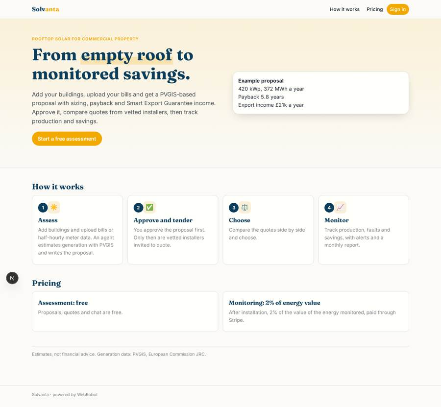
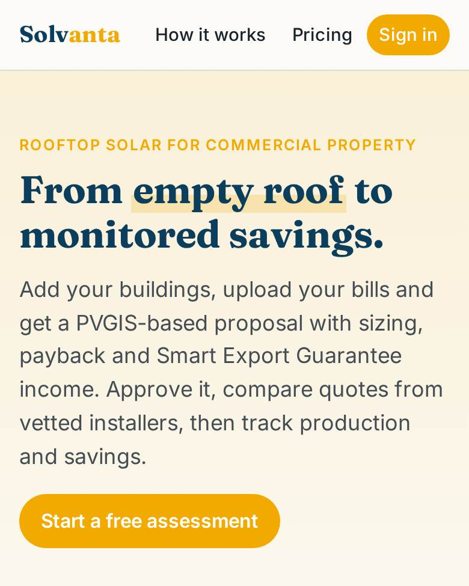
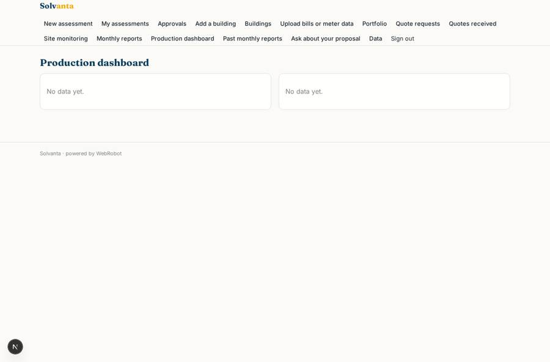
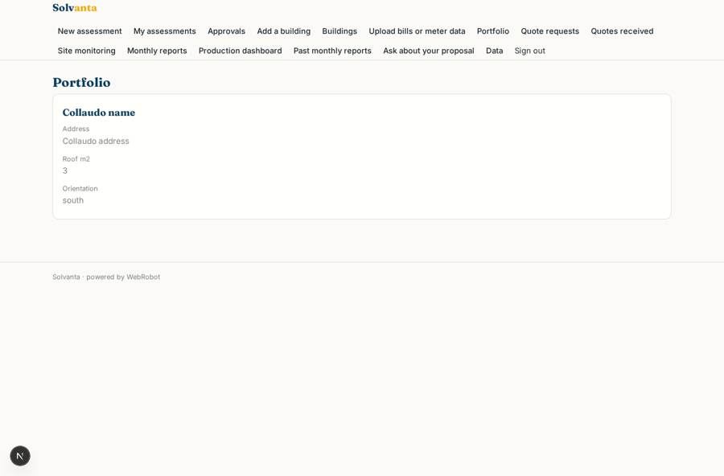
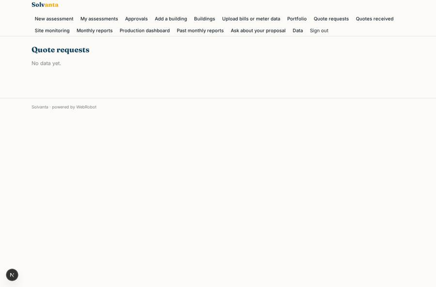
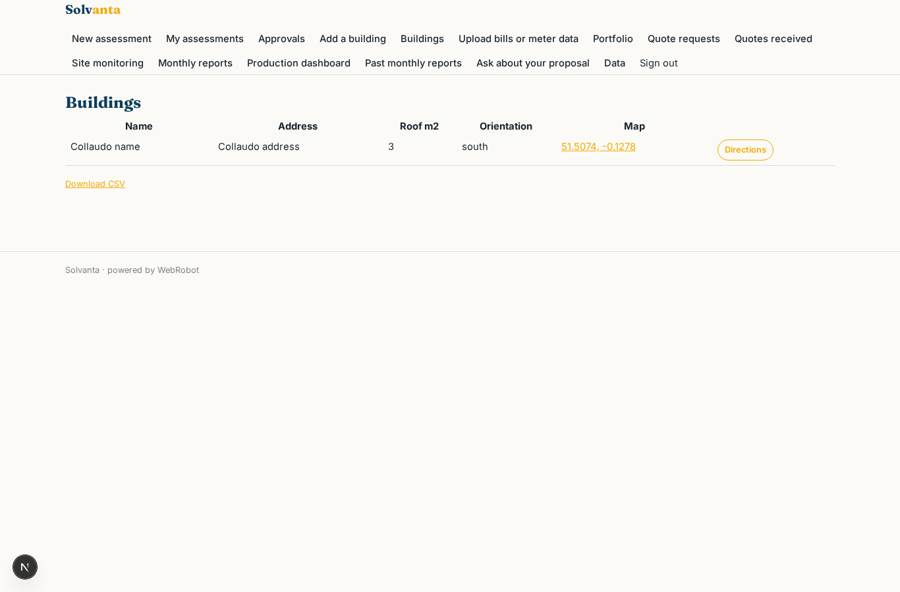

# Solvanta

_Assess, install and monetise rooftop solar on your commercial buildings._

**Sector:** Sanità, istruzione, energia, gov · **Manifest:** valid (schema + runtime contract) · **Functional test:** passed (27 checks passed)

## Description given to the app builder

I want Solvanta, software for commercial property owners to assess, install and monetise rooftop solar. An owner signs up, adds buildings with address, roof area and orientation, and uploads electricity bills; we want half-hourly meter data through the DCC or the supplier. An agent estimates generation using PVGIS, sizing and payback, including export income at the published Smart Export Guarantee tariffs, and produces a proposal. The owner requests quotes; vetted installers on our platform submit them, and the owner chooses. After installation, we need live inverter and meter telemetry through the manufacturers' IoT APIs to track production, faults and savings on dashboards, with monthly email reports and alerts when output drops. Roles: owner, asset manager, installer, admin. Pricing: free assessment, then 2% of energy value monitored, through Stripe. Installers see only jobs they are invited to quote on, owners see only their buildings, and asset managers see a portfolio across many owners. Each proposal must be approved by the owner before installers are invited. An assistant answers questions about the proposal in chat. English only.

## Functional test: what did not pass

- **form saves a record** (form submit_quote): only role installer may fill it, and the test cannot hold that role _(warning)_
- **trigger has its effect** (trigger new_quote): email to record.owner_email: no such recipient in the test (role nobody holds or empty field) _(warning)_
- **page opened by a role allowed to** (view submit_quote): only role installer may open it, the test cannot hold it _(warning)_

## Navigation recording

Signed in as the app's admin, the recorder opened 7 menu page(s): New assessment, My assessments, Approvals, Add a building, Buildings, Upload bills or meter data, Portfolio.
- agent run did not open: new_assessment: the run did not open
- data page empty: assessments (history)

Empty data pages are mostly expected on the local runtime: agents are mocked there, so the collections they fill stay empty.

## Features not expressible today (spec.extensions)

- **dcc_meter_data**: Direct half-hourly meter data from the DCC or suppliers needs a licensed DCC user and the owner's consent flow; not available yet. For now owners upload the half-hourly CSV their supplier provides.
- **monitoring_fee_2pct**: The fee of 2% of the energy value monitored needs a usage-based charge computed from the readings; not expressible yet. Free assessment is in place; the monitoring fee must be set up separately in Stripe.
- **other_inverter_apis**: Only SolarEdge (API key) is connected. Manufacturers that use OAuth (e.g. SMA, Huawei, Enphase) are not available yet.
- **portfolio_telemetry**: Readings belong to each monitoring instance, so the asset manager's portfolio shows buildings and their own sites, not other owners' telemetry.
- **installer_vetting**: Vetting is done by the admins, who maintain the installers list on the data page and invite installers by email.

## Screenshots (interpretive runtime, test data)

### home-anon

### home-mobile

### readings

### portfolio

### quote_requests

### buildings

