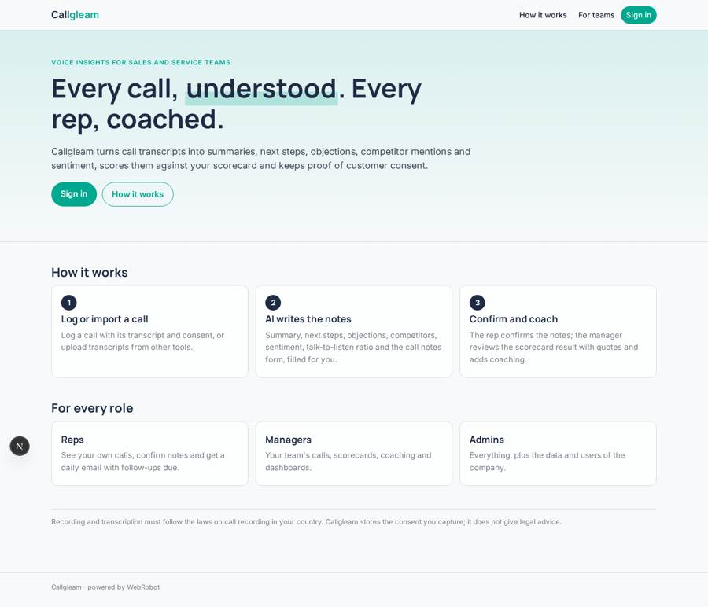
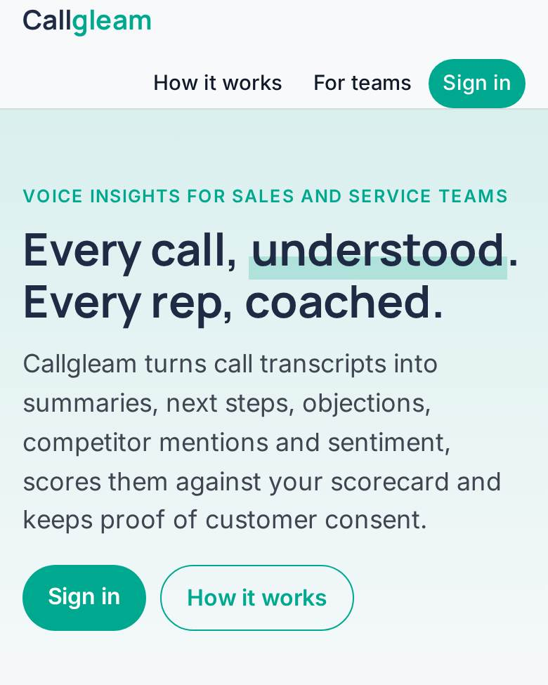
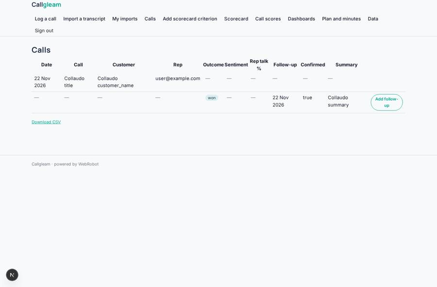
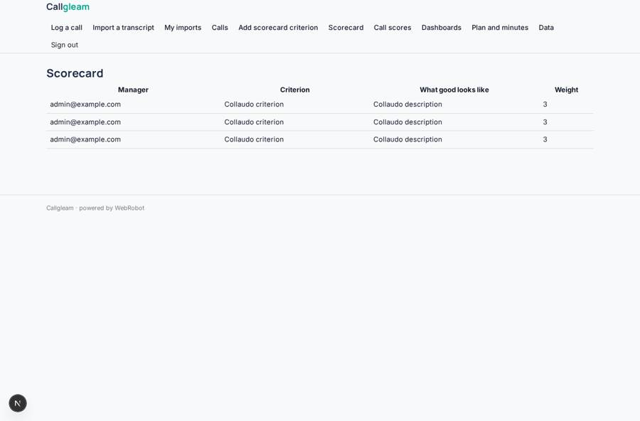
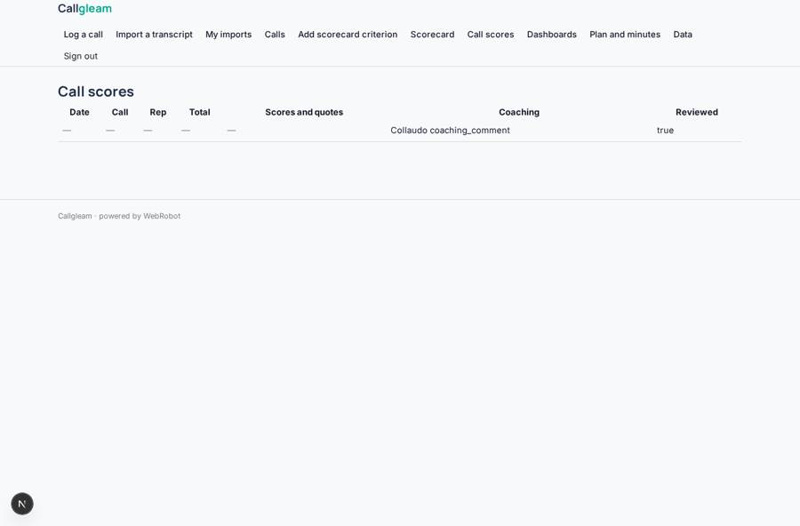
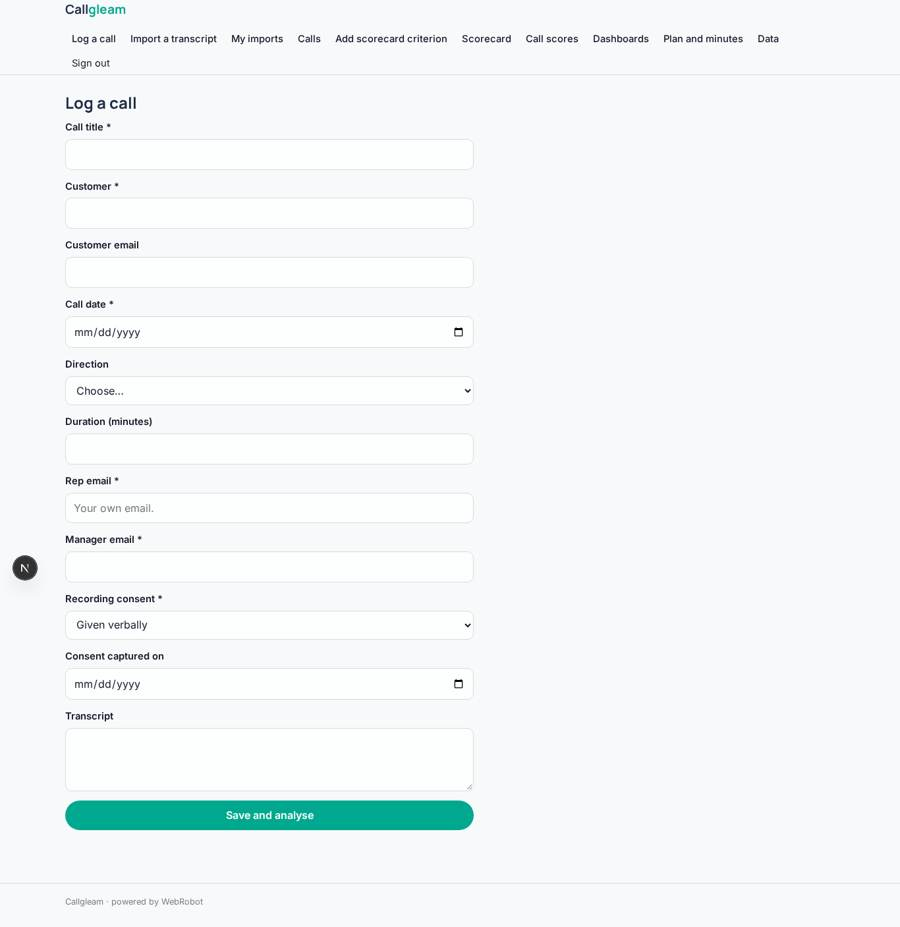

# Callgleam

_Every sales and service call, turned into insight._

**Sector:** B2B AI and SaaS · **Manifest:** valid (schema + runtime contract) · **Functional test:** passed (23 checks passed)

## Description given to the app builder

I want Callgleam, a voice platform for sales and service teams that records calls and turns them into insights. The company signs up; reps see their own calls, managers their team, admins everything. The core of the real product is telephony and audio: reps make and receive calls from the browser or their phone number, calls are recorded and transcribed with speaker separation, so that must be included. On each transcript an agent writes a summary, next steps, objections raised, competitor mentions, sentiment and talk-to-listen ratio, and fills the call notes form (outcome, products discussed, follow-up date), which the rep confirms. Managers set a scorecard (opening, discovery, next steps) and the agent scores calls against it with quotes; the manager reviews and adds coaching comments. Customers' consent to recording is captured and stored. Reps can also upload recordings or text transcripts from other tools. Daily email with follow-ups due; dashboards of call volumes, conversion by rep, recurring objections and topics trending week by week. Pricing: subscription per user plus included call minutes, extra minutes billed per use. English.

## Functional test: what did not pass

- **saved record shown where its collection is read** (view scores): a record was saved in call_scores (by admin) but the page does not show it (as rep) _(warning)_

## Navigation recording

Signed in as the app's admin, the recorder opened 7 menu page(s): Log a call, Import a transcript, My imports, Calls, Add scorecard criterion, Scorecard, Call scores.
No issue found.

Empty data pages are mostly expected on the local runtime: agents are mocked there, so the collections they fill stay empty.

## Design checks (linter)

- view scorecard_form: roles manager cannot add to scorecards, a shared collection only the admins fill — keep roles: [admin], or own the records by user

## Features not expressible today (spec.extensions)

- **telephony_softphone**: NOT AVAILABLE YET: calling from the browser or from the rep's own phone number (softphone, number provisioning, inbound routing). Today calls are logged by hand with their transcript.
- **call_recording**: NOT AVAILABLE YET: recording the call audio and storing it. Consent is captured and stored on each call, but no audio is recorded.
- **transcription_diarization**: NOT AVAILABLE YET: speech-to-text with speaker separation, and upload of audio recordings (the upload accepts text transcripts only). Use a transcription tool and import its speaker-labelled text.
- **per_seat_billing**: Per-user subscription: the plan is priced per account; per-seat quantity pricing and pooled minutes across a team are not expressible yet. Minutes are modelled as credits (1 credit = 1 minute), extra billed per use.
- **row_links**: A link from a call row to its 'Confirm call notes' or coaching edit form (/v/call_notes?id=...) is not available in tables yet.

## Screenshots (interpretive runtime, test data)

### home-anon

### home-mobile

### calls

### scorecard

### scores

### log_call

