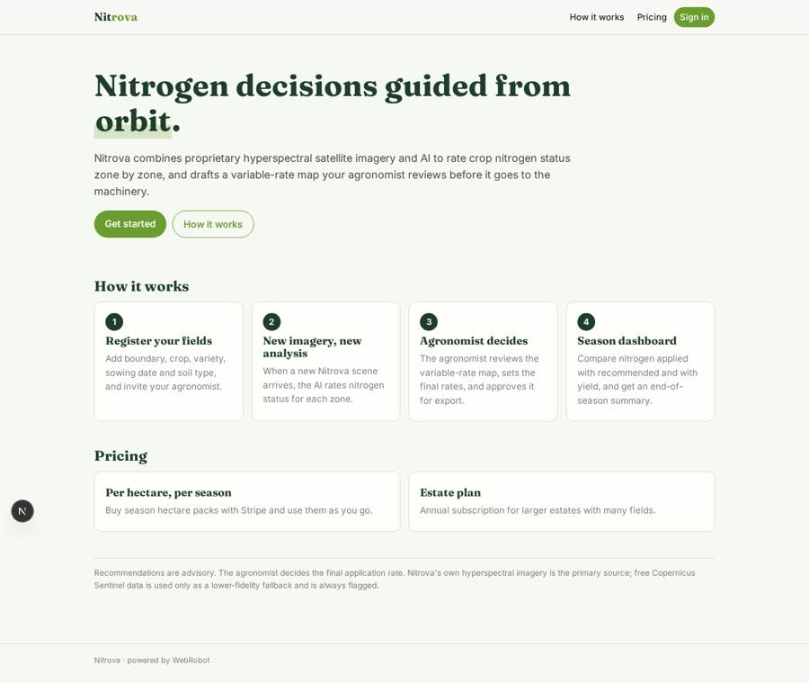
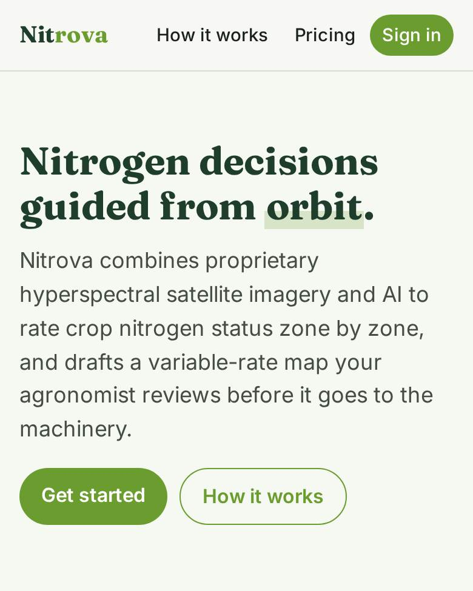
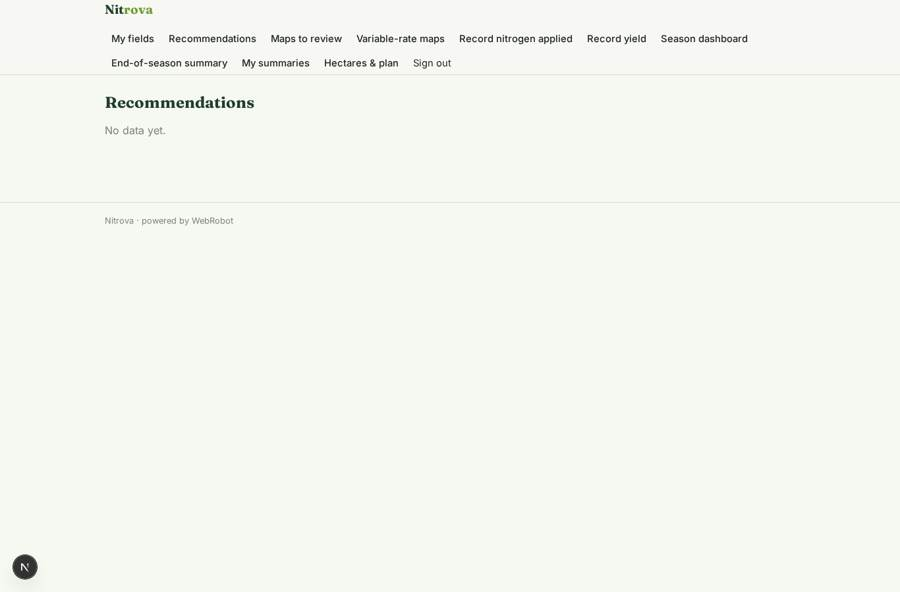
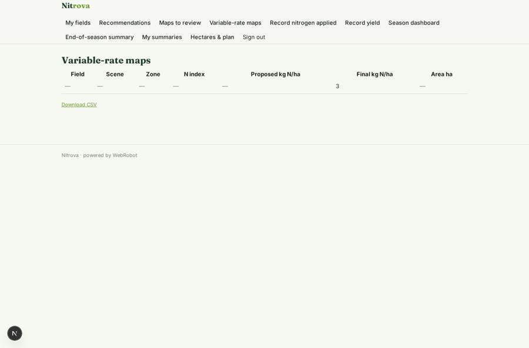
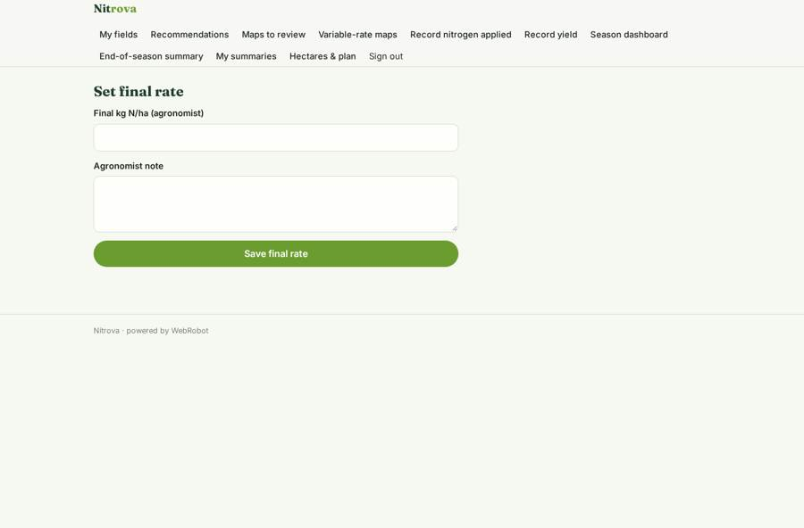
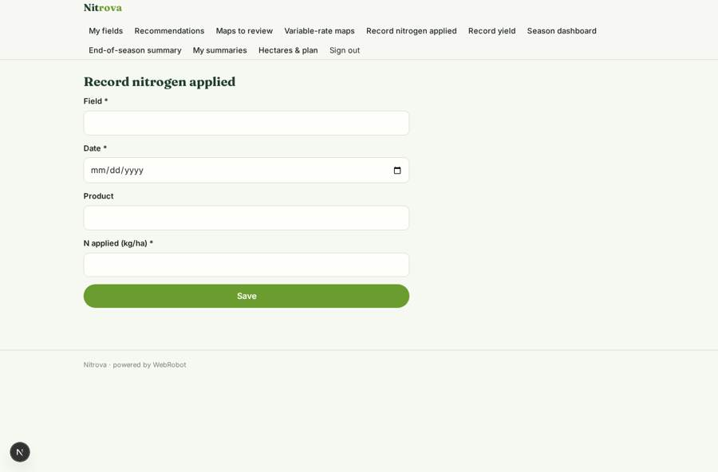

# Nitrova

_Hyperspectral nitrogen guidance, zone by zone._

**Sector:** Sanità, istruzione, energia, gov · **Manifest:** valid (schema + runtime contract) · **Functional test:** passed (17 checks passed)

## Description given to the app builder

We need Nitrova, a service that combines hyperspectral satellite data and AI to guide nitrogen fertiliser decisions. Our own satellites and the proprietary imagery are the product and are outside the software; free Copernicus Sentinel data is not equivalent, so it is only a fallback. Farmers and agronomists sign up, draw field boundaries on a map and enter crop, variety, sowing date and soil type. When new imagery arrives, an agent calculates crop nitrogen status per zone and produces a variable-rate application map that the agronomist reviews before export to machinery. Farmers get email alerts. Pricing per hectare per season. Roles are farmer, agronomist and farm business admin; agronomists see the farms that have invited them. A season dashboard shows nitrogen applied versus recommended and yield where entered, and the agent writes an end-of-season summary. Recommendations are advisory and the agronomist decides the final rate. Payment through Stripe, annual subscriptions for larger estates. English only.

## Functional test: what did not pass

- **saved record shown where its collection is read** (view vra): a record was saved in vra_zones (by admin) but the page does not show it (as farmer) _(warning)_

## Navigation recording

Signed in as the app's admin, the recorder opened 7 menu page(s): My fields, Recommendations, Maps to review, Variable-rate maps, Record nitrogen applied, Record yield, Season dashboard.
- data page empty: recs (table)

Empty data pages are mostly expected on the local runtime: agents are mocked there, so the collections they fill stay empty.

## Features not expressible today (spec.extensions)

- **boundary_drawing**: Drawing field boundaries on a map is not available yet: users paste a GeoJSON polygon and a centroid position.
- **machinery_export**: Export to machinery formats (ISOXML, shapefile) is not available; the approved variable-rate map exports as CSV with zone geometry.
- **farm_business_admin**: A separate farm business admin role with team members is not modelled; the farmer account owns the fields and invites agronomists by email.
- **per_hectare_charge**: Charging per hectare per season at field registration is approximated with hectare credit packs and an annual estate plan; exact per-hectare season billing needs custom logic.
- **imagery_api**: api.nitrova.com is a placeholder for Nitrova's own imagery service; the real host and API key must be set by the admins.

## Screenshots (interpretive runtime, test data)

### home-anon

### home-mobile

### recs

### vra

### adjust_zone

### add_application

